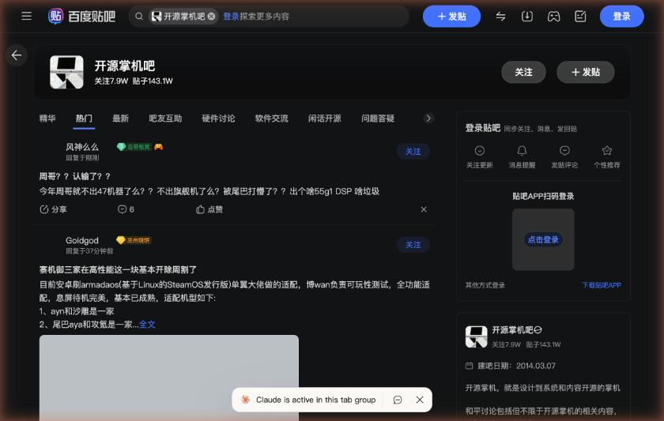
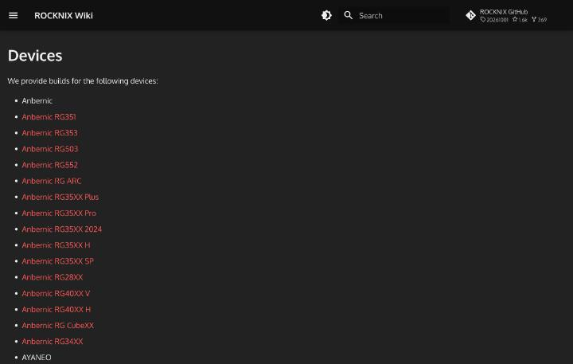
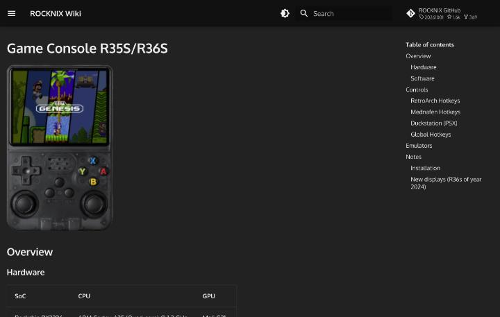

# Overview of Chinese handhelds

This repository deals with handheld game consoles made by Chinese manufacturers and intended mainly for emulating retro games. In Chinese, the word 掌机 (handheld game console) is combined with 开源 (open source) or 复古 (retro) to form 开源掌机 and 复古掌机.

This article is a map for reading the articles that follow. It sorts out the available devices along four axes: brand, SoC, price range, and form factor. Only figures written on the source pages are used. Where pages disagree, the disagreement is left as is.

Chinese-language information gathers on the Baidu Tieba forum [开源掌机吧](https://tieba.baidu.com/f?kw=%E5%BC%80%E6%BA%90%E6%8E%8C%E6%9C%BA). According to the page on November 2, 2026, this community has 81,000 followers and 1,467,000 posts (79,000 and 1,431,000 on October 3, 2026), and it was created in March 2014.

## Form factors

Handhelds divide first by shape. The device pages on 掌机圈 have a field called 握持类型 (grip type), and devices with the same 3.5-inch screen differ in shape. For example, the R36S is listed as 竖版 (vertical), the grip type field for the RG-35XX H is blank, the GKD Bubble is 横版 (horizontal), and the Miyoo Flip is 翻盖/折叠 (clamshell/folding) ([R36S](https://zhangjiquan.com/handheld/r36s), [RG-35XX H](https://zhangjiquan.com/handheld/rg-35xx-h), [GKD Bubble](https://zhangjiquan.com/handheld/gkd-bubble), [Miyoo Flip](https://zhangjiquan.com/handheld/miyoo-355-flip)).

The RG-35XX H page lists 周哥35XXH,35XX横版机 as aliases. 横版机 means a horizontal device, which suggests a habit of calling devices with an H after the model number horizontal. However, the page contains no explanation that supports this reading.

Screen aspect ratios also differ by device. A 4:3 device matches the video of older consoles directly. A 16:9 device also matches the video of the PSP and later. In the list of six devices on 掌机圈, the RG40XXH, RG406V, and Nova were 4:3, and the RG556, RP4 Pro, and RP5 were 16:9 ([spec comparison](02-devices.md)).

## Brands and nicknames

The lists of devices supported by each OS offer a clue to which brands make these products. The [ROCKNIX supported device list](https://rocknix.org/devices/) includes Anbernic, AYANEO, AYN, GameForce, Hardkernel, MagicX, Mangmi, Powkiddy, and Retroid. The [Knulli supported device list](https://github.com/knulli-cfw/knulli.org/blob/main/docs/devices/index.md) differs in also including Miyoo and TrimUI.

Counting the ROCKNIX list on November 2, 2026 gives 16 entries for Anbernic, 12 for Powkiddy, 5 each for AYANEO, AYN, and Retroid, 3 each for Hardkernel and unbranded devices, and 1 each for GameForce, MagicX, and Mangmi, for a total of 52 ([ROCKNIX supported device list](https://rocknix.org/devices/)). The count on October 3, 2026 was 51, with 15 for Anbernic. An AI-generated article on 什么值得买 says the number of supported devices grew from 49 to 66. This does not match that count, and the reason could not be confirmed.

On Chinese forums, brands have nicknames. The device database [掌机圈](https://zhangjiquan.com/handhelds) lists Anbernic's [RG-406V](https://zhangjiquan.com/handheld/rg-406v) and [RG-556](https://zhangjiquan.com/handheld/rg-556) under the aliases 周哥RG-406V and 周哥RG556. 周哥 is the nickname for Anbernic. Retroid is called 沙雕, and 掌机圈 lists 沙雕5,RP 5 as aliases for the [Retroid Pocket 5](https://zhangjiquan.com/handheld/retroid-pocket-5), 沙雕4 Pro,RP4 Pro for the [Retroid Pocket 4 Pro](https://zhangjiquan.com/handheld/retroid-pocket-4-pro), and 沙雕 Nova for the [Retroid Pocket Nova](https://zhangjiquan.com/handheld/retroid-pocket-nova). Details of the slang are collected in [Chinese vocabulary and slang](11-chinese.md).

On how each brand is positioned, an article on 什么值得买 describes Miyoo as a brand offering small devices under 200 yuan, GKD (老张) as a brand strong in OS optimization, and Anbernic as the brand with the widest lineup. This article is labeled on the page as AIGC文章 (AI-generated article), so its figures and evaluations need to be checked against other sources before being used as support ([2026开源掌机红黑榜](https://post.smzdm.com/p/aww5ev54/)).

## Small 3.5-inch devices

Devices with a 3.5-inch 640×480 screen form a low-priced group with many variations. Here are four devices, taken from their pages on 掌机圈.

| Item | R36S | RG-35XX H | GKD Bubble | Miyoo Flip |
|---|---|---|---|---|
| Release | Nov 2023 | Jan 2024 | Oct 2024 | Dec 2024 |
| Form | Vertical | Not listed | Horizontal | Folding |
| SoC | RK3326 | Allwinner H700 (全志H700) | RK3566 | RK3566 |
| Memory | 1GB DDR3L | 1GB LPDDR4 | 1GB LPDDR4 | 1GB |
| Battery | 3500mAh | Not listed | 4000mAh | 3000mAh |
| Weight | Not listed | 180g | 227g | 165g |
| Listed price | $40 | $50–75 | 379 yuan | 339 yuan at launch |

The sources are the pages for the [R36S](https://zhangjiquan.com/handheld/r36s), [RG-35XX H](https://zhangjiquan.com/handheld/rg-35xx-h), [GKD Bubble](https://zhangjiquan.com/handheld/gkd-bubble), and [Miyoo Flip](https://zhangjiquan.com/handheld/miyoo-355-flip). The weight field for the R36S was "-", and the battery field for the RG-35XX H was empty.

As a guide to emulation, the R36S page says that everything up to SNES, PS1 (at 60 FPS), and most 2D PSP games are playable. 3D PSP games need frame skipping, and for N64 and Dreamcast, only some games that are easy to run will work. The RG-35XX H page says most N64, PSP, and Dreamcast games are playable, which is worded differently from the page for the RG-40XXH, which uses the same H700.

According to its page, the Miyoo Flip went on sale at 2 p.m. on Monday, December 30, 2024, at the official corporate store on Taobao, with the first 300 units sold at 339 yuan and the price returning to 369 yuan one week later. The GKD Bubble has a touchscreen, and its storage field reads 内置 32 GB MicroSD.

For the RK3326 in the R36S, the 掌机圈 page gives a PassMark multi-core score of 440. Compared with the T820's 5577, that is a difference of more than 12 times. However, the page does not say under what conditions this score was measured.

## The SoC determines performance

A handheld's performance is determined almost entirely by its SoC. The SoCs confirmed in this research are listed below roughly from lowest to highest performance. The RK3566 is placed after the H700 only because no source directly comparing the two was found.

| SoC | Main devices | Source |
|---|---|---|
| Rockchip RK3326 | R35S, R36S | [ROCKNIX R35S/R36S](https://rocknix.org/devices/unbranded/game-console-r35s-r36s/) |
| Allwinner H700 | RG40XXH, RG35XX series, RG CubeXX | [掌机圈 RG-40XXH](https://zhangjiquan.com/handheld/rg-40xxh) |
| Rockchip RK3566 | Miyoo Flip, GKD Bubble | [掌机圈 Miyoo Flip](https://zhangjiquan.com/handheld/miyoo-355-flip) |
| Unisoc T820 (虎贲T820) | RG406V, RG556 | [掌机圈 RG-406V](https://zhangjiquan.com/handheld/rg-406v) |
| MediaTek Dimensity 1100 | Retroid Pocket 4 Pro | [掌机圈 RP4 Pro](https://zhangjiquan.com/handheld/retroid-pocket-4-pro) |
| Snapdragon 865 | Retroid Pocket 5 | [掌机圈 RP5](https://zhangjiquan.com/handheld/retroid-pocket-5) |
| Snapdragon 8 Gen 2 | Retroid Pocket Nova, AYN Odin 2 | [掌机圈 Nova](https://zhangjiquan.com/handheld/retroid-pocket-nova), [ROCKNIX Odin 2](https://rocknix.org/devices/ayn/odin2/) |

According to the ROCKNIX page, the R36S has a quad-core 1.3GHz Cortex-A35, a Mali G31, 1GB of DDR3, and a 3.5-inch 640×480 screen. The 掌机圈 page for the RG-40XXH describes the H700 as a quad-core 1.5GHz Cortex-A53 with a Mali-G31 MP2 and 1GB of LPDDR4. The ROCKNIX page for the RG40XX H says the same H700 runs at 1.4GHz by default and reaches 1.5GHz when overclocked in the settings ([ROCKNIX RG40XX H](https://rocknix.org/devices/anbernic/rg40xx-h/)).

The 掌机圈 page for the Miyoo Flip describes the RK3566 as a quad-core 1.8GHz Cortex-A55 with a Mali-G52 2EE GPU at 850MHz. The GKD Bubble page gives the same values.

The 掌机圈 pages for the RG-406V and RG-556 list the T820 as having eight Cortex-A76 and Cortex-A55 cores (2.1–2.7GHz) and a Mali-G57 MP4 GPU (850MHz). The same pages give this SoC a PassMark multi-core score of 5577.

According to 掌机圈, the Dimensity 1100 has eight Cortex-A78 cores (2.6GHz) and a Mali-G77 MC9, while the Snapdragon 865 has eight Cortex-A77 and Cortex-A55 cores (1.8–2.84GHz) and an Adreno 650. The Nova's Snapdragon 8 Gen 2 has eight cores including a Cortex-X3 (2.0–3.2GHz) and an Adreno 740, with 8–12GB of LPDDR5X memory.

## Price ranges

One article divides prices into 100–200 yuan for entry-level devices such as the R36S, 300–500 yuan for mid-range devices such as the RG35XX series, and 1000–3000 yuan for high-end devices such as the Retroid Pocket 5 and RG556. This too comes from [2026开源掌机红黑榜](https://post.smzdm.com/p/aww5ev54/), which is labeled AIGC.

The price ranges shown on 掌机圈 are 300–500 yuan for the RG-40XXH, 1000–1500 yuan for the Retroid Pocket 5, and 1500–2000 yuan for the Retroid Pocket Nova. The RG-556 and Retroid Pocket 4 Pro are shown at $150–200.

Which price range to choose depends on the systems whose games you want to play. What runs on each device is collected in [What runs](06-emulation.md).

## The OS field, and devices that support both Android and Linux

The spec tables on 掌机圈 have an OS field. Five devices, the RG-40XXH, RG-35XX H, R36S, Miyoo Flip, and GKD Bubble, are listed as 开源系统, and the RG-556 is listed as 安卓 (Android). The field for the RG-406V had no entry. Even for devices listed as 开源系统, the pages do not give the name of the specific OS.

The Retroid Pocket 5 page on Retroid's official shop gives the OS as Android 13 ([goretroid.com](https://www.goretroid.com/en-jp/products/retroid-pocket-5)). Meanwhile, the Retroid Pocket 5 is also among the devices supported by ROCKNIX. This means the same device has both options: Android, and a replacement Linux. The replacement steps are collected in [OS types](03-os.md) and [Installing CFW](04-install-cfw.md).

## What the ROCKNIX device pages tell you

ROCKNIX device pages cover the drivers used and the control combinations as well as the SoC and memory. The R35S/R36S page says the kernel is mainline Linux, the GPU drivers are libmali (GLES 3.2) and Panfrost (GL 3.1/GLES 3.1), the compositor is Sway, and the interface is Emulation Station ([ROCKNIX R35S/R36S](https://rocknix.org/devices/unbranded/game-console-r35s-r36s/)).

The same page also lists RetroArch hotkeys. Holding SELECT and pressing START twice quits the game, SELECT and R1 saves, and SELECT and L1 loads. SELECT and R2 fast-forwards.

On the RG35XX H page, the same controls start from the MENU button. As an H700 device, it is listed with a mainline Linux kernel and the Panfrost GPU driver, and it runs at 1.5GHz when overclocking is selected in the settings ([ROCKNIX RG35XX H](https://rocknix.org/devices/anbernic/rg35xx-h/)).

The pages for the high-end AYN Odin 2 and Retroid Pocket Nova say the SoC is a Snapdragon 8 Gen 2 (SM8550) and the GPU drivers are Freedreno and Turnip. The controls start from the HOME button ([ROCKNIX Odin 2](https://rocknix.org/devices/ayn/odin2/), [ROCKNIX Nova](https://rocknix.org/devices/retroid/retroid-pocket-nova/)). These two pages also say that the kernel manages the fan, and that you can choose the joystick LED color and the battery level display.

## How to read prices

The price fields on 掌机圈 are basically 价格区间 (price range) and 起售价格 (launch price). The R36S had a price range of "$0 - $50" and a launch price of $40. The RG-35XX H is shown as "$050 - $75".

If a device page has an online store purchase link, 到手价 and 券面额 are attached. The link for the RG-35XX H showed a final price of 379 yuan and a coupon value of 50 yuan. Further down the same page, the purchase link appears again under the heading 优惠购机 (buy at a discount).

Both dollars and yuan are used, but the dates and exchange rate conditions are unknown. Prices are therefore written in the currency shown.

Retroid's official shop has a Retroid Pocket 5 version labeled "Refurbished" at $156, which was sold out when checked. The regular version in the same shop has a list price of $209 and a discounted price of $179 ([goretroid.com](https://www.goretroid.com/en-jp/products/retroid-pocket-5)). These cannot be compared directly with the 1000–1500 yuan shown on 掌机圈, since both the currency and the version sold differ.

The spec section of the refurbished page lists a CPU with one 2.8GHz Cortex-A77 core, three 2.4GHz Cortex-A77 cores, and four 1.8GHz Cortex-A55 cores, 8GB of LPDDR4x memory, 128GB of UFS 3.1 storage plus a TF card slot, a 5.5-inch 1080p 60fps AMOLED screen, and a 5000mAh battery. The 掌机圈 page gives the memory as "6 or 8GB". The reason for this difference could not be confirmed.

## Sales channels

Retroid has an official site for China. At the bottom of the top page, 天猫旗舰店 and 淘宝企业店 are listed as sales channels ([Retroid official site for China](https://www.retroid.cn/)). The site's copyright notice reads "2023 深圳市驰晶科技有限公司". For contact, it gives an email address and says that pre-sale and after-sale inquiries are handled by Taobao customer service.

Routes for buying from outside China are covered in [How to buy](09-buying.md).

## Reading forum comments

The comment section on 掌机圈 carries short impressions from buyers. The RP4 Pro has the post 起手1500我说冤大头,闲鱼700只能给一句水桶机皇 ([掌机圈 RP4 Pro](https://zhangjiquan.com/handheld/retroid-pocket-4-pro)). The RP5 has 性价比超神, dated July 2025 ([掌机圈 RP5](https://zhangjiquan.com/handheld/retroid-pocket-5)).

The RG-35XX H has a post dated February 18, 2025: 握持手感较差,其他还行吧 (it doesn't feel good to hold, but everything else is okay) ([掌机圈 RG-35XX H](https://zhangjiquan.com/handheld/rg-35xx-h)). Each comment is one person's impression and there are few of them, so they cannot be generalized into an evaluation of the device.

## Chinese terms in this article

The Chinese terms used in the text for device and price listings are collected here with their pronunciation.

| Chinese (Simplified) | Pinyin | Meaning | Source |
|---|---|---|---|
| 掌机 | zhǎngjī | Handheld game console | [开源掌机吧](https://tieba.baidu.com/f?kw=%E5%BC%80%E6%BA%90%E6%8E%8C%E6%9C%BA) |
| 开源 | kāiyuán | Open source | [开源掌机吧](https://tieba.baidu.com/f?kw=%E5%BC%80%E6%BA%90%E6%8E%8C%E6%9C%BA) |
| 复古 | fùgǔ | Retro | [开源掌机吧](https://tieba.baidu.com/f?kw=%E5%BC%80%E6%BA%90%E6%8E%8C%E6%9C%BA) |
| 开源系统 | kāiyuán xìtǒng | Open source OS | [掌机圈 RG-35XX H](https://zhangjiquan.com/handheld/rg-35xx-h) |
| 安卓 | ānzhuō | Android | [掌机圈 RG-556](https://zhangjiquan.com/handheld/rg-556) |
| 横版 | héngbǎn | Horizontal | [掌机圈 GKD Bubble](https://zhangjiquan.com/handheld/gkd-bubble) |
| 竖版 | shùbǎn | Vertical | [掌机圈 R36S](https://zhangjiquan.com/handheld/r36s) |
| 翻盖 | fāngài | Clamshell | [掌机圈 Miyoo Flip](https://zhangjiquan.com/handheld/miyoo-355-flip) |
| 握持类型 | wòchí lèixíng | Grip type | [掌机圈 RG-35XX H](https://zhangjiquan.com/handheld/rg-35xx-h) |
| 价格区间 | jiàgé qūjiān | Price range | [掌机圈 RG-35XX H](https://zhangjiquan.com/handheld/rg-35xx-h) |
| 起售价格 | qǐshòu jiàgé | Launch price | [掌机圈 RG-35XX H](https://zhangjiquan.com/handheld/rg-35xx-h) |
| 到手价 | dàoshǒujià | Actual amount paid after coupons | [掌机圈 RG-35XX H](https://zhangjiquan.com/handheld/rg-35xx-h) |
| 券面额 | quànmiàn'é | Coupon value | [掌机圈 RG-35XX H](https://zhangjiquan.com/handheld/rg-35xx-h) |
| 优惠购机 | yōuhuì gòujī | Buy at a discount | [掌机圈 RG-35XX H](https://zhangjiquan.com/handheld/rg-35xx-h) |
| 天猫旗舰店 | Tiānmāo qíjiàndiàn | Official store on Tmall | [Retroid official site for China](https://www.retroid.cn/) |
| 淘宝企业店 | Táobǎo qǐyèdiàn | Corporate store on Taobao | [Retroid official site for China](https://www.retroid.cn/) |
| 性价比 | xìngjiàbǐ | Performance relative to cost | [掌机圈 RP5](https://zhangjiquan.com/handheld/retroid-pocket-5) |
| 闲鱼 | xiányú | Name of a secondhand marketplace | [掌机圈 RP4 Pro](https://zhangjiquan.com/handheld/retroid-pocket-4-pro) |
| 冤大头 | yuāndàtóu | Someone who gets ripped off | [掌机圈 RP4 Pro](https://zhangjiquan.com/handheld/retroid-pocket-4-pro) |
