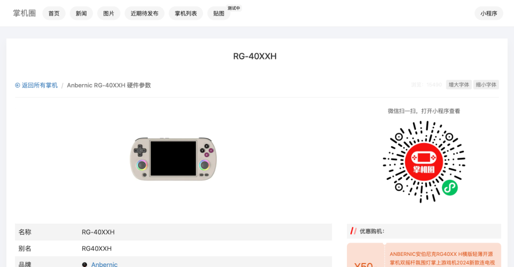
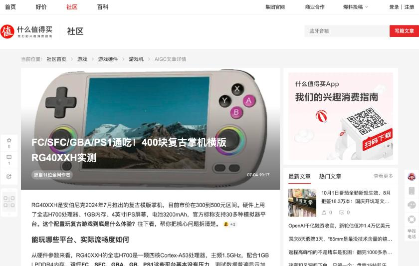
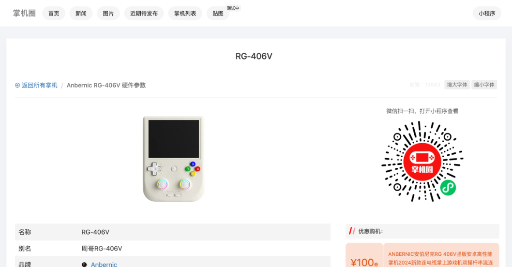
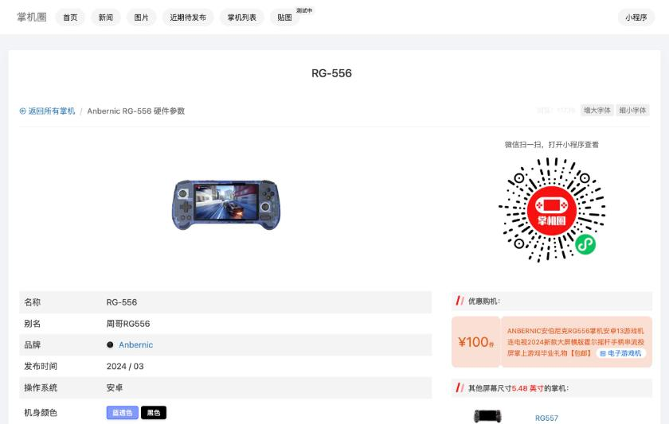
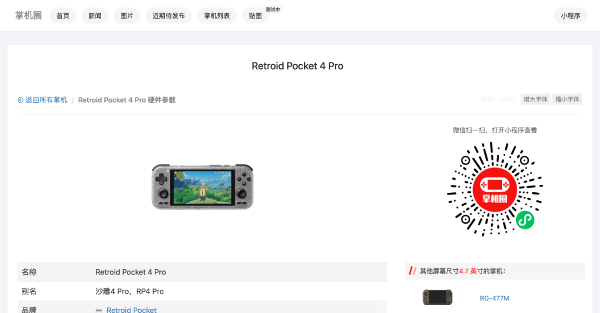
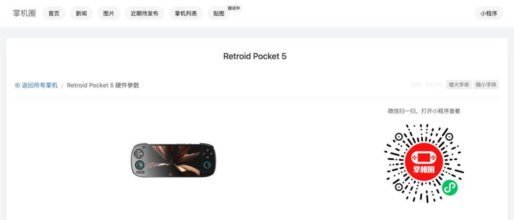
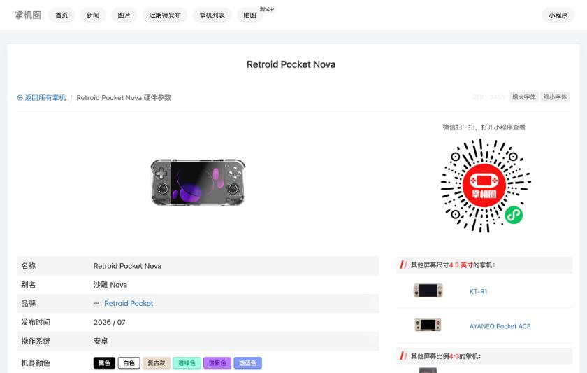
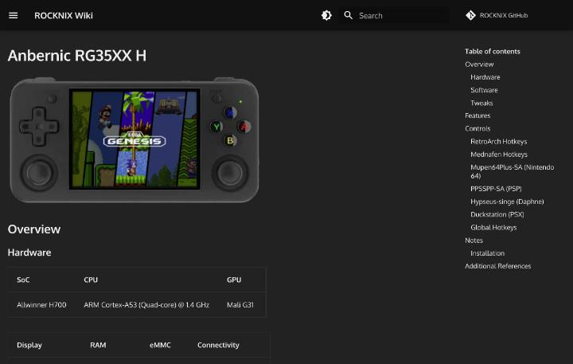

# Differences between the main devices

This page compares six devices that were candidates for play, based on their pages on the specification database [掌机圈](https://zhangjiquan.com/handhelds). The figures on 掌机圈 include information posted by users. They are not official spec sheets, so items that are not listed, such as battery capacity, require looking for other sources.

## Spec list

| Item | RG40XXH | RG406V | RG556 | RP4 Pro | RP5 | Nova |
|---|---|---|---|---|---|---|
| Release | Jul 2024 | Sep 2024 | Mar 2024 | Jan 2024 | Sep 2024 | Jul 2026 |
| Screen | 4.0-inch 4:3 | 4.0-inch 4:3 | 5.48-inch 16:9 | 4.7-inch 16:9 | 5.5-inch 16:9 | 4.5-inch 4:3 |
| Pixel density | 200 | 300 | 400 | 325.61 | 400.5 | 355.6 |
| Refresh rate | 60Hz | 60Hz | 60Hz | 60Hz | 60Hz | 120Hz |
| SoC | H700 | T820 | T820 | Dimensity 1100 | Snapdragon 865 | Snapdragon 8 Gen 2 |
| Memory | 1GB LPDDR4 | 8GB LPDDR4X | 8GB LPDDR4X | 8GB LPDDR4x | 6/8GB LPDDR4 | 8–12GB LPDDR5X |
| Storage | SD card | 128GB UFS 2.2 | 128GB UFS 2.2 | 128GB UFS 3.1 | 128GB UFS 3.1 | 128–256GB |
| Wireless | Wi-Fi 5, BT 4.2 | Wi-Fi 5, BT 5.0 | Wi-Fi 5, BT 5.0 | Wi-Fi 6, BT 5.2 | Wi-Fi 6, BT 5.1 | Wi-Fi 7, BT 5.3 |
| Weight | 208g | 289g | 331g | 261g | 280g | 255g |
| Cooling | Not listed | Heat pipe and fan | Heat pipe and fan | Fan | Fan | Fan |
| Price shown | 300–500 yuan | 1048 yuan (after coupon) | 1199 yuan (after coupon) | $150–200 | 1000–1500 yuan | 1500–2000 yuan |

The sources are the pages for the [RG40XXH](https://zhangjiquan.com/handheld/rg-40xxh), [RG406V](https://zhangjiquan.com/handheld/rg-406v), [RG556](https://zhangjiquan.com/handheld/rg-556), [RP4 Pro](https://zhangjiquan.com/handheld/retroid-pocket-4-pro), [RP5](https://zhangjiquan.com/handheld/retroid-pocket-5), and [Nova](https://zhangjiquan.com/handheld/retroid-pocket-nova). The cooling field for the RG40XXH is empty, and the 1048 yuan and 1199 yuan for the RG406V and RG556 are the final prices (after coupons) of the purchase links shown on 掌机圈.

## How to read the spec table fields

Device pages on 掌机圈 present specs in a table, field by field. The field names are in Chinese: 发布时间 (release date), 机身颜色 (body color), 外观尺寸 (external dimensions), 重量 (weight), 屏幕尺寸 (screen size), 屏幕比例 (aspect ratio), 屏幕刷新率 (refresh rate), 处理器 (SoC), 内存 (memory), 存储 (storage), 电池 (battery), 散热 (cooling), 连接性 (wireless), 视频输出 (video output), and 模拟器支持 (emulation guide) ([RG-35XX H page](https://zhangjiquan.com/handheld/rg-35xx-h)).

Some devices have blank fields. This is why the list above shows "Not listed" for the RG40XXH's cooling. At the bottom of the page is a button labeled 信息补充或纠错 (add or correct information), which lets users send corrections. A note on the page cautions that the listed specs are collected from information online and may contain omissions or errors.

The emulation guide field is one short line. For example, the RG-35XX H has "N64,PSP和Dreamcast大部分可玩", and the R36S has "SNES FX和3D PS1(60 FPS)…". No measurement conditions are given, so these remain only a rough guide to what is playable.

## Anbernic RG40XXH

A horizontal 4-inch device with an H700. 掌机圈 lists its size as 163×79×16mm, two SD card slots, and Mini HDMI output. Supported game formats include PSP, DOS, NDS, N64, PS1, DC, arcade, GBA, GBC, GB, SFC, FC, MAME, and MD.

The [RG40XXH hands-on article](https://post.smzdm.com/p/aqrg0rx2/) on 什么值得买 gives a 3200mAh battery and a weight of 208g, and says that FC, SFC, GBA, GB, and PS1 run without problems. PSP and N64 are only partly playable. This article also has the AIGC label, so its figures need to be checked against the 掌机圈 page above before use.

A distinguishing feature of this device is its wide choice of OS. Both [ROCKNIX](https://rocknix.org/devices/anbernic/rg40xx-h/) and [Knulli](https://github.com/knulli-cfw/knulli.org/blob/main/docs/devices/anbernic/rg40xx-h.md) officially support it.

## Anbernic RG406V

A vertical 4-inch device whose SoC is the 虎贲T820. According to 掌机圈, it has 8GB of memory and 128GB of UFS 2.2 storage, uses a heat pipe and fan for cooling, and has a gyro and Hall sticks. It weighs 289g. The supported games field on 掌机圈 says "N64, DC, PSP", and PS2 is not mentioned.

The screen is 4 inches with a pixel density of 300. Because it is a 4:3 screen, displaying 16:9 PSP video leaves black bars at the top and bottom.

## Anbernic RG556

A horizontal device with a large 5.48-inch screen. The SoC is the same T820 as the RG406V, and 掌机圈 lists a weight of 331g, a pixel density of 400, and Hall sticks and Hall triggers. On supported games, 掌机圈 says that N64, Dreamcast, and PSP all run at satisfactory frame rates, most GameCube and Wii games are playable, some PS2 games are playable, and only simple games work on Switch.

## Retroid Pocket 4 Pro

A horizontal 4.7-inch device with a Dimensity 1100. 掌机圈 lists a weight of 261g, support for WiFi 6 and Bluetooth 5.2, and Micro HDMI and USB-C output. Supported games are listed as going up to GameCube, Wii, and PS2, and for Switch only simple, small games are said to work.

The same page carries a buyer's comment: "起手1500我说冤大头,闲鱼700只能给一句水桶机皇". It says that 1500 yuan right after launch felt expensive, but that at 700 yuan on 闲鱼 the writer rates it as an all-rounder with few weak points.

## Retroid Pocket 5

A horizontal 5.5-inch device with a Snapdragon 865. 掌机圈 lists a size of 199.2×78.5×15.6mm, a weight of 280g, a maximum brightness of 500 nits, and USB-C output. Supported games go up to GameCube, Wii, and PS2, and some Switch games also run.

This device also has an advantage over the others in OS options. Both [ROCKNIX](https://rocknix.org/devices/retroid/retroid-pocket-5/) and [Knulli](https://github.com/knulli-cfw/knulli.org/blob/main/docs/devices/goretroid/retroid-pocket-5.md) have pages for it. The Knulli page describes inserting a prepared SD card, starting the device while holding the volume up key, and choosing to boot from the menu that appears.

## Retroid Pocket Nova

A new device released in July 2026. It has a Snapdragon 8 Gen 2 and a 4.5-inch 4:3 screen with a 120Hz refresh rate. 掌机圈 lists a size of 169.9×84.1×26.3mm, a weight of 255g, and support for WiFi 7 and Bluetooth 5.3. Supported games go up to some Switch games.

One buyer's comment gives an evaluation to the effect of: "It can also play PS3 emulators and PC emulators, the 8 Gen 2 drivers are in good shape, it fits in the palm at 255g, and it is a finished device with everything in order: performance, heat dissipation, battery, and weight." It is also an officially supported device of [LineageOS](https://wiki.lineageos.org/devices/RPN).

## Four devices in the 3.5-inch class

Apart from the six devices above, devices with 3.5-inch screens were also looked up on 掌机圈. The four devices are the R36S, RG-35XX H, GKD Bubble, and Miyoo Flip, and they share a 640×480 screen, a 4:3 aspect ratio, and 60Hz.

### R36S

A vertical device released in November 2023. The brand field on 掌机圈 reads "Game Console", which looks like a generic label. The SoC is the RK3326, with four Cortex-A35 cores (1.3–1.5GHz) and a Mali-G31 MP2 (650MHz), along with 1GB of DDR3L memory. Storage is two external MicroSD cards, the battery is 3500mAh, the connectivity field says USB-C OTG, and the speaker field says mono ([掌机圈 R36S](https://zhangjiquan.com/handheld/r36s)).

The ROCKNIX page groups the same device as "R35S/R36S" and lists 1GB of DDR3 memory and a 3.5-inch 640×480 screen ([ROCKNIX R35S/R36S](https://rocknix.org/devices/unbranded/game-console-r35s-r36s/)). Some 2024 R36S units have a new screen, and these are said to need additional work to run. The page explains the steps for placing an overlay file matching the screen type in the boot area.

### RG-35XX H

An Anbernic device released in January 2024. 掌机圈 lists external dimensions of 145×69×16mm, a weight of 180g, an H700 (four Cortex-A53 cores at 1.5GHz, Mali-G31 MP2 at 650MHz), and 1GB of LPDDR4. Storage is two external MicroSD cards, wireless is WiFi 5 and Bluetooth 4.2, and video output is Mini HDMI. It also has a 3.5mm earphone jack and stereo speakers ([掌机圈 RG-35XX H](https://zhangjiquan.com/handheld/rg-35xx-h)).

The ROCKNIX page gives the same device's H700 as 1.4GHz and says that overclocking in the settings brings it to 1.5GHz. The page says wireless LAN is turned on in the network settings of the EmulationStation main menu, and also says that the power LED color can be chosen and that Bluetooth audio and controllers are supported ([ROCKNIX RG35XX H](https://rocknix.org/devices/anbernic/rg35xx-h/)).

### GKD Bubble

A horizontal device with a touchscreen, released in October 2024. 掌机圈 lists external dimensions of 166.8×82×24mm, a weight of 227g, an RK3566 SoC (four Cortex-A55 cores at 1.8GHz, Mali-G52 2EE at 850MHz), 1GB of LPDDR4 memory, and a 4000mAh battery. Video output is Micro HDMI, the speakers are stereo, and it has a vibration function. The price is given as 379 yuan ([掌机圈 GKD Bubble](https://zhangjiquan.com/handheld/gkd-bubble)).

### Miyoo Flip

A folding device released in December 2024. 掌机圈 lists external dimensions of 82×80×20mm and a weight of 165g, the lightest of the three devices with a listed weight. The SoC is the same RK3566 as the GKD Bubble. The battery is 3000mAh, wireless is WiFi 5 and Bluetooth 5.2, video output is Mini HDMI, and the speaker is mono. The body comes in four colors: black, white, yellow, and 复古灰 ([掌机圈 Miyoo Flip](https://zhangjiquan.com/handheld/miyoo-355-flip)).

The alias field on the page lists "Miyoo 翻盖机,翻米,蜜柚Flip,米柚翻盖掌机". This shows that the device is called by its shape (翻盖) and by Chinese phonetic renderings of the brand name, rather than by model number.

## Differences in numbers

Comparing the ten devices so far using the figures on 掌机圈 gives the following. Weight ranges from 165g for the Miyoo Flip to 331g for the RG556. In between are the RG-35XX H at 180g, RG40XXH at 208g, GKD Bubble at 227g, Nova at 255g, RP4 Pro at 261g, RP5 at 280g, and RG406V at 289g. The weight field for the R36S was empty.

Prices range from $40 for the R36S (起售价格) to 1500–2000 yuan for the Nova (price range). However, because dollars and yuan are mixed, they cannot be ranked.

As for SoC generations, devices with the H700 and RK3566 are small and light, and devices with the T820 and above are heavy. This is merely the result of lining up the figures for ten devices and has not been verified as a general rule.

## OS support

The following table shows which devices the official OSes support, from the lists checked so far. "Not listed" only means that no matching device name was found in that list. It is not a definitive statement that the device is unsupported.

| Device | ROCKNIX | Knulli | Other |
|---|---|---|---|
| RG40XXH | Yes | Yes | RG40XX-H in muOS's supported device data |
| RG-35XX H | Yes | Yes | RG35XX H in muOS's supported device data |
| R36S | Yes (R35S/R36S) | Not listed | ArkOS description could not be confirmed |
| RG406V | Not listed | Not listed | Could not be confirmed |
| RG556 | Not listed | Not listed | Could not be confirmed |
| RP4 Pro | Not listed | Not listed | Could not be confirmed |
| RP5 | Yes | Yes (GoRetroid) | Could not be confirmed |
| Nova | Yes | Not listed | Officially supported by LineageOS (code name RPN) |
| Miyoo Flip | Not listed | Yes | Supported by GammaOS Core |
| GKD Bubble | Not listed | Not listed | Supported by GammaOS Core |

The sources are the [ROCKNIX supported device list](https://rocknix.org/devices/), the [Knulli supported device list](https://github.com/knulli-cfw/knulli.org/blob/main/docs/devices/index.md), [GammaOS Core](https://github.com/TheGammaSqueeze/GammaOSCore), the [LineageOS Wiki](https://wiki.lineageos.org/devices/RPN), and the [MustardOS repository](https://github.com/MustardOS). The RG406V and RG556 have different model numbers from the RG552 and RG353 on the ROCKNIX list.

## What the official shop says about the Retroid Pocket 5

The Retroid Pocket 5 page on Retroid's official shop lists a 5.5-inch AMOLED, 1080p at 60fps, a 5000mAh battery, active cooling, Android 13, analog L2 and R2, and 3D Hall sticks. Wireless is Wi-Fi 6 and Bluetooth 5.1, and it says that official OTA incremental updates are supported ([goretroid.com](https://www.goretroid.com/en-jp/products/retroid-pocket-5)).

The RP5 fields on 掌机圈 give wireless as WiFi 6 and Bluetooth 5.1, and memory as 6 or 8GB. The wireless standards match between the official shop and 掌机圈. For memory, the refurbished page says 8GB, which is worded differently from the 6 or 8GB on 掌机圈. The RP5 page on 掌机圈 has no figure for battery capacity, so the 5000mAh on the official shop is the only clue.

## Chinese terms in this article

Here are the field names in the spec tables, along with their pronunciation.

| Chinese (Simplified) | Pinyin | Meaning | Source |
|---|---|---|---|
| 发布时间 | fābù shíjiān | Release date | [掌机圈 RG-35XX H](https://zhangjiquan.com/handheld/rg-35xx-h) |
| 机身颜色 | jīshēn yánsè | Body color | [掌机圈 RG-35XX H](https://zhangjiquan.com/handheld/rg-35xx-h) |
| 外观尺寸 | wàiguān chǐcùn | External dimensions | [掌机圈 RG-35XX H](https://zhangjiquan.com/handheld/rg-35xx-h) |
| 重量 | zhòngliàng | Weight | [掌机圈 RG-35XX H](https://zhangjiquan.com/handheld/rg-35xx-h) |
| 屏幕尺寸 | píngmù chǐcùn | Screen size | [掌机圈 RG-35XX H](https://zhangjiquan.com/handheld/rg-35xx-h) |
| 屏幕比例 | píngmù bǐlì | Screen aspect ratio | [掌机圈 RG-35XX H](https://zhangjiquan.com/handheld/rg-35xx-h) |
| 屏幕刷新率 | píngmù shuāxīnlǜ | Screen refresh rate | [掌机圈 RG-35XX H](https://zhangjiquan.com/handheld/rg-35xx-h) |
| 处理器 | chǔlǐqì | Processor (SoC) | [掌机圈 RG-35XX H](https://zhangjiquan.com/handheld/rg-35xx-h) |
| 内存 | nèicún | Memory | [掌机圈 RG-35XX H](https://zhangjiquan.com/handheld/rg-35xx-h) |
| 存储 | cúnchǔ | Storage | [掌机圈 RG-35XX H](https://zhangjiquan.com/handheld/rg-35xx-h) |
| 电池 | diànchí | Battery | [掌机圈 RG-35XX H](https://zhangjiquan.com/handheld/rg-35xx-h) |
| 散热 | sànrè | Cooling | [掌机圈 RG-35XX H](https://zhangjiquan.com/handheld/rg-35xx-h) |
| 连接性 | liánjiēxìng | Wireless and other connectivity | [掌机圈 RG-35XX H](https://zhangjiquan.com/handheld/rg-35xx-h) |
| 视频输出 | shìpín shūchū | Video output | [掌机圈 RG-35XX H](https://zhangjiquan.com/handheld/rg-35xx-h) |
| 模拟器支持 | mónǐqì zhīchí | Emulation guide | [掌机圈 RG-35XX H](https://zhangjiquan.com/handheld/rg-35xx-h) |
| 信息补充或纠错 | xìnxī bǔchōng huò jiūcuò | Add or correct information | [掌机圈 RG-35XX H](https://zhangjiquan.com/handheld/rg-35xx-h) |
