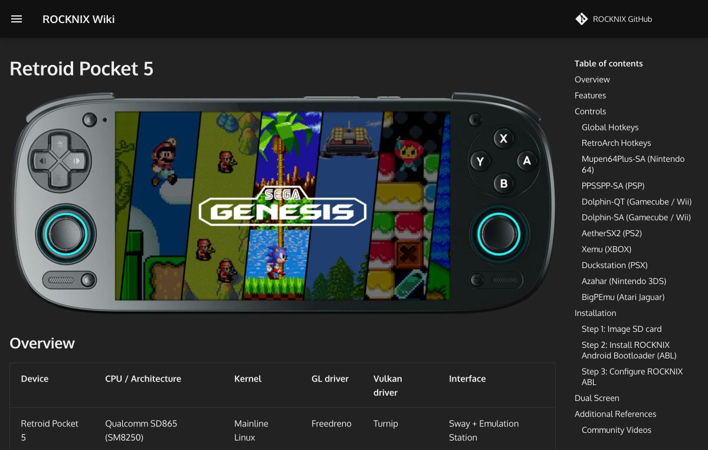

# Installing CFW

This page sorts out the installation of ROCKNIX and Knulli from the steps given in their official documents. Both follow the same flow: write the image matching the device to an SD card, insert it in the device, and boot. Depending on the device, there is additional work before or after writing. The differences between the OSes themselves are summarized in [OS options](03-os.md).

CFW stands for custom firmware. In the Chinese-speaking world, the work of replacing an OS is called 刷机, and there are examples of the OS and its contents being called 固件 (firmware) or 系统. In Baidu search results, videos and documents about 刷机 and 固件 for devices such as the RG40XX H were listed ([Baidu search results](https://www.baidu.com/s?wd=RG40XXH%20%E5%88%B7%E6%9C%BA%20%E5%9B%BA%E4%BB%B6%20Knulli%20%E6%95%99%E7%A8%8B)).

## The common approach

ROCKNIX's [official installation steps](https://rocknix.org/play/install/) are to download the image for the device, write it to an SD card or internal storage, boot, and proceed with the installation. On Windows, the official "ROCKNIX Image Burner" can be used for writing. Once the tool is open, you just choose the manufacturer and device and press "Write Image to Drive". To do it manually, get the image for your SoC from the releases page, decompress it, and write it with Rufus, Raspberry Pi Imager, Win32 Disk Imager, or `dd`.

Choosing the image requires care. As an example, the ROCKNIX steps say to use the "ROCKNIX-RK3588" image for the Gameforce Ace. If in doubt, check the supported device list for the image matching your device ([installation steps](https://rocknix.org/play/install/)).

Knulli's [installation steps](https://github.com/knulli-cfw/knulli.org/blob/main/docs/play/install.md) are almost the same. Get the image for your device from "Installation Package Downloads" on the releases page, decompress it with 7zip if it is split into several parts, and write it to an SD card. As an example, the steps say to use the "rg35xx" image for the RG35XX. All split parts go in the same folder, and you extract 001 with 7zip. The writing tools listed are Rufus, Balena, Raspberry Pi Imager, Win32 Disk Imager, and `dd`.

If Windows prompts you to format partitions it cannot read after writing, you must not format them. The Knulli documentation asks you never to format unreadable partitions, even if Windows strongly recommends it. It explains that several new drives appearing in Windows with warnings that they cannot be read is because Windows cannot read Linux file systems, and that this is a normal state ([installation steps](https://github.com/knulli-cfw/knulli.org/blob/main/docs/play/install.md), [partitioning guide](https://github.com/knulli-cfw/knulli.org/blob/main/docs/guides/partitioning.md)).

Watch out for devices with no matching build. Knulli's installation steps say that devices not listed under "Installation Package Downloads" do not yet have a published build, and warn against using another device's package ([installation steps](https://github.com/knulli-cfw/knulli.org/blob/main/docs/play/install.md)).

To boot, insert the SD card with the device powered off, then turn on the power. On some devices, you need to set the boot order so that the SD card comes first. With Knulli, on devices with a second SD card slot, that slot must be left empty during the first boot.

The official documents also describe what happens after booting. ROCKNIX restarts the device when the installation process finishes, and EmulationStation then opens ([installation steps](https://rocknix.org/play/install/)). Knulli's installation process also runs automatically. Some stages take several minutes, so you need to wait. When it finishes, EmulationStation starts ([installation steps](https://github.com/knulli-cfw/knulli.org/blob/main/docs/play/install.md)).

## Things to note about ROCKNIX

ROCKNIX's OS area is formatted as ext4 and cannot be read directly on Windows. To add games, use network transfer, a USB connection, a second SD card, or similar. A second SD card is automatically recognized at boot whether it is ext4, FAT32, or exFAT. On x86 devices, ROCKNIX includes an installation tool, available from the tools menu in EmulationStation ([installation steps](https://rocknix.org/play/install/)).

## Additional steps for H700 Anbernic devices

ROCKNIX says that H700 Anbernic devices need one manual step after writing and before booting ([installation guide](https://rocknix.org/configure/h700-installation/)). From the `device_trees` folder on the ROCKNIX partition, copy the DTB file for your device to the top-level folder of the partition. Rename the copied file to lowercase `dtb.img`. Finally, safely remove the SD card using the computer's "eject" function, insert it in the device, and boot. If you skip the eject step, the SD card may become unbootable, in which case you start over from the initial write.

This manual step is needed only the first time. The installation guide says it is not needed for normal updates ([installation guide](https://rocknix.org/configure/h700-installation/)).

DTB file names are fixed for each device. For example, the RG40XX H uses `sun50i-h700-anbernic-rg40xx-h.dtb`, the RG40XX V uses `sun50i-h700-anbernic-rg40xx-v.dtb`, and the RG CubeXX uses `sun50i-h700-anbernic-rgcubexx.dtb`. The RG35XX line has two kinds of DTB depending on the board revision. The difference cannot be seen from the outside, so if the screen is garbled, hold the power button for 10 seconds to turn the device off, start over from writing, and try the other DTB.

The devices with two kinds are the RG35XX 2024, H, and Plus. Each has a file ending in `-rev6-panel`. The SP has a separate v2 file, `sun50i-h700-anbernic-rg35xx-sp-v2-panel.dtb` ([installation guide](https://rocknix.org/configure/h700-installation/)).

In the ROCKNIX source code (commit `ae41127`), there are more two-kind DTBs than in this installation guide's list. The H700 list in [config.xml](https://github.com/ROCKNIX/distribution/blob/ae41127cee7e3e81b1ab3b17b676d91be5165e61/projects/ROCKNIX/config.xml) also has `sun50i-h700-anbernic-rg40xx-h-v2-panel`, `sun50i-h700-anbernic-rg40xx-v-v2-panel`, and `sun50i-h700-anbernic-rg34xx-sp-v2-panel`. The [v2-panel DTS](https://github.com/ROCKNIX/distribution/blob/ae41127cee7e3e81b1ab3b17b676d91be5165e61/projects/ROCKNIX/devices/H700/linux/dts/allwinner/sun50i-h700-anbernic-rg40xx-h-v2-panel.dts) for the RG40XX H loads the normal RG40XX H DTS and only changes the screen part specification to `anbernic,rg40xx-v2-panel`. Since the only difference between the two is the screen part, it is thought that on the RG40XX H too, you would try the other DTB if the screen is garbled. This has not yet been verified on actual hardware.

In the same source, images for the H700 are split into two kinds, a DDR3 version and a DDR4 version (config.xml). The difference is the U-Boot part that makes memory usable at the very start of booting. The memory of the RG40XXH is listed as LPDDR4 on 掌机圈 ([Differences between the main devices](02-devices.md)), so the DDR4 version should be the right one. Check on the ROCKNIX device page before downloading. How DTBs and the DDR3 and DDR4 versions work is covered in detail in [After you turn on the power](19-boot.md).

## Installing ROCKNIX on the Retroid Pocket 5

The Retroid Pocket 5 can boot ROCKNIX from an SD card while keeping Android's internal storage. The steps on the [official page](https://rocknix.org/devices/retroid/retroid-pocket-5/) are as follows.

1. Write the SM8250 version of ROCKNIX to an SD card.
2. In Android, copy the `rocknix_abl` folder from the SD card to the top level of internal storage.
3. In Settings, under "Handheld Settings", "Advanced", "Run Script as Root", select the `rocknix_abl` folder.
4. Run `backup_abl.sh` to back up the current ABL.
5. Run `flash_abl.sh` to write the ROCKNIX ABL.
6. Restart while holding volume down to enter the ROCKNIX ABL. Use volume up and down to select items and the power button to confirm.
7. In "Set device model", choose Retroid Pocket 5 or the Visionox version.
8. In "Switch boot mode", set the boot mode to Linux.
9. Choose "Start", and ROCKNIX boots.

ABL is the first software that runs before the OS boots. Rewriting it lets you replace the OS, but a mistake in the steps may leave the device unable to boot. Step 4 is the one that always backs up the current ABL. The ROCKNIX pages for the Retroid Pocket 6 and AYN Odin 2 also describe the same steps.

For step 1, the page says to get the SM8250 version from the latest nightly build. The Retroid Pocket 5 page also has a section on installing to internal storage, but the content of those steps has not been checked ([Retroid Pocket 5](https://rocknix.org/devices/retroid/retroid-pocket-5/)).

This page does not say how to return to Android after installing the ROCKNIX ABL. All that can be told is that the boot mode item is an option for switching to "Linux", and how to go back could not be confirmed. What can be confirmed is only that the backup procedure for the original ABL is in step 4.

## Installing Knulli on the Retroid Pocket 5

Knulli's [Retroid Pocket 5 page](https://github.com/knulli-cfw/knulli.org/blob/main/docs/devices/goretroid/retroid-pocket-5.md) describes a method using an SD card. Insert the SD card with Knulli written to it, turn the device off, then turn on the power while holding volume up. A simple text-only menu appears; use volume up and down to select "Boot" and the power button to confirm. The menu may be displayed vertically rather than with the screen horizontal.

ROCKNIX and Knulli use different buttons. You press volume down to enter the ROCKNIX ABL and volume up to enter the Knulli menu. In both, you then operate with volume up and down and the power button. The first sentence of "Installation" on the page says that both Android and Linux can be booted. However, the device name in that sentence was "Retroid Pocket Mini", even though this is the RP5 page.

Other devices also require advance preparation in Knulli: Miyoo's Flip, the Retroid Pocket Flip 2, Retroid Pocket Mini, and Retroid Pocket Mini V2. At the first stage of installation, these devices are directed to prepare according to "Installation" on the device page ([installation steps](https://github.com/knulli-cfw/knulli.org/blob/main/docs/play/install.md)).

## Knulli partitions and first boot

When Knulli is written, the SD card is divided into six partitions. According to the [partitioning guide](https://github.com/knulli-cfw/knulli.org/blob/main/docs/guides/partitioning.md), they are an unallocated area of about 36MB, Linux areas of 20MB and 16MB, a FAT32 `BATOCERA` of about 4GB, a 512MB `SHARE`, and the remaining free space. Games, themes, and save data go in `SHARE`. On first boot, `SHARE` expands to the remaining free space on the SD card and is initialized as exFAT. Note that the first boot therefore takes time.

The `BATOCERA` partition holds an image file containing the KNULLI OS (`boot/batocera`) and files needed for booting such as `bootlogo.bmp`. Writing erases all files that were on the SD card. The previous format and number of partitions do not matter. The partitions are small so that the image can be written to an SD card of any capacity, and the official documentation says 8GB or more ([partitioning guide](https://github.com/knulli-cfw/knulli.org/blob/main/docs/guides/partitioning.md)).

`/userdata`, `SHARE`, the share partition, and the user data partition are all names for the same storage location. When a second SD card is used, `/userdata` points to the second card rather than the first card's `SHARE`. Two SD cards therefore cannot be used as game storage at the same time ([partitioning guide](https://github.com/knulli-cfw/knulli.org/blob/main/docs/guides/partitioning.md)).

Putting games on a second SD card is also an option. Knulli strongly recommends a two-card setup if you plan to keep using it: the first card is used only for the OS, and games, themes, and save data go on the second. With a two-card setup, you need to switch between internal and external storage manually after the first boot ([quick start](https://github.com/knulli-cfw/knulli.org/blob/main/docs/play/quick-start.md)).

## Choosing a file system

The SHARE partition was ext4 before the Knulli Gladiator release, and exFAT has been the default since then. The reason ext4 was the default was a problem with PortMaster games, and the change was made because that problem was resolved. The official documentation says ext4 is faster and also more resistant to file system corruption when writes are interrupted. If direct reading from Windows or macOS is not important, you can choose to switch to ext4 ([partitioning guide](https://github.com/knulli-cfw/knulli.org/blob/main/docs/guides/partitioning.md)).

Why old versions of Knulli defaulted to ext4 is detailed in a separate document. Many PortMaster games relied on symbolic links. Because exFAT cannot use symbolic links, some games did not run or could not save settings and progress. On the PortMaster side, a fix using bind mounts instead of symbolic links was applied to most games. At the time the document was updated, PortMaster had 1009 ports, of which about 25 were still affected ([PortMaster and exFAT](https://github.com/knulli-cfw/knulli.org/blob/main/docs/guides/portmaster-and-exfat.md)).

With ext4, the card can no longer be read directly from Windows. Adding games is therefore done mainly over Wi-Fi or by USB transfer. The document says that on devices without Wi-Fi, such as the RG28XX or RG35XX 2024, it is safer to stay with exFAT ([PortMaster and exFAT](https://github.com/knulli-cfw/knulli.org/blob/main/docs/guides/portmaster-and-exfat.md)).

To change the file system, use Knulli's built-in formatter. Under "Format a disk" in "Frontend developer options" in System settings in the main menu, choose the target and either ext4 or exFAT. After "Format now", a restart is required. The official documentation asks you to avoid formatting directly on a Windows, macOS, or Linux computer ([formatting documentation](https://github.com/knulli-cfw/knulli.org/blob/main/docs/play/add-games/formatting.md)).

ROCKNIX also has storage modes. If the external SD card is ext4, you can use "Merged Storage", which merges internal and external storage. This mode is disabled by default. When it is disabled, or when the card is exFAT or FAT32, the mode is "Simple Storage", in which the roms folder on the external card is used directly as the game location ([adding games](https://rocknix.org/play/add-games/)).

## Common stumbling blocks and fixes

The Knulli documents include several clues for when installation goes wrong. The first is when `SHARE` does not appear in Windows. The explanation is that Windows sometimes does not assign a drive letter to `SHARE` after it has expanded. Search for "disk management" in the Start menu, open Disk Management, right-click the SD card's `SHARE`, and assign a drive letter ([partitioning guide](https://github.com/knulli-cfw/knulli.org/blob/main/docs/guides/partitioning.md)).

The second is when `/userdata` has not expanded correctly or cannot be mounted. The symptoms in the document are being told there is not enough space despite a 128GB SD card, and Wi-Fi information and theme settings disappearing at every boot. Causes listed are manually changing the format or partition sizes, problems with the SD card or writing software, and corrupted image files. It can also happen if the SD card is pulled out of a computer without safely removing it ([partitioning guide](https://github.com/knulli-cfw/knulli.org/blob/main/docs/guides/partitioning.md)).

The basic fix is to download the image again and rewrite it. On Windows, the document strongly recommends Rufus. If that does not fix it, suspect a faulty SD card. With a two-card setup, check whether the second SD card is exFAT or ext4. Those are the only two that Knulli supports ([partitioning guide](https://github.com/knulli-cfw/knulli.org/blob/main/docs/guides/partitioning.md)).

The third is when Wi-Fi does not connect. The quick start says that if the router's encryption is mixed WPA2 and WPA3, the connection may fail. In that case, switch to WPA1 and WPA2. Alternatively, you can enable the experimental feature "WIRELESS_HYBRID_FIX" under "Services" in System Settings ([quick start](https://github.com/knulli-cfw/knulli.org/blob/main/docs/play/quick-start.md)). The networking document treats this problem as one reported on Anbernic H700 devices, and says the experimental feature is available from Knulli Firefly ([networking](https://github.com/knulli-cfw/knulli.org/blob/main/docs/configure/networking.md)).

Devices without built-in Wi-Fi, such as the RG35XX 2024 and RG28XX, can also use a USB Wi-Fi dongle. Supported dongles use RTL8192cu or RTL8188eu/us chips. The KNULLI community strongly recommends TP-Link's TL-WN725N. After inserting the dongle, turn on ENABLE_WIFI_DONGLE in Services ([networking](https://github.com/knulli-cfw/knulli.org/blob/main/docs/configure/networking.md)).

ROCKNIX has clues too. When a conflict keeps games from appearing, running `/usr/bin/cleanup_overlay` often solves it, and running it restarts the device. When game folders do not appear in `/storage/roms`, check that the microSD has a `roms` directory and restart ([adding games](https://rocknix.org/play/add-games/)). When a second card is not recognized, check that "Autodetect Games Card" is on in System Settings and restart.

## Ways to add games

[Adding games](https://rocknix.org/play/add-games/) for ROCKNIX covers network transfer, USB gadget, SD card, USB drive, Linux computer, and NFS. Network transfer means connecting the device to Wi-Fi and connecting over HTTP, SMB, or SFTP. The connection user name is `root`, and the default password is `rocknix`. After adding files, update the game list from the game settings in the START menu.

The page also gives details of network transfer. For HTTP, enable "Simple HTTP Server" in the network settings and open the device's IP address in a browser. For SMB, setting the Windows network type to "Private" makes the device appear under Network in Explorer. If it does not appear, open it with `\\hostname.local` or `\\IP-address`. On macOS, press "Cmd+K" in Finder and enter `smb://` followed by the destination. The SFTP port is 22 ([adding games](https://rocknix.org/play/add-games/)).

Transfer over a USB cable has two modes. The network gadget (formerly ECM) creates a network connection between the computer and the device and uses Samba or SFTP over it, and the page calls it "most useful". The file transfer gadget (formerly MTP) looks simple but has limitations: some OSes need additional drivers or software, and transfers can fail and have to be redone ([adding games](https://rocknix.org/play/add-games/)).

You can also take the SD card out of the device and use it. On devices with two SD card slots, to use the second card for games, put a card formatted as FAT32, exFAT, ext4, or btrfs in slot 2 and boot. When booting finishes, a `roms` directory is created automatically on the second card ([adding games](https://rocknix.org/play/add-games/)).

ROCKNIX also has a recovery mode. On most devices, you enter it by holding volume down during boot. The device's storage appears to the computer as USB mass storage, and you can manage ROMs, format partitions, and do a clean install of ROCKNIX. When finished, eject all drives and press volume up to return to a normal boot. On RK3566 devices, you need to connect to the computer by USB before entering. On the Retroid Pocket 5 and Mini, select "RECOVERY" in the GRUB menu ([adding games](https://rocknix.org/play/add-games/)).

On Knulli, opening `\\KNULLI` in Windows Explorer or `smb://KNULLI` in the macOS Finder shows the device's folders. Inside the `roms` folder are subfolders for each system. BIOS files, as Knulli's [BIOS documentation](https://github.com/knulli-cfw/knulli.org/blob/main/docs/play/bioses.md) says, are not included with KNULLI. BIOS files are copyrighted, so you need to prepare them yourself. The BIOS files you need can be checked with "Missing BIOS check" in the game settings.

If you are not using ext4, you may also insert the game SD card in a computer and copy files directly. If you changed the host name, you need to substitute that host name for the `KNULLI` part in network transfers ([quick start](https://github.com/knulli-cfw/knulli.org/blob/main/docs/play/quick-start.md)).

## Settings and updates after installation

Knulli's quick start lays out the flow after installation in order. For Wi-Fi, open the main menu with the START button and configure it under "Network settings". If you need PortMaster, run "Install.PortMaster" in "Ports" while connected to Wi-Fi. To add box art and descriptions, use the built-in scraper, which can retrieve them from ScreenScraper, TheGamesDB, and ArcadeDB. For RetroAchievements, enter your account under "RetroAchievement Settings" in the game settings ([quick start](https://github.com/knulli-cfw/knulli.org/blob/main/docs/play/quick-start.md)).

The quick start recommends learning the hotkeys before launching a game for the first time. ROCKNIX device pages also have hotkey lists. On the Retroid Pocket 5, RetroArch saves with HOME and R1 pressed together and loads with HOME and L1 ([Retroid Pocket 5](https://rocknix.org/devices/retroid/retroid-pocket-5/)).

Security cautions are also given. By default, Knulli does not require a root password, and when connected to a network, people on the same network can see its data. Turning on "Enforce security" under "Security" in System settings in the main menu and restarting makes it use a random root password. It is recommended that you avoid connecting to networks outside your control ([networking](https://github.com/knulli-cfw/knulli.org/blob/main/docs/configure/networking.md)). ROCKNIX's default root password is `rocknix`, and it can be changed under "Security" in System Settings ([adding games](https://rocknix.org/play/add-games/)).

Update methods differ between the two OSes. ROCKNIX uses OTA or manually placing a `.tar`. KNULLI's update document distinguishes major and minor updates. A major update, such as from 20240721 to Firefly, requires rewriting the card, and all settings are also reset. Before updating, back up the `userdata` folder. With a two-card setup, you must also remove the `system` folder from the `userdata` folder so that KNULLI can create a new one with the new default settings. After updating, you must not restore the previous `system` folder ([update](https://github.com/knulli-cfw/knulli.org/blob/main/docs/play/update.md)).

For a minor update, get the "boot package" for your device and replace `boot/batocera` on the BATOCERA partition. Delete the old file or keep it under a new name such as `batocera.bak`. The advantage of keeping it is that you can go back to the previous version. Copy `batocera.update` from the package you got into the `boot` folder, rename it to `batocera`, and restart the device, and the update starts automatically. The boot package has the device name in its name, a name ending in `boot.gz` or similar, and a size of about 1.5–2.0GB ([update](https://github.com/knulli-cfw/knulli.org/blob/main/docs/play/update.md)).

Knulli's update document says that the OTA update menu is shown, but because no OTA server is available, it asks you to update manually. Another section of the same document also has OTA steps. Since the two statements disagree, which is current could not be confirmed ([update](https://github.com/knulli-cfw/knulli.org/blob/main/docs/play/update.md)).

## Chinese terms in this article

The table below lists words related to installation in this article. Pinyin is written with tone marks. The source is the Baidu search results page, where the words actually appeared.

| Chinese (Simplified) | Pinyin | Meaning | Source |
| --- | --- | --- | --- |
| 刷机 | shuā jī | Rewriting a device's OS | [Baidu search results](https://www.baidu.com/s?wd=RG40XXH%20%E5%88%B7%E6%9C%BA%20%E5%9B%BA%E4%BB%B6%20Knulli%20%E6%95%99%E7%A8%8B) |
| 固件 | gùjiàn | Firmware | [Baidu search results](https://www.baidu.com/s?wd=RG40XXH%20%E5%88%B7%E6%9C%BA%20%E5%9B%BA%E4%BB%B6%20Knulli%20%E6%95%99%E7%A8%8B) |
| 教程 | jiàochéng | Step-by-step guide, tutorial | [Baidu search results](https://www.baidu.com/s?wd=RG40XXH%20%E5%88%B7%E6%9C%BA%20%E5%9B%BA%E4%BB%B6%20Knulli%20%E6%95%99%E7%A8%8B) |
| 刷系统 | shuā xìtǒng | Writing an OS | [Baidu search results](https://www.baidu.com/s?wd=RG40XXH%20%E5%88%B7%E6%9C%BA%20%E5%9B%BA%E4%BB%B6%20Knulli%20%E6%95%99%E7%A8%8B) |
| 更新系统 | gēngxīn xìtǒng | Updating an OS | [Baidu search results](https://www.baidu.com/s?wd=RG40XXH%20%E5%88%B7%E6%9C%BA%20%E5%9B%BA%E4%BB%B6%20Knulli%20%E6%95%99%E7%A8%8B) |
| 读卡器 | dúkǎqì | Card reader | [Baidu search results](https://www.baidu.com/s?wd=RG40XXH%20%E5%88%B7%E6%9C%BA%20%E5%9B%BA%E4%BB%B6%20Knulli%20%E6%95%99%E7%A8%8B) |
| TF卡 | TF kǎ | microSD card | [Baidu search results](https://www.baidu.com/s?wd=RG40XXH%20%E5%88%B7%E6%9C%BA%20%E5%9B%BA%E4%BB%B6%20Knulli%20%E6%95%99%E7%A8%8B) |
| 格式化 | géshìhuà | Formatting | [Baidu search results](https://www.baidu.com/s?wd=RG40XXH%20%E5%88%B7%E6%9C%BA%20%E5%9B%BA%E4%BB%B6%20Knulli%20%E6%95%99%E7%A8%8B) |
| 备份 | bèifèn | Backup | [Baidu search results](https://www.baidu.com/s?wd=RG40XXH%20%E5%88%B7%E6%9C%BA%20%E5%9B%BA%E4%BB%B6%20Knulli%20%E6%95%99%E7%A8%8B) |
| 变砖 | biànzhuān | A device becoming unable to boot (so-called bricking) | [Baidu search results](https://www.baidu.com/s?wd=RG40XXH%20%E5%88%B7%E6%9C%BA%20%E5%9B%BA%E4%BB%B6%20Knulli%20%E6%95%99%E7%A8%8B) |
| 下载 | xiàzài | Download | [Baidu search results](https://www.baidu.com/s?wd=RG40XXH%20%E5%88%B7%E6%9C%BA%20%E5%9B%BA%E4%BB%B6%20Knulli%20%E6%95%99%E7%A8%8B) |
| 安伯尼克 | Ānbóníkè | Chinese name for Anbernic | [Baidu search results](https://www.baidu.com/s?wd=RG40XXH%20%E5%88%B7%E6%9C%BA%20%E5%9B%BA%E4%BB%B6%20Knulli%20%E6%95%99%E7%A8%8B) |
