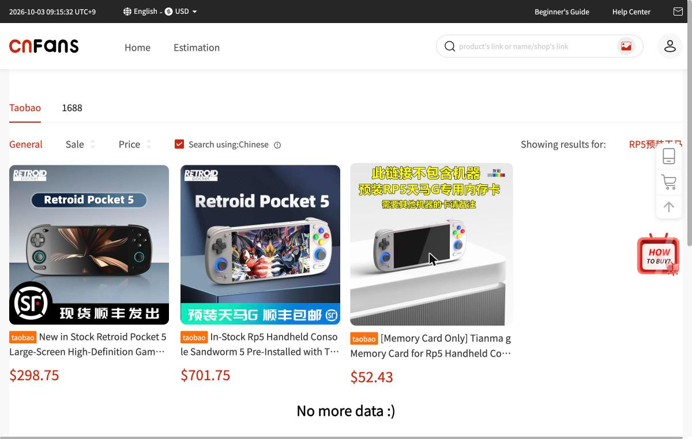
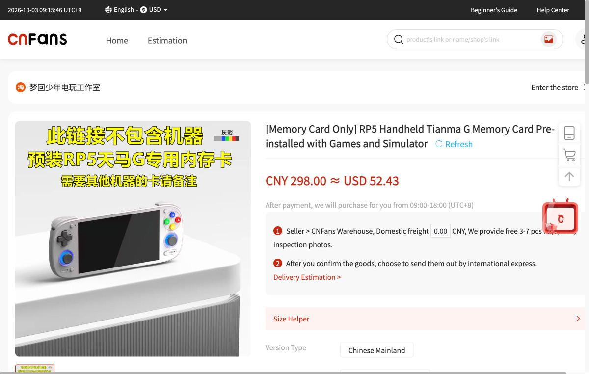
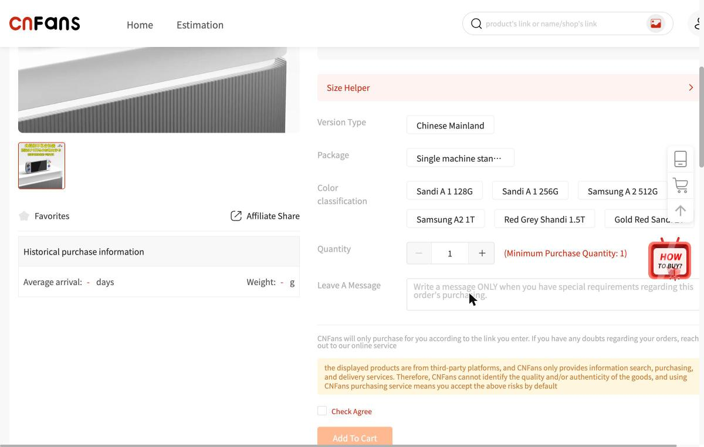

# Frontends and Tianma G

A frontend is an app that displays a list of games and launches the selected game in the matching emulator. "Tianma G", often seen in Chinese listings, is one kind of frontend. This article starts from how Pegasus, on which it is based, works, and then sorts out the structure of Tianma G and how to install it.

## Pegasus

Pegasus is a graphical frontend for browsing game collections and launching various emulators from one place. The [official README](https://github.com/mmatyas/pegasus-frontend) names customizability, support for multiple platforms, and high performance as its features. It runs on Windows, Linux, Mac, Android, Raspberry Pi, and Odroid, and its license is GPLv3. Themes can change the look of the screen, and EmulationStation gamelist files can also be used.

Pegasus's policy is set out on the official getting started page. Pegasus itself neither bundles nor downloads games, emulators, or game data and images. Instead, users can freely combine what they have prepared themselves. It is designed not to take in features that other external tools already provide, and to be used in combination with them ([Getting started](https://github.com/mmatyas/pegasus-docs/blob/master/docs/user-guide/getting-started.md)).

This policy also matters when reading Chinese listings. Pegasus itself only handles the screen and launching, so how well things run is determined by the emulators and settings it is combined with. Something bundled with a game pack cannot be regarded as a "Pegasus feature".

The official release targets listed on the getting started page are Windows 7 and later, Linux on Ubuntu 18.04 or Debian Buster and later, Raspberry Pi on Raspbian Buster and later, Odroid on Ubuntu 18.04 and later, Android 5 and later, and macOS 10.13 and later. There are two release lines: "latest", which includes the newest fixes, and "stable", which has gone several weeks after publication without problems. Android gets an APK, so the steps are to allow "unknown sources" in the settings and then open it in a file manager app. On first launch, it asks for storage permission in order to find games ([same source](https://github.com/mmatyas/pegasus-docs/blob/master/docs/user-guide/getting-started.md)).

## Screen controls and settings

Pegasus can be operated by keyboard, gamepad, mouse, or touch. The main menu opens with the Esc key or the B or circle button on a gamepad, and it can also be pulled out from the right edge of the screen ([Getting started](https://github.com/mmatyas/pegasus-docs/blob/master/docs/user-guide/getting-started.md)).

The default assignments are collected in the official controls table. Confirm is the Enter key or A (or ×) on a gamepad, and back is the Esc key or B (or ○). Game details are assigned to the I key or X (or □), and filtering and search to the F key or Y (or △). L1 and R1 switch to the previous and next collection. L2 and R2 move through the game list one page at a time. On a keyboard, Alt and a letter key move to games starting with that letter ([Default controls](https://github.com/mmatyas/pegasus-docs/blob/master/docs/user-guide/controls.md)).

On the settings screen, you can choose the display language, turn full screen on or off, and select a theme. How games are found is determined by two items under "Gaming" in the settings. One is "Set game directories", which edits the list of folders searched for metadata files. The other is "Enable/disable data sources", which switches whether game lists from other software are imported ([Getting started](https://github.com/mmatyas/pegasus-docs/blob/master/docs/user-guide/getting-started.md)).

## Metadata files and assets

Pegasus manages the game list and how to launch games in a text file called `metadata.pegasus.txt`. According to the [official documentation](https://github.com/mmatyas/pegasus-docs/blob/master/docs/user-guide/meta-files.md), this file uses the format `name: value`. There are two kinds of groups to write: collections and games.

A collection is a category such as a system. `collection` sets the collection's name, `extension` the file extensions to include, and `launch` the common launch command. For a game, `game` sets the display name, `file` the file name, and `developer` the developer. To change the launch command for one game, you can also write `launch` for that game. Conditions for including files can be specified with `extension`, `file`, `regex`, and `directory`, and conditions for excluding them with `ignore-extension`, `ignore-file`, and `ignore-regex`. Plural forms such as `extensions` and `files` work the same way. Exclusion takes priority over inclusion.

Variables such as `{file.path}` can be used in launch commands. `{file.path}` is the absolute path of the game file, `{file.name}` is the file name, `{file.basename}` is the file name without the extension, and `{file.dir}` is the folder containing the file.

The metadata file format has some detailed rules. Names are not case-sensitive. Values can span multiple lines, with the second and later lines starting with a space or tab. Lines starting with `#` are comments, and blank lines are ignored. In descriptions, a line with only a dot separates paragraphs. The basic file name is `metadata.pegasus.txt`, and if it is not found, `metadata.txt` is searched for. Adding a name before the extension, as in `MarioGames.metadata.pegasus.txt`, allows several files in the same folder. Placing them in `metafiles` in the settings folder also lets you manage them together, apart from the games ([meta-files.md](https://github.com/mmatyas/pegasus-docs/blob/master/docs/user-guide/meta-files.md)).

Collections with the same name merge into one across multiple metadata files. One game can also be placed in several collections. A collection's `shortname` is used as a clue when a theme looks for images such as logos. In the official table, Game Boy Advance is `gba`, PlayStation is `psx`, PlayStation Portable is `psp`, Nintendo 64 is `n64`, and Sega Dreamcast is `dreamcast` ([same source](https://github.com/mmatyas/pegasus-docs/blob/master/docs/user-guide/meta-files.md)).

Game entries can also carry information such as `developer`, `publisher`, `genre`, `players`, `release`, and `rating`. `players` takes the form `2` or `1-4`, and `release` the form `1985-05-22`, where the month or day can be omitted if unknown. `rating` takes the form `70%` or `0.7`. For a game to appear in the list, it must belong to at least one collection and have at least one file that exists ([same source](https://github.com/mmatyas/pegasus-docs/blob/master/docs/user-guide/meta-files.md)).

In the official example, Super Famicom games are placed in `C:/games/snes`, and `metadata.pegasus.txt` is created there. You just list extensions such as `smc, sfc` in `extensions` and write `snes9x "{file.path}"` in `launch`. After that, add this folder to the search targets in the settings, and the games appear in the list from the next launch. With `regex`, games can also be gathered into a separate collection by a naming rule such as `\d+.in.1` ([same source](https://github.com/mmatyas/pegasus-docs/blob/master/docs/user-guide/meta-files.md)).

Cover images and videos can be specified per game, as in `assets.box_front`. If they are not specified, Pegasus looks in `media/<game name>/` in the game's folder for files with fixed names such as `boxFront`, `logo`, and `video`. Images can be PNG and JPG, and videos WEBM, MP4, and AVI ([documentation](https://github.com/mmatyas/pegasus-docs/blob/master/docs/user-guide/meta-assets.md)).

The search for images and videos has an order of priority. First are files specified per game in the metadata. Second are files specified as collection defaults, third are files with fixed names in `<folder>/media/<game name>/`, and fourth is third-party data such as EmulationStation and Steam. Whether collection default images are used is up to the theme author ([meta-assets.md](https://github.com/mmatyas/pegasus-docs/blob/master/docs/user-guide/meta-assets.md)).

The `<game name>` part can be either the game's title or the file name without the extension. Recognized names include `boxFront` for the front of the box, `logo` for the logo, `cartridge` and `disc` for cartridges and discs, `background` for the background, `screenshot` for screenshots, and `video` for video. For audio, it looks for MP3, OGG, and WAV ([same source](https://github.com/mmatyas/pegasus-docs/blob/master/docs/user-guide/meta-assets.md)).

Collecting images for a large number of games yourself is hard work. The official documentation recommends using software called scrapers. It introduces four examples: Universal XML Scraper, Steven Selph's Scraper, Skraper.net, and Skyscraper ([same source](https://github.com/mmatyas/pegasus-docs/blob/master/docs/user-guide/meta-assets.md)). Pegasus can read the `media` folder structure made by Skraper directly. Images and videos go in folders such as `box2dfront` and `videos`, with the same names as the game files ([Other data sources](https://github.com/mmatyas/pegasus-docs/blob/master/docs/user-guide/meta-sources.md)).

## Using data from other software

Pegasus can import game lists from other software without writing metadata files. The import sources listed in the official documentation are Steam, GOG, Android apps, Lutris, EmulationStation, LaunchBox, and Skraper images. Android apps that are installed and launchable are listed as in any other launcher. If connected to a network, it also gets information and images from Google Play ([Other data sources](https://github.com/mmatyas/pegasus-docs/blob/master/docs/user-guide/meta-sources.md)).

Closest to this article's subject is compatibility with EmulationStation. If EmulationStation is installed, Pegasus checks the folders written in `es_systems.cfg` and uses the information and images in `gamelist.xml` inside them. However, EmulationStation has many mutually incompatible forks, and Pegasus supports only the last official release. A conversion tool is also available, and `metadata.pegasus.txt` is described as close to a combination of `es_systems.cfg`, which holds system information, and `gamelist.xml`, which holds game information ([same source](https://github.com/mmatyas/pegasus-docs/blob/master/docs/user-guide/meta-sources.md)).

## Settings locations, themes, and scripts

Pegasus's settings files go in a fixed location for each platform. In the official list, Linux uses `~/.config/pegasus-frontend/`, Windows uses `C:\Users\[username]\AppData\Local\pegasus-frontend\`, and macOS uses `~/Library/Preferences/pegasus-frontend/`. Android is given as `<storage>/Android/data/org.pegasus_frontend.android/files/pegasus-frontend/`, and a `config` folder in the same place as the program can be used on all platforms ([Configuration directories](https://github.com/mmatyas/pegasus-docs/blob/master/docs/user-guide/config-dirs.md)). The platform-specific notes for Android, however, say that the settings folder is `<storage>/pegasus-frontend`, and on the SD card if there is no internal storage. The reason the two statements disagree could not be confirmed ([platform-android.md](https://github.com/mmatyas/pegasus-docs/blob/master/docs/user-guide/platform-android.md)).

Launching with `--portable`, or placing `portable.txt` next to the executable, enables portable mode. In this mode, Pegasus tries to write only inside its own folder, which makes it easy to carry on a USB memory stick or similar. There is also a caution that on Linux, programs sometimes cannot be run from USB drives or NTFS ([Portable mode](https://github.com/mmatyas/pegasus-docs/blob/master/docs/user-guide/portable.md)).

Themes are installed by extracting the theme's folder into `themes` in the settings folder and selecting it on the settings screen. If the folder does not exist, create it manually ([Installing themes](https://github.com/mmatyas/pegasus-docs/blob/master/docs/user-guide/installing-themes.md)). There is also a mechanism where you create `scripts` in the settings folder and place folders named after events under it. Events include `game-start` (before a game starts), `game-end` (after a game ends), `quit`, `reboot`, and `shutdown`, and the executables inside are called in alphabetical order ([Scripting](https://github.com/mmatyas/pegasus-docs/blob/master/docs/user-guide/scripting.md)).

## Launching on Android

On Android, other apps are launched differently from on a computer. According to the official documentation, instead of calling a program directly, you use the Activity Manager's `am start` to specify the app that opens the file ([notes for Android](https://github.com/mmatyas/pegasus-docs/blob/master/docs/user-guide/platform-android.md)). On Android 11 and later, app file access is restricted, so you may need to grant permissions in advance so that other apps can read the game folder.

The official examples show how to write this. To open a file in the default app, the form is `am start --user 0 -a android.intent.action.VIEW -d {file.path}`. `--user 0` comes with the author's note that a permission error occurred without it. To open in a specific app, specify the app's Activity name with `-n`. For PPSSPP, it is `org.ppsspp.ppsspp/.PpssppActivity`. The documentation explains that the only ways to find an Activity name are to read the app's `AndroidManifest.xml` or ask the developer ([platform-android.md](https://github.com/mmatyas/pegasus-docs/blob/master/docs/user-guide/platform-android.md)).

Some apps cannot open files directly. The official documentation gives RetroArch as an example. Launching it uses many custom arguments such as `-e ROM`, `-e LIBRETRO`, and `-e CONFIGFILE`. `LIBRETRO` takes the path of the core file and `CONFIGFILE` the path of the settings file, so these need to be rewritten to match where things are stored on your device. Note that internal storage paths also differ by device ([same source](https://github.com/mmatyas/pegasus-docs/blob/master/docs/user-guide/platform-android.md)). The official documentation also points to an online tool for making launch commands.

The list of known emulators that can open files includes Dolphin (`org.dolphinemu.dolphinemu/.activities.AppLinkActivity`), PPSSPP, and DraStic. On the other hand, Citra is listed as "not supported" and ePSXe as "not directly, with a workaround". The list is stated to be incomplete and reflects the time of writing ([same source](https://github.com/mmatyas/pegasus-docs/blob/master/docs/user-guide/platform-android.md)). Other cautions are that video playback uses a lot of battery, that launching a memory-heavy app can cause Android to close Pegasus, and that restart and power-off are not possible because of Android restrictions ([same source](https://github.com/mmatyas/pegasus-docs/blob/master/docs/user-guide/platform-android.md)).

If you set Pegasus as the home screen app (default launcher), it starts when the device boots. To undo this, choose again under "Default apps" in Android's settings ([same source](https://github.com/mmatyas/pegasus-docs/blob/master/docs/user-guide/platform-android.md)). In the official example, metadata files are placed in two folders on the SD card, `Roms/NES` and `Roms/PSP`, with NES launched through a RetroArch core and PSP through standalone PPSSPP ([Android example setup](https://github.com/mmatyas/pegasus-docs/blob/master/docs/user-guide/platform-android-example.md)).

## The EmulationStation approach

Besides Pegasus, the frontend widely used in custom firmware for handhelds is EmulationStation. According to the official Knulli documentation, Knulli's default frontend is EmulationStation and its default theme is Art Book Next. The Carbon and Knulli themes are also bundled, and all three are updated with each release ([Themes](https://github.com/knulli-cfw/knulli.org/blob/main/docs/configure/customization/themes.md)). ROCKNIX device pages also say that Sway and EmulationStation are used on top of mainline Linux ([ROCKNIX Retroid Pocket 5](https://rocknix.org/devices/retroid/retroid-pocket-5/)).

EmulationStation-based OSes take a different approach from Pegasus. In Pegasus, the user writes the emulator launch commands. In Knulli, each emulator is configured from the EmulationStation screen. Every time a game is launched, all emulator-specific settings files are erased and recreated from the settings in EmulationStation. Settings changed on the RetroArch screen are therefore lost at the next launch ([Game Settings](https://github.com/knulli-cfw/knulli.org/blob/main/docs/play/game-settings.md)).

Settings have a hierarchy. From the top, these are the Knulli defaults, global settings, per-system settings, and per-game settings. Many items are set to "auto" and inherit the value from the level above. The official recommendation is to make changes at as low a level as possible. For example, to affect just one particular game, change that game's settings. Per-system settings are opened by pressing "Select" in the game list, and per-game settings by holding the launch button ([same source](https://github.com/knulli-cfw/knulli.org/blob/main/docs/play/game-settings.md)).

Emulators can be switched only at the per-system and per-game levels. They cannot be chosen at the global level because no emulator can cover every system. For each system, Knulli has chosen a default emulator suited to most games and low-performance handhelds. If a game behaves oddly, it recommends trying a switch to another emulator. The official documentation says that on systems that are hard to reproduce, such as N64, the best emulator differs by game ([same source](https://github.com/knulli-cfw/knulli.org/blob/main/docs/play/game-settings.md)).

There are two kinds of emulator: RetroArch "cores" and standalone emulators. Many standalone emulators do not support auto save and load, do not attach images to save data, and in some cases cannot show saves on the EmulationStation screen. In the official example, with N64's Mupen64plus: Rice, save states can be saved and loaded, but the records are not displayed in EmulationStation ([same source](https://github.com/knulli-cfw/knulli.org/blob/main/docs/play/game-settings.md)).

Adding images and descriptions also differs from Pegasus. Knulli has a built-in scraper that gets information from ScreenScraper, TheGamesDB, and ArcadeDB, with ScreenScraper as the default. Using ScreenScraper requires logging in to an account. The scraper searches for games based on ROM file names, so it cannot find them if the names are not tidy. A region marker (such as `(U)`) also serves as a clue. If you move `gamelist.xml` and the image folders made on another device as they are, they can be used without scraping again. If they do not appear, run "Update gamelists" ([Scraping](https://github.com/knulli-cfw/knulli.org/blob/main/docs/play/scraping.md)).

"Collections" in EmulationStation come in three kinds: "automatic", which automatically gathers things such as recently played games; "editable", to which the user adds games one by one; and "dynamic", which automatically gathers games by conditions such as genre. Knulli also describes a way of using a collection called "Now Playing" to stack up games you want to play ([Collections](https://github.com/knulli-cfw/knulli.org/blob/main/docs/configure/collections.md)).

What happens at power-off can also be changed in the settings. Enabling "Quick Resume Mode" and "Auto Save/Load" automatically saves progress at the time of power-off, and the last game starts straight away at the next boot. The official explanation is that sleep on handhelds uses a lot of battery, so it recommends powering off rather than relying on sleep for long periods. Some emulators do not support auto save, in which case you need to save yourself ([Quick Resume](https://github.com/knulli-cfw/knulli.org/blob/main/docs/configure/quick-resume.md)).

## What Tianma G is

Tianma G is Pegasus localized into Chinese, with a game pack attached. A 什么值得买 introductory article reposted on Zhihu explains that the Chinese community 跳坑者联盟 did the 汉化 (Chinese localization) of the G frontend based on Pegasus and also made a pack of 汉化 games ([模拟器游戏 篇四](https://zhuanlan.zhihu.com/p/703325151)). According to the article, the pack includes GBA, NDS, 3DS, PSP, PS1, PS2, Wii, arcade, and more, for a total of about 2.8TB. The content can be chosen to fit the storage capacity, and the article used a 220GB trimmed version. Each game comes with a cover, a name, and an introductory video, and 8 themes are built in.

The CSDN article sorts out the structure. The frontend is Pegasus, whose role is to display the cover wall and menus. What actually runs the games is RetroArch or standalone emulator APKs. ROMs, BIOS files, cover images, videos, and Chinese metadata form the resource layer ([天马G前端的使用](https://blog.csdn.net/fanged/article/details/152960565)). When the author of this article read the source of the Android version of Pegasus, the process for launching an emulator APK on Android only assembled an Intent call equivalent to `am start` and ran `startActivity` from JNI. What Tianma G provides is a UI for managing and launching games.

The Zhihu article says that on 闲鱼 there are 商家 selling this Tianma G pack for around 20 yuan. Since the pack is easy to obtain, it is thought that much of the listing's value lies in what amounts to a handling fee.

An introduction to the same frontend was also found in a 2020 Baidu Tieba post. The poster writes of starting to use this PC frontend out of a wish to choose ROMs of games on hand from a list and launch them, and says the name to search for is 天马模拟器前端. The pack was about 15GB at the time ([给大家分享一个PC上的模拟器前端](https://tieba.baidu.com/p/6671136635)).

## Installing the PC version

The Zhihu article divides installing the PC version into three stages. The first is installing the emulator itself. From 安装包 in the downloaded folder, choose the archive that fits your environment and extract it to the top-level folder of a drive. If it is not at the top level, the emulator does not run correctly. Extraction creates a folder called "Pegasus G". To prevent crashes at launch, also install the video plugin from the "解决闪退工具" folder.

The second is placing the game ROMs. Extract the contents of the pack's `roms` folder to `roms` under "Pegasus G". File names must not be changed. Tianma G automatically scans `roms` and recognizes game names and descriptions.

The third is launching: start the Tianma G launcher, and the game list appears. The problems and solutions described in the article are as follows. When there was no sound, installing the 3DM game runtime solved it. When Wii games crashed, installing all the optional drivers in the solutions folder solved it. Key controls differ by emulator, and in PPSSPP, Esc opens the settings.

## Installing the Android version

The CSDN article describes installing the Android version in three stages: APKs, settings files, and ROMs. The first step is installing APKs: Tianma G itself, RetroArch, and a file manager app such as MT管理器. The author installed them with adb. After installation, launch each once and grant permissions.

Next are the settings files. Place Tianma G's theme pack and settings files, along with the `Android` folder. On Android 11 and later, each app's data folder (`Android/data/<package name>`) is protected and cannot be written to from file manager apps, so this part has to be placed manually. This is because Tianma G shares settings files and ROM paths among several apps, such as Pegasus, RetroArch, and AetherSX2.

Last are the ROMs. In addition to the ROM files, prepare main images, secondary images, introductory videos, and metadata files for the Tianma G screen, and place them in the `Roms` folder at the root of the phone. If you use the 跳坑者联盟 pack, these are already prepared in the trimmed pack.

The author tried this on an old phone (Snapdragon 855) and reports that the screen looked gorgeous and that a USB-connected controller could be used without lag. On the other hand, the author says black bars on the left and right of 4:3 games are also a drawback of phones.

## Cautions when reading "preinstalled Tianma G" listings

An image in a listing for the Retroid Pocket 5 found on CNFans read "预装RP5天马G专用内存卡". The page description says that this product is only a memory card, and that after it arrives you install according to a tutorial. There are six options, from Sandisk 128GB up to 2TB ([CNFans search results](https://cnfans.com/search?keywords=RP5%E9%A2%84%E8%A3%85%E5%A4%A9%E9%A9%AC&searchType=keywords)).

From the listing text, the titles of the included games, their number, and the breakdown by system could not be determined. The whole Tianma G pack is about 2.8TB, so what fits on a 128GB card is only part of it. The pack includes ROMs and is often problematic from a rights standpoint. When buying from a listing, you need to check the contents with the seller.

## Chinese terms in this article

Words from Tianma G introductions and listing text are organized in the table below, roughly in the order they are mentioned in the text.

| Chinese (Simplified) | Pinyin | Meaning | Source |
|---|---|---|---|
| 前端 | qiánduān | Frontend. An app that shows a list of games and launches them | [Zhihu article](https://zhuanlan.zhihu.com/p/703325151) |
| 汉化 | hànhuà | Localizing into Chinese | [Zhihu article](https://zhuanlan.zhihu.com/p/703325151) |
| 精简版 | jīngjiǎnbǎn | Version with reduced content and smaller size | [Zhihu article](https://zhuanlan.zhihu.com/p/703325151) |
| 跳坑者联盟 | tiàokēngzhě liánméng | Name of the community that made the Tianma G pack | [Zhihu article](https://zhuanlan.zhihu.com/p/703325151) |
| 安装包 | ānzhuāngbāo | Folder containing installation files | [Zhihu article](https://zhuanlan.zhihu.com/p/703325151) |
| 闪退 | shǎntuì | An app suddenly closing | [Zhihu article](https://zhuanlan.zhihu.com/p/703325151) |
| 商家 | shāngjiā | Shop owner, seller | [Zhihu article](https://zhuanlan.zhihu.com/p/703325151) |
| 闲鱼 | xiányú | Secondhand marketplace app | [Zhihu article](https://zhuanlan.zhihu.com/p/703325151) |
| 模拟器 | mónǐqì | Emulator | [Tieba post](https://tieba.baidu.com/p/6671136635) |
| 预装 | yùzhuāng | Preinstalled | [CNFans listing](https://cnfans.com/search?keywords=RP5%E9%A2%84%E8%A3%85%E5%A4%A9%E9%A9%AC&searchType=keywords) |
| 专用 | zhuānyòng | Dedicated | [CNFans listing](https://cnfans.com/search?keywords=RP5%E9%A2%84%E8%A3%85%E5%A4%A9%E9%A9%AC&searchType=keywords) |
| 内存卡 | nèicúnkǎ | Memory card | [CNFans listing](https://cnfans.com/search?keywords=RP5%E9%A2%84%E8%A3%85%E5%A4%A9%E9%A9%AC&searchType=keywords) |
