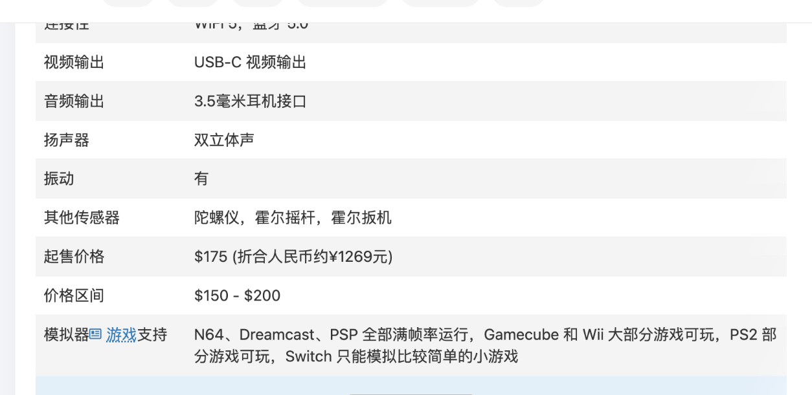
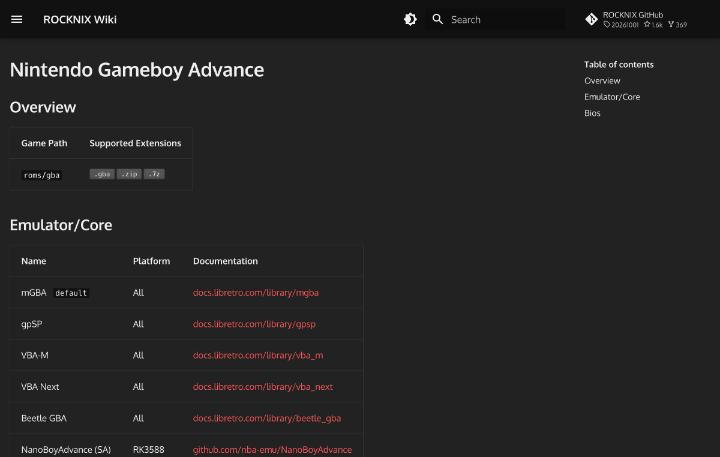

# What runs

Which console's software runs on which device is determined by the SoC's performance, emulator support, and the shape of the screen. This article sorts this out based on the evaluations published for each device and the OS support tables.

## Guide by device

The specification database [掌机圈](https://zhangjiquan.com/handhelds) has a 模拟器支持 field for each device. Because it allows comparison in the same format, it was the most useful material in this research. However, the entries include user posts and are not confirmations on actual hardware.

The RG-40XXH field names many supported formats, including PSP, DOS, NDS, N64, PS1, DC, arcade, GBA, GBC, GB, SFC, FC, MAME, and MD ([RG-40XXH](https://zhangjiquan.com/handheld/rg-40xxh)). This is a list of supported formats, and whether they run comfortably is another matter. In a Baidu Tieba post about modifying the RG40XXH's cooling, the poster replies that PS1 at double resolution on the H700 does not stutter if filters and masks are turned off. The Dreamcast emulator also does not stutter when set to 640×480 ([给RG40XXH改造散热](https://tieba.baidu.com/p/10191425150)). The same thread also has the opposite opinion, that "even PS1 at double resolution is heavy on the H700", so results differ depending on the settings.

The RG-406V field lists only "N64, DC, PSP" and does not mention PS2 or GameCube ([RG-406V](https://zhangjiquan.com/handheld/rg-406v)). The field for the RG-556, with the same T820, is somewhat more specific. It says N64, Dreamcast, and PSP all run at satisfactory frame rates, most GameCube and Wii games are playable, some PS2 games are playable, and only simple games work on Switch ([RG-556](https://zhangjiquan.com/handheld/rg-556)). Even with the same SoC, the amount written differs by entry. This difference is better seen as a difference between writers rather than between the two devices.

The Retroid Pocket 4 Pro field says it runs at most up to GameCube, Wii, and PS2, with only simple, small games on Switch ([RP4 Pro](https://zhangjiquan.com/handheld/retroid-pocket-4-pro)). The Retroid Pocket 5 entry says up to GameCube, Wii, and PS2, with a small number of Switch games also running ([RP5](https://zhangjiquan.com/handheld/retroid-pocket-5)). The Retroid Pocket Nova goes up to some Switch games, and a buyer's comment says PS3 and PC emulators can also be played ([Nova](https://zhangjiquan.com/handheld/retroid-pocket-nova)).

Lining up a guide by generation from the entries for each device above gives this: the H700 handles 8- to 16-bit consoles and PS1, plus some DC and PSP. The T820 handles N64, DC, and PSP, plus most GC and Wii and some PS2. The Dimensity 1100 and Snapdragon 865 go up to PS2 and a small number of Switch games. The Snapdragon 8 Gen 2 handles some Switch games and trial runs of PS3.

## Types of emulators and how to choose

Emulators that run on handheld OSes divide broadly into two kinds. One is the "core", which runs inside RetroArch, and the other is the standalone emulator. The official Knulli documentation explains that many standalone emulators do not support auto save and load. Some cannot attach images to save data, or cannot show saves on the EmulationStation screen. However, they work without problems as far as function goes, and can be used once you get used to the differences in behavior ([Game Settings](https://github.com/knulli-cfw/knulli.org/blob/main/docs/play/game-settings.md)).

There are many cases where several emulators are available for the same console. For each system, Knulli has made the default the one it considers "suited to most games and low-performance handhelds". When a game does not run well, it recommends trying a different emulator. It explains that on systems that are hard to reproduce, such as N64, the best emulator may differ by game. Switching is done in per-system or per-game settings ([same source](https://github.com/knulli-cfw/knulli.org/blob/main/docs/play/game-settings.md)).

The official ROCKNIX Wiki lists the available emulators in a table on each system's page, and some tables also have a mark showing the default and a column of board names. The Famicom entry has the default Nestopia, along with FCEUmm, QuickNES, and Mesen. The Super Famicom entry consists of the default Snes9x, three older versions of Snes9x, Beetle Supafaust, and the bsnes family. For Game Boy and Game Boy Color, the default is Gambatte, and SameBoy, Gearboy, TGB Dual, mGBA, and VBA-M can also be chosen ([NES](https://rocknix.org/systems/nes/), [SNES](https://rocknix.org/systems/snes/), [GB](https://rocknix.org/systems/gb/)). Mega Drive has three: Genesis Plus GX, Genesis Plus GX Wide, and PicoDrive ([Genesis](https://rocknix.org/systems/genesis/)).

As a rule of thumb for choosing, first use the default, and switch when problems appear. The ROCKNIX tables are only lists of emulators that "can be chosen" and do not go so far as to show whether a game runs comfortably. This research did not test behavior on actual hardware, so what is written about how well things run relies on forum posts and each emulator's official materials.

## Supported emulators by OS

ROCKNIX's Retroid Pocket 5 page gives control assignments for each emulator. Listed are Mupen64Plus-SA for N64, PPSSPP-SA for PSP, Dolphin for GameCube and Wii, AetherSX2 for PS2, xemu for Xbox, DuckStation for PS1, Azahar for 3DS, and BigPEmu for Atari Jaguar ([ROCKNIX Retroid Pocket 5](https://rocknix.org/devices/retroid/retroid-pocket-5/)). The pages for the Snapdragon 8 Gen 2 Retroid Pocket 6 and AYN Odin 2 also list Gopher64 for N64 in addition to these.

The RG40XX H page lists controls for RetroArch and Mednafen, along with DuckStation for PS1, PPSSPP-SA for PSP, and Mupen64Plus-SA for N64. It has no control tables for GameCube, PS2, or 3DS emulators ([ROCKNIX RG40XX H](https://rocknix.org/devices/anbernic/rg40xx-h/)).

## Status by system

From here on, for each system, the available emulators and the operating cautions confirmed in official materials are listed. The order is close to going from older to newer console generations.

### Game Boy Advance

On ROCKNIX's GBA page, mGBA is the default, and gpSP, VBA-M, VBA Next, and Beetle GBA can also be chosen. Standalone NanoBoyAdvance is also listed for the RK3588 ([GBA](https://rocknix.org/systems/gba/)).

According to the official libretro documentation, mGBA is an emulator that aims to be faster and more accurate than many existing GBA emulators. It can also run Game Boy and Game Boy Color games. Its core options include "Idle loop removal", which is explained as reducing the load on the GBA CPU when used on low-performance hardware without enough power. There is also a "Frameskip" setting that skips frames to improve performance at the expense of smoothness ([mGBA](https://docs.libretro.com/library/mgba/)).

For gpSP, the compatibility section of the same materials gives examples of games that do not work. For example, it says that the sensors are not reproduced for WarioWare: Twisted!, which uses a tilt sensor, and the Boktai series, which uses a solar sensor (the materials write it as Boktai Trilogy). On the other hand, mGBA's options include an item for changing the brightness of the solar sensor ([gpSP](https://docs.libretro.com/library/gpsp/), [mGBA](https://docs.libretro.com/library/mgba/)).

### PlayStation

ROCKNIX's PS1 table lists Beetle PSX, standalone DuckStation, PCSX ReARMed, PCSX ReARMed 32, DuckStation, and SwanStation. In the board column, only the two PCSX ReARMed entries name the RK3326. Standalone DuckStation has four: S922X, RK3399, RK3588, and RK3566, and the "DuckStation" and "SwanStation" entries say "All". The board column of this table does not have the H700's name, and H700 support could not be confirmed from the table ([PSX](https://rocknix.org/systems/psx/)).

In the official libretro documentation, PCSX ReARMed is a derivative of PCSX Reloaded with special optimizations added for ARM CPUs. The "Dynamic recompiler" option uses ari64 on 32-bit ARM and lightrec on 64-bit environments. "Enhanced resolution", which renders at double resolution, is clearly stated to lower speed, and its speed-up setting is also said to cause glitches in games. When video stutters on slow storage media, "CD Access Method" can be set to asynchronous, and the method of loading everything into memory applies only to CHD ([PCSX ReARMed](https://docs.libretro.com/library/pcsx_rearmed/)).

The DuckStation README explains that it emphasizes playability and speed while aiming for accuracy that runs on low-performance devices. It does not recommend "hack" settings, and its goal is for all playable games to run on the default settings. Its feature list includes upscaled rendering, improved vertex precision through PGXP, and texture replacement. The required environment is a GPU supporting one of OpenGL 3.1, OpenGL ES 3.1, Direct3D 11 Feature Level 10.0, or Vulkan 1.0 ([DuckStation](https://github.com/stenzek/duckstation)).

### PSP

For PSP, the two entries in ROCKNIX's table are both PPSSPP. You can choose standalone PPSSPP or libretro PPSSPP ([PSP](https://rocknix.org/systems/psp/)). The official PPSSPP documentation names rendering resolution as the most effective improvement. PSP games are made to run at 480×272, and the setting is specified as a multiple of that. 4x is roughly 1080p, and 8x corresponds to 4K ([Graphics settings](https://www.ppsspp.org/docs/settings/graphics/)).

At high resolutions, thin lines can appear between menu and HUD elements. This is because PSP games were tested only at 480×272. It also says that games using scaled-up pixel art benefit little from raising the resolution, and that games using scaling, rotation, or vector graphics look better ([same source](https://www.ppsspp.org/docs/settings/graphics/)).

### Nintendo 64

In ROCKNIX's N64 table, Mupen64Plus-Next is the default, and Mupen64Plus, Parallel N64, standalone Mupen64Plus, and standalone Gopher64 can also be chosen ([N64](https://rocknix.org/systems/n64/)). According to libretro's materials, Mupen64Plus-Next uses GLideN64 as its default rendering plugin, and Angrylion and ParaLLEl-RDP can also be chosen. It also incorporates recent LLE development through ParaLLEl-RDP and ParaLLEl-RSP. On the other hand, the same materials explain that using LLE for the RSP is more accurate but increases the computational load ([Mupen64Plus-Next](https://docs.libretro.com/library/mupen64plus/)).

### Nintendo DS and 3DS

For DS, melonDS is the default in ROCKNIX's table. DeSmuME, standalone melonDS, and standalone Drastic can also be chosen. For 3DS, only standalone Azahar is listed ([NDS](https://rocknix.org/systems/nds/), [3DS](https://rocknix.org/systems/3ds/)). The Azahar README describes Azahar as a high-level emulation 3DS emulator for PC and mobile, and says it carries on from Citra ([Azahar](https://github.com/azahar-emu/azahar)).

### Dreamcast

The Dreamcast table lists three kinds of Flycast (regular, 2021 version, and 32-bit version) and standalone Flycast. In the board column, all four list the RK3326, and the 32-bit version targets only the RK3326 ([Dreamcast](https://rocknix.org/systems/dreamcast/)). The README says that standalone Flycast also handles Naomi, Naomi 2, and Atomiswave in addition to Dreamcast ([Flycast](https://github.com/flyinghead/flycast)).

### GameCube and Wii

For both, what is listed in ROCKNIX's table is Dolphin. Three can be chosen: standalone, Qt, and libretro ([GameCube](https://rocknix.org/systems/gamecube/), [Wii](https://rocknix.org/systems/wii/)). The official Dolphin guide requires 64-bit Android 5.0 or later on Android devices. Android 9 or later is recommended, and for Qualcomm, a Snapdragon 700 or later with at least two high-performance cores is the guideline. For GPUs, it says RDNA2-family and Snapdragon perform best, and that upper-tier Mali may also be playable. Other manufacturers are not generally recommended ([Performance Guide](https://dolphin-emu.org/docs/guides/performance-guide/)).

### PlayStation 2 and later

For PS2, only AetherSX2 is listed in ROCKNIX's table. The board column has RK3588, S922X, RK3399, and SD865 ([PS2](https://rocknix.org/systems/ps2/)). The official materials for PCSX2 on computers are a useful reference for how heavy PS2 is. Even the minimum requirements call for an x86-64 CPU supporting SSE4.1 with two physical cores, 8GB of memory, and a GPU supporting Vulkan 1.1 or similar. The middle requirements list a 4-core CPU supporting AVX2 and 16GB of memory. The materials also caution that requirements vary greatly by game ([PCSX2 System Requirements](https://pcsx2.net/docs/setup/requirements/)). These are requirements for computers, and the values do not apply directly to handhelds.

Newer generations have emulators listed in ROCKNIX's tables, but behavior on handhelds could not be confirmed in this research. Cemu for Wii U, RPCS3 for PS3, and xemu for Xbox are in the ROCKNIX tables. For PS Vita, the page listing Vita3K says support is a work in progress ([Wii U](https://rocknix.org/systems/wiiu/), [PS3](https://rocknix.org/systems/ps3/), [Xbox](https://rocknix.org/systems/xbox/), [PS Vita](https://rocknix.org/systems/psvita/)).

## Settings guide

Emulator settings divide into two directions: raising image quality and raising speed. Here, guidelines from official materials are summarized by emulator. The values are what the materials say and do not guarantee behavior on any device.

### PPSSPP

PPSSPP's official recommended settings are written separately for high-performance and low-performance devices. On high-performance devices, match the rendering resolution to the screen and set texture filtering to "Auto Max Quality". The combination is to use Vulkan, set MSAA to 4x or 8x, and turn off all speed-up settings. On low-performance devices, lower the resolution to 2x or 1x and turn off post-processing effects. Software skinning helps in some cases and not in others, so it says to try it and decide; from PPSSPP 1.21 it is always on. The last resort when that is still not enough is setting frame skip to 1 or 2 ([Recommended settings](https://www.ppsspp.org/docs/settings/recommended/)).

Items for reducing latency are on the same page. For games such as the rhythm game Patapon, the settings are to use Vulkan, set "Buffer graphics commands" to 1 or "No buffer", and turn off VSync ([same source](https://www.ppsspp.org/docs/settings/recommended/)). For rendering backends, Vulkan is recommended on many devices, and OpenGL is described as an option for compatibility on Android ([Graphics settings](https://www.ppsspp.org/docs/settings/graphics/)).

### Dolphin

The official Dolphin guide explains performance settings in terms of both their effects and side effects. "Enable Dual Core" has a large effect, but because it splits CPU and GPU work onto separate cores, it occasionally crashes with unknown-instruction errors. "Emulated CPU Clock Override" is a powerful way to gain performance on weak devices. Lowering it below 100% causes slowdown inside the game, and the frame-skipping function that many games have greatly reduces the load. However, games relying on specific timing may have glitches ([Performance Guide](https://dolphin-emu.org/docs/guides/performance-guide/)).

Rendering backends suit some GPUs better than others. Vulkan is good on NVIDIA, AMD, and handheld RDNA2. For Adreno (Snapdragon), it says results vary by driver. OpenGL is positioned as the slowest but stable. For internal resolution, even 2x can be visibly slower on integrated GPUs and handhelds, so the guide recommends finding the right point between image quality and speed ([same source](https://dolphin-emu.org/docs/guides/performance-guide/)).

Stuttering from shader compilation can be addressed in settings. The standard "Specialized" can stop each time a new shader is created, which lessens the more you play. "Hybrid Ubershaders" greatly reduces stops. However, it is not recommended on NVIDIA Vulkan. "Exclusive Ubershaders" eliminates stops, but the load is very high at high resolutions, and it is not recommended without a powerful desktop GPU ([same source](https://dolphin-emu.org/docs/guides/performance-guide/)).

### PS1 and GBA cores

PCSX ReARMed for PS1 offers frame skip from 0 to 3. "Frame duping" gains speed by reusing the previous frame when there is no new rendering data. "Threaded Rendering" processes GPU commands in a separate thread, with a choice of synchronous and asynchronous. "PSX cpu clock" has a default of 57 and a range of 30 to 100. Lowering it may reduce the load, but it causes compatibility problems, so the documentation says to change it only for games that need it ([PCSX ReARMed](https://docs.libretro.com/library/pcsx_rearmed/)).

mGBA for GBA offers frame skip from 0 to 10. "Idle loop removal" has three values, "Remove Known", "Detect and Remove", and "Don't Remove", and is described as a setting for low-performance hardware ([mGBA](https://docs.libretro.com/library/mgba/)). In Mupen64Plus-Next for N64, the "dynamic_recompiler" CPU core is the fastest and cannot be chosen in some environments. It says framebuffer emulation should be turned off only when there are performance problems. "Less accurate blending mode" is a speed-up for slow GPUs but may cause glitches ([Mupen64Plus-Next](https://docs.libretro.com/library/mupen64plus/)).

### How to read the results of settings

All the settings so far are the emulators' official explanations. The same settings do not necessarily work on every device or board. In the Tieba thread mentioned at the start, replies saying that PS1 on the H700 does not stutter even at double resolution sat alongside replies saying it is heavy, and this alone does not tell which is right. No figures on actual hardware were taken in this research.

## Screen shape and size

Screen shape also affects how easy games are to play. Displaying PSP or PS2 software on a 4:3 screen puts black bars at the top and bottom or at the sides, making the usable display smaller. The RG406V is 4-inch 4:3, the Retroid Pocket 5 is 5.5-inch 16:9, and the Retroid Pocket Nova is 4.5-inch 4:3. Whether 4:3 games can be shown large without black bars is a reason to choose a device by screen shape.

The screen ratio on the game side also differs by system. libretro's materials list gpSP's GBA screen ratio as 3:2 and PCSX ReARMed's PS1 as 4:3. PSP games are based on 480×272, according to PPSSPP's materials ([gpSP](https://docs.libretro.com/library/gpsp/), [PCSX ReARMed](https://docs.libretro.com/library/pcsx_rearmed/), [Graphics settings](https://www.ppsspp.org/docs/settings/graphics/)). In Knulli's explanation of shaders, "RCG-Integer-Dramatic-LCD-CRT" requires integer scaling, and a separate setting is provided for screens that do not scale to an integer ([Shaders](https://github.com/knulli-cfw/knulli.org/blob/main/docs/configure/customization/shaders.md)).

## Heavy 3D games

Whether heavy 3D games such as GTA run is something for which this research could not gather specific sources. PS2 emulation, as the CSDN article says, centers on Android emulators ([天马G前端的使用](https://blog.csdn.net/fanged/article/details/152960565)). If you plan to play PS2, the safe choice is to consider the Retroid Pocket 4 Pro, which 掌机圈 says runs at most up to PS2, or the Retroid Pocket 5 and above.

## Chinese terms in this article

Words confirmed in the device database and forum threads are organized in the table below.

| Chinese (Simplified) | Pinyin | Meaning | Source |
|---|---|---|---|
| 掌机 | zhǎngjī | Handheld game console | [RG-556 page on 掌机圈](https://zhangjiquan.com/handheld/rg-556) |
| 掌机圈 | zhǎngjīquān | Name of a device database site | [RG-556 page on 掌机圈](https://zhangjiquan.com/handheld/rg-556) |
| 模拟器支持 | mónǐqì zhīchí | Emulator support | [RG-556 page on 掌机圈](https://zhangjiquan.com/handheld/rg-556) |
| 处理器 | chǔlǐqì | Processor (SoC) | [RG-556 page on 掌机圈](https://zhangjiquan.com/handheld/rg-556) |
| 屏幕尺寸 | píngmù chǐcùn | Screen size | [RG-556 page on 掌机圈](https://zhangjiquan.com/handheld/rg-556) |
| 屏幕比例 | píngmù bǐlì | Screen aspect ratio | [RG-556 page on 掌机圈](https://zhangjiquan.com/handheld/rg-556) |
| 内置 | nèizhì | Built-in | [RG-556 page on 掌机圈](https://zhangjiquan.com/handheld/rg-556) |
| 外置 | wàizhì | External | [RG-556 page on 掌机圈](https://zhangjiquan.com/handheld/rg-556) |
| 满帧率 | mǎn zhēnlǜ | Reaching the maximum frame rate | [RG-556 page on 掌机圈](https://zhangjiquan.com/handheld/rg-556) |
| 可玩 | kě wán | Playable | [RG-556 page on 掌机圈](https://zhangjiquan.com/handheld/rg-556) |
| 部分 | bùfen | Some, part | [RG-556 page on 掌机圈](https://zhangjiquan.com/handheld/rg-556) |
| 小游戏 | xiǎo yóuxì | Small game | [RG-556 page on 掌机圈](https://zhangjiquan.com/handheld/rg-556) |
| 霍尔摇杆 | huò'ěr yáogǎn | Stick using Hall sensors | [RG-556 page on 掌机圈](https://zhangjiquan.com/handheld/rg-556) |
| 散热 | sànrè | Heat dissipation | [Tieba thread](https://tieba.baidu.com/p/10191425150) |
| 改造 | gǎizào | Modification | [Tieba thread](https://tieba.baidu.com/p/10191425150) |
