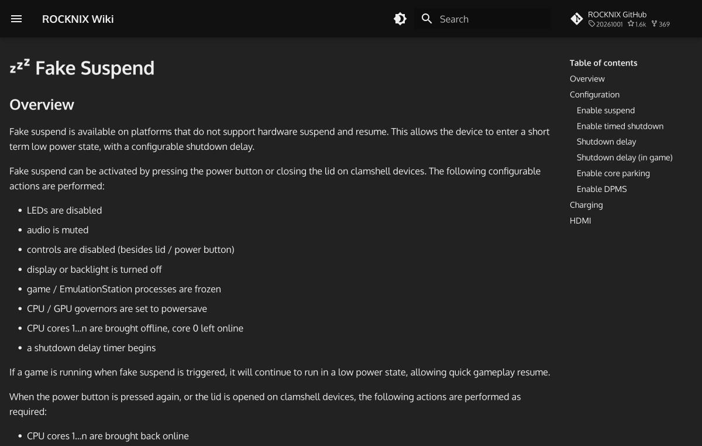
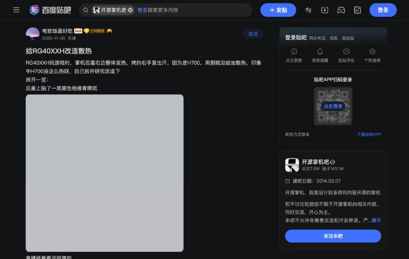

# What you can modify

Modifications to handheld game consoles can be divided into three kinds: software, OS, and hardware. This article sorts out the modifications that can actually be done, as far as could be confirmed from official documents and forum posts. Points that could not be confirmed are stated as such.

## Adjusting look and usability

The easiest place to start is software settings. Knulli's [official documentation](https://github.com/knulli-cfw/knulli.org/blob/main/docs/about-knulli.md) lists these as standard features: automatic retrieval of cover images and descriptions from ScreenScraper and others, theme switching, screen border (bezel) decorations, automatic game categorization and favorites collections, save data sync, and RGB LED settings. The same documentation is said to have pages explaining how to change the boot logo, background music, and shaders. Below is what could be confirmed by reading those pages in turn.

ROCKNIX has similar features. According to the [official Wiki](https://rocknix.org/), power and performance profiles, Bluetooth audio and controllers, HDMI output, cloud sync, VPN, RetroAchievements, and automatic retrieval of game information are available. On the RG40XX H, CPU overclocking can be chosen in the settings, and it runs at 1.5GHz ([ROCKNIX RG40XX H](https://rocknix.org/devices/anbernic/rg40xx-h/)). For the power LED, the page says you can either choose from candidate colors or turn it off, and that your choice persists after a restart. However, other lighting patterns are not supported.

### Themes

Knulli's standard frontend is EmulationStation, and its standard theme is Art Book Next. Batocera's Carbon theme and the Knulli theme are also included from the start, and all three are updated automatically with each release ([Themes](https://github.com/knulli-cfw/knulli.org/blob/main/docs/configure/customization/themes.md)). From "Theme Configuration" in "User Interface Settings" in the main menu, you can choose the screen aspect ratio, the system screen artwork, the type of game artwork, the display of descriptions, text size, color scheme, and the splash screen during startup. The color scheme candidates include ones named after SteamOS, SNES, Famicom, DMG, and OLED.

To change the look with your own images, there is no need to touch the theme's XML directly. According to the documentation, if you create a folder called `/userdata/theme-customizations/art-book-next/` and place images and color scheme settings under it, the changes remain even when the theme is updated. The idea is the same on ROCKNIX, where the location is `~/roms/rocknix/theme-customizations/art-book-next/` ([ROCKNIX Themes](https://rocknix.org/configure/themes/)). The standard theme on both is Art Book Next, and the ROCKNIX explanation lists 16:9, 4:3, 16:10, 5:3, 3:2, and 1:1 as supported aspect ratios.

There is also the option of replacing the frontend itself. Pegasus's [README](https://github.com/mmatyas/pegasus-frontend) explains that themes can change everything, down to screen elements, menus, and animations. Tianma G has 8 built-in themes ([模拟器游戏 篇四](https://zhuanlan.zhihu.com/p/703325151)). Covers and videos for each game can be added with `metadata.pegasus.txt` and the `media` folder. Details of how this works are as written in [Frontends and Tianma G](05-frontend-tianma-g.md).

### Boot logo and background music

Knulli's boot logo is the image displayed between turning on the power and EmulationStation starting. It changes when you replace `bootlogo.bmp` on the SD card's `knulli` partition with a bitmap of the same resolution as the device's screen. For the RG35XX Plus, H, SP, and 2024 line, that is a 640×480 image. The steps are to shut down the device, remove the SD card, open the `knulli` partition on a computer, replace the file, put the card back, and boot. The page says to ignore any warning from Windows that the drive is corrupted. It also recommends backing up the original file. The same page also says that some devices do not support this method ([Boot Logo](https://github.com/knulli-cfw/knulli.org/blob/main/docs/configure/customization/bootlogo.md)).

For background music, placing MP3 or OGG tracks in the `music` folder inside the `userdata` folder makes them play instead of the standard tracks. The conditions are a sample rate of 44100Hz and a bit rate of at most 256kb/s. To separate tracks by system, create subfolders with the same names as the `roms` folders. In this case, the documentation explains that no tracks should be placed at the top level. For example, SNES uses `snes`. After adding tracks, "Sound Settings" in the menu lets you switch frontend music and set the volume and how long track names are displayed ([Background Music](https://github.com/knulli-cfw/knulli.org/blob/main/docs/configure/customization/background-music.md)).

### Shaders and bezels

A shader is a small program that changes the look of the game's screen. Some raise image quality, and others deliberately bring out the feel of old LCDs or CRTs. Knulli lets you choose prepared sets of settings globally, per system, and per game. For the global setting, open the main menu with the Start button and choose "Shader Set" from "Game Rendering & Shaders" in "Game Settings". Per-system settings override the global setting, and per-game settings override per-system settings ([Shaders](https://github.com/knulli-cfw/knulli.org/blob/main/docs/configure/customization/shaders.md)).

The documentation also describes what is in the sets. "Curvature" uses crt-lottes-fast for most consoles and zfast-lcd for many handhelds. "Enhanced" is based on the anti-aliasing shader advanced-aa. "Retro" is based on sharp-bilinear-simple. The "Retrovibes" line consists of sets aimed at not slowing down the H700 and A133, with 480p, 720p, and 768p versions for different screen resolutions. The "RCG" sets are settings based on Retro Game Corps' recommendations. They are divided into those that need integer scaling and those that do not. The documentation cautions that results are not the same on all devices. It also says that some emulators other than RetroArch cores do not apply shaders.

The ROCKNIX documents also give steps for making your own set. The [official Shaders](https://rocknix.org/configure/shaders/) page has an example of making a two-pass shader for GBA. Load vba-color in the first pass, set the number of shader passes to 2, and choose LCD1x for the second pass. The parameters are Darken 0.25, Brighten Scanlines 28.00, and Brighten LCD 6.00. When saving, turn off "Simple Presets" and give it a name. The saved set is said to appear in the "Shader Set" list in the per-system advanced settings. A note on the same page says that adding passes lowers speed.

Bezels are a feature that places artwork in the leftover black areas when the game's aspect ratio differs from the screen's. Knulli's standard set "Default-KNULLI" supports 4:3, 1:1, and 16:9, so it can be used both on the device's screen and on a TV connected over HDMI. However, bezels work only with RetroArch cores. Most bezels are made for a specific aspect ratio, and if they do not match the screen, they either are not applied or are misaligned. Many sets for Batocera assume 16:9, so some cannot be used on devices with 4:3 screens ([Bezel Decorations](https://github.com/knulli-cfw/knulli.org/blob/main/docs/configure/customization/bezel-decorations.md)). The ROCKNIX page also lists three uses for RetroArch overlays: filling margins, reproducing scanlines, and displaying buttons on a touchscreen. Standalone emulators do not support overlays ([Overlays](https://rocknix.org/configure/overlays/)).

### Screen color and lighting

Knulli has had a "Display Settings" menu since the Scarab release. It is in "Device Settings" and lets you change the color temperature. The standard value is 50. Raising it makes the screen redder, and lowering it makes it bluer. The documentation states clearly that on some devices this menu does not appear at all ([Display Settings](https://github.com/knulli-cfw/knulli.org/blob/main/docs/configure/display-settings.md)). RGB LEDs work out of the box on the RG40XX H and V. The standard color is green, matching the Knulli logo. They can also be used for a low battery indicator, a charging indicator, and an animation when you earn a RetroAchievement. However, some devices turn off RGB when the remaining battery falls below a certain level, in which case the battery indicator cannot be used ([RGB LEDs](https://github.com/knulli-cfw/knulli.org/blob/main/docs/configure/rgb-leds.md)).

## Power and battery settings

Next are settings related to battery life. Knulli has a "Power Management" menu in releases from Firefly onward. Based on idle time, you can choose to dim the screen, turn off the screen, suspend, or power off. The setting has two stages, so setting the first stage to suspend and the second to power off makes the device go as far as powering off after a certain time. The documentation cautions that on some devices the battery drains surprisingly fast even during suspend, and that this cannot be fixed in software. On devices with lids such as the RG35XX SP, you can also choose what happens when the lid is closed ([Power Management](https://github.com/knulli-cfw/knulli.org/blob/main/docs/configure/power-management.md)).

For this reason, Knulli recommends "Quick Resume". When you shut down properly by pressing the power button for about 2 seconds, progress is saved automatically on supported emulators. The next time you turn on the power, the last game played starts and resumes from where it was saved. To enable this, turn on "Auto Save/Load" and "Quick Resume Mode" in "Game Settings". With most ports and with emulators that do not support auto save, you need to save and load yourself. If it gets stuck in repeated booting, delete the three lines `global.quickresume`, `bootgame.cmd`, and `bootgame.path` from the settings file `system/knulli.conf` ([Quick Resume](https://github.com/knulli-cfw/knulli.org/blob/main/docs/configure/quick-resume.md)).

ROCKNIX's "Fake Suspend" is a mechanism for devices without hardware suspend. With the power button or lid, it turns off the LEDs, stops the sound, turns off the screen, and stops the game and EmulationStation processes. It sets the CPU and GPU to power saving, turns off CPU cores other than core 0, and starts a timer until shutdown. The standard wait is 15 minutes during a game and 0 minutes in the menu. On the settings screen, besides the time until shutdown, you can choose whether to stop the cores and whether to turn off the screen with DPMS. There is also a caution that stopping cores loses settings that pin to specific cores. With a charger connected, the screen and so on stop but the device does not shut down. With HDMI connected, none of this happens, so the device can be used as a stationary console with the lid closed ([Fake Suspend](https://rocknix.org/configure/fake-suspend/)).

The battery level display can also be improved. Knulli's "BatteryPlus" calculates the percentage remaining from the battery voltage rather than the value reported by the power management IC. According to the documentation, on Anbernic's H700 RG XX series, you can sometimes actually play for about an hour when the IC's value is at 0 to 1 percent. To improve accuracy, do one calibration: charge to 100 percent with the power on, remove the charger, and wait about 15 seconds. Setting `system.batteryplus.mode` in the settings file `knulli.conf` to `pmic` returns to the IC's value ([BatteryPlus](https://github.com/knulli-cfw/knulli.org/blob/main/docs/configure/batteryplus.md)).

## Replacing the OS

Replacing the OS changes the character of a device. The options for each device are summarized in [OS options](03-os.md), and the installation steps in [Installing CFW](04-install-cfw.md). Android devices too have environments such as [GammaOS Core](https://github.com/TheGammaSqueeze/GammaOSCore), which boots from an SD card and offers root and Magisk. This OS also has a mode for operating the screen like a mouse and settings that relax file access restrictions. According to the README, GammaOS Core is a lightweight version of Android 13 TV based on LineageOS. It has been heavily reworked to reduce memory use.

An OS can be modified as well as installed and used. ROCKNIX's [Modifying ROCKNIX](https://rocknix.org/contribute/modify/) gives, with commands, ways to rebuild a single package after building the source locally, to patch a package, and to make an image that includes your changes. As a prerequisite, it asks you to first succeed in building an unmodified branch, to establish a baseline.

Knulli is also said to have a guide to applying patches manually. The [Patches and Overlays](https://github.com/knulli-cfw/knulli.org/blob/main/docs/configure/patches-and-overlays.md) page states clearly that it is not the normal way to update, but an introduction for advanced users familiar with Linux. The work requires getting into the device over SSH, and the page says to make Wi-Fi and SSH usable first. In Knulli, the whole system is in a read-only SquashFS, and only `/userdata` is writable. Because of this constraint, keeping changes requires a method called overlays. The page itself says that ordinary users do not need this knowledge.

## Cooling mods

Among hardware mods, the one with a detailed record of a real example is cooling on the RG40XXH. A post on Baidu Tieba from November 2025 gives the steps with photos ([给RG40XXH改造散热](https://tieba.baidu.com/p/10191425150)).

The poster disassembled the device to investigate because the right side of the back got hot during play and their right hand got sweaty. The back cover had a black insulating paper, 青稞纸, stuck to it, 0.5mm thick. Under that were two pieces of 2mm-thick foam to keep the battery from moving. The poster felt this insulating paper was like putting a blanket over the H700. So they removed the insulating paper and stuck a thermal pad on top of the H700. The pad used was 5.5mm thick. They also write that since there is a 2mm gap between the battery and the cover, you can just stick something suitable there to keep the battery from moving.

As a result, during play, the only part of the back that got hot was a small area directly above the H700, and the right hand no longer got hot. The poster explains that the H700 does not get extremely hot even at full load, and that if the heat is released to the outer cover, it does not build up. The reference was a method seen on the video site Bilibili that uses a thermal pad and copper foil on a chip marked "A122".

In the comments, someone asked about the thickness of the thin copper foil for releasing heat. The poster's answer was about 0.1mm, as thin as paper. For thermal pads, the reply was that the cheapest is good enough, and that for the 40XXH you can use a 5mm one or stack two 2.5mm ones. To the question "Does doing this really have any effect?", there was a reply to the effect that "the effect is just a lower temperature than without the pad, and it is not essential". The poster takes the view that the RG40XXH has no cooling parts because the manufacturer left them out (the post writes Anbernic as 周割). This explanation is the poster's opinion.

Another comment wonders whether simply placing a silicone pad would have been enough. Yet another says that overseas reviews also called heat a problem on the 40XXH. The poster replied that when the H700 is used in a set-top box, sticking on an aluminum heat sink is enough, with no fan needed. They also gave holes in the outer shell as a reason. Software measures also came up. One comment points out that PS1 at double resolution is heavy on the H700. The poster replied that it does not stutter if filters and masks are turned off, and also writes that the Dreamcast emulator does not stutter at 640×480.

The end of this post also added the impression that the RG40XXH's D-pad easily produces slight misinputs, but that having Bluetooth and Wi-Fi is convenient, and that playing with a connected controller is an especially good experience.

## Is adding memory worthwhile?

Another example is a question about taking the RG40XXH's memory from 1GB to 2GB. In a Baidu Tieba thread from January 2025, the poster asks whether it can be increased by soldering directly to the board ([周哥掌机 改内存可行吗](https://tieba.baidu.com/p/9414324153)).

The replies split between opinions that it is technically possible and opinions that there is little point. Those saying it is possible write that the principle is the same as adding RAM to a smartphone, and that it only requires changes on the software side. Another user wrote that for devices in the 3566 line, Linux versions were "0+1" and Android versions were usually "32+2", but that someone had replaced the chips to make "256+4", and that this person had posted on this forum offering the work for a fee. The meaning of the numbers is not explained; they can be read as capacity pairs, but this could not be confirmed. Another user writes that modifying a 3566 device to "4+128" made Android lighter. However, their opinion is that H700 devices do not need to be modified.

Those saying there is little point write that what holds this device back is the CPU, not the memory. Some replies doubt that it would have any effect, since PS2 cannot be played even with 2GB. Several also said that once the cost of the mod is added, you could buy a different device with better performance. An actual example of the steps for this mod could not be confirmed in this thread. All that could be confirmed is the content of the discussion.

## Turning a smartphone into a game console

A mod in a different direction is to use an old smartphone you have on hand. The author of a CSDN article attached a controller to an unused 小米9 (Snapdragon 855) and used it as a retro game console. The author writes that a used 小米9 costs 350 yuan, and that even with a controller it comes to about half the price of an RG406V, with twice the performance. The basis for the comparison is that the T820 is substantially lower than the Snapdragon 855 in both CPU and GPU ([天马G前端的使用](https://blog.csdn.net/fanged/article/details/152960565)). This article is a personal opinion, dated October 2025.

## Chinese terms in this article

The topic of modding brings up many words for parts and work. The words below actually appeared in the posts and pages cited in this article. 魔改 was confirmed in the phrase 官方魔改系统 in the heading of a product in Baidu search results. Its meaning could not be confirmed on that page, so it is written according to general usage.

| Chinese (Simplified) | Pinyin | Meaning | Source |
|---|---|---|---|
| 散热 | sàn rè | Heat dissipation | [Tieba cooling mod](https://tieba.baidu.com/p/10191425150) |
| 发热 | fā rè | Heat generation | [Tieba cooling mod](https://tieba.baidu.com/p/10191425150) |
| 导热垫 | dǎo rè diàn | Thermal pad | [Tieba cooling mod](https://tieba.baidu.com/p/10191425150) |
| 铜箔 | tóng bó | Copper foil | [Tieba cooling mod](https://tieba.baidu.com/p/10191425150) |
| 泡棉 | pào mián | Foam | [Tieba cooling mod](https://tieba.baidu.com/p/10191425150) |
| 青稞纸 | qīng kē zhǐ | Name of an insulating paper | [Tieba cooling mod](https://tieba.baidu.com/p/10191425150) |
| 后盖 | hòu gài | Back cover | [Tieba cooling mod](https://tieba.baidu.com/p/10191425150) |
| 满载 | mǎn zài | Running at full load | [Tieba cooling mod](https://tieba.baidu.com/p/10191425150) |
| 串键 | chuàn jiàn | Misinput on a D-pad or similar | [Tieba cooling mod](https://tieba.baidu.com/p/10191425150) |
| 蓝牙 | lán yá | Bluetooth | [Tieba cooling mod](https://tieba.baidu.com/p/10191425150) |
| 内存 | nèi cún | Memory | [Tieba upgrade thread](https://tieba.baidu.com/p/9414324153) |
| 焊 | hàn | To solder | [Tieba upgrade thread](https://tieba.baidu.com/p/9414324153) |
| 改装 | gǎi zhuāng | To rebuild by replacing parts | [Tieba upgrade thread](https://tieba.baidu.com/p/9414324153) |
| 改机 | gǎi jī | A modified device, or modifying one | [Tieba upgrade thread](https://tieba.baidu.com/p/9414324153) |
| 瓶颈 | píng jǐng | Bottleneck | [Tieba upgrade thread](https://tieba.baidu.com/p/9414324153) |
| 魔改 | mó gǎi | Heavy modification | [Baidu search results](https://www.baidu.com/s?wd=RG40XXH%20%E9%AD%94%E6%94%B9%20%E6%94%B9%E6%9C%BA%20%E6%8E%8C%E6%9C%BA) |

## Cautions about modding

Rewriting the OS or modifying hardware can lead to breakdowns or a voided warranty. ROCKNIX's Retroid Pocket 5 steps are ordered so that, at the stage of rewriting the ABL, you first run a script that backs up the current ABL and then run the script that writes the new one ([ROCKNIX Retroid Pocket 5](https://rocknix.org/devices/retroid/retroid-pocket-5/)). Knulli's boot logo steps also recommend keeping a copy of the original file.

On hardware disassembly, this research confirmed only the example of sticking on a thermal pad and the discussion of adding memory. Board modification steps and battery replacement are not covered here, since no documents on them were checked. The same goes for screen replacement. As for the effect of the thermal pad, the poster personally answered that it is not essential. Numerical measurements could not be confirmed in the post.
