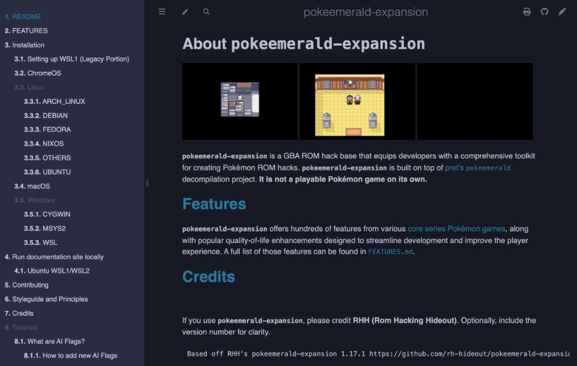
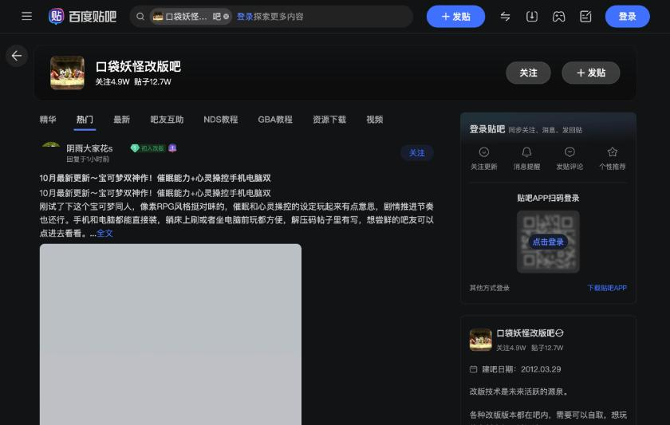

# Pokémon ROM hacks

Modified versions of Pokémon are called 口袋妖怪改版 in Chinese and have formed a large community. The tools for making them are mainly published as open source, and there are two approaches: building from source and directly editing ROM data. This article sorts out the role of each tool and the minimal steps, as far as could be confirmed from official READMEs and documentation.

## Ways of making them

The ways of making them divide broadly into three. The first is to apply a diff patch published by an author to the original ROM and play. The second is to directly rewrite ROM data with a dedicated editor such as HexManiacAdvance. The third is to build a project made by disassembling or decompiling the game's source code.

On the difference between the latter two, the pret Wiki takes a clear position. According to the page "[Why should I use this over binary hacking?](https://github.com/pret/pokeemerald/wiki/Why-should-I-use-this-over-binary-hacking)", binary hacking makes it hard to add new features, and even when you change a value, it is hard to tell what behavior it corresponds to. In decompiled projects, the biggest advantage is said to be that you can write C code directly and do not have to worry about where data is placed (offsets). Because the linker recalculates references, there is no need to worry about free space. Git manages the change history, so there is no need to keep lots of ROM copies either. In exchange, it also says that experience with C-family languages is desirable.

## Building from source

[pret](https://pret.github.io/) is a group that publishes disassembly and decompilation projects for Pokémon. [pokered](https://github.com/pret/pokered) is a disassembly of Red and Blue, and [pokecrystal](https://github.com/pret/pokecrystal) of Crystal, both written in assembly language. [pokeemerald](https://github.com/pret/pokeemerald) is a decompilation of Emerald, and [pokefirered](https://github.com/pret/pokefirered) of FireRed and LeafGreen, in C. The READMEs give the kinds of ROMs produced by building and the SHA1 of each. For example, the SHA1 of `pokeemerald.gba` made by pokeemerald is `f3ae088181bf583e55daf962a92bb46f4f1d07b7`.

[pokeemerald's INSTALL.md](https://github.com/pret/pokeemerald/blob/HEAD/INSTALL.md) explains how to set up a build environment. On Windows 10 and 11, WSL1 is the fastest and strongly recommended. As a guide to slowness, msys2 is about 2 times and Cygwin about 5–6 times slower than WSL1. WSL2 can be faster than WSL1 if the files are placed on the WSL2 side. However, tools such as Porymap that use versions of Qt before 5.15.2 may not be able to read WSL2 network drive paths. On Ubuntu, the four required packages are `build-essential`, `binutils-arm-none-eabi`, `git`, and `libpng-dev`.

### Minimal build steps

Following the steps in INSTALL.md on an Ubuntu-family environment gives the following. INSTALL.md has no step for preparing a ROM. The ROM is made from the source alone.

1. Install the packages with `sudo apt install build-essential binutils-arm-none-eabi git libpng-dev`.
2. Get the project with `git clone https://github.com/pret/pokeemerald`.
3. At the same directory level, run `git clone https://github.com/pret/agbcc`, then `cd agbcc`, `./build.sh`, and `./install.sh ../pokeemerald` in order, to put the compiler into the project.
4. Move with `cd pokeemerald` and run `make`. If it succeeds, `pokeemerald.gba` is created.

To speed it up, check the value of `nproc` and add it after `make -j`. You can check whether the result is identical to the original game with `make compare`. If identical, `pokeemerald.gba: OK` appears at the end, and if there are differences, `FAILED` appears. The compiler section says that if devkitARM is installed, you only need to run `make modern`. Whether this method lets you skip the agbcc steps could not be confirmed. For a build with debug information, `make modern DINFO=1` is suggested.

### pokeemerald-expansion

A project that serves as the basis for hacks based on Emerald is [pokeemerald-expansion](https://github.com/rh-hideout/pokeemerald-expansion). According to the README, it is a ROM hack base built on top of pret's pokeemerald. It is not itself a playable game. It has hundreds of features that have appeared in the Pokémon series, along with features that improve playability. Users are asked to credit RHH (Rom Hacking Hideout). The README's sample text is a single line starting with `Based off RHH's pokeemerald-expansion 1.17.1`. It cannot communicate with official Pokémon games. If compatibility with official games is needed, the README directs you to pret's pokeemerald. The README also adds a note not to use GitHub's "Download Zip", because it does not include the commit history, so updates and branch merges are not possible.

[INSTALL.md](https://github.com/rh-hideout/pokeemerald-expansion/blob/master/INSTALL.md) explains the build steps. After finishing the preparation for your OS, you need three commands: `git clone https://github.com/rh-hideout/pokeemerald-expansion`, `cd pokeemerald-expansion`, and `make`. If it succeeds, a list of memory usage is displayed and `pokeemerald.gba` is created. The description of environments differs somewhat from pret's. For Windows, it says WSL2 is the fastest, with WSL1 about 7 times, Msys2 about 20 times, and Cygwin about 30 times slower, and only the WSL family is recommended. Ubuntu, Debian, Arch, NixOS, Fedora, macOS, and ChromeOS each have a separate page of steps. Measurement conditions are not given, so it is best to avoid directly comparing the figures of the two projects.

You can choose from three branches. The latest patch release is the branch with officially released features and bug fixes. `master` is that branch plus later fixes. `upcoming` is the branch that also includes unreleased new features, into which fixes are merged irregularly. To switch from pokeemerald, add RHH as a git remote and `git pull` the chosen branch. If your pokeemerald is not up to date, you have to resolve merge conflicts yourself.

The feature list is in [FEATURES.md](https://github.com/rh-hideout/pokeemerald-expansion/blob/master/FEATURES.md). On the battle side, it lists mechanics such as Mega Evolution, Dynamax, and Terastal, double wild battles, the physical/special split for moves, and items, abilities, and move effects up to Generation 9. Trainer teams support the Pokémon Showdown team format, so you can paste in what you made with a builder. Adding species has also been made easier: it says that the work of touching more than 20 files in plain pokeemerald takes about 5. Many features are designed to be switched on and off in the settings files in `include/config/`.

The steps for adding a new Pokémon are on the page [How to add new Pokémon species](https://github.com/rh-hideout/pokeemerald-expansion/blob/master/docs/tutorials/how_to_new_pokemon.md), with examples. The order is to declare the species constant, define the species information, add the graphics, decide moves and evolutions, and make it appear. It says that constants should be added at the end without moving existing numbers. Because numbers go into save data, changing them changes the species in saves. There are also optional items, such as differences by form or gender. The same page also says that pressing Select on a Pokémon's summary screen opens a debug screen for checking sprites.

### A minimal modification example

To get a feel for the work, "[Change Starter Pokémon](https://github.com/pret/pokeemerald/wiki/Change-Starter-Pok%C3%A9mon)" on the pret Wiki is a small example. According to this page, you can change the first Pokémon just by rewriting the three species constants in `src/starter_choose.c` in the source. For example, replacing `SPECIES_TREECKO`, `SPECIES_TORCHIC`, and `SPECIES_MUDKIP` with `SPECIES_CHIKORITA`, `SPECIES_CYNDAQUIL`, and `SPECIES_TOTODILE` gives the Generation 2 set. Species constant names are mostly the Pokémon's name prefixed with `SPECIES_`, and the page says to check `src/data/text/species_names.h` if in doubt.

To change the level, change the 5 in `ScriptGiveMon(starterMon, 5, ...)` in `src/battle_setup.c` to 3. Save the file and rebuild with `make`, and you can check the result. This page is written for pokeemerald, and the file structure may differ in pokeemerald-expansion. Check the actual files before using it.

The Wiki has many other procedures. The [Tutorials / Mods](https://github.com/pret/pokeemerald/wiki/Tutorials) page is a list that ranks difficulty from 1 to 3 stars and organizes entries by area, such as bug fixes, screens, items, scripts, battles, and music. One star is said to need only adding and deleting specific lines or merging a feature branch. [Feature Branches](https://github.com/pret/pokeemerald/wiki/Feature-Branches) lists branches you can merge and use, such as DexNav and a day/night system. Where to ask questions when stuck is collected on the [Getting Help](https://github.com/pret/pokeemerald/wiki/Getting-Help-with-the-Decomps) page. It lists three Discord servers, RH Hideout, pret, and Team Aqua's Hideout, and their channels.

## Editing maps and data

[Porymap](https://github.com/huderlem/porymap) is a map editor for pokeruby, pokeemerald, and pokefirered. It has an [official guide](https://huderlem.github.io/porymap/), and although there are distributed builds for Windows and macOS, on Linux building from source is the basic approach.

The guide's [Introduction](https://huderlem.github.io/porymap/manual/introduction.html) positions Porymap as the equivalent of Advance Map, used in traditional binary hacking. Importantly, Porymap does not read or write ROM files. What it reads and writes are the files of a decompiled project, and it strongly recommends managing versions with Git. Before you start, it asks you to prepare a project and confirm that the ROM builds.

The first operation is to choose the project folder with `File > Open Project…`. For pokeemerald, the first map displayed is Petalburg City. In the guide's example, you draw flowers on grass with the pencil tool, save with `File > Save`, and rebuild the ROM, and can then check the change in the game. As a caution, saving in the game also puts part of that location's map into the save data. If you have saved on top of an edited map, the map needs to be reloaded in the game. Using `NODEP=1` in the build can cause data changes to be ignored, so it is not recommended.

A wide range can be edited, divided among the [guide's pages](https://huderlem.github.io/porymap/). Targets are map tiles, collision, map connections, headers, events (people, signs, warps, scripts, and so on), wild Pokémon encounters, tilesets, and region maps. The event details pane has no undo function, so there is a warning to use Git. On the wild Pokémon page, you can select table cells and directly rewrite the species, minimum level, and maximum level, and also change encounter rates. A new map is made from `File > New Map...` by deciding its name, group, size, tileset, and so on.

Porymap can be extended with JavaScript. The guide's examples include switching palettes between day and night, custom brushes, detecting tile errors, automatic map generation, and scattering grass patterns. If you build from source yourself, these features need Qt's qml module. A list of the files Porymap reads and writes is also published, and includes, for example, `map.json` under `data/maps/`, `data/layouts/layouts.json`, and `src/data/wild_encounters.json`. A note adds that files Porymap writes should preferably not be fixed by hand.

For writing scripts, [Poryscript](https://github.com/huderlem/poryscript) is also said to be an option. According to the README, it is a higher-level language that compiles to the script language of pokeemerald, pokefirered, and pokeruby. Advantages listed include control with `if`, `elif`, `else`, `while`, and `switch`, automatic text line wrapping, and organizing scripts by map. An online playground and a VS Code extension are also officially offered. In the pret Wiki's [Useful Modding Tools](https://github.com/pret/pokeemerald/wiki/Useful-Modding-Tools), Porymap is positioned as effectively essential and Poryscript as for those writing complex scripts. Tilemap Studio is introduced for editing background image tilemaps.

## Editing ROMs directly

[HexManiacAdvance](https://github.com/haven1433/HexManiacAdvance) is an editor for the Pokémon GBA games. According to the README, it targets the English versions of Ruby, Sapphire, FireRed, LeafGreen, and Emerald, and can edit Pokémon, trainer, move, and item data, maps and events, text, images, and event scripts. It can also create and apply IPS and UPS patches and export backups while you work. It requires Windows and .NET 6.0.

The README also lists features such as reordering the Pokédex, adding the Fairy type, adding new moves and tutor moves, and adding type-changing abilities. Text that no longer fits in its original location is said to be moved elsewhere automatically. The license is MIT, and there is also a user community on Discord.

How to use it is on the introductory pages of the [official Wiki](https://github.com/haven1433/HexManiacAdvance/wiki). According to "[Basic Tutorial 01: Pokemon Editing](https://github.com/haven1433/HexManiacAdvance/wiki/Basic-Tutorial-01:-Pokemon-Editing)", the steps are to open HexManiac, load a ROM of a Pokémon GBA game, and enter the Pokémon table from the "Pokemon" box or from `data.pokemon` in the "Explore More" section. It says that names are limited to 10 characters and base stats to 255, and that you need to note the order: HP, Attack, Defense, Speed, Special Attack, Special Defense. To have only one type, enter the same type twice. The author of this page also states clearly that they can neither give out Pokémon ROMs nor indicate where to obtain them.

Changing starters is covered in [Basic Tutorial 10](https://github.com/haven1433/HexManiacAdvance/wiki/Basic-Tutorial-10:-Starter-Pokemon-Editing). In "Pokémon Stats" under "Data", rewrite the name, sprite, and icon, and check in an emulator. It notes that the steps differ between FireRed and Emerald, and cautions to take extra backups for experimental parts such as changing casino prizes. The [Wiki](https://github.com/haven1433/HexManiacAdvance/wiki/What-are-HMA-Scripts%3F) also explains scripts with the extension `.hma`. Their contents vary, from simple ones readable like IPS files to ones that insert code. Official ones can be chosen from `Utilities -> Scripts` in the menu. The explanation says these include adding the Fairy type, extending battle scripts, and a table of new abilities.

The [FAQ](https://github.com/haven1433/HexManiacAdvance/wiki/Hex-Maniac-Advance-%E2%80%90-Frequently-Asked-Questions) also gives constraints. Hacks made by others cannot be edited, because their data has been moved and HexManiac may not pick it up. Generation 9 Pokémon are also not added automatically. It says the extension called HUBOL adds Generations 4 through 8, and that for Generation 9 you replace existing Pokémon yourself. The FAQ also explains the difference from Pokémon Essentials, another tool for making Pokémon games. Essentials is a tool for making games on RPG Maker. HMA is a tool for editing existing GBA ROMs, and starts with everything in place, such as the original 386 Pokémon.

## Applying patches to your own data

Diff patches come in formats such as IPS, UPS, and BPS. HexManiacAdvance can make two kinds of patches: IPS and UPS. On the player side, RetroArch supports "soft patching", which applies patches automatically. According to the [Libretro documentation](https://docs.libretro.com/guides/softpatching/), when `rom.bin` is loaded, if `rom.ups`, `rom.ips`, or `rom.bps` is in the same place, it is applied automatically at launch. Supported formats are UPS, IPS, and BPS, and XDelta depends on compile-time settings. Multiple patches are applied in order if numbers are added to the extension, as in `rom.ips`, `rom.ips1`, and `rom.ips2`. Among Game Boy Advance cores, the support table lists mGBA as a supported core. There is also a condition that automatic patching works only in implementations that can load the ROM in memory.

Apply patches only to original ROMs you have prepared yourself. A patch contains only diff information, not the original data. This research did not look into where to obtain ROMs and patches, and no links are given. On handling your own data, see [Preparing your own data and rights-free games](13-own-data-and-free-games.md).

## Chinese-speaking communities

Chinese-speaking communities gather on Baidu Tieba.

According to the page, [口袋改版资源吧](https://tieba.baidu.com/f?kw=%E5%8F%A3%E8%A2%8B%E6%94%B9%E7%89%88%E8%B5%84%E6%BA%90) has 261,000 followers and 1,645,000 posts. The tabs at the top are Featured, Popular, Latest, 吧友互助 (mutual help within the community), image and text walkthroughs, 汉化发布, 改版发布, and 改版教程. The pinned post, dated March 26, 2021, is "本吧资源导航", described as a table of contents gathering game files, walkthroughs, 秘籍, emulators, cheat codes, helper tools, modding tutorials, tools, assets, and more.

汉化 means turning a foreign-language game into Chinese. On this forum, 汉化发布 is the name of a tab, alongside 改版发布. However, no post explaining how to do Chinese localization could be confirmed this time.

[口袋妖怪改版吧](https://tieba.baidu.com/f?kw=%E5%8F%A3%E8%A2%8B%E5%A6%96%E6%80%AA%E6%94%B9%E7%89%88) has 49,000 followers and 127,000 posts, and was created in March 2012. Its tabs include NDS tutorials, GBA tutorials, resource downloads, and videos. Its slogan is 改版技术是未来活跃的源泉 (modding technology is the source of future activity).

One example of a hack on 口袋改版资源吧 is 宝可梦 水银. According to the statement in the post, it is a non-commercial ROM hack based on FireRed, and its story and content are described as a fan work based on Gold, Silver, and Crystal and HeartGold and SoulSilver. The statement also says that rights to the Pokémon series belong to Nintendo and others.

Places to ask questions for pret and RHH are on Discord. Whether there is a place to ask in Chinese could not be confirmed in this research.

## Chinese terms in this article

The words below actually appeared on the forum pages cited in this article. 汉化 and 改版 were confirmed as forum tab names. 宝可梦 is in the title of a hack.

| Chinese (Simplified) | Pinyin | Meaning | Source |
|---|---|---|---|
| 口袋妖怪 | kǒu dài yāo guài | Chinese name for Pocket Monsters | [口袋妖怪改版吧](https://tieba.baidu.com/f?kw=%E5%8F%A3%E8%A2%8B%E5%A6%96%E6%80%AA%E6%94%B9%E7%89%88) |
| 宝可梦 | bǎo kě mèng | Another Chinese name for Pokémon | [口袋改版资源吧](https://tieba.baidu.com/f?kw=%E5%8F%A3%E8%A2%8B%E6%94%B9%E7%89%88%E8%B5%84%E6%BA%90) |
| 改版 | gǎi bǎn | Modified version | [口袋改版资源吧](https://tieba.baidu.com/f?kw=%E5%8F%A3%E8%A2%8B%E6%94%B9%E7%89%88%E8%B5%84%E6%BA%90) |
| 改版发布 | gǎi bǎn fā bù | Release of modified versions | [口袋改版资源吧](https://tieba.baidu.com/f?kw=%E5%8F%A3%E8%A2%8B%E6%94%B9%E7%89%88%E8%B5%84%E6%BA%90) |
| 改版教程 | gǎi bǎn jiào chéng | Modding guide | [口袋改版资源吧](https://tieba.baidu.com/f?kw=%E5%8F%A3%E8%A2%8B%E6%94%B9%E7%89%88%E8%B5%84%E6%BA%90) |
| 汉化 | hàn huà | Chinese localization | [口袋改版资源吧](https://tieba.baidu.com/f?kw=%E5%8F%A3%E8%A2%8B%E6%94%B9%E7%89%88%E8%B5%84%E6%BA%90) |
| 汉化发布 | hàn huà fā bù | Release of Chinese localizations | [口袋改版资源吧](https://tieba.baidu.com/f?kw=%E5%8F%A3%E8%A2%8B%E6%94%B9%E7%89%88%E8%B5%84%E6%BA%90) |
| 吧友互助 | bā yǒu hù zhù | Mutual help among forum members | [口袋改版资源吧](https://tieba.baidu.com/f?kw=%E5%8F%A3%E8%A2%8B%E6%94%B9%E7%89%88%E8%B5%84%E6%BA%90) |
| 资源导航 | zī yuán dǎo háng | Table of contents of resources | [口袋改版资源吧](https://tieba.baidu.com/f?kw=%E5%8F%A3%E8%A2%8B%E6%94%B9%E7%89%88%E8%B5%84%E6%BA%90) |
| 攻略 | gōng lüè | Walkthrough | [口袋改版资源吧](https://tieba.baidu.com/f?kw=%E5%8F%A3%E8%A2%8B%E6%94%B9%E7%89%88%E8%B5%84%E6%BA%90) |
| 秘籍 | mì jí | Collection of tricks, secret manual | [口袋改版资源吧](https://tieba.baidu.com/f?kw=%E5%8F%A3%E8%A2%8B%E6%94%B9%E7%89%88%E8%B5%84%E6%BA%90) |
| 金手指 | jīn shǒu zhǐ | Cheat code | [口袋改版资源吧](https://tieba.baidu.com/f?kw=%E5%8F%A3%E8%A2%8B%E6%94%B9%E7%89%88%E8%B5%84%E6%BA%90) |
| 模拟器 | mó nǐ qì | Emulator | [口袋改版资源吧](https://tieba.baidu.com/f?kw=%E5%8F%A3%E8%A2%8B%E6%94%B9%E7%89%88%E8%B5%84%E6%BA%90) |
| 辅助工具 | fǔ zhù gōng jù | Helper tool | [口袋改版资源吧](https://tieba.baidu.com/f?kw=%E5%8F%A3%E8%A2%8B%E6%94%B9%E7%89%88%E8%B5%84%E6%BA%90) |
| 教程 | jiào chéng | Guide, tutorial | [口袋妖怪改版吧](https://tieba.baidu.com/f?kw=%E5%8F%A3%E8%A2%8B%E5%A6%96%E6%80%AA%E6%94%B9%E7%89%88) |
| 置顶 | zhì dǐng | To pin to the top | [口袋改版资源吧](https://tieba.baidu.com/f?kw=%E5%8F%A3%E8%A2%8B%E6%94%B9%E7%89%88%E8%B5%84%E6%BA%90) |

## Cautions

There also appear to be distribution sites that hand out ROMs with patches already applied. Redistributing the original ROM is problematic from a rights standpoint. The safe approach is to get only the patch (the diff file) and apply it to an original ROM you have prepared yourself. This research did not record links to places distributing ROMs and patches.

pokeemerald-expansion cannot communicate with official games. HexManiacAdvance is not suited to editing other people's hacks. Each tool has a defined target, so you need to choose the tool that fits what you want to make.
