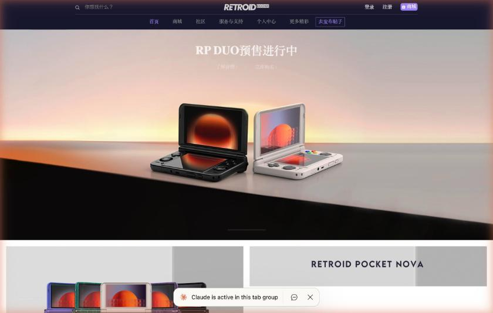
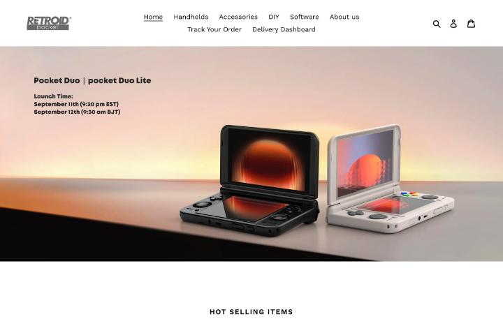
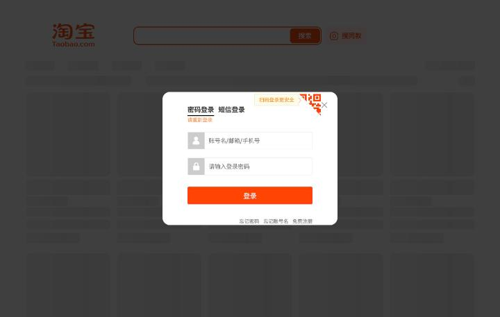
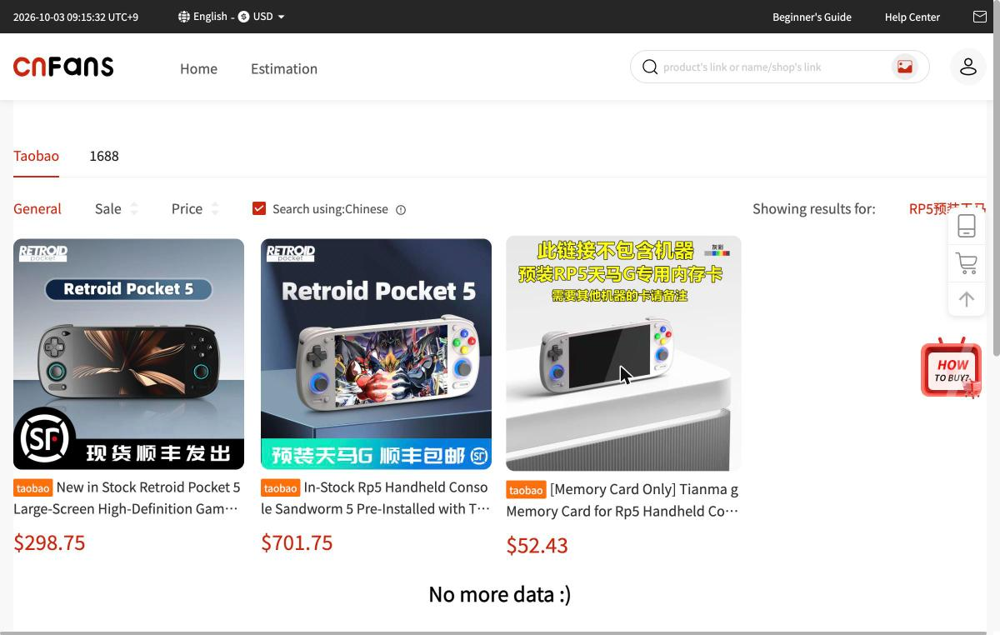
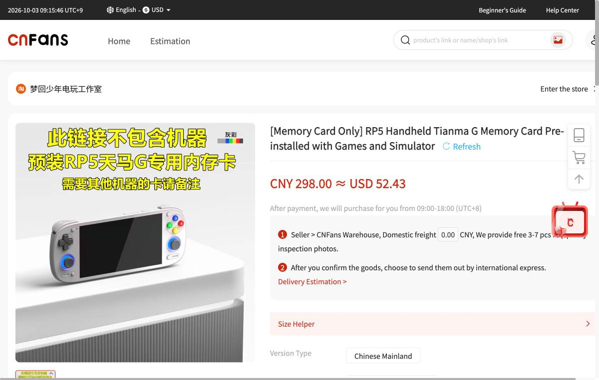

# How to buy Chinese devices

There are broadly four ways to buy a handheld game console from a Chinese manufacturer from Japan: official stores for China, official stores for overseas customers, proxy buying services, and secondhand sales between individuals. This article sorts out, site by site, what could be confirmed by actually opening the pages on October 3, 2026. Prices and shipping fees change daily, so always recheck them on screen before buying.

Things that could not be confirmed are stated as such. On sites requiring login, login was avoided, so search results and prices were not seen.

## Official sales channels for China

Retroid's [official site](https://www.retroid.cn/) for China lists 天猫旗舰店 (official store on Tmall) and 淘宝企业店 (corporate store on Taobao) as entry points for sales. The top page showed a pre-sale of the new RP DUO, as "RP DUO预售进行中" (pre-sale in progress). According to the contact page, a telephone line is in preparation, and pre-sale and after-sale inquiries go to Taobao customer service.

The top menu has Home, 商城 (shop), 社区 (community), Service and Support, and My Page. At the bottom of the page, products are divided into 掌机 and 配件 (accessories), and 使用指南 (usage guide) and 下载中心 (download center) are offered as support ([retroid.cn](https://www.retroid.cn/)). The site's copyright notice was in the name of a company in Shenzhen.

The Tmall and Taobao stores are for consumers within China. Whether they ship to Japan or offer support in Japanese could not be confirmed, because the store pages could not be viewed. To order from Japan, the overseas stores below or proxy buying are the realistic options.

## Official stores for overseas customers

Retroid has an overseas store where you can buy in English. Accessing [goretroid.com](https://www.goretroid.com/en-jp) moved to a display for Japan (en-jp), with prices shown in US dollars.

As displayed on October 3, 2026, the Retroid Pocket Duo was $269, the Duo Lite from $149, the Nova from $239, and the Pocket 6 from $244. The Pocket 5 was $179 on sale (regular price $209), and the Classic was $99 on sale (regular price $149) ([goretroid.com](https://www.goretroid.com/en-jp)). The banner at the top gave the release date of the Pocket Duo and Duo Lite as 9:30 p.m. on September 11, US Eastern Time (9:30 a.m. on September 12, Beijing time).

### Retroid's shipping and return rules

According to the [shipping policy](https://www.goretroid.com/en-jp/policies/shipping-policy), the carriers are 4PX and DHL. 4PX takes about 15 to 60 days, and the policy says that in some countries it takes 45 to 90 days. Those wanting to receive it sooner are directed to choose DHL. With DHL, a remote area surcharge of about $50 may apply. The guideline until shipment is 1 to 7 days, and nothing ships on Sundays or Chinese holidays. Packages are tracked with services such as [17track](https://www.17track.net/zh-cn), which the site introduces.

The [return policy](https://www.goretroid.com/en-jp/policies/refund-policy) states clearly that purchase prices do not include tax. It explains that tax of 20% to 24% applies in the EU, and that in the US, packages over $800 are taxed. The page says nothing about how Japan is treated. If a package is returned because tax was not paid, the fee is not refunded.

Returns must be made within 15 days of receiving the package, and the item must be unused and in its original box. Return shipping is at the buyer's expense and is deducted from the refund. Sale items are not eligible for refund, and the policy says only regular-price items can be refunded. Exchanges are allowed only for initial defects or damage. In other words, a device bought on sale may not be returnable even if you do not like it.

### Anbernic's official store

Anbernic's official site [anbernic.com](https://anbernic.com/) is an English store built with Shopify. The top page introduces the RG DS Plus, RG 35, RG 55G1, and others, and gives credit cards, debit cards, and PayPal as payment methods. The warranty is 12 months from purchase.

According to the [shipping policy](https://anbernic.com/policies/shipping-policy), the processing period is 2 to 4 business days, and there are overseas warehouses in the US, Australia, Spain, and the UK. On October 3, 2026, there was a notice that shipments from China would be delayed because of the National Day holiday from September 30 to October 5, and that items in overseas warehouses would not be affected. On November 2, 2026, that notice was gone, and the page said the pre-order RG DDS is expected to start shipping on December 10, 2026. Items in overseas warehouses can go only to limited destination countries, and if you cannot choose a shipping method at checkout, that means they cannot be sent to that country.

To cancel an order, apply through a support ticket within 12 hours of ordering. If tracking shows a package as delivered but you did not receive it, a claim is not accepted unless you make contact within 14 days of the delivery date shown. The guideline for claims on lost packages is within 30 days of the shipping date.

The [return policy](https://anbernic.com/policies/refund-policy) says that 15-day returns are accepted only in certain regions, including Japan. The eligible regions are the US, the EU, Canada, Australia, the UK, and Japan. The cost of returning for personal reasons is 25% of the order amount plus the cost of the return label. When 25% is less than $35, it is calculated as $35. For initial defects, Anbernic in principle first sends replacement parts for repair free of charge, and if that does not fix the problem, you can apply for a free return within 15 days. Glitches that a system update fixes do not count as initial defects. After 15 days, replacement parts are sent free of charge during the 12-month warranty.

Comparing these so far, Retroid's overseas store does not refund sale items, and return shipping is at the buyer's expense. Anbernic includes Japan among the countries eligible for returns, but returning something you do not like costs at least 25% of the order amount. Neither suits buying casually with the idea of trying and returning.

### AYN's official site

AYN's [official site](https://www.ayntec.com/), as opened on November 2, 2026, showed the Thor as accepting pre-orders, with shop links for the Odin3 Portal and the Odin 2. The Thor is described as having a Snapdragon 8 Gen 2, a 6-inch AMOLED, Android 13, and a 6000mAh battery. The pages for price, shipping, and return rules were not opened here, so they could not be confirmed.

### Cautions when using official overseas stores

All three official stores are in English, and none has a Japanese support desk. Payment methods, shipping fees, taxes, and warranty conditions differ by store. Before ordering, you need to read the shipping and return policy pages, and in particular check the return conditions and who pays customs duties. How Japanese customs duties and consumption tax are handled was not checked in this research, so check with customs or official information.

## The barrier of Chinese e-commerce sites

Many Chinese e-commerce sites require login at the search stage. In this research, product pages on 闲鱼 could be viewed without login, but search showed a login screen and no results. Taobao was the same: opening a search URL brought up a popup for password login and QR code login. JD.com moved to an authentication page during the search. On the secondhand site 转转 (Zhuanzhuan), the search URL tried returned a 404.

Logging in cannot be done on your behalf, so searching these sites has to be done with your own account. Also, when buying from Chinese e-commerce sites from Japan, account creation, identity verification, payment methods, and whether shipping to Japan is possible differ by site. None of these could be confirmed in this research. For those who need explanations in Japanese, the proxy buying service below is a lower hurdle.

## The proxy buying service CNFans

On November 2, 2026, cnfans.com showed only a maintenance notice saying the site was under persistent cyberattacks and undergoing maintenance and upgrades, so the descriptions below are as of October 3, 2026. Check the current state before using it.

CNFans is a proxy buying service that lets you search Taobao products without logging in. The search URL takes the form `https://cnfans.com/search?keywords=<Chinese keyword>&searchType=keywords`, and prices are shown in US dollars. You can choose currencies such as USD, EUR, and CNY, but not Japanese yen.

The shorter the search keyword, the better the matches. Short terms such as "安伯尼克 RG406V" listed products for the device, but adding terms, as in "安伯尼克 256G 游戏内存卡", mixed in unrelated products such as SD cards for dash cams. Product names are shown in machine-translated English, so the meaning can drift from the original Chinese name.

On product pages, switching color or capacity options did not change the displayed price. The exact price of each configuration is therefore not known until it is put in the cart.

According to the page's explanation, the order flow is as follows. First, search by product name or link and pay. CNFans makes the purchase on your behalf between 9:00 and 18:00 China time. The product arrives at the CNFans warehouse, and 3–7 inspection photos are taken. After checking the contents, you choose an international shipping method. Each product showed domestic Chinese shipping as 0 yuan.

The scope of inspection is limited. The after-sales description on CNFans product pages (which can be opened from the [search results](https://cnfans.com/search?keywords=RP5%E9%A2%84%E8%A3%85%E5%A4%A9%E9%A9%AC&searchType=keywords)) says that for electronics and digital products, they only check for visible problems and whether accessories are complete, and cannot power on the item to check its functions. If you are dissatisfied after it reaches the warehouse, you can apply for a return within 5 days. The return cost is a fee of about $0.75 per item, about $3 including return shipping. Custom-made items cannot be returned.

Items that cannot be sent include knives, lighters, liquids, food, seeds, and magnetic parts. Customs treatment is said to differ by country. The page states clearly that CNFans cannot judge the quality or authenticity of products. International shipping methods and fees are chosen on a screen after payment, but this research did not proceed to payment, so the shipping method screen could not be confirmed.

## Products with games included

Chinese e-commerce sites have many 预装 products with games already included. When products for the Retroid Pocket 5 "with Tianma G" were looked up on October 3, 2026, CNFans's handling differed by product ([search results](https://cnfans.com/search?keywords=RP5%E9%A2%84%E8%A3%85%E5%A4%A9%E9%A9%AC&searchType=keywords)).

Of the three listings offered as a set of the device and a card with Tianma G, two could not be purchased even when their product pages were opened, showing an English message that "proxy purchase is not possible because the product is suspected of infringing rights". The other one redirected to the top page. The result is that sets of a device with games are likely not purchasable on CNFans.

On the other hand, a listing for a Tianma G memory card alone for the RP5 could be opened. The listing description says that this product is only a memory card, and that after it arrives you install according to a tutorial. There are six options from 128GB to 2TB, and the lowest price shown was 298 yuan, or $52.43.

The listing text does not give the titles or number of included games. The Tianma G pack is about 2.8TB, too large to fit on a 128GB card ([模拟器游戏 篇四](https://zhuanlan.zhihu.com/p/703325151)). Before buying, you need to check the contents with the seller.

Here there is a caution about rights. Cards and devices loaded with large numbers of commercial games do not necessarily have the permission of the rights holders of those games. That CNFans has refused to act as a proxy for some products on grounds of "suspected rights infringement" is one fact showing this. However, the page did not give details of the reason for refusal. This article does not recommend cards with games. How to use data you have prepared yourself and how to think about rights are summarized in [Handling ROMs and BIOS](12-roms-and-bios.md) and [Preparing your own data and rights-free games](13-own-data-and-free-games.md).

## How to read prices

[掌机圈](https://zhangjiquan.com/handhelds) shows on its device pages the final price of purchase links (the actual price after coupons). The amounts shown were 1048 yuan for the RG-406V (100-yuan coupon), 1199 yuan for the RG-556 (100-yuan coupon), 418 yuan for the RG-40XXH (50-yuan coupon), and 1598 yuan for the Retroid Pocket 5. The links are not dated, so these are not necessarily current prices. On November 2, 2026, these four device pages no longer showed the 到手价 field as page text, leaving only the 起售价格 and 价格区间 fields, so these amounts could not be rechecked. Other price ranges are summarized in [Differences between the main devices](02-devices.md).

Even for the same Retroid Pocket 5, the currency and level of the price change by seller. On the official overseas store, it was $179 on sale on October 3, 2026 ([goretroid.com](https://www.goretroid.com/en-jp)). Listings on CNFans for the device described as "with Tianma G" were $281.15 and $298.75. The configurations and accessories differ, so this is not a price comparison under the same conditions.

A conversion ratio can be calculated from what CNFans displays. The memory card listing showed 298 yuan and $52.43 together, which gives about $0.1759 per yuan. At this ratio, $281.15 converts back to about 1598 yuan, and $298.75 to about 1698 yuan. These are values I calculated from the numbers on screen, not an exchange rate published by CNFans. Still, it matches the price of the purchase link for the Retroid Pocket 5 on 掌机圈 (1598 yuan), so it can be inferred that this listing's dollar price simply converts the yuan price at the same ratio. However, whether the product is the same could not be confirmed.

Exchange ratios move from day to day, so this number cannot be applied going forward. When converting to Japanese yen, use the rate of your card company or bank at the time of purchase.

## Questions to ask sellers

Here are examples of questions for Chinese-speaking sellers. 收录游戏列表能发我吗 means "Can you send me the list of included games?", PS2和PSP的游戏有多少个 means "How many PS2 and PSP games are there?", and 内存卡保修多久 means "How long is the memory card's warranty?". You cannot ask sellers directly through CNFans, so the chat on Taobao or 闲鱼 is needed.

A CNFans listing had the note 需要其他机器的卡请备注 (if you need a card for another device, write it in the remarks). Whether remarks actually reach the seller could not be confirmed, because no order was placed.

## Points to review before buying

Based on what has been checked so far, here are the points to review before buying. The first thing to check is the device's OS. Android devices from Retroid and AYN can be bought from the official stores. If you want to install a Linux-based OS, you can first check support for each device in [OS options](03-os.md).

Return conditions differ by seller: Retroid does not refund sale items, and Anbernic, even though it accepts returns from Japan, deducts at least 25% of the order amount. With CNFans, return applications must be made within 5 days of arrival at the warehouse, and there is no functional inspection. Taxes are also something to look at: Retroid states clearly that prices do not include tax, and Anbernic writes that customs duties for European destinations are borne by the buyer. How taxes are handled in Japan was outside the scope of this research.

Also, purchase links on review sites sometimes earn referral fees. [Retro Game Corps](https://retrogamecorps.com/) states clearly on its site that links to Amazon, eBay, AliExpress, and others may carry referral codes. Checking for such notices before using a link lets you see how the site earns money, which is reassuring. How to treat articles labeled as AI-generated is covered in [Communities and information sources](10-communities.md).

## Chinese terms in this article

Shopping-related Chinese words from the text are listed here, limited to those that could be confirmed on official sites and listing pages.

| Chinese (Simplified) | Pinyin | Meaning | Source |
|---|---|---|---|
| 掌机 | zhǎngjī | Handheld game console | [retroid.cn](https://www.retroid.cn/) |
| 天猫旗舰店 | tiānmāo qíjiàndiàn | Official store on Tmall | [retroid.cn](https://www.retroid.cn/) |
| 淘宝企业店 | táobǎo qǐyèdiàn | Corporate store on Taobao | [retroid.cn](https://www.retroid.cn/) |
| 商城 | shāngchéng | Shop | [retroid.cn](https://www.retroid.cn/) |
| 配件 | pèijiàn | Accessories | [retroid.cn](https://www.retroid.cn/) |
| 预售 | yùshòu | Pre-sale | [retroid.cn](https://www.retroid.cn/) |
| 即将开放 | jíjiāng kāifàng | Opening soon | [retroid.cn](https://www.retroid.cn/) |
| 预装 | yùzhuāng | Preinstalled | [CNFans](https://cnfans.com/search?keywords=RP5%E9%A2%84%E8%A3%85%E5%A4%A9%E9%A9%AC&searchType=keywords) |
| 内存卡 | nèicúnkǎ | Memory card | [CNFans](https://cnfans.com/search?keywords=RP5%E9%A2%84%E8%A3%85%E5%A4%A9%E9%A9%AC&searchType=keywords) |
| 机器 | jīqì | Machine; here, the device | [CNFans](https://cnfans.com/search?keywords=RP5%E9%A2%84%E8%A3%85%E5%A4%A9%E9%A9%AC&searchType=keywords) |
| 备注 | bèizhù | Remarks | [CNFans](https://cnfans.com/search?keywords=RP5%E9%A2%84%E8%A3%85%E5%A4%A9%E9%A9%AC&searchType=keywords) |
| 天马 | tiānmǎ | Tianma, name of a frontend | [CNFans](https://cnfans.com/search?keywords=RP5%E9%A2%84%E8%A3%85%E5%A4%A9%E9%A9%AC&searchType=keywords) |
| 到手价 | dàoshǒujià | Actual price after coupons | [掌机圈](https://zhangjiquan.com/handhelds) |
| 登录 | dēnglù | Login | [Taobao](https://s.taobao.com/search?q=Retroid+Pocket+5) |
| 使用指南 | shǐyòng zhǐnán | Usage guide | [retroid.cn](https://www.retroid.cn/) |
