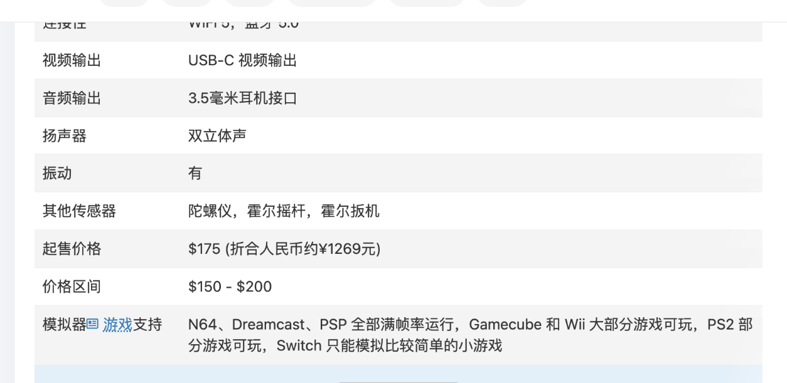

# How to study Chinese

Studying Chinese is one of the aims of this repository. The same words appear again and again in handheld listings, spec tables, and forums. Vocabulary picked up from pages you have actually seen is easier to remember along with its context. This article sorts out what can be learned from which pages and summarizes the basics of the writing system and pronunciation and how to use dictionaries and machine translation. The word list is in the [vocabulary list](../chinese/vocabulary.md), forum slang is in the [slang glossary](../chinese/slang.md), and the words used for searching are in the [search keywords](../chinese/search-keywords.md).

## The order for learning Chinese in this field

Chinese in this field gets harder in this order: spec tables, listings, forums. Spec tables have fixed field names, and each is a short noun. Listing descriptions consist of short sentences lined up, with many set phrases aimed at buyers. Forum posts mix nicknames, sarcasm, and abbreviations, so a dictionary alone is sometimes not enough to read them completely.

The approach in this repository is therefore to proceed in the following order. First, get down the bare minimum of how to read simplified characters and pinyin. Next, memorize the field names in spec tables by matching them to Japanese. After that, read listing sentences by dividing them up, and finally move on to forum posts. Look up words you don't know in a dictionary and add them to the [vocabulary list](../chinese/vocabulary.md) or the [slang glossary](../chinese/slang.md).

## Basics of simplified characters

According to Wikipedia, simplified characters are one of the two standard sets of characters for writing Chinese. The other is traditional characters. Simplified characters are used as the standard in mainland China, Malaysia, and Singapore. Traditional characters are used officially in Hong Kong, Macau, and Taiwan ([Simplified Chinese characters](https://en.wikipedia.org/wiki/Simplified_Chinese_characters)). The same page explains that simplification reduces the total stroke count of characters and simplifies the way components are written. Because radicals are simplified as a group, many characters change at once. On the other hand, many characters did not change, and those are the same in both sets.

Most of the pages opened for this repository were written in simplified characters. 散热 in discussions of heat dissipation and 内存卡 in listings are both simplified. Looking up 散热 in the MDBG dictionary shows 散熱 in the traditional field. For 内存, it shows 內存 ([散热 on MDBG](https://www.mdbg.net/chinese/dictionary?page=worddict&wdrst=1&wdqb=%E6%95%A3%E7%83%AD), [内存卡](https://www.mdbg.net/chinese/dictionary?page=worddict&wdrst=1&wdqb=%E5%86%85%E5%AD%98%E5%8D%A1)). MDBG's input field has an option for switching between simplified and traditional. Pages of shops in Taiwan and Hong Kong were not opened in this research, so differences in terminology there have not been confirmed.

Some characters are close in form to their Japanese counterparts, and some are not. A manageable way to use this is to first pick up many words whose meaning you can guess on sight, and then check the ones you guessed wrong in a dictionary. For example, with 刷新率, you can guess a meaning of renewal from 刷新, but in a spec table the word refers to refresh rate.

## Pinyin and tones

Pinyin (拼音) is the romanization of Standard Chinese. According to Wikipedia, it is used officially in China, Singapore, and the United Nations. In mainland China it is also the dominant input method for typing characters on computers ([Pinyin](https://en.wikipedia.org/wiki/Pinyin)). It is also used for ordering dictionary headwords and as a clue when looking up pronunciation.

In pinyin, a syllable is represented by the 声母 (shēngmǔ), the initial consonant, and the 韵母 (yùnmǔ), the remaining part. The same page says the usual order of the initials is b p m f d t n l g k h j q x zh ch sh r z c s. The initial is an optional part.

Tones are represented by four marks. The first tone is flat and high, marked with a macron (ā). The second tone rises, marked with an acute (á). The third tone dips low and then rises, marked with a caron (ǎ). The fourth tone falls, marked with a grave (à). The neutral tone has no mark. The same page explains that these marks are placed above vowels. The rules for when there are several vowels are as follows.

- If there is an a or e, that vowel
- For ou, above the o
- Otherwise, the second vowel

For example, in nèicún (内存), the marks are on the e of nèi and the u of cún. In sànrè (散热), both are fourth tone. If you know the rules, you can read from the position of the mark which vowel is the center.

There are other rules that are easy to overlook. ü (as in ǜ) only needs to be written differently from u after l and n. After j, q, x, and y, the ü sound is still written u. For example, 鱼 is written yú, not yǘ. In shuāxīnlǜ (刷新率), the vowel comes after l, so it is written ǜ. When typing, ü is hard to enter, so v is sometimes substituted. When a syllable boundary needs to be shown, an apostrophe is used. 西安 (Xī'ān) and 先 (xiān) are an example.

Because old typewriters could not type tone marks, there is also a method of representing them with numbers. For example, tóng is written `tong2`, and the neutral tone is written with no number, or with 0 or 5. If you know this correspondence, you can read forms without tones or with numbers when you come across them in spec tables and forums. However, forms that omit tones tend to be ambiguous as to which word they mean. Wikipedia also points out that tone marks are omitted in places such as news articles, causing ambiguity.

Tone changes (tone sandhi) are usually not reflected in pinyin spelling. This means that seeing the pinyin alone does not tell you the actual pronunciation. You need the habit of checking with dictionary audio or native speakers' pronunciation.

This field also has examples of the same character having several readings. Looking up 内存卡 on MDBG showed no entry for that form, and it was displayed split into 内存 (nèicún) and 卡 (kǎ and qiǎ). For 卡, kǎ has the meaning of card, and qiǎ is listed as meaning to get caught or wedged. The 模 in 模拟器 has two readings on 汉典, mó and mú ([模 on 汉典](https://www.zdic.net/hans/%E6%A8%A1)). Which reading applies is determined within the word, so looking it up as a word is more reliable than looking it up character by character.

## Using dictionaries and search

Use MDBG and 汉典 for different purposes. MDBG is a dictionary for looking up words, and its menu has five items: word, character, translation, practice, and help. You can enter Chinese, pinyin, or English in the input field. The results table lists traditional characters, pinyin, English meaning, simplified characters, and HSK level. For example, 卡 was shown as HSK 2 and 内存 as HSK 7-9. Below MDBG's input field there is also an explanation of a function that takes a whole Chinese passage, automatically divides it into words, and looks them up. This is convenient for checking long forum sentences word by word.

When no word matches exactly, you can use the wildcard `*` to search for words containing the term. MDBG suggested `*散热*` in a search for 散热, and gave the same suggestion when 内存卡 had no results. However, MDBG explicitly prohibits automated access, so use it only for looking things up by hand.

汉典 (zdic.net) is a dictionary for detailed lookups of individual characters. The page for 模 showed the pinyin, 注音 (such as ㄇㄛˊ), radical (木), total stroke count (14), stroke order, and the structure of the character form. It was also confirmed on screen that the bottom of the page has tabs for basic explanation, detailed explanation, national-language dictionary, Kangxi Dictionary, Shuowen Jiezi, phonology and dialects, and character origin and form. It is suited to cases where you want to research meaning from the form of a character or don't know the reading. Because ads appear, its screen is not shown in this repository.

Chinese words can be used as they are for searching sales sites. CNFans has a "Search using: Chinese" setting, for searching with Chinese keywords. Product names appear in machine-translated English, so knowing the original Chinese words makes things easier to find. The words used for searching are collected in the [search keywords](../chinese/search-keywords.md).

## Vocabulary to learn from spec tables

The device pages on 掌机圈 have fixed spec table fields, which makes them good for learning device vocabulary. The [RG-406V page](https://zhangjiquan.com/handheld/rg-406v) is laid out with fields such as 发布时间 (release date), 外观尺寸 (external dimensions), 外壳材质 (casing material), 屏幕尺寸, 屏幕分辨率 (screen resolution), 屏幕比例 (aspect ratio), 屏幕刷新率, 处理器, CPU核心和线程数, GPU, 连接性, 视频输出, 音频输出, 扬声器 (speaker), 起售价格, 价格区间, and 模拟器游戏支持. On the value side as well there are words such as 散热管,散热风扇 (heat pipe and fan), 霍尔摇杆 (Hall effect stick), 陀螺仪 (gyro), and 双立体声 (stereo speakers).

屏幕 (screen) appears repeatedly in the field names. 屏幕尺寸, 屏幕分辨率, 屏幕比例, and 屏幕刷新率 are all 屏幕 plus a word that is also understandable in Japanese. Finding such shared components lets you expand your vocabulary with less effort than memorizing words one at a time.

The purchase link field lists 到手价 (actual price after coupons and the like), 券面额 (coupon value), and 下单链接 (order link). These are words you can use as they are when reading actual listings. On November 2, 2026, the field was no longer shown as page text on the device pages checked.

## Vocabulary to learn from listings

The listing for a Tianma G card found on CNFans has short sentences that contain the important words. The image says 此链接不包含机器 (this link does not include the device), 预装RP5天马G专用内存卡 (dedicated memory card for the RP5 with Tianma G preinstalled), and 需要其他机器的卡请备注 (if you need a card for another device, write it in the notes) ([search results](https://cnfans.com/search?keywords=RP5%E9%A2%84%E8%A3%85%E5%A4%A9%E9%A9%AC&searchType=keywords)). The page description has 此商品链接只有内存卡 请知悉 (this product is the memory card only), 玩家到手后可根据教程安装 (buyers can install it according to the instructions after it arrives), and 傻瓜式操作 (a simple operation anyone can do).

Words that can be picked up from these sentences include 预装 (put in beforehand), 专用 (dedicated), 内存卡 (memory card), 教程 (instructions), 备注 (notes), and 傻瓜式 (anyone can do it). Dividing a sentence breaks it into combinations of short words such as 此链接 (this link), 不包含 (does not include), and 机器 (device). This way of dividing is the basic pattern for reading listing sentences.

## Vocabulary and slang to learn from forums

The [post on the RG40XXH heat dissipation mod](https://tieba.baidu.com/p/10191425150) is rich in device vocabulary. Words such as 发热 (heat generation), 散热 (heat dissipation), 导热垫 (thermal pad), 泡棉 (foam), 铜箔 (copper foil), 满载 (running at full power), and 串键 (false D-pad input) appear. Rather than calling the manufacturer Anbernic 周哥, the poster writes 周割 with a note of ridicule.

Brands have nicknames. As listed on 掌机圈, the alias of Anbernic's [RG-406V](https://zhangjiquan.com/handheld/rg-406v) is 周哥RG-406V, and the alias of Retroid's [Retroid Pocket 5](https://zhangjiquan.com/handheld/retroid-pocket-5) is 沙雕5,RP 5. Buyers' comments are also material for studying expressions. The [RP4 Pro page](https://zhangjiquan.com/handheld/retroid-pocket-4-pro) has the comment 起手1500我说冤大头,闲鱼700只能给一句水桶机皇. 冤大头 is a way of referring to someone who loses out. 水桶机皇 can be read as meaning the king of all-round devices with few weak points. A comment on the [Retroid Pocket Nova page](https://zhangjiquan.com/handheld/retroid-pocket-nova) calls this device 完美毕业掌机 (the perfect final device). 毕业 (graduation) is an expression meaning there is no need to buy any further replacement.

Reading forum content is less of a burden if you decide on an order. First, grasp which topic about which device it is from the forum name and the post title. Tieba forum names end in 吧, as in 开源掌机吧. Next, pick out device names and numbers in the body text. After that, look up words you don't know in the [slang glossary](../chinese/slang.md) and a dictionary. Divide long words such as 完美毕业掌机 into 完美, 毕业, and 掌机, and look them up one at a time.

The type of forum also affects which vocabulary is common. On the top page of 开源掌机吧, tabs for hardware discussion, software exchange, and questions and answers, as well as a tab called 吧友互助, could be confirmed. 口袋改版资源吧 has a 改版教程 tab, where you can learn the vocabulary of Pokémon modding. For details such as forum size, see the [communities article](10-communities.md).

## Software vocabulary

An introductory article on Tianma G contains a concentration of software vocabulary. These are words such as 前端 (frontend), 整合包 (bundled pack), 汉化 (Chinese localization), 精简 (lightweighting), 懒人包 (low-effort simple pack), 封面 (cover image), and 信息差 (information gap) ([模拟器游戏 篇四](https://zhuanlan.zhihu.com/p/703325151)). A CSDN article uses words such as 配置 (settings), 主题包 (theme pack), and 权限 (permissions) ([天马G前端的使用](https://blog.csdn.net/fanged/article/details/152960565)).

## Using machine translation

Machine translation can also be used when reading listings and posts. According to Google Translate's help, text in images can also be translated. The steps are to open Google Translate in a browser, select the Images tab at the top, specify the source and target languages, and then select the image to translate. After translating, you can display the original side by side, copy the translated text, or save the translated image ([画像を翻訳する (Translate images)](https://support.google.com/translate/answer/6142483)). In CNFans listings, important explanations are in images, so this function is useful.

However, the same help page cautions that translation accuracy depends on the clarity of the text. Small text, blurry text, and text in stylized typefaces may not be translated accurately. It also says results are better for clearly captured text in a common font. When translating listing images too, don't trust the translation as is, and check important words in a dictionary.

As for how to divide the work, a good method is to get the gist with machine translation and look up the important words in a dictionary. For example, product names in CNFans search results are displayed in machine-translated English. From that you can tell the type of product, but for words important to a purchase, such as 预装 (put in beforehand) and 此链接不包含机器 (does not include the device), it is more reliable to check the original Chinese description. MDBG's automatic sentence division gives a clue to word boundaries when verifying machine translation results. How forum slang and nicknames come out in machine translation has not been verified in this research.

## Sites and apps useful for study

Here are the sites and apps that could actually be opened and confirmed, along with their features. Descriptions of features are limited to what was written on each official page.

MDBG ([www.mdbg.net](https://www.mdbg.net/chinese/dictionary)) is a Chinese dictionary usable in a browser. As described in the section on dictionaries and search above, you can look things up in Chinese, pinyin, or English, and automatic sentence division is also available. It was confirmed that the menu has a practice item, but its contents were not opened.

汉典 ([www.zdic.net](https://www.zdic.net/)) is a detailed character-by-character dictionary. You can check the pinyin, radical, total stroke count, and stroke order.

Pleco ([www.pleco.com](https://www.pleco.com/)) is a Chinese dictionary app for iOS and Android. The official page lists its main features as follows: OCR for looking up unknown words live with the camera, handwriting input for looking things up by writing characters on the screen, dictionaries from several publishers, recordings by two native speakers for 34,000 words, flashcards that can be made from dictionary entries, a document reader in which you can look up words by tapping, and stroke order animations for about 27,000 characters. The function for looking up words shown on the screen is said to be available only on Android. If your handheld is an Android device, you could use it to look up Chinese screens in apps, but the app was not installed and tried in this research. The price and the contents of each dictionary have also not been confirmed.

The official HSK site ([中文考试服务网](https://www.chinesetest.cn/)) is a site that provides information on the HSK Chinese proficiency test. The top page lists items such as HSK3.0, mock exams, test registration, test dates, test center search, score lookup, and certificate verification. Vocabulary by test level and the contents of the test could not be confirmed by opening other pages of this site, so they are not written here. The HSK 2 and HSK 7-9 shown on MDBG can be read as a guide to which band of the test's vocabulary list a word falls into, but the definitions of the levels could not be confirmed on the official site.

For the fine details of pinyin and tones, Wikipedia's [Pinyin](https://en.wikipedia.org/wiki/Pinyin) page explains them in detail using tables and examples. Wikipedia is an encyclopedia anyone can edit, so check important points in dictionaries and official materials as well.

## Examples of how to study

Here are three efficient ways to proceed. The first is to memorize spec table field names by matching them to Japanese. The second is to read listing descriptions by dividing them into short sentences. The third is to pick out verbs and tool names from forum posts.

Spec table words are good for studying tones and simplified characters. In Chinese, the same kanji can have a meaning different from Japanese. For example, 内存 is memory, 存储 is storage, and 刷新率 is refresh rate.

When memorizing words, learn them with pinyin and tones from the start. If you memorize 散热 as sànrè with its tones, you will notice it more easily when you hear it. Copy tone marks from what the dictionary displays. The rule is that pinyin you are not confident about is not put in the vocabulary list either.

## Chinese terms in this article

The following table collects the main words appearing in the text of this article, along with their pinyin and meaning.

| Chinese (Simplified) | Pinyin | Meaning | Source |
|---|---|---|---|
| 掌机 | zhǎngjī | Handheld game console | [掌机圈](https://zhangjiquan.com/handhelds) |
| 散热 | sànrè | To release heat, dissipate heat | [MDBG](https://www.mdbg.net/chinese/dictionary?page=worddict&wdrst=1&wdqb=%E6%95%A3%E7%83%AD) |
| 内存 | nèicún | Memory (RAM) | [MDBG](https://www.mdbg.net/chinese/dictionary?page=worddict&wdrst=1&wdqb=%E5%86%85%E5%AD%98%E5%8D%A1) |
| 内存卡 | nèicúnkǎ | Memory card | [CNFans search results](https://cnfans.com/search?keywords=RP5%E9%A2%84%E8%A3%85%E5%A4%A9%E9%A9%AC&searchType=keywords) |
| 模拟器 | mónǐqì | Emulator | [RG-406V](https://zhangjiquan.com/handheld/rg-406v) |
| 刷新率 | shuāxīnlǜ | Refresh rate | [RG-406V](https://zhangjiquan.com/handheld/rg-406v) |
| 到手价 | dàoshǒujià | Actual price after coupons and the like | [RG-406V](https://zhangjiquan.com/handheld/rg-406v) |
| 预装 | yùzhuāng | Put in beforehand | [CNFans search results](https://cnfans.com/search?keywords=RP5%E9%A2%84%E8%A3%85%E5%A4%A9%E9%A9%AC&searchType=keywords) |
| 备注 | bèizhù | Notes | [CNFans search results](https://cnfans.com/search?keywords=RP5%E9%A2%84%E8%A3%85%E5%A4%A9%E9%A9%AC&searchType=keywords) |
| 汉化 | hànhuà | Chinese localization | [模拟器游戏 篇四](https://zhuanlan.zhihu.com/p/703325151) |
| 前端 | qiánduān | Frontend | [模拟器游戏 篇四](https://zhuanlan.zhihu.com/p/703325151) |
| 满载 | mǎnzài | Running at full power | [RG40XXH post](https://tieba.baidu.com/p/10191425150) |
| 毕业 | bìyè | Graduation; meaning no need for further replacement | [Retroid Pocket Nova](https://zhangjiquan.com/handheld/retroid-pocket-nova) |
| 简体字 | jiǎntǐzì | Simplified characters | [Simplified Chinese characters](https://en.wikipedia.org/wiki/Simplified_Chinese_characters) |
| 拼音 | pīnyīn | Pinyin | [Pinyin](https://en.wikipedia.org/wiki/Pinyin) |
| 声母 | shēngmǔ | Consonant at the start of a syllable | [Pinyin](https://en.wikipedia.org/wiki/Pinyin) |
| 韵母 | yùnmǔ | The rest of a syllable, excluding the 声母 | [Pinyin](https://en.wikipedia.org/wiki/Pinyin) |
| 汉典 | Hàndiǎn | Name of a Chinese dictionary site | [汉典](https://www.zdic.net/hans/%E6%A8%A1) |
