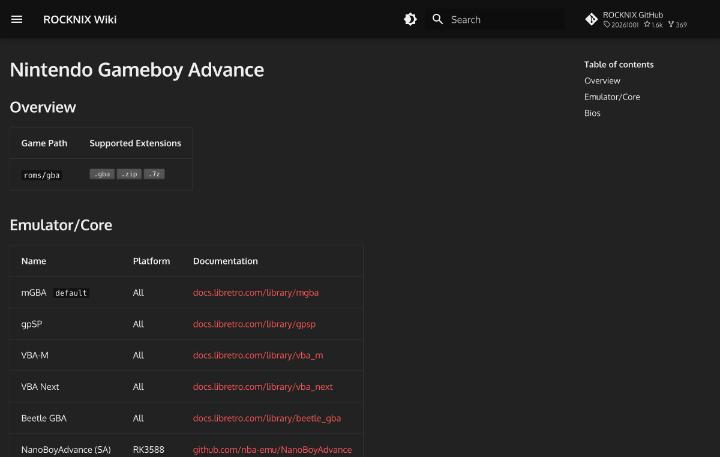

# Handling ROMs and BIOS

To play on an emulator, you need the game data (ROM) and, for some systems, the boot data of the original console (BIOS). This page sorts out, from official documents, where to place ROMs and BIOS files, how to check that the data is correct, how to organize metadata, and how to think about rights. It does not give guidance on where to obtain them, distribution links, or download steps. ROMs and BIOS files are copyrighted, and much of what is distributed lacks the rights holders' permission.

## File types and extensions

ROM formats differ by system. The ROCKNIX wiki has a page for each system with a table of the folder where games go and the supported extensions. For example, the Game Boy Advance uses `roms/gba`, with the extensions `.gba`, `.zip`, and `.7z` ([GBA page](https://rocknix.org/systems/gba/)). The PlayStation uses `roms/psx`, and 11 types are listed, including `.bin`, `.cue`, `.chd`, and `.iso` ([PSX page](https://rocknix.org/systems/psx/)). The PlayStation 2 uses `roms/ps2`, with `.chd`, `.iso`, `.mdf`, `.cso`, and `.gz` ([PS2 page](https://rocknix.org/systems/ps2/)). The Dreamcast uses `roms/dreamcast`, and `.lst`, `.bin`, `.dat`, `.zip`, and `.7z` are listed ([Dreamcast page](https://rocknix.org/systems/dreamcast/)).

The same table also lists the available emulators and cores, and for the GBA, mGBA is the default. The ROCKNIX documentation says that the required files differ by system and directs readers to the page for each system for details ([Adding games](https://rocknix.org/play/add-games/)).

The RetroArch documentation says that a general rule of thumb is not to put the data of disc-based systems into zip files ([ROMs, Playlists, and Thumbnails](https://docs.libretro.com/guides/roms-playlists-thumbnails/)). Extension support differs by emulator, so if in doubt, check the system page of the OS you use.

## What a BIOS is

According to Knulli's [explanation of BIOS](https://github.com/knulli-cfw/knulli.org/blob/main/docs/play/bioses.md), a BIOS is basic software that accesses a computer's hardware at a low level. Some game consoles also have a BIOS, and it may be needed for emulation. Like games, BIOS files are protected by copyright, so they are not included with Knulli. The same document explains that users are expected to prepare them themselves.

In the RetroArch documentation, a BIOS is a copy of the OS of the device a core reproduces. Depending on the core, the BIOS is either required or optional. In that document's examples, Beetle PSX HW and SwanStation require it, and for mGBA and PCSX ReARMed it is optional ([BIOS](https://docs.libretro.com/guides/bios/)). Some cores run without a BIOS because of a method called HLE (high-level emulation). The same document says that HLE tries to reproduce the output rather than the actual behavior of the device, and that bugs and display glitches often occur.

This document states clearly that RetroArch and libretro do not distribute copyrighted system files or game content. Users are expected to prepare BIOS files and games themselves, in accordance with the law where they live.

## Locations and names

In ROCKNIX, games go in the `roms` folder, and BIOS files go under `roms/bios`. For example, the [Retroid Pocket 5 page](https://rocknix.org/devices/retroid/retroid-pocket-5/) lists `SCPH-70012.bin` in `/roms/bios/aethersx2/bios` as the required BIOS for AetherSX2 on the PS2, and `Complex_4627v1.03.bin` and `mcpx_1.0.bin` in `/roms/bios/xemu/bios` as the required BIOS files for xemu on the Xbox. For DuckStation on the PS1, it gives `/roms/bios` as the location and links to a list of supported BIOS files. The file names are fixed. Knulli explains that emulators expect BIOS files under very specific names, sometimes in specific subfolders. Knulli is case-sensitive, so the case of the names must also match.

The ROCKNIX system pages also state BIOS locations clearly. The GBA page has a table of file names, MD5 values, and locations. The PS2 page says that at least one of the files in the table is required. The Dreamcast page leaves the list of required files to libretro's Flycast documentation ([Flycast](https://docs.libretro.com/library/flycast/)).

Knulli's locations take a different form from ROCKNIX's. Knulli places all data in `/userdata`. Inside are `bios` for BIOS files, `roms` for games, `saves` for saves, `screenshots` for screenshots, `themes` for themes, and so on. Inside `roms` are subfolders for each system, for example `snes` for the Super Famicom and `gb` for the Game Boy. Knulli only looks for games in the subfolders of `roms`. Games placed anywhere else are not recognized as games. Details of how storage works are in [Game storage](https://github.com/knulli-cfw/knulli.org/blob/main/docs/play/add-games/game-storage.md).

RetroArch is a different case. ROMs can go anywhere RetroArch can read. Dividing them into folders named after systems is a common example but is not required. BIOS files usually go in RetroArch's "system" directory. Readers are directed to check the location in the "Directory" settings and the core's documentation. Locations differ by OS, so read the documentation for your environment first.

ROCKNIX has two storage methods. With a microSD formatted as ext4, you can choose "Merged Storage", which combines internal and external storage. This method is disabled by default, and when enabled, the default destination is external. When it is disabled, and with ExFAT or FAT32, you get "Simple Storage", in which the contents of the `roms` folder on the external card appear in `/storage/roms`. If the folder does not appear, the guidance is to check that the microSD has a `roms` directory and reboot. For when conflicts occur, there is also a command, `/usr/bin/cleanup_overlay`, and running it reboots the device ([Adding games](https://rocknix.org/play/add-games/)).

## Transferring files

ROCKNIX offers several ways to transfer files. Over the network there are three: HTTP, SMB, and SFTP. Connecting by USB has two modes: one that presents the device as a network, and a file transfer mode. Also described are taking out the SD card and opening it on a PC, recovery mode, USB drives, a Linux PC, and NFS. After adding games, open the game settings from the START button and run "Update Gamelists" under tools to reflect them in the list. A network connection requires a username and password, and the password can be changed under "Security" in the settings ([Adding games](https://rocknix.org/play/add-games/)).

Knulli also offers wireless transfer by SMB, USB connection, and direct handling of the SD card ([Adding games](https://github.com/knulli-cfw/knulli.org/blob/main/docs/play/add-games/index.md)). Both OSes are the same in needing the list to be updated after a transfer.

## Checking that data is correct

Knulli has a function for checking whether BIOS files are all present. Opening "Missing BIOS check" in the game settings from the START button menu shows missing BIOS files and BIOS files whose checksums do not match. Even if a checksum does not match, the file may actually work, so the guidance is that if the location is correct, you should launch a game and try it. On Windows, showing file extensions prevents double extensions like `.bin.bin` and mistakes like `.bin.zip`. There is also a function that warns about missing BIOS files when launching a game, and it can be turned off in the settings.

This check involves four points to look at. Whether the file location is `bios/filename` or `bios/subfolder/filename`. Whether the name is exact, including spaces and underscores. Whether the case matches. And whether the file is really absent, or only the checksum differs. If only the checksum differs, a different file may be there, and the remedy is different from when the file cannot be found.

Whether the content of a ROM is correct can also be checked by checksum. The README of pret's [pokeemerald](https://github.com/pret/pokeemerald) lists the SHA1 values of the ROMs the build can produce. Each comes with a link to its record in the ROM database No-Intro. If the SHA1 of the ROM you built matches this value, you can confirm that it is the expected data.

A feature of RetroArch is that it uses checksums when creating game lists. The content scanner checks against a database of known good copies. The key for matching is a CRC checksum for small data from before the disc era, and for disc games, a serial number embedded in the data. Hashes such as SHA1 are in the database as information but are not used for matching. The default "strict" scan leaves files not in the database out of the list, and "loose" puts them in. When matching succeeds, the database name is attached, separately from the file name. Thumbnails are looked up based on that name ([Databases](https://docs.libretro.com/guides/databases/)).

This database is based on .dat files in clrmamepro format. No-Intro, Redump, GameTDB, and others are named as upstream groups. No-Intro's official site describes itself as a group that records the best copies of ROMs and digital games and provides DAT files for ROM management software and an online database. The same page states clearly that it is not involved in distribution or sharing and does not help anyone obtain the listed data ([No-Intro](https://no-intro.org/)).

How to calculate checksum values is not described in the documents read in this research. The steps for calculating them on each OS have not been confirmed.

## Game management and metadata

As ROMs increase, work is needed to tidy up the look of the list. Knulli has a function that automatically fetches cover images and descriptions from ScreenScraper, TheGamesDB, and ArcadeDB. ROCKNIX also has a scraper for the same purpose. Pegasus has information for each game written in `metadata.pegasus.txt`, and looks for covers and videos as files with fixed names in `media/<game name>/` ([Pegasus metadata](https://github.com/mmatyas/pegasus-docs/blob/master/docs/user-guide/meta-files.md)). How this works is described in [Frontends and Tianma G](05-frontend-tianma-g.md).

According to the Knulli documentation, the built-in scraper looks for information using the ROM's file name as a clue. If the name has a region marker such as `(U)` or `(EU)`, that is taken into account too. If the name is not correct, the game cannot be identified. The Knulli documentation says that ScreenScraper requires logging in with an account, and that registration is free. Some sources put a limit on the amount that can be fetched per day, so it is recommended to get the settings in order before running it. To fetch games one at a time, long-press the button that launches a game and select "Scrape" in the game menu. When a game cannot be found because of a different name, enter the game's name by hand under "Input". To fetch many games at once, use "Scraper" in the main menu to narrow things down, such as the target systems and whether to exclude recently fetched games, and then select "Scrape now". After fetching, use "Update gamelists" to reflect the results in the list ([Scraping](https://github.com/knulli-cfw/knulli.org/blob/main/docs/play/scraping.md)).

To move information fetched on another EmulationStation-based device, copy the whole system folder and replace `gamelist.xml` as well. `gamelist.xml` contains references to the fetched images, so without it the images are not displayed. The ROCKNIX documentation says scraping requires an internet connection and a ScreenScraper account. The steps are to enter the username and password in "Scraper" in the main menu and select the items to fetch with checkboxes. Preview images, titles, release dates, developers, and so on are fetched automatically ([Scraping](https://rocknix.org/configure/scraper/)). Login details are for each person to enter and are not written in this repository.

Pegasus's way of finding assets has an order of priority. The order is: what is specified for each game in the metadata file, what is specified as the default for a collection, files with fixed names in `media/<game name>/`, and third-party data sources. The official documentation introduces scrapers such as Universal XML Scraper, Steven Selph's Scraper, Skraper.net, and Skyscraper as usable for many games ([meta-assets.md](https://github.com/mmatyas/pegasus-docs/blob/master/docs/user-guide/meta-assets.md)).

RetroArch has its own system of playlists and thumbnails. Dividing ROMs into folders by system makes them easier to manage but is not required. Playlists can be created with the scanner or edited by hand. Thumbnails come in three types, in-game snapshots, title screens, and box art, and are fetched per playlist from the online updater. However, there is a warning that this bulk fetching may overwrite thumbnails users have set themselves ([ROMs, Playlists, and Thumbnails](https://docs.libretro.com/guides/roms-playlists-thumbnails/)).

## Mods and patches

In game modding, there is a method of using a difference patch instead of distributing a finished product made by rewriting the original ROM. [HexManiacAdvance](https://github.com/haven1433/HexManiacAdvance) can create and apply IPS and UPS patches. If only the patch is shared and users apply it to their own ROMs, redistribution of the original game's data itself can be avoided. Details are written in [Pokémon ROM hacks](08-pokemon-hacking.md).

RetroArch supports "soft patching", which applies patches automatically at launch. The supported formats are UPS, IPS, BPS, and xdelta. When loading `rom.bin`, if `rom.ups`, `rom.ips`, or `rom.bps` with the same name exists, the patch is applied automatically. To apply several patches, add a number to the end of the extension, as in `rom.ips`, `rom.ips1`, and `rom.ips2`, and they are applied in this order. However, automatic patching is limited to cases where the core loads the ROM from memory. There is a support table by core; for example, on the GBA, mGBA, VBA-M, VBA Next, and Meteor support it, and on the Game Boy, SameBoy does not. Genesis Plus GX supports it on the Mega Drive but not on the Master System, so it differs by system ([Softpatching ROMs](https://docs.libretro.com/guides/softpatching/)).

## Where Chinese articles touch on ROMs and BIOS

Chinese articles use frank expressions on the topic of ROMs. The author of the CSDN article on Tianma G writes that the content of ROMs is 比较敏感, and explains that because there is a distinction between legal and illegal, emulator makers and the various studios do not provide ROMs, at least on the surface. 敏感 is a word meaning that care is needed in handling something. The author goes on to write that within China there are 整合包 from 跳坑者联盟, with substantial contents. This repository does not cover how to obtain such packs ([天马G前端的使用](https://blog.csdn.net/fanged/article/details/152960565)).

The same article describes Tianma G as combining ROM management software and emulator launcher software. 配置文件 (configuration file), ROM 路径 (ROM path), and 启动脚本 (launch script) are words that appear in the sentences explaining how Tianma G's several apps share settings and paths. As a drawback of Linux-based OSes, it writes that BIOS / Core 手动配置 is needed. 手动 means by hand.

The article also explains that in addition to the ROM file, you need a main image, a secondary image, an introductory video, and metadata. It says the metadata can simply be what is in a 精简包, and that releases by 跳坑者联盟 come with it prepared from the start. The mechanism follows the same idea as the scrapers and Pegasus metadata in the section on game management and metadata above.

ROM hack forums have 资源 (resources) and 改版 (modified version) in their names, as in 口袋改版资源吧. The forum's description lists a table of contents of resources including game files, emulators, cheat codes, and tools ([口袋改版资源吧](https://tieba.baidu.com/f?kw=%E5%8F%A3%E8%A2%8B%E6%94%B9%E7%89%88%E8%B5%84%E6%BA%90)). Knowing these words makes it easier to look for game modding information in Chinese. However, obtaining ROMs themselves is outside the scope of this repository.

## How to think about rights

The official documents confirmed in this repository all say that ROMs and BIOS files are not included. Knulli does not bundle BIOS files, and pret publishes only the build steps and SHA1 values for checking. RetroArch and libretro also state clearly that they do not share system files and game content, and users are expected to prepare them themselves. No-Intro also writes that it is a group that creates list data for ROMs and does not help anyone obtain them.

According to the CSDN article, Tianma G packs contain a type of data that emulator makers and studios do not officially provide, and were organized by a community within China ([天马G前端的使用](https://blog.csdn.net/fanged/article/details/152960565)). Obtaining such packs is problematic from a rights standpoint, so this repository does not cover it.

What is lawful differs by country and region. In this research, the legal texts and official commentaries of each country, including Japan, were not opened and confirmed. This repository therefore gives no legal judgment. All that could be confirmed is that each official document asks you to prepare ROMs and BIOS files yourself.

One way to prepare them yourself is to extract the data from game cartridges and discs you have on hand. The equipment and prices needed, open source tools, how to play rights-free games, and BIOS alternatives are collected in [Preparing your own data and rights-free games](13-own-data-and-free-games.md).

## Chinese terms in this article

The following table collects the words touched on in the Chinese section of this article, along with their pinyin and meaning.

| Chinese (Simplified) | Pinyin | Meaning | Source |
|---|---|---|---|
| 敏感 | mǐngǎn | Requiring care in handling; sensitive | [天马G前端的使用](https://blog.csdn.net/fanged/article/details/152960565) |
| 合法 | héfǎ | Lawful | [天马G前端的使用](https://blog.csdn.net/fanged/article/details/152960565) |
| 非法 | fēifǎ | Illegal | [天马G前端的使用](https://blog.csdn.net/fanged/article/details/152960565) |
| 提供 | tígōng | To provide | [天马G前端的使用](https://blog.csdn.net/fanged/article/details/152960565) |
| 工作室 | gōngzuòshì | Workshop, studio | [天马G前端的使用](https://blog.csdn.net/fanged/article/details/152960565) |
| 跳坑者联盟 | Tiàokēzhě Liánméng | Name of a group within China that makes Tianma G packs | [天马G前端的使用](https://blog.csdn.net/fanged/article/details/152960565) |
| 精简包 | jīngjiǎnbāo | Lightweight pack | [天马G前端的使用](https://blog.csdn.net/fanged/article/details/152960565) |
| 配置文件 | pèizhì wénjiàn | Configuration file | [天马G前端的使用](https://blog.csdn.net/fanged/article/details/152960565) |
| 路径 | lùjìng | Path, file location | [天马G前端的使用](https://blog.csdn.net/fanged/article/details/152960565) |
| 启动脚本 | qǐdòng jiǎoběn | Launch script | [天马G前端的使用](https://blog.csdn.net/fanged/article/details/152960565) |
| 手动 | shǒudòng | By hand | [天马G前端的使用](https://blog.csdn.net/fanged/article/details/152960565) |
| 管理器 | guǎnlǐqì | Management software | [天马G前端的使用](https://blog.csdn.net/fanged/article/details/152960565) |
| 资源 | zīyuán | Resources | [口袋改版资源吧](https://tieba.baidu.com/f?kw=%E5%8F%A3%E8%A2%8B%E6%94%B9%E7%89%88%E8%B5%84%E6%BA%90) |
| 改版 | gǎibǎn | Modified version | [口袋改版资源吧](https://tieba.baidu.com/f?kw=%E5%8F%A3%E8%A2%8B%E6%94%B9%E7%89%88%E8%B5%84%E6%BA%90) |
