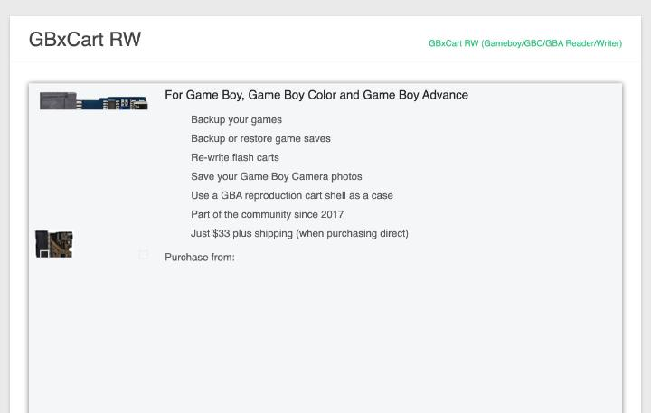
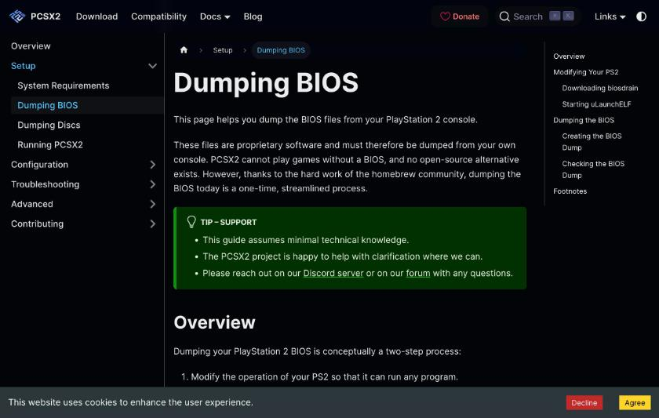
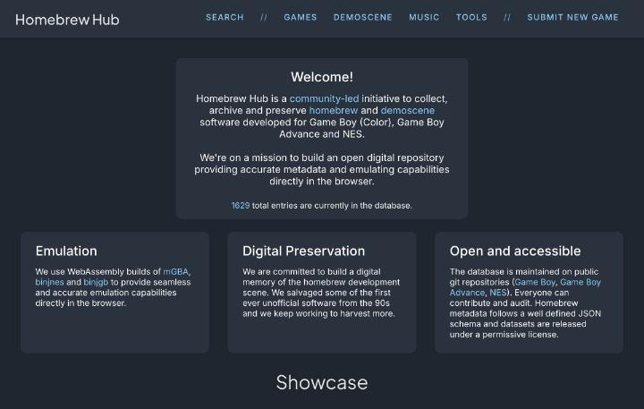
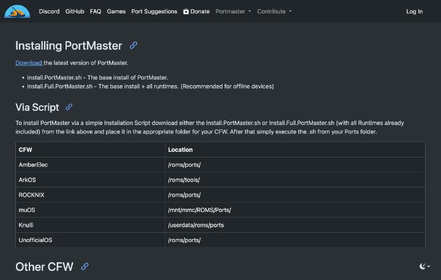
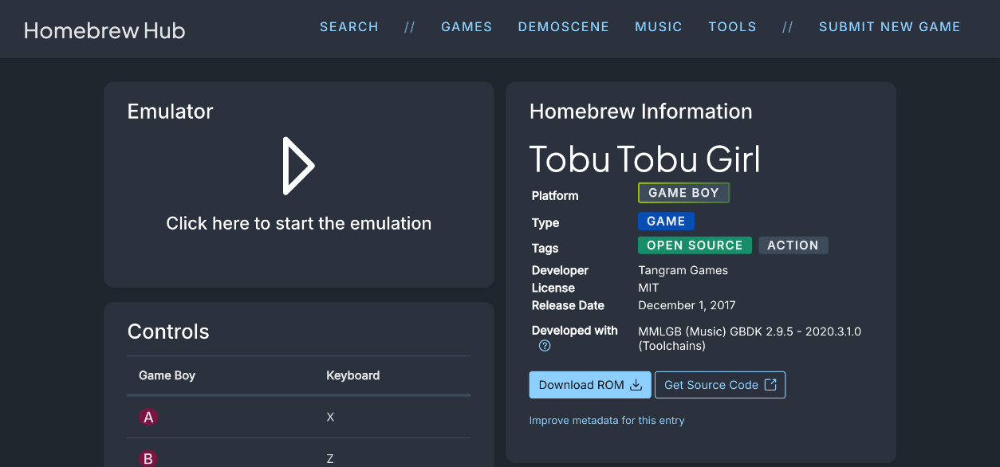

# Preparing your own data and rights-free games

Where to place ROMs and BIOS files is written in [Handling ROMs and BIOS](12-roms-and-bios.md). This article sorts out, in three parts, how to prepare data you can play without rights problems: dumping it yourself from cartridges and discs you have on hand, games such as homebrew that are freely distributed, and open source implementations that stand in for a BIOS. Everything here is limited to what was confirmed in official documents.

## Dumping it yourself

libretro's [explanation of BIOS](https://github.com/libretro/docs/blob/master/docs/guides/bios.md) says that RetroArch and libretro do not share copyrighted system files or game data. The premise is that users prepare BIOS files and games themselves, in accordance with the laws of their own countries. The [guide](https://github.com/libretro/docs/blob/master/docs/guides/import-content.md) to importing games also assumes the content has already been obtained legally.

Game Boy and Game Boy Advance cartridges can be dumped with a dedicated reader and software. [FlashGBX](https://github.com/lesserkuma/FlashGBX) is software that runs on Windows, Linux, and macOS and is for extracting ROMs and save data. It supports four readers: GBxCart RW, GBFlash, Joey Jr, and Game Bub. It also has a function for generating dump reports, which keep a record of the dump for preservation. The interface languages are English, German, and Simplified Chinese, which also helps with studying Chinese.

## Hardware needed for dumping, and prices

Dumping cartridges requires a dedicated reader. The prices that could be confirmed are as follows.

| Device | Price | Supports | Source |
|---|---|---|---|
| GBxCart RW | $33 plus shipping (when bought direct) | GB, GBC, GBA | [GBxCart RW official site](https://www.gbxcart.com/) |
| Joey Jr | $42 | GB, GBC, GBA | [BennVenn's Shop](https://bennvenn.myshopify.com/collections/game-cart-to-pc-interface/products/usb-gb-c-cart-dumper-the-joey-jr) |

The official GBxCart RW page says it can be used for backups, for backing up and restoring saves, and for writing to flash carts. On Windows, the CH340/CH341 driver is required. According to the Joey Jr page, it needs no software or drivers and can be used like an external hard disk. ROMs and saves can be extracted by dragging. A USB-C cable is not included. On a Mac, hidden files may corrupt saves, so using FlashGBX is recommended. The page emphasizes not updating the firmware with anything other than what is on that page. The same shop was selling the JoeyN64 for $55.

Another option is GBFlash. [GBFlash](https://github.com/simonkwng/GBFlash) is a device with a 32-bit ARM processor that writes to GB/GBA cards at high speed. According to the README, its top speed exceeds 550 kilobytes per second. FlashGBX officially supports it as well. A page with its price could not be confirmed in this research. Game Bub is introduced on its official site as an "open source FPGA retro emulation handheld", but no price is on the top page.

## Open source options

Around dumping there is a lot of open source software and hardware. On the software side, FlashGBX is GPL-3.0. [Open Source Cartridge Reader](https://github.com/sanni/cartreader) is a reader that is easy to build and modify and can dump ROMs and saves to an SD card without a PC. The license is GPL-3.0, and it supports the Famicom, Super Famicom, Nintendo 64, Game Boy Color, Game Boy Advance, Mega Drive, and Master System. With adapters it also supports the Virtual Boy, Game Gear, PC Engine, WonderSwan, Neo Geo Pocket, Atari systems, and others. According to the README, development has moved to the [oscartreader GitHub organization](https://github.com/oscartreader). There, the firmware, cartridge database, and hardware design files are published in separate repositories. Because the design files are available, it also suits learning by ordering and building the boards yourself. The price of an assembled unit could not be confirmed in this research.

For PS2 discs, the steps are in the [official PCSX2 documentation](https://pcsx2.net/docs/setup/discs/). On Windows, a tool called MPF can be used, with Redumper running internally. ImgBurn is also introduced, with a warning that its installer contains adware. For the PS2 BIOS as well, PCSX2 documents [how to extract the BIOS](https://pcsx2.net/docs/setup/bios/).

DuckStation requires a PS1 BIOS, and its policy is for you to extract one from a console you have on hand. Extracting the BIOS may require modifying the console itself. The specific steps for this were not confirmed in this research.

## Playing rights-free games

Homebrew refers to games made by individuals or teams and freely distributed. [Homebrew Hub](https://hh.gbdev.io/) is a database collecting homebrew, demos, music cartridges, and tools for the Game Boy, Game Boy Advance, and Famicom. According to the top page, it has 1629 entries, and it comes with an emulator that runs in the browser. The data is managed in public repositories: [gbdev/database](https://github.com/gbdev/database) for the Game Boy, [gbadev-org/games](https://github.com/gbadev-org/games) for the Game Boy Advance, and [nesdev-org/homebrew-db](https://github.com/nesdev-org/homebrew-db) for the Famicom.

The top page also has announcements of game-making events, such as GBA Jam 2026, held from June 13 to September 14, 2026. The page for each game is where the author and the handling of rights are listed. How removal requests are handled can be checked on the site's "disclaimer/DMCA" page. Getting into the habit of looking at each game's license notice before playing lets you play safely.

Linux-based OSes have PortMaster. According to the [official PortMaster site](https://portmaster.games/), this is a program that installs ports (versions of PC games ported over) for handheld Linux and manages updates and removal. The download size is 8MB, and you can filter by genre and runtime. A new version was announced on November 5, 2023. The [installation page](https://portmaster.games/installation.html) describes the steps of obtaining Install.PortMaster.sh, placing it in a fixed folder for each OS, and running it. The locations are `/roms/ports/` for ROCKNIX, `/mnt/mmc/ROMS/Ports/` for muOS, `/userdata/roms/ports` for Knulli, and `/roms/tools/` for ArkOS. The all-in-one version is described as suited to offline devices.

There are also other games whose rights are easy to check. [Freedoom](https://github.com/freedoom/freedoom) is an FPS with free content, playable on the Doom engine. It has everything from levels to art, sound effects, and music, but a separate engine is needed to run it. [ScummVM](https://github.com/scummvm/scummvm) is a system for running adventure games, on the premise that users prepare the game data files. The games its official site distributes for free are covered in the section on them below.

### How to read Homebrew Hub

The [disclaimer page](https://hh.gbdev.io/disclaimer) of Homebrew Hub gives the site's policy. It explains that the listed ROMs, playable games, homebrew, and tools are all free software, each with its own license. It also says that, as far as the operators know, no commercial copyrighted works are included. If unauthorized content is ever listed, the policy is to take it down on being contacted. Developers themselves have the right, for any reason, to remove an entry, remove a ROM, prohibit play in the browser, and edit what is displayed.

Individual game pages list license and development environment information. For example, the page for "Tobu Tobu Girl" shows the Game Boy as the supported system, game as the type, and "OPEN SOURCE" and "ACTION" as tags. The developer is Tangram Games, the license is MIT, and the release date is December 1, 2017. The development environment field gives MMLGB for music and GBDK 2.9.5-2020.3.1.0 as the toolchain. The left side of the page has an emulator playable in the browser and a table of keyboard controls. Below the information on the right side are a ROM download button and a link to the source code. For keyboard controls, the A button was the X key and the B button was the Z key.

Learning to read this page lets you check the license and distribution terms before playing. Games with published source code can also be read as real examples of the GBDK used in the [article on making your own games](14-making-games.md).

### Free games officially distributed by ScummVM

According to the README, ScummVM needs game data files to run, and there is also "Mass Add" for adding several games at once. The official ScummVM site has a [download page for free games](https://www.scummvm.org/games/). When opened on October 3, 2026, the page's heading was "Game downloads for ScummVM version 2026.3.0".

The page's description says it currently has 11 free games: Beneath a Steel Sky, Broken Sword 2.5, DreamWeb, Flight of the Amazon Queen, Lure of the Temptress, Drascula: The Vampire Strikes Back, Soltys, Sfinx, The Griffon Legend, Nippon Safes, Inc., and Mystery House. Also listed are God of Thunder, many works made with the SLUDGE engine, a collection of WAGE works, and Helga Deep In Trouble. Mystery House is labeled as the public domain edition of the Apple II version.

Note the large differences in size as well. Beneath a Steel Sky was 7.3 MiB for the floppy version and 66.2 MiB for the CD version. Flight of the Amazon Queen is 6.8 MiB for the floppy version and 107.4 MiB for the unmodified CD version. Broken Sword 2.5 was large at 859.7 MiB. Each file has an update date, along with a link for checking its SHA-256. Whether ScummVM can run on handheld OSes has not been confirmed in this research.

### The import flow with libretro

When using RetroArch, the steps for importing data are in libretro's [import guide](https://github.com/libretro/docs/blob/master/docs/guides/import-content.md). The beginning of the guide says the premise is that the content has already been obtained legally.

The first task is to select "Update Databases" from "Online Updater" in the main menu. This updates the database and core information files. Next, scan folders with "Import Content". The scan is recursive, so subfolders can stay organized as they are. The default automatic scan is "strict", which requires the content's CRC checksum or the disc's serial to match the database. A "loose" scan that also adds non-matching items can be selected. Finally, if needed, fetch thumbnails such as box art with "Playlist Thumbnails Updater". To attach thumbnails to manually scanned content, the playlist name and item names must match those on the thumbnail site.

Cores are installed from "Core Downloader" in "Online Updater". If this item is not visible, enable "Show Core Downloader" under "Menu Item Visibility" in "User Interface" in "Settings". In RetroArch installed with a package manager, this item may not appear, and the steps for that case are in the [guide to installing cores](https://github.com/libretro/docs/blob/master/docs/guides/download-cores.md). The BIOS location is normally RetroArch's "system" directory.

## Implementations that stand in for a BIOS

Some emulators can run without a BIOS. The libretro documentation explains a method called HLE. It does not reproduce the original behavior itself, only the output, and bugs tend to occur.

[mGBA](https://github.com/mgba-emu/mgba) can replace the Game Boy Advance BIOS with a built-in implementation. It can also load an external BIOS. In the libretro table, the BIOS is optional for mGBA. In the same table, it is also optional for PCSX ReARMed and required for Beetle PSX HW and SwanStation. For the Game Boy Advance there is also [Cult-of-GBA/BIOS](https://github.com/Cult-of-GBA/BIOS), a replacement BIOS under the MIT license.

For the PS1 there is OpenBIOS from [PCSX-Redux](https://github.com/grumpycoders/pcsx-redux). According to the README, it is a BIOS implementation for the MIPS R3000A that can boot PS1 games without a retail BIOS. It also says that retail BIOS files are protected by copyright, so this serves as a replacement. Building requires a MIPS toolchain.

The PS2 is a different case. The official PCSX2 documentation read in this research only gives guidance on extracting the BIOS from a console you have on hand and does not mention open source replacements.

## Chinese terms in this article

This article centers on official documents in English. The Chinese listed here is mainly words appearing in the descriptions of products selling cards with games on them, as confirmed on CNFans listing pages. The contents of the listing pages are in the [CNFans source note](../sources/cnfans.md).

| Chinese | Pinyin | Meaning | Source |
|---|---|---|---|
| 开源 | kāiyuán | Open source | [开源掌机吧](https://tieba.baidu.com/f?kw=%E5%BC%80%E6%BA%90%E6%8E%8C%E6%9C%BA) |
| 掌机 | zhǎngjī | Handheld game console | [掌机圈](https://zhangjiquan.com/handhelds) |
| 游戏 | yóuxì | Game | CNFans listing page |
| 模拟器 | mónǐqì | Emulator | [天马G前端的使用](https://blog.csdn.net/fanged/article/details/152960565) |
| 预装 | yùzhuāng | Put in beforehand | CNFans listing page |
| 内存卡 | nèicúnkǎ | Memory card | CNFans listing page |
| 专用 | zhuānyòng | Dedicated | CNFans listing page |
| 机器 | jīqì | Machine; here, the device itself | CNFans listing page |
| 玩家 | wánjiā | Player, someone who plays | CNFans listing page |
| 备注 | bèizhù | Notes; a memo when ordering | CNFans listing page |

预装 appears in titles such as 预装RP5天马G专用内存卡. It means sold with games and emulators already installed. Products of this kind may contain contents with rights problems. Reading the approach in the [article on ROMs and BIOS](12-roms-and-bios.md) first will give you peace of mind.

## What you can learn

Through the work of dumping, you can learn how cartridge memory mappers and save data work. The FlashGBX support list includes Game Boy mappers such as MBC1 and MBC5. Replacement BIOS implementations have readable source code, so they are teaching material for learning a console's boot flow. Homebrew is made at events such as GBA Jam, and it can also be an entry point for moving over to the side of making games yourself.
