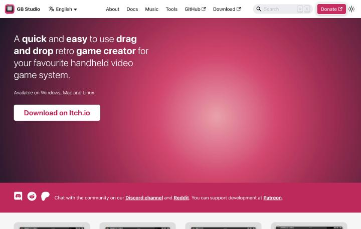
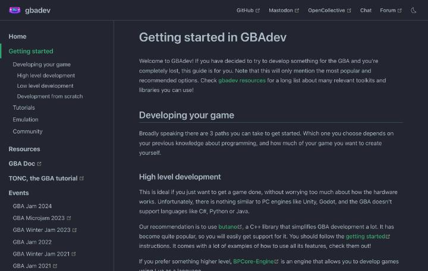
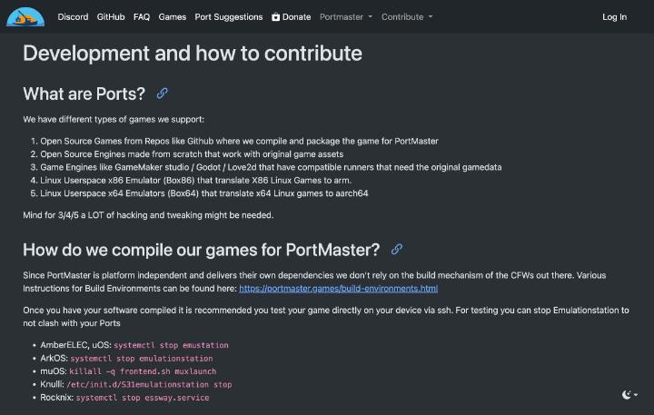
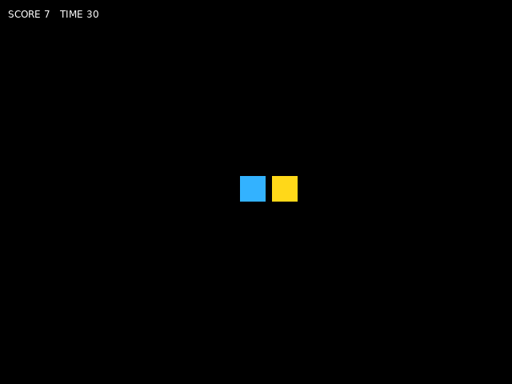
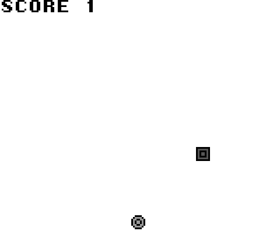
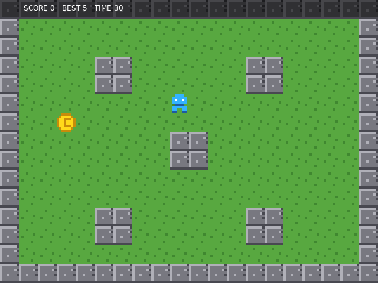
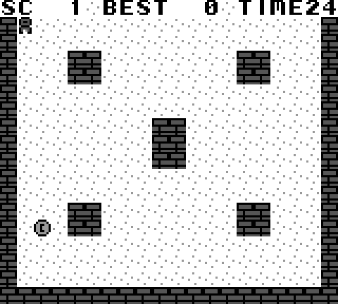

# How to make your own games and open source tools

The way to make your own games to play on a handheld differs by system. This article sorts out programming methods and open source tools in three parts: the Game Boy, the Game Boy Advance, and Linux-based handhelds. The sources are official pages. Places to distribute the games you make are in [Preparing your own data and rights-free games](13-own-data-and-free-games.md).

## Making games without writing code

You can make Game Boy games without programming experience. [GB Studio](https://www.gbstudio.dev/) is a drag-and-drop game creation tool. According to the official page, it can make top-down games, platformers, shooters, and more, and it has a built-in music editor. A finished game can be exported as a real ROM file, so it can be played on a Game Boy emulator. There is also a browser export, and publishing to itch.io is possible. The supported OSes are Windows, Mac, and Linux. The source code is on [GitHub](https://github.com/chrismaltby/gb-studio), and the license was confirmed to be MIT.



## Making Game Boy games in C or assembly

The community [gbdev.io](https://gbdev.io/) is a non-profit group working on Game Boy development. It runs the technical reference Pan Docs, the resource collection awesome-gbdev, the assembler RGBDS, the C compiler GBDK-2020, and more. Its [resource list page](https://gbdev.io/resources.html) lists tools by type.

For assemblers, [RGBDS](https://github.com/gbdev/rgbds) is positioned as the standard development tool for the Game Boy and Game Boy Color. The license is MIT. There is also RGBDS-Live, which can be tried in the browser. For learning, the assembly tutorial "GB ASM Tutorial" is suitable. It starts with Hello World, builds an Arkanoid-style game, and finishes with a shooter.

For writing in C, there is [GBDK-2020](https://github.com/gbdk-2020/gbdk-2020). It is the maintained GBDK, uses the SDCC toolchain, and provides a C compiler, assembler, linker, and libraries. GitHub's automatic detection cannot identify the type of license, so check the LICENSE in the repository. ZGB and Retr0 GB are introduced as engines built on top of GBDK.

Tools for graphics and sound are also available. These include Tilemap Studio for editing tiles, the sound driver DevSoundX, and hUGETracker for making music. For checking behavior, use emulators such as mGBA, SameBoy, Emulicious, and BGB. Emulicious is described as allowing debugging from VS Code while viewing the source.

Finished games can also be written to a flash cart for real hardware and played. GBxCart RW and FlashGBX, introduced in the [article on dumping](13-own-data-and-free-games.md), can also be used for writing.

## Making Game Boy Advance games

For the GBA, [gbadev.net](https://gbadev.net/) is the community hub. Its [getting started guide](https://gbadev.net/getting-started.html) divides the path into three.



The high-level path is for people who prioritize making a game. The guide says there are no PC engines such as Unity or Godot, and that C#, Python, and Java cannot be used either. The recommendation is the C++ library [Butano](https://github.com/GValiente/butano), whose license is Zlib. There is also BPCore-Engine, written in Lua.

The low-level path is for people who handle I/O registers directly. What the guide calls the most popular is the combination of devkitARM and libtonc, and the tutorial "Tonc" is regarded as the best teaching material currently available. Natu for Nim and agb for Rust are also introduced. For toolchains, you can also choose gba-toolchain, which uses CMake, and meson-gba, which uses Meson. DevKit Advance, whose last release was in 2003, comes with a warning not to use it because it is too old. There is also a path of building from scratch without libraries, but help is hard to get, so it is for experienced people.

For emulators, NanoBoyAdvance, mGBA, and no$gba are recommended. NanoBoyAdvance is the most accurate but has no debugging features. Its GitHub repository was archived after a last update on June 21, 2026. mGBA can connect to GDB, so you can debug as with a PC program. no$gba is inferior in accuracy but comes with an excellent debugger.

## Making games for Linux-based handhelds

On Linux-based OSes such as ROCKNIX, Knulli, and muOS, use the PortMaster system. The [PortMaster development page](https://portmaster.games/porting.html) divides supported games into five types: open source games from places such as GitHub, compiled and packaged for PortMaster; open source engines made from scratch that work with the original game assets; engines such as GameMaker, Godot, and LÖVE, with compatible runners that need the original game data; x86 Linux games translated for ARM by Box86; and x64 Linux games translated for aarch64 by Box64.



The constraints are significant. The same page says that many OSes have no full OpenGL, and neither X11 nor Weston. Rockchip-based Anbernic devices use an old 3.x-series kernel and a proprietary Mali driver, so only OpenGL ES can be used. OpenGL 2.x-level features are supplied by a translation library called GL4ES. Output goes through KMS/DRM or SDL2, and Vulkan and X11 cannot be used.

From a maker's point of view, the easiest tools to use are those with an official runtime provided. SDL 1.2 can be translated with sdl12-compat. Godot 3 runs with an export template called FRT. FRT disables joystick handling, so control mapping is handled by gptokeyb. LÖVE has aarch64 builds for each version. Godot 4, Java, LibGDX, SFML, SDL3, and Allegro are covered by a runtime called WestonPack. Minecraft (through launchers that use the JDK), Unciv, and Mindustry are given as working Java ports.

Controller input is mapped to keyboard and mouse with gptokeyb. It is called in a form like `./gptokeyb "application" -c mykeymaps.gptk`, and it also supports quitting with START and SELECT. During development, it is recommended to log in to the device over SSH to try things. When doing so, stop the frontend. On ROCKNIX you can use `systemctl stop essway.service`, and on Knulli `/etc/init.d/S31emulationstation stop`. Once finished, you shape it into a port following the [packaging guide](https://portmaster.games/packaging.html) on the same site.

When using LÖVE, KMS/DRM has no mouse cursor, so each game needs to include a cursor drawn in software, as explained on the same page.

## Making a minimal game

From here on, we actually build something. The same "collect the coins" game was made in two ways, with LÖVE (Lua) and GBDK (C). The code was built and its behavior confirmed during this research. The source is in the repository at [examples/love2d-coin](../examples/love2d-coin) and [examples/gbdk-coin](../examples/gbdk-coin).

### Do you need a ROM, and what do you make it with?

Whether a ROM is needed depends on the device you play on. On the Game Boy and Game Boy Advance, both emulators and flash carts on real hardware work by loading a ROM file. The official GB Studio page also says a finished product can be exported as a real ROM file. Homemade games for the GB always include a step that makes a ROM.

On Linux-based OSes, there is no need to make a ROM. PortMaster's [development page](https://portmaster.games/porting.html) lists LÖVE as a supported engine, and the LÖVE launch script in the [packaging guide](https://portmaster.games/packaging.html) runs a folder called `lovegame` as it is. The folder containing the Lua files is the game itself.

The languages are Lua for LÖVE and C for GBDK. For a first game, LÖVE is recommended. It runs on a PC right away, the code is short, and checking the screen is quick. GBDK suits a second game, for learning how ROMs work. How to make games for Android devices is not covered in this research.

### Making it with LÖVE (no ROM)

LÖVE is a framework for writing 2D games in Lua. The [official release page](https://github.com/love2d/love/releases/tag/11.5) lists 11.5 for macOS, Windows, a Linux AppImage, and an Android APK. On macOS, the Homebrew cask was disabled on September 1, 2026, and `brew install --cask love` failed. The reason shown is that it does not pass macOS's Gatekeeper check. In this research, the macOS zip from the release page was extracted and used.

Only two files need to be made. First, `conf.lua`, which sets the window size.

```lua
function love.conf(t)
  t.window.title = "Coin Catcher"
  t.window.width = 640
  t.window.height = 480
end
```

Next, write `main.lua`, the game itself.

```lua
local SIZE = 32
local SPEED = 240
local TIME_LIMIT = 30

local player, coin, score, timeLeft

local function placeCoin()
  coin.x = love.math.random(0, 640 - SIZE)
  coin.y = love.math.random(0, 480 - SIZE)
end

local function reset()
  player = { x = 304, y = 224 }
  coin = { x = 100, y = 100 }
  score = 0
  timeLeft = TIME_LIMIT
  placeCoin()
end

local function isDown(key, padButton)
  if love.keyboard.isDown(key) then
    return true
  end
  local pad = love.joystick.getJoysticks()[1]
  return pad ~= nil and pad:isGamepad() and pad:isGamepadDown(padButton)
end

local function overlaps(a, b)
  return a.x < b.x + SIZE and b.x < a.x + SIZE
     and a.y < b.y + SIZE and b.y < a.y + SIZE
end

function love.load()
  reset()
end

function love.update(dt)
  if timeLeft <= 0 then
    return
  end
  timeLeft = timeLeft - dt

  local dx, dy = 0, 0
  if isDown("left", "dpleft") then dx = dx - 1 end
  if isDown("right", "dpright") then dx = dx + 1 end
  if isDown("up", "dpup") then dy = dy - 1 end
  if isDown("down", "dpdown") then dy = dy + 1 end

  player.x = math.max(0, math.min(640 - SIZE, player.x + dx * SPEED * dt))
  player.y = math.max(0, math.min(480 - SIZE, player.y + dy * SPEED * dt))

  if overlaps(player, coin) then
    score = score + 1
    placeCoin()
  end
end

function love.draw()
  love.graphics.setColor(1, 0.85, 0.1)
  love.graphics.rectangle("fill", coin.x, coin.y, SIZE, SIZE)
  love.graphics.setColor(0.2, 0.7, 1)
  love.graphics.rectangle("fill", player.x, player.y, SIZE, SIZE)
  love.graphics.setColor(1, 1, 1)
  love.graphics.print(string.format("SCORE %d   TIME %d", score, math.max(0, math.ceil(timeLeft))), 10, 10)
  if timeLeft <= 0 then
    love.graphics.printf("TIME UP  Press Enter / A", 0, 220, 640, "center")
  end
end

function love.keypressed(key)
  if key == "escape" then
    love.event.quit()
  elseif key == "return" and timeLeft <= 0 then
    reset()
  end
end

function love.gamepadpressed(_, button)
  if button == "a" and timeLeft <= 0 then
    reset()
  end
end
```

LÖVE calls functions with fixed names at fixed times. `love.load` is called once at startup, `love.update(dt)` every frame, and `love.draw` for each draw. `dt` is the number of seconds elapsed since the previous frame, and making the amount of movement `SPEED * dt` means things move at the same speed regardless of the frame rate.

`isDown` is a function that handles both the keyboard's arrow keys and the gamepad's D-pad. On handhelds, the D-pad may arrive as a gamepad, so both are supported. The collision check `overlaps` tests whether two rectangles overlap only by comparing the positions of their four sides.

To run it, just pass the game's folder to LÖVE.

```sh
love examples/love2d-coin
```

When using the extracted zip on macOS, call the executable inside the app. For example, `love.app/Contents/MacOS/love examples/love2d-coin`. Move the blue square with the arrow keys, and touching the yellow square increases the score. The time limit is 30 seconds, and afterward you can restart with Enter.



Behavior was also confirmed with a test script that simulates input. Holding right for just 0.1 seconds moves 24 pixels at speed 240. Moving to the coin's position increased the score from 0 to 1. The position stops at the screen edge, and after time runs out the score does not change. Pressing Enter returned the score to 0.

When putting it on a handheld, follow the PortMaster flow. In the packaging guide, port names use only lowercase alphanumerics, periods, and underscores. The launch script has a name containing uppercase letters and ends in `.sh`. The LÖVE example loads the runtime with `source $controlfolder/runtimes/"love_11.5"/love.txt` and launches the game with `$LOVE_RUN "$GAMEDIR/lovegame"`. The runtime is 11.5, the same version as the LÖVE run in this article. However, running this launch script on an actual handheld has not been confirmed in this research. The locations are `/roms/ports/` for ROCKNIX and `/userdata/roms/ports` for Knulli. To register it as an official port, `port.json`, `README.md`, a screenshot, and `gameinfo.xml` are needed. PortMaster also asks for testing on several OSes and resolutions.

### Making it with GBDK (with a ROM)

GBDK-2020 is a set of a C compiler and libraries for the Game Boy. From the [official release page](https://github.com/gbdk-2020/gbdk-2020/releases/tag/4.5.0), version 4.5.0 of `gbdk-macos-arm64.tar.gz` for macOS (Apple Silicon) was downloaded. Extracting it gives a compiler called `bin/lcc`. For the emulator to play on, mGBA is used. On macOS it was installed with `brew install mgba`.

The game's code is the following `main.c`.

```c
#include <gb/gb.h>
#include <gbdk/console.h>
#include <stdint.h>
#include <stdio.h>

#define PLAYER 0
#define COIN 1

static const uint8_t tiles[] = {
    0xFF, 0xFF, 0x81, 0xFF, 0xBD, 0xFF, 0xA5, 0xFF,
    0xA5, 0xFF, 0xBD, 0xFF, 0x81, 0xFF, 0xFF, 0xFF,
    0x3C, 0x3C, 0x7E, 0x42, 0xFF, 0x99, 0xFF, 0xA5,
    0xFF, 0xA5, 0xFF, 0x99, 0x7E, 0x42, 0x3C, 0x3C,
};

static uint8_t px = 80, py = 80;
static uint8_t cx = 120, cy = 100;
static uint8_t seed = 1;
static uint8_t score = 0;

static uint8_t rnd(void) {
    seed = (uint8_t)(seed * 75u + 74u);
    return seed;
}

static void place_coin(void) {
    cx = 8 + (rnd() % 144);
    cy = 24 + (rnd() % 120);
}

static uint8_t near(uint8_t a, uint8_t b) {
    return (a > b ? a - b : b - a) < 8;
}

void main(void) {
    uint8_t keys;

    set_sprite_data(0, 2, tiles);
    set_sprite_tile(PLAYER, 0);
    set_sprite_tile(COIN, 1);
    SHOW_SPRITES;

    gotoxy(0, 0);
    printf("SCORE %u", (unsigned int)score);

    while (1) {
        keys = joypad();
        seed = (uint8_t)(seed + 1);

        if ((keys & J_LEFT) && px > 8) px--;
        if ((keys & J_RIGHT) && px < 160) px++;
        if ((keys & J_UP) && py > 16) py--;
        if ((keys & J_DOWN) && py < 152) py++;

        if (near(px, cx) && near(py, cy)) {
            score++;
            place_coin();
            gotoxy(0, 0);
            printf("SCORE %u", (unsigned int)score);
        }

        move_sprite(PLAYER, px, py);
        move_sprite(COIN, cx, cy);
        vsync();
    }
}
```

The Game Boy's screen is made by arranging 8×8 pictures called tiles. According to [Pan Docs](https://gbdev.io/pandocs/Tile_Data.html), one tile is 16 bytes, with each row represented by 2 bytes. The first byte holds the low bits of the color number and the next byte the high bits, so one pixel is 2 bits, which means 4 colors. For sprites, color number 0 is transparent. `tiles` in the code is two tiles written in this format, the first being the player's square and the second the coin's circle.

According to the [OAM explanation](https://gbdev.io/pandocs/OAM.html), a sprite's position is specified as the screen position plus 16 for Y and 8 for X. That is why the movement range in the code is 8 to 160 for X and 16 to 152 for Y. `move_sprite` is passed values that include this offset. `set_sprite_data` sends the tiles to VRAM, `set_sprite_tile` assigns them to sprites, and `vsync` waits for the screen update. The score is background text using `gotoxy` and `printf`.

All the build needs is one line calling `lcc`, which is put in a `Makefile`.

```make
GBDK_HOME ?= $(HOME)/gbdk

coin.gb: main.c
	GBDK_HOME=$(GBDK_HOME)/ $(GBDK_HOME)/bin/lcc -o $@ main.c

clean:
	rm -f coin.gb *.o *.lst *.map *.sym *.asm *.ihx *.noi
```

`make GBDK_HOME=$HOME/gbdk` produces a 32-kilobyte ROM called `coin.gb`. To open it in mGBA, do the following.

```sh
mgba coin.gb
```

There were two failures in the build. The first was a problem where the compiler `lcc` produced no output when run and stopped with exit code 133. The cause was that the path of the folder containing GBDK was long. Investigating with `lldb` showed `lcc` failing a string buffer check. Placing it at a short path such as `$HOME/gbdk` fixes it. The second was a problem where `gotoxy` gave an "implicit declaration" error. The declaration is in `<gbdk/console.h>` and is not included in `<gb/gb.h>`.

Behavior was confirmed by simulating button input in PyBoy, an open source emulator. Pressing the right button increases the sprite's X coordinate. Holding the up button stopped the Y coordinate at 16. Moving the player to the coin's position displayed `SCORE 1` on screen, and the coin moved to another location.



Testing was done only on an emulator on a PC. To write to a flash cart for real hardware, you need FlashGBX from the [article on dumping](13-own-data-and-free-games.md) and a supported cart. To play in a handheld's emulator, place the ROM in that OS's Game Boy ROM folder. The name of the folder needs to be checked in each OS's documentation.

### Expanding it a little (graphics, sound effects, walls, saving the high score)

The minimal game only moved squares around. From here, graphics, sound effects, a map with walls, and saving the high score are added. The additions are placed as expanded versions of the same "coin collecting" game, in `examples/love2d-coin-plus` and `examples/gbdk-coin-plus`. Neither brings in outside assets. The graphics are pixel art written as text, and the Python scripts `make_assets.py` and `make_tiles.py` convert it to images. The sound effect in the LÖVE version is also calculated as a waveform by `make_assets.py` and written out to `coin.wav`. This form can be distributed as it is without worrying about asset rights.



#### LÖVE version

The screen is assembled from 32-pixel tiles. The four tiles for wall, floor, player, and coin are lined up horizontally in one image, `tiles.png`, and only the needed part is cut out and drawn. Quad is used for cutting out. On the official wiki's [love.graphics.newQuad](https://love2d.org/wiki/love.graphics.newQuad) page, a Quad is described as a mechanism for drawing with part of a texture, suited to sprite sheets. A caution on the same page is that calling it repeatedly from `love.update` or `love.draw` is slow, so create it once and reuse it. The code too creates them only once, inside `love.load`.

```lua
function love.load()
  love.graphics.setDefaultFilter("nearest", "nearest")
  sheet = love.graphics.newImage("tiles.png")
  quads = {}
  for i, name in ipairs({ "grass", "rock", "player", "coin" }) do
    quads[name] = love.graphics.newQuad((i - 1) * TILE, 0, TILE, TILE, sheet:getDimensions())
  end
  pickup = love.audio.newSource("coin.wav", "static")
  best = loadBest()
  reset()
end
```

`setDefaultFilter("nearest", "nearest")` is a setting that stops interpolation when enlarging images, showing the pixels as they are. The official wiki's explanation of this setting was not checked in this research.

Walls are represented by a map written as rows of characters. `#` is a wall and `.` is floor. `map.lua` calculates which tile a coordinate falls on and checks whether it is a wall.

```lua
function M.isSolid(col, row)
  if col < 0 or row < 0 or col >= M.cols or row >= M.rows then
    return true
  end
  return rows[row + 1]:sub(col + 1, col + 1) == "#"
end

function M.hitsWall(x, y, w, h)
  local c1 = math.floor(x / M.TILE)
  local c2 = math.floor((x + w - 1) / M.TILE)
  local r1 = math.floor(y / M.TILE)
  local r2 = math.floor((y + h - 1) / M.TILE)
  for r = r1, r2 do
    for c = c1, c2 do
      if M.isSolid(c, r) then
        return true
      end
    end
  end
  return false
end
```

This is a simple collision check that only tests whether any of the rectangle's four corners falls in a wall tile. Movement is checked separately for horizontal and vertical. Even if you cannot move horizontally you can still move vertically, so you slide along walls.

The high score is written out as text to the save folder. The official wiki's [love.filesystem.write](https://love2d.org/wiki/love.filesystem.write) says this function writes a file to the save directory and completely replaces any existing file. The return values are whether it succeeded and a message on failure. The save location is a folder determined by `identity` in `conf.lua`. This game's `identity` is `coin-catcher-plus`, and on macOS `highscore.txt` was created in `~/Library/Application Support/LOVE/coin-catcher-plus`.

```lua
local function loadBest()
  if love.filesystem.getInfo(SAVE_FILE) then
    local text = love.filesystem.read(SAVE_FILE)
    return tonumber(text) or 0
  end
  return 0
end

local function finish()
  if score > best then
    best = score
    local ok, message = love.filesystem.write(SAVE_FILE, tostring(best))
    if not ok then
      print("save failed: " .. message)
    end
  end
end
```

Behavior was verified in the same way as before. Pressing right for 0.1 seconds moves 24 pixels, and holding left stops at 36 pixels, just before the wall. Moving to the coin's position increases the score by 1, and when the time limit ran out, a score of 5 was written to `highscore.txt`. On the next launch, the high score was displayed as 5. Sound effect playback was confirmed only as far as the file loading successfully. It was not confirmed by listening to the sound.

#### GBDK version



In the Game Boy version too, walls and floor are drawn with background tiles. The map is rows of characters, as in the LÖVE version.

```c
static const char *const rows[ROWS] = {
    "####################",
    "#..................#",
    "#..................#",
    "#...##........##...#",
    "#...##........##...#",
    "#..................#",
    "#..................#",
    "#........##........#",
    "#........##........#",
    "#........##........#",
    "#..................#",
    "#..................#",
    "#...##........##...#",
    "#...##........##...#",
    "#..................#",
    "#..................#",
    "#..................#",
    "####################",
};
```

The wall check looks directly at the map's characters.

```c
static uint8_t solid(uint8_t col, uint8_t row) {
    if (col >= COLS || row >= ROWS) {
        return 1;
    }
    return rows[row][col] == '#';
}

static uint8_t hits_wall(uint8_t x, uint8_t y) {
    return solid((x + 1) >> 3, (y + 1) >> 3)
        || solid((x + 6) >> 3, (y + 1) >> 3)
        || solid((x + 1) >> 3, (y + 6) >> 3)
        || solid((x + 6) >> 3, (y + 6) >> 3);
}
```

For graphics, four tiles were drawn in `tiles.png` and converted to C data with `png2asset`, which comes with GBDK. The command is `png2asset tiles.png -spr8x8 -tiles_only -o tiles.c`. The generated `tiles.c` contains 64 bytes of data for the four tiles. Background tiles are loaded starting at number 128. The area from 128 on is shared between background and sprites, so the player and coin can also be specified as numbers 130 and 131. This sharing is described in the tile data table in [Pan Docs](https://gbdev.io/pandocs/Tile_Data.html).

Saving the high score uses the battery-backed RAM inside the cartridge. According to [Pan Docs on MBC5](https://gbdev.io/pandocs/MBC5.html), the RAM appears in the range `A000` to `BFFF`, and writing `0A` to `0000`–`1FFF` enables reads and writes. Following these steps, the code enables the RAM, writes the values, and disables it at the end.

```c
static void load_best(void) {
    SWITCH_RAM(0);
    ENABLE_RAM;
    best = (*(uint8_t *)0xA000 == SAVE_MAGIC) ? *(uint8_t *)0xA001 : 0;
    DISABLE_RAM;
}

static void save_best(void) {
    SWITCH_RAM(0);
    ENABLE_RAM;
    *(uint8_t *)0xA000 = SAVE_MAGIC;
    *(uint8_t *)0xA001 = best;
    DISABLE_RAM;
}

static void beep(void) {
    NR52_REG = 0x80;
    NR51_REG = 0x11;
    NR50_REG = 0x77;
    NR10_REG = 0x16;
    NR11_REG = 0x40;
    NR12_REG = 0x73;
    NR13_REG = 0x00;
    NR14_REG = 0xC3;
}
```

To declare in the ROM header that the cartridge has RAM, add `-Wm-yt0x1B -Wm-ya1` when building. Looking at the resulting ROM with the `file` command showed `MBC5+RAM+BATT`, RAM 64Kbit.

The sound effect is played by writing the sound registers directly. According to [Pan Docs on Audio Registers](https://gbdev.io/pandocs/Audio_Registers.html), the top bit of `NR52` is the audio power, `NR51` is left and right assignment, and `NR50` is the overall volume. For channel 1, `NR12` sets the initial volume and decay, and `NR13` and the low 3 bits of `NR14` set the 11-bit period. Writing `NR14` with its top bit set starts the sound. The frequency is `131072 ÷ (2048 − period value)` hertz. The period in the code is `0x300`, so the starting pitch is calculated to be about 102 hertz, and it changes with the `NR10` sweep. This sound has not been confirmed by ear, either on real hardware or as emulator audio.

Behavior was confirmed with PyBoy. The game starts with START, and pressing the right button for 10 frames advances the X coordinate by 20. Holding left and up stopped at 8, just before the wall. Overlapping the coin's position made the score 1, and the coin moved to another location. When time ran out the high score was updated, and closing the emulator generated an 8192-byte save file. Launching again restored the high score. After time runs out, restarting with START happens at the moment the button is released. This is because `waitpadup` in the code waits until release.

#### What you can make next

Adding the following elements to these two sets of code brings them closer to something playable. In LÖVE, directions include moving enemies, switching between several stages, and drawing backgrounds with `love.graphics.newImage`. In GBDK, directions include making large characters with metasprites and adding a BGM driver. The [gbdev.io resource collection](https://gbdev.io/resources.html) lists tutorials for GBDK and music tools.

## Chinese terms in this article

The topics of this article center on official documents in English. Only basic Chinese words whose sources could be confirmed in this research are listed. Use them as a foothold when looking for information on making your own games in Chinese.

| Chinese | Pinyin | Meaning | Source |
|---|---|---|---|
| 开源 | kāiyuán | Open source | [开源掌机吧](https://tieba.baidu.com/f?kw=%E5%BC%80%E6%BA%90%E6%8E%8C%E6%9C%BA) |
| 掌机 | zhǎngjī | Handheld game console | [掌机圈](https://zhangjiquan.com/handhelds) |
| 游戏 | yóuxì | Game | CNFans listing page |
| 模拟器 | mónǐqì | Emulator | [天马G前端的使用](https://blog.csdn.net/fanged/article/details/152960565) |
| 屏幕分辨率 | píngmù fēnbiànlǜ | Screen resolution | [RG-406V](https://zhangjiquan.com/handheld/rg-406v) |
| 操作系统 | cāozuò xìtǒng | OS | [RG-556](https://zhangjiquan.com/handheld/rg-556) |

To look up LÖVE and GBDK terms in Chinese materials, first try adding 开源 and 掌机 to the combinations in the [search keywords](../chinese/search-keywords.md), and searching should turn up articles on Tieba and Zhihu. The results of this search were not checked in this research.

## What you can learn

The Game Boy is teaching material for learning how CPUs and memory work with a small number of instructions. Pan Docs and the GB ASM Tutorial are both available, and you can check behavior in an emulator's debugger. On the GBA, you can use devkitARM and libtonc to practice handling I/O registers directly. Linux-based handhelds are a place to gain experience in logging in over SSH to build and adapting to the constraints of graphics APIs. Porting work is also an entry point to learning the differences between OpenGL ES and KMS/DRM.
