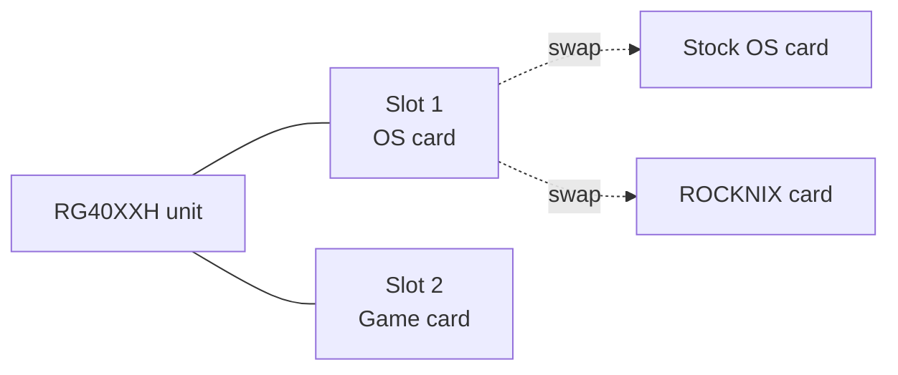
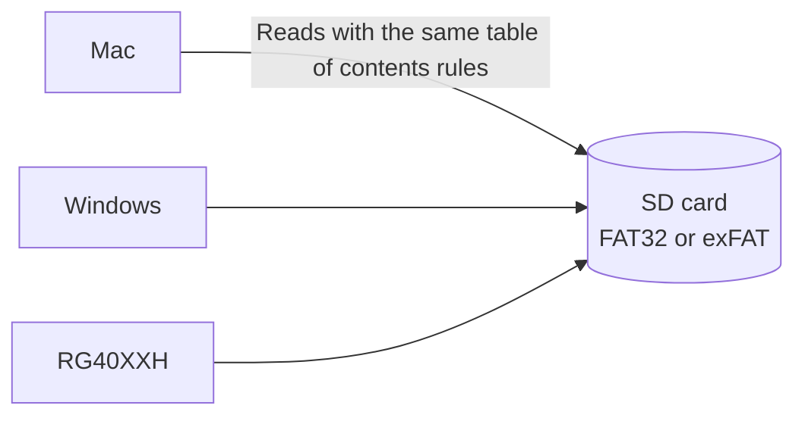

# The Big Picture of the RG40XXH

The six articles from this one through number 20 are a series that traces the process of playing games on the RG40XXH, in order, starting from what you can see. The series assumes readers who have not studied computer science, and terms are explained where they appear. This article looks at the whole machine divided into three layers, and covers game files and the contents of the SD card.

| No. | Article | Layer covered |
|---|---|---|
| 15 | The big picture of the RG40XXH (this article) | The whole, files, SD card |
| 16 | [Emulators and menus](16-emulator-and-menu.md) | Apps |
| 17 | [How saves work](17-save-data.md) | Apps and files |
| 18 | [How the OS works](18-os.md) | OS |
| 19 | [After you turn on the power](19-boot.md) | The boundary between the OS and the hardware |
| 20 | [CPUs and machine code](20-cpu.md) | Hardware |

The explanations of how things work were checked by reading the ROCKNIX source code. The reference is commit `ae41127` of [ROCKNIX/distribution](https://github.com/ROCKNIX/distribution). Nothing has yet been checked on real hardware. Points that should be checked on real hardware are noted in the text as they come up.

## How it differs from older consoles

The GBA, DS, and PSP were dedicated machines built to run software for that system. When you insert a cartridge or UMD, dedicated parts inside the unit read the software and run it.

The RG40XXH is built differently. Inside are general-purpose parts close to those of a smartphone. It contains neither GBA parts nor DS parts. Instead, it runs software that pretends to be a GBA or DS, and plays old games that way. You can think of it as a small computer that can pretend to be old consoles.

The main specs of the parts, using the figures from 掌机圈 collected in [Differences between the main devices](02-devices.md), are as follows.

| Item | RG40XXH |
|---|---|
| Screen | 4.0-inch, 4:3 aspect ratio |
| SoC (a chip combining the CPU and other parts) | Allwinner H700 |
| Memory | 1GB LPDDR4 |
| Storage | SD card (2 slots) |
| Wireless | Wi-Fi 5, Bluetooth 4.2 |
| Weight | 208g |

## Looking at three layers

A computer is easier to understand when thought of as divided into three layers. Set beside a smartphone, it looks like this.

| Layer | Smartphone | RG40XXH |
|---|---|---|
| Apps | LINE, camera, games | Game list menu, emulators, game files |
| OS | iOS, Android | Linux (the stock one, or ROCKNIX or similar) |
| Hardware | CPU, memory, screen | H700, 1GB of memory, 4-inch screen, buttons, Wi-Fi |

The lower the layer, the closer it is to the machine.

- The hardware is the collection of parts you can touch.
- The OS is the basic software that runs the parts together. It manages what to show on the screen, how to use the battery, and what to write where on the SD card.
- Apps are the software you use to play. On the RG40XXH, the center of this is the menu that shows the game list and the emulators that pretend to be old consoles.

The upper layers run supported by the lower layers. The menu has the OS show things on the screen, and the OS sends commands to the hardware parts. The series is structured to descend from the top in this order.

## The OS is on the SD card

On a smartphone, the OS is in a storage part inside the unit. The RG40XXH has no built-in storage. Both the OS and the games are on SD cards.

Because of this, just swapping the card swaps the OS. If you take out the stock card and insert a card with ROCKNIX written to it, the unit boots as a ROCKNIX machine, and if you go back to the stock card it returns to the original machine.



Replacing the OS, or the OS used as the replacement, is called CFW (custom firmware). The [steps for installing CFW](04-install-cfw.md) are the steps for writing a different OS to an SD card. Even if this fails, the hardware parts are not damaged. You can start over by rewriting the card. This property is a big advantage as teaching material for learning about OSes.

As for using the two cards, one possible arrangement is the first for the OS and the second for games. ROCKNIX recognizes a second SD card at boot whether it is ext4, FAT32, or exFAT ([steps for installing CFW](04-install-cfw.md)). When changing games, you don't have to touch the OS card.

## Game files are rows of numbers

Game software is a file, just like photos and music. A file is, in essence, numbers from 0 to 255 lined up in a row, and each such number is called a byte.

| File | What the numbers represent | What reads it |
|---|---|---|
| Photo (`.jpg`) | The colors of dots | A photo app |
| Music (`.mp3`) | The shape of sound waves | A music app |
| Game (`.gba`) | Commands to the console, and data such as graphics and text | A GBA, or an emulator pretending to be a GBA |

Even when the file types differ, the contents are all rows of numbers. The only difference is who reads the numbers and how. The `.gba` or `.jpg` at the end of a file name is called an extension, and it is a marker for what to read the row of numbers as.

Game files are made from blueprints written by people. In this repository's [gbdk-coin](../examples/gbdk-coin), a text called `main.c` is that blueprint. `main.c` is written in the human-readable C language, and passing it through a conversion tool (compiler) makes it `coin.gb`, a row of numbers the Game Boy can read. What goes on in the conversion is covered in [CPUs and machine code](20-cpu.md).

## Folders on the SD card

The contents of the SD card are organized by folders and files. To compare it to a bookshelf, the SD card is the bookshelf, folders are the dividers, and files are the books.

In ROCKNIX, games are divided into folders for each system. GBA games go in `/storage/roms/gba`, and Game Boy games in `/storage/roms/gb` ([gba.conf](https://github.com/ROCKNIX/distribution/blob/ae41127cee7e3e81b1ab3b17b676d91be5165e61/config/emulators/gba.conf), [gb.conf](https://github.com/ROCKNIX/distribution/blob/ae41127cee7e3e81b1ab3b17b676d91be5165e61/config/emulators/gb.conf)).

```
/storage/roms/
├── gb/
│   └── coin.gb
├── gba/
│   └── (GBA games)
└── ports/
    └── (launch scripts for PortMaster games)
```

The reason for placing them in fixed folders is that the menu showing the game list determines the type of console from the location of the folder. Games placed in the wrong folder don't appear in the list or can't be opened correctly. How this works is explained in [Emulators and menus](16-emulator-and-menu.md).

The leading `/storage` is the name of a location as seen from inside the OS. It refers to the rewritable area of the SD card. Why there are a "rewritable area" and an area that isn't is covered in [How the OS works](18-os.md). The folder names on the stock OS are to be checked on real hardware.

## Why the same card can be read by both a Mac and the RG40XXH

The SD card contains a table of contents recording where on the card each file is. The rules for how this table of contents is written are called a file system. FAT32 and exFAT are typical examples, and they are ways of writing that Mac, Windows, and Linux all know.



It is the same reason a digital camera's SD card can be read on a PC. However, there are various file systems, and not every OS can read every one. For example, ext4, which ROCKNIX uses for its OS area, cannot be read on a Mac by default. The [steps for installing CFW](04-install-cfw.md) state the same limit for Windows.

## The flow up to playing

Connecting the flow from turning on the power to playing a game with the layers gives the following. The following articles dig into each stage one at a time.

| Stage | What is happening | Detailed article |
|---|---|---|
| Turn on the power | The OS is loaded in order, starting from a small program | [After you turn on the power](19-boot.md) |
| The menu appears | The OS launches the menu app | [How the OS works](18-os.md) |
| Choose a game | The menu checks folders, makes a list, and hands off to the responsible emulator | [Emulators and menus](16-emulator-and-menu.md) |
| Play | The emulator pretends to be the console and executes commands | [CPUs and machine code](20-cpu.md) |
| Save | The emulator writes the save contents to a file | [How saves work](17-save-data.md) |

## Chinese terms in this article

The Chinese words were selected from those whose sources were confirmed in other articles in this repository, choosing ones related to this article's topics.

| Chinese | Pinyin | Meaning | Source |
|---|---|---|---|
| 掌机 | zhǎngjī | Handheld game console | [掌机圈](https://zhangjiquan.com/handhelds) |
| 处理器 | chǔlǐqì | Processor (SoC) | [RG-406V](https://zhangjiquan.com/handheld/rg-406v) |
| 内存 | nèicún | Memory | [掌机圈 RG-35XX H](https://zhangjiquan.com/handheld/rg-35xx-h) |
| 存储 | cúnchǔ | Storage | [掌机圈 RG-35XX H](https://zhangjiquan.com/handheld/rg-35xx-h) |
| 操作系统 | cāozuò xìtǒng | OS | [RG-556](https://zhangjiquan.com/handheld/rg-556) |
| TF卡 | TF kǎ | microSD card | [Baidu search results](https://www.baidu.com/s?wd=RG40XXH%20%E5%88%B7%E6%9C%BA%20%E5%9B%BA%E4%BB%B6%20Knulli%20%E6%95%99%E7%A8%8B) |
| 根目录 | gēnmùlù | Root folder | [模拟器游戏 篇四](https://zhuanlan.zhihu.com/p/703325151) |

## What you can learn

Dividing the RG40XXH into the three layers of hardware, OS, and apps shows the role of each part and piece of software. Because the OS is on the SD card, you can swap cards to try different OSes and compare how the same hardware changes. That files are rows of numbers, that folder locations and extensions have meaning, and that file systems are shared rules between machines are the premises of all the articles to come. The next article, [Emulators and menus](16-emulator-and-menu.md), digs into the app layer.
