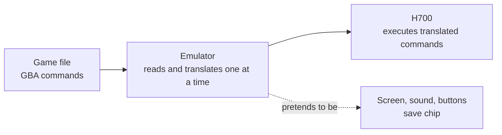
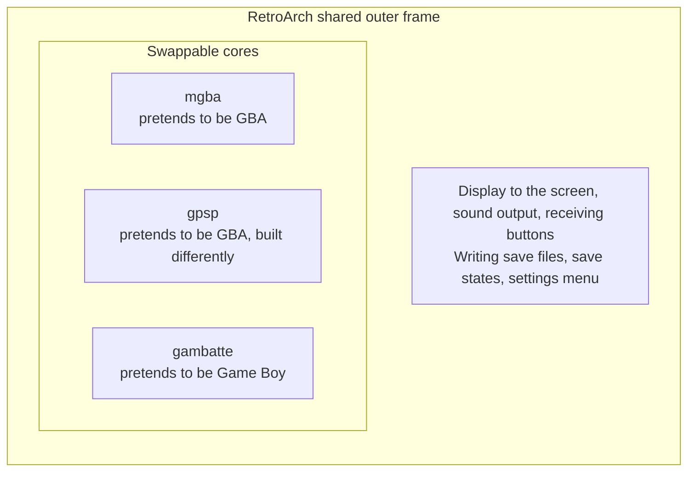
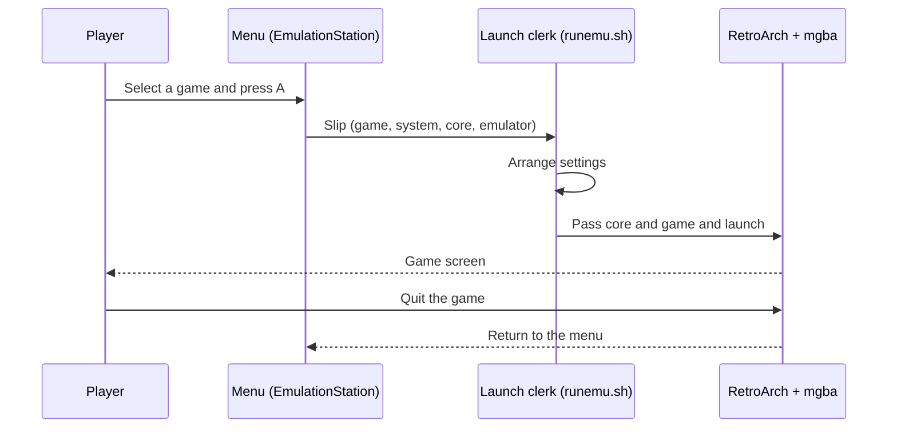

# Emulators and Menus

This continues [The big picture of the RG40XXH](15-rg40xxh-big-picture.md). This article covers the top of the three layers, the app layer. It explains, checking against the ROCKNIX source code (commit `ae41127`), how the menu that shows the game list finds games and which emulator it hands them to.

## An emulator is an interpreter

The RG40XXH contains no GBA parts. What runs GBA games is software called an emulator.

The commands in a game file are written in the language of that console's CPU. The GBA's CPU is the ARM7TDMI, and [pokeemerald-expansion](https://github.com/rh-hideout/pokeemerald-expansion/blob/dfb0f84374230f4d462191601179b742f9f077df/Makefile) is also set to build for this CPU. The RG40XXH's H700 is a Cortex-A53 ([H700 options](https://github.com/ROCKNIX/distribution/blob/ae41127cee7e3e81b1ab3b17b676d91be5165e61/projects/ROCKNIX/devices/H700/options)). Both are in the ARM family, but their generations differ. Under ROCKNIX the H700 runs in 64-bit mode (AArch64), whose command language differs from the GBA's. A game's commands also assume the GBA's screen, sound, and button parts at fixed memory positions, and the RG40XXH does not have those parts. So the game file cannot simply be run as it is.

The emulator acts as a simultaneous interpreter between them.



The emulator translates more than CPU commands. It takes on pretending to be all the GBA's parts, from how the GBA draws its screen, produces sound, and reads buttons, to writing to the save chip. The game runs believing it is inside a real GBA.

## The effort of translating, and how heavy each system is

Interpreting takes effort. Work a real GBA finishes in one step, an emulator imitates with many operations. A CPU much faster than the original console is therefore needed.

In general, the newer and more complex the console being imitated, the heavier the emulator. The GBA and Game Boy are light, and the PSP, which draws 3D graphics, is on the heavy side. Rough expectations for the RG40XXH are collected in [What runs](06-emulation.md) and [Differences between the main devices](02-devices.md). According to the materials cited there, FC, SFC, GBA, GB, and PS1 run without problems, and PSP and N64 are only partly playable.

## The game list menu

The game list that appears when you turn on the power is an app called EmulationStation. ROCKNIX uses [emulationstation-next](https://github.com/ROCKNIX/emulationstation-next), which it has modified itself ([emulationstation package.mk](https://github.com/ROCKNIX/distribution/blob/ae41127cee7e3e81b1ab3b17b676d91be5165e61/projects/ROCKNIX/packages/ui/emulationstation/package.mk)).

The menu's job is close to that of a library receptionist. It has three tasks.

1. Check the designated folders and look for game files
2. Show the games it finds in lists by system
3. Hand the selected game to the responsible emulator

The receptionist has one roster for the job.

## The receptionist's roster

The roster is named `es_systems.cfg`. ROCKNIX collects a configuration file for each system and assembles this roster at build time (`add_es_system` in [config/functions](https://github.com/ROCKNIX/distribution/blob/ae41127cee7e3e81b1ab3b17b676d91be5165e61/distributions/ROCKNIX/config/functions)). The GBA configuration file is as follows ([gba.conf](https://github.com/ROCKNIX/distribution/blob/ae41127cee7e3e81b1ab3b17b676d91be5165e61/config/emulators/gba.conf)).

```sh
SYSTEM_NAME="gba"
SYSTEM_FULLNAME="Game Boy Advance"
SYSTEM_MANUFACTURER="Nintendo"
SYSTEM_RELEASE="2001"
SYSTEM_HARDWARE="portable"
SYSTEM_PATH="/storage/roms/gba"
SYSTEM_EXTENSION=".gba .zip .7z"
SYSTEM_PLATFORM="gba"
SYSTEM_THEME="gba"
```

| Field | Meaning |
|---|---|
| `SYSTEM_FULLNAME` | The system name shown in the menu |
| `SYSTEM_PATH` | The folder to search for games |
| `SYSTEM_EXTENSION` | The file extensions treated as games |
| `SYSTEM_THEME` | The theme used for the menu's look |

From these values, `add_es_system` writes out one system's entry in the roster in the following form.

```xml
<system>
  <name>gba</name>
  <fullname>Game Boy Advance</fullname>
  <path>/storage/roms/gba</path>
  <extension>.gba .zip .7z</extension>
  <command>/usr/bin/runemu.sh %ROM% -P%SYSTEM% --core=%CORE% --emulator=%EMULATOR% --controllers="%CONTROLLERSCONFIG%"</command>
  ...
</system>
```

In the Game Boy configuration ([gb.conf](https://github.com/ROCKNIX/distribution/blob/ae41127cee7e3e81b1ab3b17b676d91be5165e61/config/emulators/gb.conf)), the folder is `/storage/roms/gb` and the extensions are `.gb .gbc .zip .7z`. These two configurations tell us the following.

- Placing `coin.gb` in `roms/gba` does not make it appear in the list. This is because `.gb` is not among the extensions in the GBA roster entry.
- Files still compressed as `.zip` or `.7z` are treated as games.
- Only when both the folder name and the extension match does it line up in the list as a game.

The shelf for PortMaster games is a little different ([ports.conf](https://github.com/ROCKNIX/distribution/blob/ae41127cee7e3e81b1ab3b17b676d91be5165e61/config/emulators/ports.conf)). The folder is `/storage/roms/ports`, the extensions are `.sh .appimage`, and it is a shelf of launch scripts rather than game files. Games that run without going through an emulator line up here.

## Deciding the responsible emulator

The roster also lists candidate emulators for each system. For the GBA on the H700, the following candidates are registered ([emulators/package.mk](https://github.com/ROCKNIX/distribution/blob/ae41127cee7e3e81b1ab3b17b676d91be5165e61/projects/ROCKNIX/packages/virtual/emulators/package.mk)).

| Emulator | Core | Default |
|---|---|---|
| retroarch | mgba | Default |
| retroarch | vbam, vba_next, beetle_gba, skyemu | |
| retroarch | gpsp (added on devices such as the H700) | |
| mednafen | gba (added on devices such as the H700) | |

For the Game Boy, `gambatte` on `retroarch` is the default, and `sameboy`, `gearboy`, `mgba`, and others are candidates. Non-default options can be selected again in the menu settings, per system or per game.

The relationship between RetroArch and cores that appears here is as shown in the following diagram.



RetroArch is the outer frame that takes on the work common to all consoles. The version ROCKNIX uses is v1.22.2 with fixes added ([retroarch package.mk](https://github.com/ROCKNIX/distribution/blob/ae41127cee7e3e81b1ab3b17b676d91be5165e61/projects/ROCKNIX/packages/emulators/libretro/retroarch/package.mk)). A core is a component that handles only the parts that differ by console, and it is used by plugging it into the frame. Because the same frame is used, button mappings and save handling are consistent for games on any system.

Some emulators are standalone and don't use RetroArch; in the settings for the H700, `drastic-sa` is the default for the DS and `ppsspp-sa` for the PSP (emulators/package.mk). The trailing `-sa` is short for standalone, and refers to an emulator that runs outside RetroArch. For the DS, the RetroArch cores `melonds` and `desmume` are also among the candidates.

## What happens after you press the A button

When you select a game and press the A button, the receptionist fills in `%ROM%` and `%CORE%` in the roster's `<command>` field with the selected game and core. It is like filling out a slip.

```sh
/usr/bin/runemu.sh /storage/roms/gba/game.gba -Pgba --core=mgba --emulator=retroarch --controllers="..."
```

This slip is received by the launch clerk, [runemu.sh](https://github.com/ROCKNIX/distribution/blob/ae41127cee7e3e81b1ab3b17b676d91be5165e61/projects/ROCKNIX/packages/rocknix/sources/scripts/runemu.sh). runemu.sh reads the names of the core and emulator from the slip.

```sh
CORE="${ARGUMENTS##*--core=}"  # read from --core= onwards
CORE="${CORE%% *}"  # until a space is found
EMULATOR="${ARGUMENTS##*--emulator=}"  # read from --emulator= onwards
EMULATOR="${EMULATOR%% *}"  # until a space is found
```

It then reads the per-game settings and arranges things such as how the CPU runs and the cooling settings. If the emulator is `retroarch`, what finally launches is RetroArch in the following form. After `-L` is the file of the core to plug in, and the final `"${ROMNAME}"` is the file of the game to play.

```sh
/usr/bin/${RABIN} -L /tmp/cores/${CORE}_libretro.so --config ${RETROARCH_TEMP_CONFIG} --appendconfig ${RETROARCH_APPEND_CONFIG} "${ROMNAME}"
```

The whole flow is summarized in a diagram.



## Getting your own games into the list

If your own games follow the same roster rules, they line up in the list just like commercial games.

| Your own game | Folder to place it in | Extension | How it is launched |
|---|---|---|---|
| `coin.gb` from [gbdk-coin](../examples/gbdk-coin) | `/storage/roms/gb` | `.gb` | Opened with RetroArch and a Game Boy core |
| [love2d-coin](../examples/love2d-coin) adapted for PortMaster | `/storage/roms/ports` | `.sh` | The launch script is run as it is |

How to write launch scripts for PortMaster is collected in [How to make your own games](14-making-games.md). Whether they appear in the list on real hardware has not yet been checked.

## Chinese terms in this article

The Chinese words were selected from those whose sources were confirmed in other articles in this repository, choosing ones related to this article's topics.

| Chinese | Pinyin | Meaning | Source |
|---|---|---|---|
| 模拟器 | mónǐqì | Emulator | [模拟器游戏 篇四](https://zhuanlan.zhihu.com/p/703325151) |
| 模拟器游戏支持 | mónǐqì yóuxì zhīchí | Emulator support | [RG-556](https://zhangjiquan.com/handheld/rg-556) |
| 前端 | qiánduān | Frontend | [模拟器游戏 篇四](https://zhuanlan.zhihu.com/p/703325151) |
| 配置 | pèizhì | Settings | [天马G前端的使用](https://blog.csdn.net/fanged/article/details/152960565) |
| 启动脚本 | qǐdòng jiǎoběn | Launch script | [天马G前端的使用](https://blog.csdn.net/fanged/article/details/152960565) |
| 封面 | fēngmiàn | Cover image | [模拟器游戏 篇四](https://zhuanlan.zhihu.com/p/703325151) |

In the Chinese-speaking world, the menu that shows the game list is called 前端 (frontend). 天马G, which is widely used in the Chinese-speaking world, is an app with the same role ([Frontends and Tianma G](05-frontend-tianma-g.md)).

## What you can learn

The menu works according to the "folder, extension, responsible emulator" written in the roster's configuration files. When a game does not appear in the list, checking the folder it was placed in and its extension will usually reveal the cause. An emulator is software that translates a console's commands and pretends to be its parts, and it is built in two pieces: an outer frame called RetroArch and a component called a core. The next article, [How saves work](17-save-data.md), looks at how emulators handle game saves.
