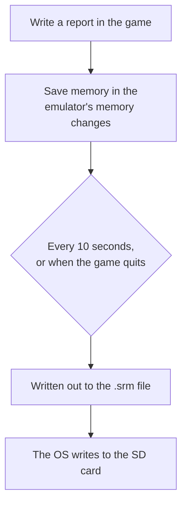
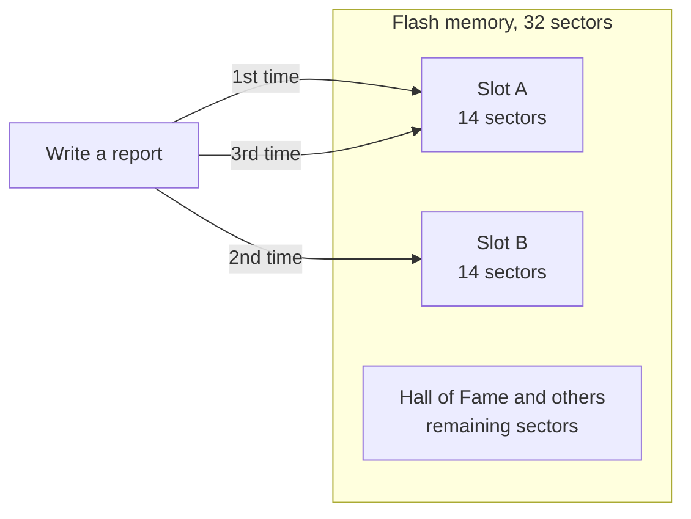

# How Saves Work

This continues from [Emulators and menus](16-emulator-and-menu.md). This article covers where a game's save is kept on a real cartridge and which file it becomes on the RG40XXH. Finally, it uses source code to check what is inside the saves of a homemade game and Pokémon Emerald.

## There are two kinds of save

From the player's point of view, there are two kinds of save.

| | In-game save | Save state |
|---|---|---|
| How it is done | In Pokémon, "write a report" | From the emulator's menu |
| Whose feature it is | The game | The emulator |
| Exists on real consoles | Yes | No |
| When you can save | Only when the game allows it | Any time (even during a battle) |

The shortest way to understand the difference is to know what is inside a real cartridge.

## The two kinds of memory in a cartridge

A cartridge has two kinds of memory with different properties.

| Memory | Contents | Rewriting |
|---|---|---|
| ROM | The game itself (instructions, graphics, sound, text) | Not possible |
| Save memory | The contents of the save | Possible |

ROM is short for Read Only Memory, meaning memory that can only be read. This is where the habit of calling game files "ROMs" comes from. However many times you play, not one byte of the ROM changes. To record that something changed in the game, a separate, rewritable memory is needed.

How save memory is built differs by game. Below are two examples that can be confirmed from source code.

- Pokémon Crystal specifies its cartridge type as `MBC3+TIMER+RAM+BATTERY` ([pokecrystal Makefile](https://github.com/pret/pokecrystal/blob/5beda23ffa505f62e1dad7e3d7c214d1737b3358/Makefile)). This type carries a clock (TIMER) and RAM whose contents are kept by a battery (BATTERY). RAM remembers its contents only while it has power, so the battery is what keeps them.
- The Pokémon Emerald source has code that handles 1Mbit (128KB) flash memory, and saves are written there ([agb_flash_1m.c](https://github.com/rh-hideout/pokeemerald-expansion/blob/dfb0f84374230f4d462191601179b742f9f077df/src/agb_flash_1m.c)). Flash memory remembers its contents even without power.

## On the RG40XXH, save memory becomes a file

The RG40XXH has no chip for saves. So the emulator pretends to be save memory. When the game orders a write to save memory, the emulator writes the contents out to a file on the SD card.

In RetroArch, this file's extension is `.srm` (`FILE_PATH_SRM_EXTENSION` in [file_path_special.h](https://github.com/libretro/RetroArch/blob/015298c2e3bb7361207fc1098d3757f645e58595/file_path_special.h)). The file has the same name as the game file, with only the extension changed.

### It sits next to the game

The RetroArch settings for H700 in ROCKNIX ([retroarch.cfg](https://github.com/ROCKNIX/distribution/blob/ae41127cee7e3e81b1ab3b17b676d91be5165e61/projects/ROCKNIX/packages/emulators/libretro/retroarch/sources/H700/retroarch.cfg)) contain the following lines.

```ini
savefile_directory = "~/.config/retroarch/saves"
savefiles_in_content_dir = "true"
```

Because `savefiles_in_content_dir` is `true`, the settings put save files in the same folder as the game file. The location of save states is set by a script that arranges the settings at every startup, to a per-system folder under `/storage/roms/savestates/` (`SNAPSHOTS="${ROMS_DIR}/savestates"` in [setsettings.sh](https://github.com/ROCKNIX/distribution/blob/ae41127cee7e3e81b1ab3b17b676d91be5165e61/projects/ROCKNIX/packages/rocknix/sources/scripts/setsettings.sh)). If the settings are followed, the folders after playing one GBA game should look like this.

```
/storage/roms/
├── gba/
│   ├── game.gba        The game itself. Playing does not change it
│   └── game.srm        The in-game save. Changes each time you write a report
└── savestates/
    └── gba/            Save states
```

The actual file names and folders are to be checked on the device.

### The advantage of separating game and save

Because the game and the save are separate files, you can do the following.

- Copy only the save to a Mac as a backup
- Move the `.srm` with the game to another machine and continue playing
- Reinstall the game file while the save stays as it is

## A save state is a photo of the workbench

A save state works in a completely different way from an in-game save.

With an in-game save, the game chooses "the information to keep" and writes it to save memory. Only information the game's makers decided on is kept, such as your party of Pokémon, where you are, and the badges you hold.

With a save state, the emulator saves the whole contents of the console at that moment. This includes the contents of memory, the state of the screen and sound, and even the position of the next instruction the CPU will execute. It is like taking a photo of a workbench and later rearranging everything to match the photo. That is why you can resume even from the middle of a battle.

| | In-game save | Save state |
|---|---|---|
| Readable by another emulator | Yes | In many cases, no (the storage format differs by emulator) |
| Readable after updating the emulator | Yes | May become unreadable |
| Can be returned to a real cartridge | Yes, with dumping hardware | No |

The safe approach is to keep progress you want to last in in-game saves, and to use save states for short breaks.

## Why a save you thought you wrote disappears

You may write a report and find it gone the next time you start up. The cause lies in the timing of writes.

According to the description in the RetroArch source, `autosave_interval` is the interval (in seconds) at which save memory is written out to a file. Setting it to 0 stops this automatic writing ([config.def.h](https://github.com/libretro/RetroArch/blob/015298c2e3bb7361207fc1098d3757f645e58595/config.def.h)). In the ROCKNIX settings for H700, this value is 10 (`autosave_interval = "10"` in retroarch.cfg).



If you turn off the power right after writing a report, the write to the file may not have happened yet. The OS also buffers writes to the SD card for a little while before performing them. The OS side of this is a topic for [How the OS works](18-os.md). It is safer to make a habit of quitting the game from the menu when you finish playing, and shutting down before turning off the power.

## Looking inside a save

The contents of a save file are also a sequence of numbers. Here are two examples whose contents are easy to understand.

### A homemade game's save is 2 bytes

[gbdk-coin-plus](../examples/gbdk-coin-plus) in this repository is a game that stores its high score in save RAM, and the saving code in `main.c` is as follows.

```c
#define SAVE_MAGIC 0x4B

static void save_best(void) {
    ENABLE_RAM;
    *(uint8_t *)0xA000 = SAVE_MAGIC;
    *(uint8_t *)0xA001 = best;
    DISABLE_RAM;
}
```

| Line | What it does |
|---|---|
| `ENABLE_RAM` | Allows writing to save RAM |
| `SAVE_MAGIC` to `0xA000` | Writes the marker `0x4B` (75) to the first byte |
| `best` to `0xA001` | Writes the high score to the second byte |
| `DISABLE_RAM` | Withdraws permission to write |

`0xA000` is the address the Game Boy assigns to save RAM. The marker is there because the contents of new RAM are undefined. On reading, if the first byte is 75, the second byte is used as the high score; otherwise the score starts from 0 (`load_best`).

`-Wm-yt0x1B` in the `Makefile` is an option that writes into the ROM header that this cartridge carries battery-backed RAM. The emulator reads this header and prepares a save file. If the high score is 12, the start of the save file should look like this. If you play on a device or an emulator and check, you can see your own score as a number.

```
First bytes   75      12      ...
              marker  high score
```

### Emerald's save is built to resist corruption

Pokémon Emerald's save is built more carefully. Reading the definitions in [save.h](https://github.com/rh-hideout/pokeemerald-expansion/blob/dfb0f84374230f4d462191601179b742f9f077df/include/save.h) gives the following table.

| Definition | Value | Meaning |
|---|---|---|
| `SECTORS_COUNT` | 32 | The save area is divided into 32 sectors |
| `NUM_SAVE_SLOTS` | 2 | There are two save slots |
| `NUM_SECTORS_PER_SLOT` | 14 | One slot is 14 sectors |
| `SECTOR_SIGNATURE` | `0x8012025` | The marker on a valid sector |

The end of each sector carries a checksum for verification, the marker, and a counter of how many writes have been made.



Each time you write a report, it is written to the two slots in turn. Even if the power goes off during a write, the other slot still holds the previous report intact. On reading, the game uses the slot whose marker and checksum are correct and whose counter is larger. This mechanism is behind the message "Writing your report. Do not turn off the power."

## Chinese terms in this article

The Chinese terms here were selected for their relevance to this article's topic from words whose sources were confirmed in other articles in this repository.

| Chinese | Pinyin | Meaning | Source |
|---|---|---|---|
| 备份 | bèifèn | Backup | [Baidu search results](https://www.baidu.com/s?wd=RG40XXH%20%E5%88%B7%E6%9C%BA%20%E5%9B%BA%E4%BB%B6%20Knulli%20%E6%95%99%E7%A8%8B) |
| 内存卡 | nèicúnkǎ | Memory card | [CNFans search results](https://cnfans.com/search?keywords=RP5%E9%A2%84%E8%A3%85%E5%A4%A9%E9%A9%AC&searchType=keywords) |
| 电池 | diànchí | Battery | [掌机圈 RG-35XX H](https://zhangjiquan.com/handheld/rg-35xx-h) |
| 金手指 | jīn shǒu zhǐ | Cheat code | [口袋改版资源吧](https://tieba.baidu.com/f?kw=%E5%8F%A3%E8%A2%8B%E6%94%B9%E7%89%88%E8%B5%84%E6%BA%90) |
| 口袋妖怪 | kǒudài yāoguài | Pokémon | [口袋妖怪改版吧](https://tieba.baidu.com/f?kw=%E5%8F%A3%E8%A2%8B%E5%A6%96%E6%80%AA%E6%94%B9%E7%89%88) |

金手指 (cheat codes) are a mechanism separate from saves that rewrite values in memory while the game is being played.

## What you learn

A cartridge has an unchanging ROM and rewritable save memory. The emulator treats save memory as an `.srm` file, and under the ROCKNIX settings for H700 it places that file in the same folder as the game and writes it out every 10 seconds. A save state is a separate mechanism in which the emulator saves the whole contents of the console. The contents of a save are also a sequence of numbers: 2 bytes for a homemade game, and for Emerald a design that uses two slots in turn to resist corruption. The next article, [How the OS works](18-os.md), goes down to the OS layer, which actually performs the file writes.
