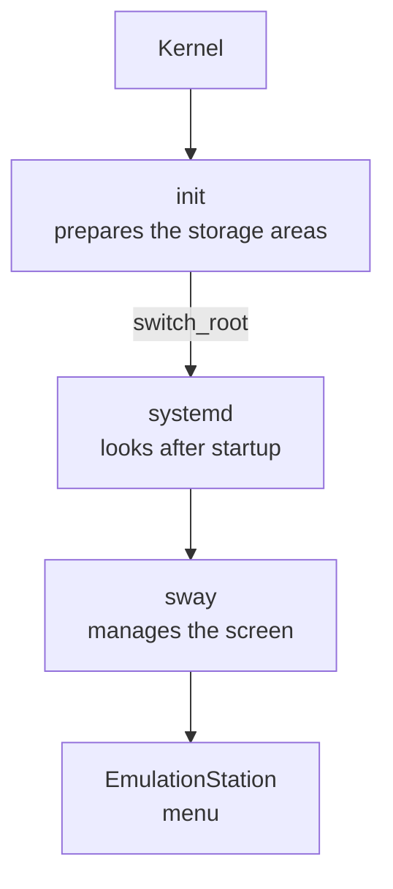
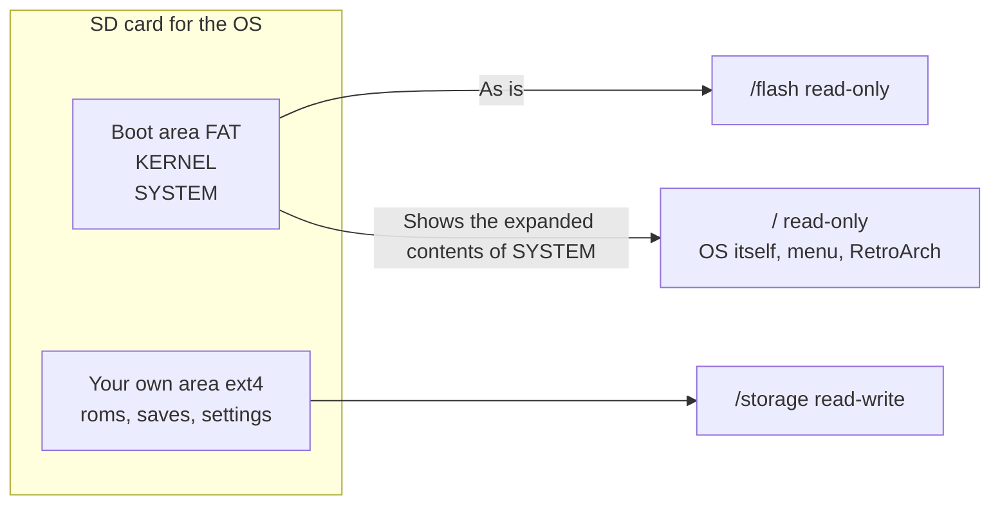
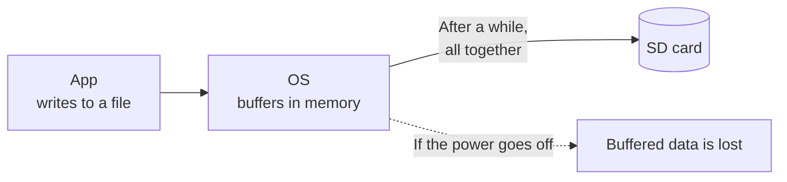

# How the OS Works

This continues from [How saves work](17-save-data.md). This article goes down one level from the app layer to the OS layer. It uses the ROCKNIX source code (commit `ae41127`) to check what the OS does, who starts the menu, and how ROCKNIX divides up where files are kept.

## The OS is a building management company

The OS's role is similar to that of a building management company. If apps such as the menu and RetroArch are the shops in a building, the OS is the company that manages the building.

| Building | RG40XXH |
|---|---|
| Shops | Apps (the menu, RetroArch, Wi-Fi settings, and so on) |
| Management company | OS (Linux) |
| Electricity, water | Battery power, CPU time |
| Shared facilities | Screen, speakers, Wi-Fi |
| Room allocation | Memory allocation |
| Storeroom | SD card |

Shops do not touch the building's wiring directly. When they want to put a picture on the screen or read a file on the SD card, they ask the management company. Having the management company in between has two advantages.

The first is avoiding collisions. If the menu and RetroArch tried to draw on the screen at the same time, the screen would be garbled. The management company decides which shop gets to use the screen.

The second is that shops do not have to care about differences between buildings. RetroArch runs on both the RG40XXH and PCs. This is because the OS absorbs the differences in screen and button components and presents them to apps in the same form.

## The OS's main jobs

The OS's work can be broadly divided into three jobs.

| Job | Description | Example on the RG40XXH |
|---|---|---|
| Mediating components | Makes components such as the screen, sound, buttons, and Wi-Fi usable by apps | Tells the app in the foreground that a button was pressed |
| Starting and watching programs | Decides which programs run when, and deals with them when they stop | Starts the menu and restarts it if it crashes |
| Managing files | Remembers what is where on the SD card and reads and writes on behalf of apps | Reads and writes game and save files |

The central part of the OS is called the kernel. The small programs responsible for mediating components are drivers.

## The Linux brand

There are several kinds of OS.

| OS | Main machines it is used on |
|---|---|
| Linux | RG40XXH, servers, many embedded devices |
| Android | Smartphones. The kernel is Linux |
| macOS, iOS | Mac, iPhone |
| Windows | PCs |

ROCKNIX, Knulli, and muOS are all packages for handhelds based on Linux ([OS options](03-os.md)). Even within Linux, they use different kernel lineages. Knulli's RG40XX H page gives the kernel as Allwinner BSP 4.9.170 (article 03). The ROCKNIX settings for H700 do not specify a kernel lineage, and are set to use Linux 7.1.2 as published on kernel.org with ROCKNIX patches applied ([linux package.mk](https://github.com/ROCKNIX/distribution/blob/ae41127cee7e3e81b1ab3b17b676d91be5165e61/packages/linux/package.mk)). A BSP is a kernel prepared by the manufacturer, and the one from kernel.org is the mainline Linux kernel.

## Who starts the menu

Between turning on the power and the menu appearing, many programs run in order. The first half of startup is covered in [After you turn on the power](19-boot.md), so here we look at what happens after the kernel starts running.



init, which runs first, prepares the SD card's areas, then uses a command called `switch_root` to switch to the OS proper and hands over to systemd ([init](https://github.com/ROCKNIX/distribution/blob/ae41127cee7e3e81b1ab3b17b676d91be5165e61/packages/sysutils/busybox/scripts/init)).

```sh
exec /usr/bin/busybox switch_root /sysroot /usr/lib/systemd/systemd $INIT_ARGS
```

systemd looks after startup. It reads configuration files (called services) that say which programs to start, in what order, and under what conditions, and starts them accordingly.

ROCKNIX on H700 is set to use sway for screen management (`WINDOWMANAGER="swaywm-env"` in the [H700 options](https://github.com/ROCKNIX/distribution/blob/ae41127cee7e3e81b1ab3b17b676d91be5165e61/projects/ROCKNIX/devices/H700/options)). The menu service for devices using sway is [essway.service](https://github.com/ROCKNIX/distribution/blob/ae41127cee7e3e81b1ab3b17b676d91be5165e61/projects/ROCKNIX/packages/ui/emulationstation/system.d/essway.service).

```ini
[Unit]
Description=EmulationStation-with-Sway
Requires=sway.service
After=sway.service

[Service]
Type=simple
Environment=HOME=/storage
EnvironmentFile=/etc/profile
ExecStart=/usr/bin/start_es.sh
WorkingDirectory=/storage
Restart=always
RestartSec=2

[Install]
WantedBy=rocknix.target
```

| Line | Meaning |
|---|---|
| `Requires=sway.service`, `After=sway.service` | Needs sway, and starts after sway has started |
| `Environment=HOME=/storage` | Makes `/storage` this program's own place |
| `ExecStart=/usr/bin/start_es.sh` | The file to execute at startup |
| `Restart=always`, `RestartSec=2` | If it stops, always restart it after 2 seconds |

The last two lines are an example of the watching job. Even if the menu crashes for some reason, systemd restarts it after 2 seconds. The menu and RetroArch are, in the end, files placed in `/usr/bin` and similar locations, which the OS loads and runs.

## The place that cannot be rewritten, and your own place

ROCKNIX divides where files are kept into three parts. How init treats them is shown in the following table.

| Location in the OS | Contents | How init treats it |
|---|---|---|
| `/flash` | The SD card's boot area (FAT). The `KERNEL` and `SYSTEM` files | Attached read-only (`ro`) |
| `/` | The contents of the file named `SYSTEM`. The OS itself, menu, RetroArch, cores | Attached read-only (`ro,loop`) |
| `/storage` | The SD card's other area (ext4). Games, saves, settings | Attached read-write (`rw`) |

A distinctive feature of ROCKNIX is that the contents of `/` are a single file named `SYSTEM` inside `/flash`. init treats this file like one disk packed with contents (`loop`) and attaches it read-only.



As an analogy, the OS itself is a textbook kept in a safe, and `/storage` is your own notebook. This division has the following advantages.

- Even if you change settings and things stop working, the OS itself stays as it was. Even if you mess up the notebook, the textbook is safe.
- Updating is easy. At startup, init looks for update files (`.tar`, `.img.gz`, `.img`) placed in `/storage/.update` and replaces `KERNEL` and `SYSTEM` (`check_update` in init).
- The menu's `HOME=/storage` setting and the game location `/storage/roms` both point to this place of your own.

On the first boot, a process runs that expands the `/storage` area to fill the rest of the card ([fs-resize](https://github.com/ROCKNIX/distribution/blob/ae41127cee7e3e81b1ab3b17b676d91be5165e61/packages/sysutils/busybox/scripts/fs-resize)). Right after the image is written, `/storage` is only 32MB (see article 19 below), and on the first boot it expands to match the card's capacity.

## Writes are buffered before going out

The OS may not write to the SD card right away. It holds the data in memory for a while, and writes to the SD card once a certain amount has gathered. It is like saving up letters and mailing them together rather than one at a time.

Writing to an SD card is much slower than writing to memory, so grouping writes is faster overall. The trade-off is that if the power goes off during buffering, whatever has not gone out yet is lost.



The command that writes everything buffered to the SD card right now is `sync`. On a proper shutdown, the OS writes out what it has buffered before turning off the power. ROCKNIX's [update.sh](https://github.com/ROCKNIX/distribution/blob/ae41127cee7e3e81b1ab3b17b676d91be5165e61/projects/ROCKNIX/devices/H700/bootloader/update.sh) is also built to rewrite the boot area, write out with `sync`, and then return it to read-only.

```sh
# mount $BOOT_ROOT ro
sync
mount -o remount,ro $BOOT_ROOT
```

As seen in [How saves work](17-save-data.md), the emulator side also has a wait, in that it writes saves out to a file every 10 seconds. If you quit the game when you finish playing, shut down from the menu, and then turn off the power, you finish with both waits cleared.

## The Mac and the RG40XXH are distant relatives

macOS and Linux are different OSes, but both inherit the ideas of an old OS called UNIX. Writing file locations as paths starting from `/` and using commands such as `ls` and `cp` are common to both. Many of the operations for examining files on an SD card in the Mac's Terminal work as they are inside the RG40XXH. This property is useful when examining the inside of the RG40XXH over a network.

## Chinese terms in this article

The Chinese terms here were selected for their relevance to this article's topic from words whose sources were confirmed in other articles in this repository.

| Chinese | Pinyin | Meaning | Source |
|---|---|---|---|
| 系统 | xìtǒng | System, OS | [CSDN](https://blog.csdn.net/fanged/article/details/152960565) |
| 开源系统 | kāiyuán xìtǒng | Open source OS | [掌机圈 RG-35XX H](https://zhangjiquan.com/handheld/rg-35xx-h) |
| 安卓 | ānzhuō | Android | [掌机圈 RG-556](https://zhangjiquan.com/handheld/rg-556) |
| 驱动 | qūdòng | Driver | [模拟器游戏 篇四](https://zhuanlan.zhihu.com/p/703325151) |
| 闪退 | shǎntuì | An app suddenly crashing | [模拟器游戏 篇四](https://zhuanlan.zhihu.com/p/703325151) |
| 权限 | quánxiàn | Permissions | [天马G前端的使用](https://blog.csdn.net/fanged/article/details/152960565) |

## What you learn

The OS sits between apps and components and is responsible for mediating components, starting and watching programs, and managing files. In ROCKNIX, after the kernel come init, systemd, sway, and the menu, in that order, and if the menu crashes, systemd restarts it. Because the OS itself is packed into one read-only file and games and settings are kept separately in the rewritable `/storage`, the design resists breakage and is easy to update. Because writes are buffered, shutting down before turning off the power matters. The next article, [After you turn on the power](19-boot.md), looks at what happens before the kernel starts running.
