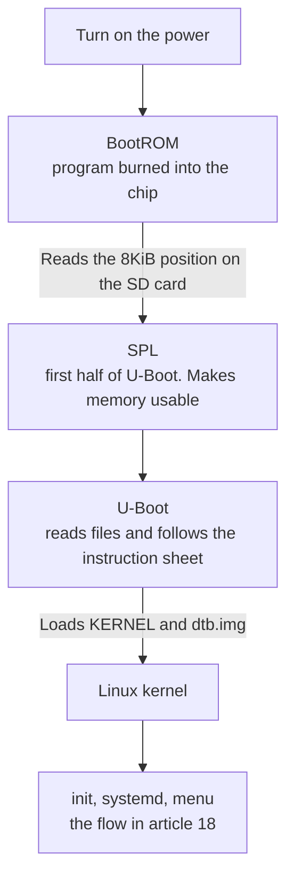
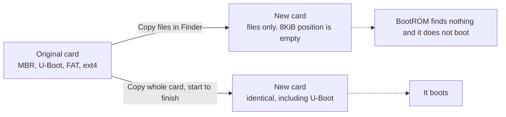

# After you turn on the power

This continues from [How the OS works](18-os.md). This article covers what happens between turning on the power and the kernel starting to run. It uses the ROCKNIX source code (commit `ae41127`) to check the "hidden areas" of the SD card, what the `dtb.img` that appears in the [steps for installing CFW](04-install-cfw.md) really is, and the difference between the DDR3 and DDR4 versions.

## Two problems

[How the OS works](18-os.md) explained that the OS starts the menu. Then who starts the OS?

The first problem is order. The OS is on the SD card. Reading the SD card requires a program, but that program is also on the SD card. Right after the power comes on, no program is running yet.

The second problem is the workbench. The RG40XXH has 1GB of memory, but right after the power comes on, this memory cannot be used yet. Memory is a component that becomes usable only after being configured through a set procedure. All that can be used is a small memory inside the chip.

These two problems are solved by handing the role along in order, from small programs to larger ones. Starting up is called boot in English because of the expression about lifting yourself up by pulling on the straps of your own boots.

## The boot relay



Each handover adds to what can be done.

| Stage | Where it runs | What it can do |
|---|---|---|
| BootROM | Inside the chip. Cannot be rewritten | Only read a fixed position. It does not understand files |
| SPL | Small memory inside the chip | Make the 1GB of memory usable |
| U-Boot | 1GB of memory | Read the file system and load the kernel according to the instruction sheet |
| Kernel | 1GB of memory | Handle all components as the OS |

## The hidden areas of the SD card

The BootROM has no notion of files. All it can do is read a fixed position. So the next stages, SPL and U-Boot, are written directly to a fixed position on the SD card, not as files.

The ROCKNIX image creation script writes the U-Boot for H700 as is to the position 8KiB from the start of the card ([bootloader/mkimage](https://github.com/ROCKNIX/distribution/blob/ae41127cee7e3e81b1ab3b17b676d91be5165e61/projects/ROCKNIX/bootloader/mkimage)).

```sh
dd if="${RELEASE_DIR}/3rdparty/bootloader/H700_${SUBDEVICE}_u-boot-sunxi-with-spl.bin" of="${DISK}" bs=1K seek=8 conv=fsync,notrunc
```

`bs=1K seek=8` means writing at a position 8 units of 1KiB ahead, that is, at the 8KiB position. The `with-spl` in the file name indicates that SPL and U-Boot are combined into one. The build settings for the H700 U-Boot also include a description saying that a small security-related program (ATF's BL31) is included in the SPL ([u-boot-DDR4 package.mk](https://github.com/ROCKNIX/distribution/blob/ae41127cee7e3e81b1ab3b17b676d91be5165e61/projects/ROCKNIX/devices/H700/packages/u-boot-DDR4/package.mk)).

The U-Boot source gives a clue to what needs to be at the 8KiB position. [sunxi_image.h](https://github.com/u-boot/u-boot/blob/8d7bc8add17bbc69a58dfe0002eea039dd2dc1bc/include/sunxi_image.h) defines the header of boot images for Allwinner chips, and gives its marker as `eGON.BT0`.

### A map of the SD card

From the image creation settings ([distributions/ROCKNIX/options](https://github.com/ROCKNIX/distribution/blob/ae41127cee7e3e81b1ab3b17b676d91be5165e61/distributions/ROCKNIX/options)) and the creation script ([scripts/mkimage](https://github.com/ROCKNIX/distribution/blob/ae41127cee7e3e81b1ab3b17b676d91be5165e61/scripts/mkimage)), the layout of the SD card right after writing is as in the following table. A sector is a unit that divides the card into 512-byte pieces.

| Position | Contents | Setting that determines it |
|---|---|---|
| Sector 0 | MBR (table of contents of partitions) | `PARTITION_TABLE="msdos"` |
| 8KiB position | SPL and U-Boot. Not a file | `bs=1K seek=8` |
| 2GiB from sector 32768 (16MiB) | Boot area (FAT, named `ROCKNIX`) | `SYSTEM_PART_START=32768`, `SYSTEM_SIZE=2048` |
| The 32MiB after that | Your own area (ext4, named `STORAGE`) | `STORAGE_SIZE=32` |

Your own area is only 32MiB because it is designed to expand to fill the rest of the card on the first boot ([How the OS works](18-os.md)).

### What was checked with a dummy image

In this research, an image with dummy contents was created using the layout of the above settings, and checked. Reading the partition table in the MBR showed the following numbers. Numbers are written starting from the lowest digits (little-endian).

| Partition | Boot flag | Type | Start sector | Sector count |
|---|---|---|---|---|
| First | `80` (bootable) | `0c` (FAT32) | `00 80 00 00` = 32768 | `00 00 40 00` = 4194304 (2GiB) |
| Second | `00` | `83` (Linux) | `00 80 40 00` = 4227072 | `00 00 01 00` = 65536 (32MiB) |

The last two bytes of the MBR are `55 aa`, which is the marker showing it is an MBR.

The area before 16MiB does not belong to any file system. It cannot be seen from the Mac's Finder or Windows Explorer. This research also copied only the files to another card-shaped image, and confirmed that the 8KiB position stays empty.



If you want to keep the bundled SD card, do not copy its files; copy the whole card from start to finish.

## Why there are DDR3 and DDR4 versions

An important job of the SPL is to make memory usable. The procedure differs by memory type.

ROCKNIX builds two kinds of U-Boot for H700 and also creates two images, a DDR3 version and a DDR4 version ([config.xml](https://github.com/ROCKNIX/distribution/blob/ae41127cee7e3e81b1ab3b17b676d91be5165e61/projects/ROCKNIX/config.xml)). The configuration name of the DDR4 U-Boot is `anbernic_rg35xx_h700_lpddr4_defconfig`, a configuration matched to the memory type (u-boot-DDR4 package.mk).

The update script that runs after boot ([update.sh](https://github.com/ROCKNIX/distribution/blob/ae41127cee7e3e81b1ab3b17b676d91be5165e61/projects/ROCKNIX/devices/H700/bootloader/update.sh)) reads the voltage applied to the memory and decides which U-Boot to write.

```sh
case "$DCDC3_MICROVOLTS" in
  1200000)
    UBOOT_BIN="H700_DDR3_u-boot-sunxi-with-spl.bin"
    ;;
  1100000)
    UBOOT_BIN="H700_DDR4_u-boot-sunxi-with-spl.bin"
    ;;
esac
```

1.2V means the DDR3 version, and 1.1V means the DDR4 version. The RG40XXH's memory is listed as LPDDR4 on 掌机圈 ([Differences between the main devices](02-devices.md)). The DDR4 version should fit, but check on the ROCKNIX device page before downloading.

## U-Boot's instruction sheet

U-Boot reads `extlinux/extlinux.conf` in the FAT boot area and loads the kernel as written there. On H700, it is created at image creation with the following contents (`mkimage_extlinux` in bootloader/mkimage, `fdt="dtb.img"` in config.xml, `EXTRA_CMDLINE` in the H700 options).

```
LABEL ROCKNIX
  LINUX /KERNEL
  FDT /dtb.img
  APPEND boot=LABEL=ROCKNIX disk=LABEL=STORAGE quiet console=ttyS0,115200 console=tty0 systemd.debug_shell=ttyS0
```

| Line | Meaning |
|---|---|
| `LINUX /KERNEL` | The kernel is the file named `KERNEL` in the FAT area |
| `FDT /dtb.img` | The DTB is the file named `dtb.img` in the FAT area |
| `APPEND boot=LABEL=ROCKNIX` | The boot area is the area named `ROCKNIX` |
| `APPEND disk=LABEL=STORAGE` | Your own area is the area named `STORAGE` |

The `APPEND` line is a message passed to the kernel and init. Using these names as clues, init attaches the `/flash` and `/storage` described in [How the OS works](18-os.md).

## The DTB is the machine's floor plan

The kernel receives a floor plan called the DTB (device tree) and learns from it which lines of the chip the screen, buttons, and LEDs are connected to. Even among devices using the same H700, screen components and button wiring differ by device.

One ROCKNIX image supports many devices using the H700. The kernel is shared, and the per-device DTBs are gathered in the `device_trees` folder.

```
FAT (boot area)
├── KERNEL
├── SYSTEM
├── extlinux/extlinux.conf
├── device_trees/
│   ├── sun50i-h700-anbernic-rg35xx-h.dtb
│   ├── sun50i-h700-anbernic-rg40xx-h.dtb
│   ├── sun50i-h700-anbernic-rg40xx-h-v2-panel.dtb
│   └── (other devices)
└── dtb.img   ← you place this yourself
```

### Inside the RG40XXH's floor plan

The DTB is made from a text called DTS. The DTS for the RG40XX H ([sun50i-h700-anbernic-rg40xx-h.dts](https://github.com/ROCKNIX/distribution/blob/ae41127cee7e3e81b1ab3b17b676d91be5165e61/projects/ROCKNIX/devices/H700/linux/dts/allwinner/sun50i-h700-anbernic-rg40xx-h.dts)) is only 38 lines. This is because it loads the RG35XX Plus floor plan and adds only what differs.

```dts
#include "sun50i-h700-anbernic-rg35xx-plus.dts"

/ {
	model = "Anbernic RG40XX H";
	compatible = "anbernic,rg40xx-h", "allwinner,sun50i-h700";
	rocknix-dt-id = "sun50i-h700-anbernic-rg40xx-h";
};
```

| Added part | Contents |
|---|---|
| `model`, `compatible` | The device name, and a mark of which device it is for |
| `rocknix-dt-id` | The name ROCKNIX uses to identify the device |
| `&joypad` | Settings such as reversing the direction of stick axes |
| `&uart5` | Enables the serial communication pins (UART) |
| `&leds` | The line the RGB LEDs are connected to (PI7) |
| `&panel` | The type of screen component (`anbernic,rg40xx-panel`) |

The DTS for the newer version of the screen ([v2-panel](https://github.com/ROCKNIX/distribution/blob/ae41127cee7e3e81b1ab3b17b676d91be5165e61/projects/ROCKNIX/devices/H700/linux/dts/allwinner/sun50i-h700-anbernic-rg40xx-h-v2-panel.dts)) is even shorter, at 14 lines. It only loads the RG40XX H floor plan, sets its own `rocknix-dt-id`, and changes the type of screen component to `anbernic,rg40xx-v2-panel`. This shows that, apart from that identifying name, the only difference between the two DTBs is the screen component. If the screen is garbled, it seems you would try the other one. Which one fits is to be checked on the device.

### Why a person copies dtb.img

The instruction sheet has only the fixed name `FDT /dtb.img`. The software at the boot stage has no way of knowing which device it has been inserted into. So in the [steps for installing CFW](04-install-cfw.md), you copy your device's DTB from `device_trees` and place it under the name `dtb.img`. A person is telling it the device.

Once booted, the kernel knows its own device from the floor plan's `rocknix-dt-id`. The update script reads that name from `/proc/device-tree/rocknix-dt-id` and replaces `dtb.img` with the DTB of the same name (update.sh). This is why the manual work is needed only the first time.

```sh
DT_ID=$(cat /proc/device-tree/rocknix-dt-id)
UPDATE_DTB_SOURCE="$BOOT_ROOT/device_trees/$DT_ID.dtb"
if [ -f "$UPDATE_DTB_SOURCE" ]; then
  echo "Updating dtb.img from $(basename $UPDATE_DTB_SOURCE)..."
  cp -f "$UPDATE_DTB_SOURCE" "$BOOT_ROOT/dtb.img"
fi
```

## Guessing what is wrong when it does not boot

Knowing the boot order gives you an idea of where it stopped. The following table is a guide reasoned from how things work, and has not yet been checked on a device.

| Symptom | Likely stage where it stopped | Possible causes |
|---|---|---|
| The screen stays dark and nothing happens | BootROM through U-Boot | A failed write, a card made only by copying files, using the wrong one of the DDR3 and DDR4 versions |
| It boots, but the screen is garbled | Kernel and DTB | The version of `dtb.img` does not fit |
| The logo appears, but it does not reach the menu | init through systemd | Preparing `/storage`, or starting the menu |

## Chinese terms in this article

The Chinese terms here were selected for their relevance to this article's topic from words whose sources were confirmed in other articles in this repository.

| Chinese | Pinyin | Meaning | Source |
|---|---|---|---|
| 刷机 | shuā jī | Rewriting a device's OS | [Baidu search results](https://www.baidu.com/s?wd=RG40XXH%20%E5%88%B7%E6%9C%BA%20%E5%9B%BA%E4%BB%B6%20Knulli%20%E6%95%99%E7%A8%8B) |
| 固件 | gùjiàn | Firmware | [Baidu search results](https://www.baidu.com/s?wd=RG40XXH%20%E5%88%B7%E6%9C%BA%20%E5%9B%BA%E4%BB%B6%20Knulli%20%E6%95%99%E7%A8%8B) |
| 格式化 | géshìhuà | Formatting | [Baidu search results](https://www.baidu.com/s?wd=RG40XXH%20%E5%88%B7%E6%9C%BA%20%E5%9B%BA%E4%BB%B6%20Knulli%20%E6%95%99%E7%A8%8B) |
| 读卡器 | dúkǎqì | Card reader | [Baidu search results](https://www.baidu.com/s?wd=RG40XXH%20%E5%88%B7%E6%9C%BA%20%E5%9B%BA%E4%BB%B6%20Knulli%20%E6%95%99%E7%A8%8B) |
| 启动速度 | qǐdòng sùdù | Boot speed | [CSDN](https://blog.csdn.net/fanged/article/details/152960565) |

## What you learn

Right after the power comes on, no program is running and memory cannot be used. So the role is handed along from small to large: BootROM, SPL, U-Boot, then the kernel. Because the BootROM can read only a fixed position, the first program is placed outside the SD card's file system, and keeping a copy of the card requires copying the whole thing. The kernel learns the layout of the device's components from a floor plan called the DTB. `dtb.img` is a file a person places to tell the pre-boot software which device it is. The next article, [CPUs and machine code](20-cpu.md), looks at what the CPU actually does at the lowest layer.
