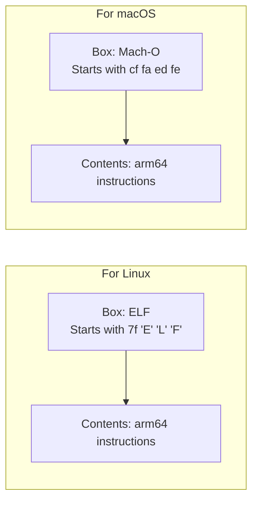
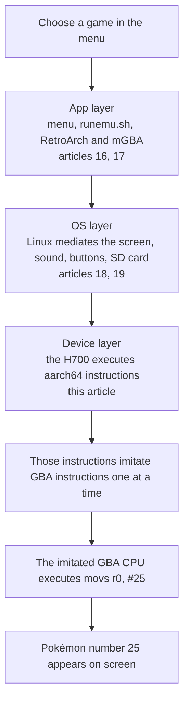

# CPUs and Machine Code

This continues from [After you turn on the power](19-boot.md) and is the last article in the series. It covers what the CPU, at the lowest of the three layers and at the center of the device, actually does. It converts a small program for the RG40XXH, for the Mac, and for PCs and compares the results, and finally reads the instructions inside Pokémon Emerald at the moment your first Pokémon is decided.

## The CPU is a worker that handles instructions one at a time

What a CPU does is surprisingly simple. It can be compared to a worker who reads and executes instructions one at a time. The worker uses three things to do the job.

| Thing | Analogy | Formal name |
|---|---|---|
| Which instruction is being read now | A bookmark in the instruction sheet | Program counter |
| A small memory of only a few dozen items | A notepad at hand | Registers |
| The place where instructions and data are kept | A workbench | Memory |

The worker endlessly repeats the following four steps.


Each instruction is a small task such as adding, comparing, reading a number from memory, or moving to another position. In exchange, they go very fast. The RG40XXH's H700 is given on the ROCKNIX page as 1.4GHz by default and 1.5GHz through settings ([Overview of Chinese handhelds](01-overview.md)). 1.5GHz is a speed of 1.5 billion ticks per second.

## Converting your own function into instructions

The following small function was written and converted for the RG40XXH's CPU (aarch64). `aarch64-linux-gnu-gcc` was used for the conversion, and `aarch64-linux-gnu-objdump` to read the result.

```c
int add_coin(int score) {
    return score + 10;
}
```

After conversion, there were only two instructions.

```
11002800    add  w0, w0, #0xa
d65f03c0    ret
```

| Part | Meaning |
|---|---|
| `11002800` | The first instruction in number form. This is what the CPU actually reads |
| `add w0, w0, #0xa` | A translation for people to read. Adds 10 to `w0` and puts the result back in `w0` |
| `w0` | Register number 0. The score is in here |
| `#0xa` | 10 in hexadecimal |
| `d65f03c0` and `ret` | The instruction to return to the place that called it |

[The big picture of the RG40XXH](15-rg40xxh-big-picture.md) said that a game file is a sequence of numbers. Many of those numbers are instructions like these, each put into number form.

## The box and its contents

Even with instructions for the same CPU, a program will not run as is on a different OS. This was checked by converting a one-line function in three ways.

```c
int add(int a, int b) { return a + b; }
```

`clang` was used to convert it in three ways: aarch64 for Linux, arm64 for macOS (meaning Apple Silicon), and x86_64 for Linux (Intel and AMD CPUs).

| Target | `file` result | First 4 bytes | Instructions inside |
|---|---|---|---|
| Linux, aarch64 | `ELF 64-bit LSB relocatable, ARM aarch64` | `7f 45 4c 46` | `0b000020` `d65f03c0` |
| macOS, arm64 | `Mach-O 64-bit arm64 object` | `cf fa ed fe` | `0b000020` `d65f03c0` |
| Linux, x86_64 | `ELF 64-bit LSB relocatable, x86-64` | `7f 45 4c 46` | `8d 04 37` `c3` |

Comparing the first and second rows, the instructions inside were the same numbers. Both are `add w0, w1, w0` and `ret`. This is because Apple Silicon and the H700 share the same instruction language (instruction set), arm64. The x86_64 instructions, on the other hand, came out as completely different numbers.

What differs is the shape of the box wrapping the instructions.



- The CPU reads only the instructions inside.
- The OS reads the shape of the box. Linux will not load a file as a program unless it starts with `7f 45 4c 46` (the marker of a format called ELF). macOS uses a different format called Mach-O.
- The ELF box also has a field saying which CPU it is for. The 2 bytes at the position 18 bytes from the start were `b7 00` (183) for aarch64 and `3e 00` (62) for x86_64. Read with `readelf -h`, they are shown as `AArch64` and `Advanced Micro Devices X86-64` respectively.

Even with the same kind of CPU, a Mac app cannot run as is on the RG40XXH because the box differs. Conversely, running Linux on an Apple Silicon Mac lets you create the same shape of box and contents as the RG40XXH. To run them, conditions such as the versions of the libraries used also need to match.

## Instructions for a different CPU cannot be executed

The environment used in this research was Linux on an x86_64 CPU. When a program that adds to the score three times and displays it was converted for aarch64 and executed as is, Linux returned the following error.

```
cannot execute binary file: Exec format error
```

This is because the CPU field in the ELF box does not match the machine's own CPU. To the x86_64 worker, `11002800` is a meaningless number.

Next, the same file was executed through an emulator called qemu (`qemu-aarch64`).

```
coin! score=10
coin! score=20
coin! score=30
```

This time it worked. qemu read the aarch64 instructions one at a time and executed them while translating them into x86_64 instructions.

| Environment in this research | RG40XXH |
|---|---|
| aarch64 instructions → qemu → x86_64 CPU | GBA instructions → mGBA → H700 |

This is exactly the interpreter explained in [Emulators and menus](16-emulator-and-menu.md).

## The instructions that decide your first Pokémon

Finally, we look inside Pokémon Emerald. [pokeemerald-expansion](https://github.com/rh-hideout/pokeemerald-expansion) is a base for modding built on the project that reconstructed Emerald's source code ([Pokémon ROM hacks](08-pokemon-hacking.md)). Its `GetStarterPokemon` is a function that returns the number of your first Pokémon from the number of the Poké Ball you chose ([starter_choose.c](https://github.com/rh-hideout/pokeemerald-expansion/blob/dfb0f84374230f4d462191601179b742f9f077df/src/starter_choose.c)).

```c
u16 GetStarterPokemon(u16 chosenStarterId)
{
    if (chosenStarterId > STARTER_MON_COUNT)
        chosenStarterId = 0;
    return sStarterMon[chosenStarterId];
}
```

`sStarterMon` is a table listing the numbers of the three first Pokémon. In the original source it holds Treecko (252), Torchic (255), and Mudkip (258). In this research, the first entry in the table was changed to Pikachu (25) and built, and the converted instructions were extracted with `arm-none-eabi-objdump`. These are the GBA CPU's instructions called Thumb, where one instruction is mainly 2 bytes.

```
0403    lsls r3, r0, #16
0c1b    lsrs r3, r3, #16
2019    movs r0, #25
2b03    cmp  r3, #3
d803    bhi  (to the last instruction)
4a02    ldr  r2, [table position]
005b    lsls r3, r3, #1
18d2    adds r2, r2, r3
8910    ldrh r0, [r2, #8]
4770    bx   lr
```

| Instruction | What it does |
|---|---|
| `lsls`, `lsrs` | Tidies the number of the chosen ball and puts it in `r3` |
| `movs r0, #25` | Puts 25 in advance into `r0`, the field for the return value |
| `cmp r3, #3` and `bhi` | If the number is greater than 3, jumps to the end with 25 as is |
| `ldr r2, [table position]` | Reads where the table is in memory |
| `lsls r3, r3, #1`, `adds` | Doubles the number and adds it to the table position (because one Pokémon takes 2 bytes) |
| `ldrh r0, [r2, #8]` | Reads the Pokémon's number from the table and puts it in `r0` |
| `bx lr` | Returns to the place that called it |

Looking at the third instruction's number `2019`, the lower `19` is 25 in hexadecimal. When the number is out of range, the answer is the value at position 0 of the table, that is, Pikachu's 25. The compiler wrote this answer directly into the instruction. In the build before the modification, this is Treecko's 252, and it holds `FC` in hexadecimal.

The Pikachu in the game existed as numbers in two places: the 25 in the table in the ROM, and the 25 written into the instruction.

### Differences between GBA and RG40XXH instructions

| | GBA | RG40XXH |
|---|---|---|
| CPU | ARM7TDMI | Cortex-A53 (H700) |
| Instruction language | ARM and Thumb (the example above is Thumb, with one instruction mainly 2 bytes) | AArch64 (one instruction is 4 bytes) |
| Register names | `r0`, `r1`, and so on | `w0`, `x0`, and so on |

Both belong to the ARM family, but their generations differ and so do their instruction languages. To run GBA games on the RG40XXH, an emulator such as mGBA is needed. The GBA's CPU type can be confirmed from `-mcpu=arm7tdmi` in the pokeemerald-expansion [Makefile](https://github.com/rh-hideout/pokeemerald-expansion/blob/dfb0f84374230f4d462191601179b742f9f077df/Makefile), and the H700's CPU type from `TARGET_CPU="cortex-a53"` in ROCKNIX's [H700 options](https://github.com/ROCKNIX/distribution/blob/ae41127cee7e3e81b1ab3b17b676d91be5165e61/projects/ROCKNIX/devices/H700/options).

## Connecting the whole series

The path from choosing a game in the menu to your first Pokémon appearing on screen, tied to each article in the series, looks like this.



## The environment used

The environment for this article's experiments is Ubuntu 24.04 on x86_64. `gcc-aarch64-linux-gnu` and `clang` were used for conversion to aarch64, and `qemu-aarch64` from `qemu-user` for execution. The Pokémon build followed the Ubuntu steps in [INSTALL.md](https://github.com/rh-hideout/pokeemerald-expansion/blob/dfb0f84374230f4d462191601179b742f9f077df/INSTALL.md) at pokeemerald-expansion commit `dfb0f84`, creating `pokeemerald.gba` with `make`. The built ROM contains Nintendo's graphics and music, so it is not distributed.

## Chinese terms in this article

The Chinese terms here were selected for their relevance to this article's topic from words whose sources were confirmed in other articles in this repository.

| Chinese | Pinyin | Meaning | Source |
|---|---|---|---|
| 处理器 | chǔlǐqì | Processor (SoC) | [RG-406V](https://zhangjiquan.com/handheld/rg-406v) |
| 内存 | nèicún | Memory | [掌机圈 RG-35XX H](https://zhangjiquan.com/handheld/rg-35xx-h) |
| 模拟器 | mónǐqì | Emulator | [模拟器游戏 篇四](https://zhuanlan.zhihu.com/p/703325151) |
| 开源 | kāiyuán | Open source | [开源掌机吧](https://tieba.baidu.com/f?kw=%E5%BC%80%E6%BA%90%E6%8E%8C%E6%9C%BA) |
| 改版 | gǎibǎn | Modified version | [口袋妖怪改版吧](https://tieba.baidu.com/f?kw=%E5%8F%A3%E8%A2%8B%E5%A6%96%E6%80%AA%E6%94%B9%E7%89%88) |

## What you learn

Using a bookmark, a notepad, and a workbench, the CPU executes instructions written as numbers, one at a time. A program file has two layers, the box the OS reads (ELF or Mach-O) and the contents the CPU reads (instructions), and it will not run if either does not fit. If the CPU's language differs, an emulator translates and executes. The first Pokémon was just a number written in a table in the ROM and inside an instruction. The six articles of the series connect in one line from choosing a game down to CPU instructions. How to make your own games is covered in [How to make your own games](14-making-games.md).
