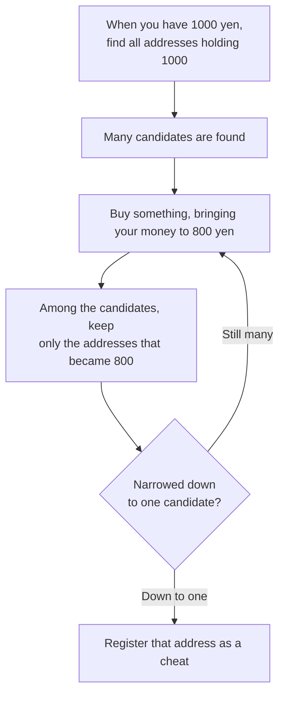
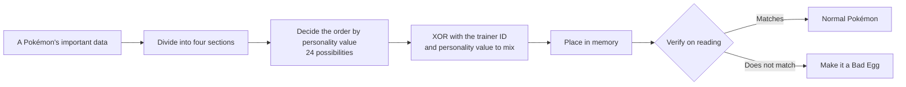
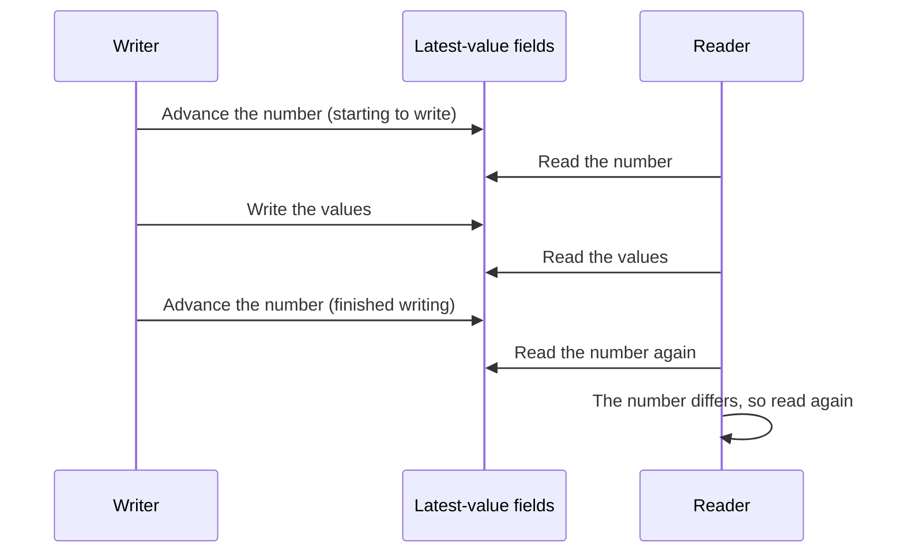

# Cheats and passthrough

The series up to [CPUs and machine code](20-cpu.md) read game files and programs in a stopped state. This article is about reading and rewriting the memory of a running game from outside. The first half covers cheats, and the second half covers the mods called passthrough. Both are techniques for reaching in from outside to the numbers of a game while it is being played.

At the end, it considers how to try the same idea on a small scale between the RG40XXH and a Mac.

## Sources for this article

The explanation proceeds by checking the following source code at fixed commits. Links to explanatory pages such as Wikipedia are also placed in the body for explaining terms.

| Source | Commit | Where it is used |
|---|---|---|
| [pokeemerald-expansion](https://github.com/rh-hideout/pokeemerald-expansion) | `dfb0f84` | GBA memory map, Emerald's protections against rewriting |
| [mGBA](https://github.com/mgba-emu/mgba) | `3a5e34b` | List of GBA addresses, cheat code formats |
| [libretro/mgba](https://github.com/libretro/mgba) | `e31759b` | The mGBA core used by ROCKNIX (a component for RetroArch) |
| [RetroArch](https://github.com/libretro/RetroArch) | `015298c` | Cheat features, the feature for sending commands from outside |
| [ROCKNIX](https://github.com/ROCKNIX/distribution) | `ae41127` | Default settings on the RG40XXH |
| [SkyCraft](https://github.com/chasmlol/SkyCraft) | `bfcaf17` | Design of a passthrough mod |

## The GBA memory map

The starting point for understanding cheats is what is where in the console's memory. An address is a location in memory. The GBA's address assignments are defined as follows in the mGBA source (`GBA_BASE_` in [memory.h](https://github.com/mgba-emu/mgba/blob/3a5e34be33dc7f8f707e5bc9db69e8a430046f21/include/mgba/internal/gba/memory.h)).

| Start address | Name | Contents |
|---|---|---|
| `0x00000000` | BIOS | A small program inside the GBA itself |
| `0x02000000` | EWRAM | Large workbench (256KB) |
| `0x03000000` | IWRAM | Small, fast workbench (32KB) |
| `0x04000000` | IO | Area for communicating with components such as buttons and the screen |
| `0x05000000` | PALETTE_RAM | Memory for the screen (color tables) |
| `0x06000000` | VRAM | Memory for the screen |
| `0x07000000` | OAM | Memory for the screen |
| `0x08000000` | ROM0 | The game itself on the cartridge |
| `0x0E000000` | SRAM | The cartridge's save memory |

The ROM area cannot be rewritten. What cheats rewrite are the numbers on the EWRAM and IWRAM workbenches. The save memory seen in [How saves work](17-save-data.md) corresponds to the area starting at `0x0E000000`.

The linker settings of pokeemerald-expansion ([ld_script_modern.ld](https://github.com/rh-hideout/pokeemerald-expansion/blob/dfb0f84374230f4d462191601179b742f9f077df/ld_script_modern.ld)) also define EWRAM as 256K from `0x2000000`, IWRAM as 32K from `0x3000000`, and ROM as 32M from `0x8000000`, matching the mGBA definitions.

### If you built the game yourself, you can find the addresses

With an Emerald you built yourself, you can look up data addresses from the program's symbol list, and for the build in this research they were as follows. Addresses change with the build settings and the content of the mods.

| Symbol | Address | Area | Contents |
|---|---|---|---|
| `gSaveblock1` | `0x0200fea4` | EWRAM | Source of the data that gets saved (money, bag, and so on) |
| `gSaveblock2` | `0x02013bf4` | EWRAM | Source of the data that gets saved (encryption key, and so on) |
| `gSaveBlock1Ptr` | `0x030051c4` | IWRAM | Address pointing to the current location of `gSaveblock1` |
| `gMain` | `0x030066c0` | IWRAM | Management of the game as a whole |

A variable such as `gSaveBlock1Ptr`, which records where other data is located, is called a pointer. Why a pointer is needed will be seen in the Emerald section below.

## What cheats really are

### A cheat code is a small program

Cheat devices were products for rewriting numbers in a game's memory. For the GBA there were [GameShark](https://en.wikipedia.org/wiki/GameShark), [Code Breaker](https://en.wikipedia.org/wiki/Code_Breaker), and [Action Replay](https://en.wikipedia.org/wiki/Action_replay_max_gba/ds). In the Chinese-speaking world, cheat codes are called 金手指 ([Pokémon ROM hacks](08-pokemon-hacking.md)).

The GBA emulator mGBA can read four cheat code formats (`enum GBACheatType` in [cheats.h](https://github.com/mgba-emu/mgba/blob/3a5e34be33dc7f8f707e5bc9db69e8a430046f21/include/mgba/internal/gba/cheats.h)).

| Format (`GBA_CHEAT_`) | Origin |
|---|---|
| `CODEBREAKER` | Code Breaker |
| `GAMESHARK` | GameShark |
| `PRO_ACTION_REPLAY` | Pro Action Replay |
| `VBA` | The emulator VisualBoyAdvance |

The list of Code Breaker instructions (`CB_` in the same file) shows that a cheat code is a small program.

| Instruction | What it does |
|---|---|
| `CB_ASSIGN_1`, `CB_ASSIGN_2` | Writes a set value to a set address |
| `CB_FILL` | Fills a set range with the same value |
| `CB_OR_2`, `CB_AND_2` | Sets or clears some bits of the value at an address |
| `CB_IF_EQ`, `CB_IF_NE`, `CB_IF_GT`, `CB_IF_LT` | Executes the next instruction only when the value at an address meets the condition |

The simplest cheat is "keep writing this value to this address." If you keep writing a large value to the address holding your money, your money stops going down. By combining conditional instructions, you can also rewrite selectively, such as "write only when the value at this address is less than 10."

### RetroArch's cheat feature

[RetroArch](https://github.com/libretro/RetroArch) also has a cheat feature ([cheat_manager.h](https://github.com/libretro/RetroArch/blob/015298c2e3bb7361207fc1098d3757f645e58595/cheat_manager.h)). The cheat types (`CHEAT_TYPE_`) follow the same idea as cheat devices.

| Type | What it does |
|---|---|
| `SET_TO_VALUE` | Sets to a set value |
| `INCREASE_VALUE`, `DECREASE_VALUE` | Increases or decreases the value |
| `RUN_NEXT_IF_EQ`, `RUN_NEXT_IF_NEQ`, `RUN_NEXT_IF_LT`, `RUN_NEXT_IF_GT` | Runs the next cheat only when the condition is met |

The emulator core tells RetroArch which memory it may rewrite. The mGBA core used by ROCKNIX (`e31759b` of `libretro/mgba` is specified in [mgba-lr package.mk](https://github.com/ROCKNIX/distribution/blob/ae41127cee7e3e81b1ab3b17b676d91be5165e61/projects/ROCKNIX/packages/emulators/libretro/mgba-lr/package.mk)) marks IWRAM and EWRAM with `RETRO_MEMDESC_SYSTEM_RAM`. A comment in the source gives the purpose as "letting RetroArch touch this memory for cheats" ([libretro.c](https://github.com/libretro/mgba/blob/e31759b24e7a4e3899285ff720d7b573ac328ae7/src/platform/libretro/libretro.c)). The ROM area has `RETRO_MEMDESC_CONST`, which indicates it cannot be rewritten.

### Searching memory to make cheats

RetroArch also has a memory search feature for finding cheats yourself. There are nine search types (`CHEAT_SEARCH_TYPE_`).

| Type | Addresses kept |
|---|---|
| `EXACT` | Addresses with exactly the specified value |
| `LT`, `LTE`, `GT`, `GTE` | Addresses that became less than, at most, greater than, or at least the previous value |
| `EQ`, `NEQ` | Addresses the same as, or different from, the previous value |
| `EQPLUS`, `EQMINUS` | Addresses that increased or decreased by exactly a given amount from the previous value |

To find the address of your money, the idea is as follows.



Each time the value changes, the candidates shrink, and the address left at the end is the address of your money. It does not read the game's program, and looks only at how numbers change while it runs.

[RetroAchievements](https://retroachievements.org/), which collects game achievements, is built on the same idea. According to its official description ([How RA Works](https://docs.retroachievements.org/general/how-ra-works.html)), achievements are judged by comparing values in the game's memory with conditions written by the author. It explains that achievement authors examine memory during play to find the addresses to use. There is also a caution that addresses may differ between versions of the same game ([Rom versions](https://retroachievements.org/forums/topic/3481?comment=24755)). In the RetroArch settings for H700 in ROCKNIX, RetroAchievements is off by default (`cheevos_enable = "false"` in [retroarch.cfg](https://github.com/ROCKNIX/distribution/blob/ae41127cee7e3e81b1ab3b17b676d91be5165e61/projects/ROCKNIX/packages/emulators/libretro/retroarch/sources/H700/retroarch.cfg)).

## Emerald's protections against rewriting

This search procedure works for many games. Emerald, however, was built so that it is hard to apply as is. The pokeemerald-expansion source has three mechanisms that guard against rewriting of memory.

### 1. Money is mixed with a key

The code that reads and writes money ([money.c](https://github.com/rh-hideout/pokeemerald-expansion/blob/dfb0f84374230f4d462191601179b742f9f077df/src/money.c)) is as follows.

```c
return *moneyPtr ^ gSaveBlock2Ptr->encryptionKey;
...
*moneyPtr = gSaveBlock2Ptr->encryptionKey ^ newValue;
```

`^` is a calculation called [exclusive OR](https://ja.wikipedia.org/wiki/%E6%8E%92%E4%BB%96%E7%9A%84%E8%AB%96%E7%90%86%E5%92%8C) (XOR). It mixes two numbers bit by bit. It has the property that XORing again with the same key restores the original.

The following table shows the result of a calculation using `0x5A3C9E17` as the key for the sake of explanation.

| | Hexadecimal | Decimal |
|---|---|---|
| Actual amount | `0x000003E8` | 1000 |
| Key | `0x5A3C9E17` | |
| Number placed in memory (amount XOR key) | `0x5A3C9DFF` | 1513922047 |
| Result of XORing with the key again | `0x000003E8` | 1000 |

Memory holds the number 1513922047, not 1000. So searching for 1000 will not find the address of your money.

Money is not the only thing mixed with the key. The code that renews the key (`ApplyNewEncryptionKeyToAllEncryptedData`) targets five things: game records (`GameStats`), items in the bag (`BagItems`), Berry Powder (`BerryPowder`), money (`money`), and casino coins (`coins`) ([load_save.c](https://github.com/rh-hideout/pokeemerald-expansion/blob/dfb0f84374230f4d462191601179b742f9f077df/src/load_save.c)).

### 2. The data's location moves

The location of the source of the data that gets saved is not fixed either. `SetSaveBlocksPointers` in the same load_save.c decides the location as follows.

```c
// Offset is the sum of the trainer id bytes
void SetSaveBlocksPointers(u16 offset)
{
    ...
    offset = (offset + Random()) & (SAVEBLOCK_MOVE_RANGE - 4);

    gSaveBlock2Ptr = (void *)(&gSaveblock2) + offset;
    *sav1_LocalVar = (void *)(&gSaveblock1) + offset;
    gPokemonStoragePtr = (void *)(&gPokemonStorage) + offset;
```

It adds a random number to the sum of the trainer ID bytes, and determines the amount to shift from the result. In [load_save.h](https://github.com/rh-hideout/pokeemerald-expansion/blob/dfb0f84374230f4d462191601179b742f9f077df/include/load_save.h), `SAVEBLOCK_MOVE_RANGE` is 128, so through the calculation `& (128 - 4)`, the shift is a multiple of 4 from 0 to 124, one of 32 possibilities. The struct that reserves the margin for shifting was named `SaveBlock1ASLR`. [ASLR](https://ja.wikipedia.org/wiki/%E3%82%A2%E3%83%89%E3%83%AC%E3%82%B9%E7%A9%BA%E9%96%93%E9%85%8D%E7%BD%AE%E3%81%AE%E3%83%A9%E3%83%B3%E3%83%80%E3%83%A0%E5%8C%96) is the name of a technique in which PC operating systems place data at random positions to prevent attacks.

The code that does the shifting (`MoveSaveBlocks_ResetHeap`) is called from the code that loads a map (`ResetMirageTowerAndSaveBlockPtrs` in [overworld.c](https://github.com/rh-hideout/pokeemerald-expansion/blob/dfb0f84374230f4d462191601179b742f9f077df/src/overworld.c)) and the code that starts a battle (`CB2_InitBattle` in [battle_main.c](https://github.com/rh-hideout/pokeemerald-expansion/blob/dfb0f84374230f4d462191601179b742f9f077df/src/battle_main.c)). At the end of the same code, the key is also created anew.

```c
// create a new encryption key
encryptionKey = Random32();
ApplyNewEncryptionKeyToAllEncryptedData(encryptionKey);
gSaveBlock2Ptr->encryptionKey = encryptionKey;
```

In other words, each time you move between towns or start a battle, both the data's address and the key that mixes your money may change. Recalculating the earlier table with the key changed to `0x13579BDF`, the same 1000 yen becomes `0x13579837` (324507703) in memory. This means that an address or number you found once may become unusable in the next scene.

The program in the game follows the shifted location through pointers such as `gSaveBlock1Ptr`. When reading data from outside, too, you first need to read the pointer to learn the current location.

### 3. Pokémon data is mixed, reordered, and verified

The data for one Pokémon is also protected ([pokemon.c](https://github.com/rh-hideout/pokeemerald-expansion/blob/dfb0f84374230f4d462191601179b742f9f077df/src/pokemon.c)). The important part (`secure`) is divided into four sections. In the pokeemerald-expansion definitions ([pokemon.h](https://github.com/rh-hideout/pokeemerald-expansion/blob/dfb0f84374230f4d462191601179b742f9f077df/include/pokemon.h)), each section holds the following information.

| Section | Main information held |
|---|---|
| `PokemonSubstruct0` | Pokémon species, held item, experience, friendship |
| `PokemonSubstruct1` | Moves known |
| `PokemonSubstruct2` | Effort values |
| `PokemonSubstruct3` | Pokérus, met location, level when met, and so on |

There are three ways these four sections are protected.

| Protection | Where in the source | Description |
|---|---|---|
| Mixing | `EncryptBoxMon`, `DecryptBoxMon` | XORs the important part with the trainer ID (`otId`) and the personality value (`personality`) |
| Reordering | `personality % 24` in `GetSubstruct` | Decides the order of the four sections by the personality value. There are 24 orders of four items |
| Verifying | `CalculateBoxMonChecksum`, `IsBadEgg` | Checks whether the sum of the sections' numbers matches the recorded checksum |



If verification fails, `IsBadEgg` marks the Pokémon as a "Bad Egg" and treats it as an egg. The [Bad Egg](https://bulbapedia.bulbagarden.net/wiki/Bad_Egg) entry on Bulbapedia, the Pokémon encyclopedia, also describes the Bad Egg (Bad EGG in the English version) as a mechanism for handling Pokémon whose data fails verification. The causes it lists are data corruption and rewriting data with cheats or external tools without redoing the checksum.

### What the protections tell us

How far these mechanisms were included for the purpose of preventing cheats cannot be determined from the source. What is certain is that the design makes simple cheats, which only write a fixed value to a fixed address, less effective on Emerald.

| Cheat step | What happens on Emerald |
|---|---|
| Search for 1000 when you have 1000 yen | Money is mixed with the key, so it is not found |
| Keep writing to the address you found | The address and key may change at each map load or battle |
| Rewrite a Pokémon's data | Verification no longer matches, and it becomes a Bad Egg |

## Operating RetroArch from outside

From here on, the idea of reading memory is used between the RG40XXH and a Mac.

### How network commands work

RetroArch has a feature for receiving commands over a network ([command.c](https://github.com/libretro/RetroArch/blob/015298c2e3bb7361207fc1098d3757f645e58595/command.c)). It accepts them over [UDP](https://ja.wikipedia.org/wiki/UDP). The default number (port) is 55355, and the feature itself is off by default in RetroArch (`DEFAULT_NETWORK_CMD_ENABLE false` in [config.def.h](https://github.com/libretro/RetroArch/blob/015298c2e3bb7361207fc1098d3757f645e58595/config.def.h)). The ROCKNIX settings for H700 likewise have `network_cmd_enable = "false"` and `network_cmd_port = "55355"` ([retroarch.cfg](https://github.com/ROCKNIX/distribution/blob/ae41127cee7e3e81b1ab3b17b676d91be5165e61/projects/ROCKNIX/packages/emulators/libretro/retroarch/sources/H700/retroarch.cfg)).

The list of commands is in [command.h](https://github.com/libretro/RetroArch/blob/015298c2e3bb7361207fc1098d3757f645e58595/command.h). The following four are relevant to this article.

| Command | Description |
|---|---|
| `GET_STATUS` | Returns whether it is playing or paused, and the game's system, name, and CRC32 |
| `READ_CORE_MEMORY <address> <bytes>` | Reads the console's memory |
| `WRITE_CORE_MEMORY <address> <value>...` | Writes to the console's memory. The source classifies it as a "destructive" (`CMD_INFO_DESTRUCTIVE`) command |
| `SHOW_MSG <text>` | Shows a message on the screen |

### The details of the memory read command

Reading the processing of `READ_CORE_MEMORY` (`command_read_memory` in command.c) reveals the following rules.

- The address is written in hexadecimal and the byte count in decimal
- At most 16384 bytes can be read at once (`COMMAND_READ_NBYTES_MAX`)
- The reply is one line: `READ_CORE_MEMORY`, followed by the address in hexadecimal and the bytes read as 2-digit hexadecimal values
- If the core has not reported a memory map, it returns `-1 no memory map defined`, and if the address does not fall in any region, it returns `-1 no descriptor for address`
- The reply is sent back to whoever sent the command

For example, to read `gSaveBlock1Ptr` in the build from this research, the exchange takes the following form. The `XX` part of the reply is the 4 bytes read.

```
Send:   READ_CORE_MEMORY 30051c4 4
Reply:  READ_CORE_MEMORY 30051c4 XX XX XX XX
```

The address in this command is a console address. The description in command.h also distinguishes it from another command that uses achievement addresses (`READ_CORE_RAM`), saying `READ_CORE_MEMORY` uses a "system address." The mGBA core used by ROCKNIX reports IWRAM from `GBA_BASE_IWRAM` (`0x03000000`) and EWRAM from `GBA_BASE_EWRAM` (`0x02000000`), passing GBA addresses to RetroArch as they are ([libretro.c](https://github.com/libretro/mgba/blob/e31759b24e7a4e3899285ff720d7b573ac328ae7/src/platform/libretro/libretro.c)). It should therefore be possible to read them with GBA addresses. Behavior on the actual device has not yet been checked.

## Passthrough mods

### Making two games into one

A passthrough mod runs two games at the same time and connects them so that they look like one game. The representative example, [SkyCraft](https://github.com/chasmlol/SkyCraft), lets you play Minecraft inside Skyrim. The design document ([DESIGN.md](https://github.com/chasmlol/SkyCraft/blob/bfcaf178524b92c2cdeb88e4ce0f13ef9ded6f32/docs/DESIGN.md)) states the principle as "Neither game is rewritten." Minecraft runs its own movement, collision detection, and combat calculations as they are, unmodified.

| Role | Game in charge |
|---|---|
| Drawing to the screen, wall collision, NPCs | Skyrim |
| Player position and physics calculations | Minecraft (window hidden, running in the background) |
| Player health | Minecraft |

### How the two games talk

The two games are connected by [shared memory](https://ja.wikipedia.org/wiki/%E5%85%B1%E6%9C%89%E3%83%A1%E3%83%A2%E3%83%AA). This is a method in which two programs open the same block of memory at the same time and read and write it. When one writes, the other can see it immediately. It can be used only within the same machine.

According to SkyCraft's design document, the shared memory is named `Local\SkyCraft_v1`, and is divided as follows.

| Section | Contents | Analogy |
|---|---|---|
| Header | Marker number, protocol version, both process numbers, heartbeat | Cover of an exchange diary |
| Latest-value fields | `PlayerState` (player), `CameraState` (camera), `FrameSync` (which frame) | Whiteboard |
| Two ring buffers | Events from Skyrim to Minecraft, and from Minecraft to Skyrim | One-way message books |
| Named events | Signals that wake the waiting side | Doorbell |

### The whiteboard and seqlock

The latest-value fields are protected by a method called [seqlock](https://en.wikipedia.org/wiki/Seqlock). According to the Wikipedia explanation, the writer's rule is to advance a number by one at the start and at the finish of writing. The reader compares the number before and after reading, and if they differ, knows it was rewritten in the middle and reads again. This lets you notice if the whiteboard is rewritten while you are reading it.



The same Wikipedia entry also says that seqlock cannot be used for data containing pointers. This is because if the writer changes what a pointer points to, a pointer the reader has already followed loses its meaning.

### Message books and ring buffers

An event that happens only once (a block was placed, an attack landed) would be erased by the next write if it were written on the whiteboard. So events are written in order to a [ring buffer](https://ja.wikipedia.org/wiki/%E3%83%AA%E3%83%B3%E3%82%B0%E3%83%90%E3%83%83%E3%83%95%E3%82%A1). A ring buffer is a temporary place for data, used by joining its two ends into a ring. When the write position reaches the end, it returns to the start. SkyCraft's two ring buffers are both of the SPSC (single producer, single consumer) form, with one writer and one reader each.

## A small passthrough on the RG40XXH

Mods like SkyCraft assume two large Windows games running at the same time. They are not suited to the RG40XXH, a Linux machine with 1GB of memory. Still, the idea of two programs exchanging numbers also applies to the combination of the RG40XXH and a Mac.

| | SkyCraft | RG40XXH and Mac |
|---|---|---|
| Connection | Shared memory on the same machine | UDP over Wi-Fi (RetroArch commands) |
| Owner of values | Minecraft owns the player's position | The RG40XXH's emulator owns the game state |
| Header check | Marker and version number | Check the game's name and CRC32 with `GET_STATUS` |
| Detecting that the other side stopped | Heartbeat | Send `GET_STATUS` at regular intervals and see whether a reply comes |

### Possible steps

What follows is a proposed procedure combining mechanisms checked in the source. It has not yet been tried on the actual device.

1. Enable network commands in the RG40XXH's RetroArch settings
2. Send `GET_STATUS` from the Mac and confirm that the Emerald you built yourself is running
3. Read `gSaveBlock1Ptr` with `READ_CORE_MEMORY` to learn the current location
4. From that location, calculate the address of the data you want and read it
5. Read `gSaveBlock1Ptr` again and check that it has the same value as in step 3. If it differs, the location moved in the meantime, so read again

UDP is a method that does not guarantee that sent data arrives ([UDP](https://ja.wikipedia.org/wiki/UDP)). Build it to resend the command when no reply comes.

Step 5 is the same idea as the reader side of a seqlock. Because Emerald moves the data's location on map loads and at the start of battles, the location may change between reading the pointer and reading the data itself. Checking that the value is the same before and after lets you notice that shift.

If the data you want to read is mixed with a key, as money is, you also need to read the key and undo the XOR. To read Pokémon data, you need to take into account that it is reordered by personality value and mixed with the ID and personality value, and restore it.

## Rules to follow

Regarding RetroArch's network commands, a comment in the source (`command_network_new` in command.c) gives a caution. If you do not specify where to listen, commands are accepted on all network interfaces, so anyone on the same network can send commands to load cores or write memory. It explains that if you use it only from the same machine, you can set `network_cmd_bind_address = "127.0.0.1"`. When operating the RG40XXH from a Mac, it is safest to enable it only on a trusted network such as your home network, and to turn it off when you are done.

Within the scope of this article, the following points are also added.

- Before rewriting with cheats or `WRITE_CORE_MEMORY`, keep a copy of your [save file](17-save-data.md). On Emerald, rewriting the wrong way turns a Pokémon into a Bad Egg
- Do not distribute ROMs you built yourself or dumped ([Handling ROMs and BIOS](12-roms-and-bios.md))

## Chinese terms in this article

The Chinese terms here were selected for their relevance to this article's topic from words whose sources were confirmed in other articles in this repository.

| Chinese | Pinyin | Meaning | Source |
|---|---|---|---|
| 金手指 | jīn shǒu zhǐ | Cheat code | [口袋改版资源吧](https://tieba.baidu.com/f?kw=%E5%8F%A3%E8%A2%8B%E6%94%B9%E7%89%88%E8%B5%84%E6%BA%90) |
| 模拟器 | mónǐqì | Emulator | [模拟器游戏 篇四](https://zhuanlan.zhihu.com/p/703325151) |
| 内存 | nèicún | Memory | [掌机圈 RG-35XX H](https://zhangjiquan.com/handheld/rg-35xx-h) |
| 口袋妖怪 | kǒudài yāoguài | Pokémon | [口袋妖怪改版吧](https://tieba.baidu.com/f?kw=%E5%8F%A3%E8%A2%8B%E5%A6%96%E6%80%AA%E6%94%B9%E7%89%88) |
| 备份 | bèifèn | Backup | [Baidu search results](https://www.baidu.com/s?wd=RG40XXH%20%E5%88%B7%E6%9C%BA%20%E5%9B%BA%E4%BB%B6%20Knulli%20%E6%95%99%E7%A8%8B) |
| 配置 | pèizhì | Settings | [天马G前端的使用](https://blog.csdn.net/fanged/article/details/152960565) |

## What you learn

A cheat is a technique for finding addresses in the memory of a running game and rewriting the numbers. A cheat code is a small program combining "this value at this address" with conditions, and with RetroArch's memory search you can find addresses without reading the program. Emerald mixes money with a key, moves the data's location, and mixes, reorders, and verifies Pokémon data, so simple cheats are less effective on it.

A passthrough mod is a technique for exchanging numbers between two programs, made up of a combination of ideas seen in the series: markers, versions, heartbeats, and preparation for the other side stopping. On the RG40XXH, RetroArch's network commands and the mGBA core that reports GBA addresses are built so that the same idea can be tried on a small scale over Wi-Fi. When you try it, it is safest to start on a trusted network, after keeping a copy of your save.
