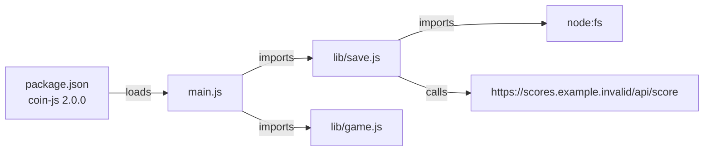
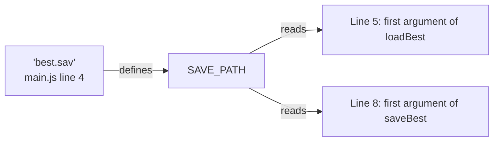

# Trying reverse engineering with REA

[Cheats and passthrough](21-cheats-and-passthrough.md) discussed looking into the memory of a running game from the outside. In this article, I actually download and run [REA](https://github.com/morluto/rea), a reverse engineering tool for AI agents, and do four experiments.

1. Build an image with the same layout as the RG40XXH's SD card and take it apart with REA
2. Rebuild a small game by watching only its behavior, and compare the original and the rebuild with REA
3. Look inside a .NET game without running it, and compare versions
4. Read a JavaScript game without running it, and compare versions

The experiment on reading the contents of machine code is long, so it is split off into the next article, [Reading machine code with REA and Ghidra](23-rea-and-ghidra.md).

All the subject material was either made by me for this article or is published by its distributor. The experiments were done on x86_64 Ubuntu 24.04. The sources used in the experiments are in [examples/rea-lab](../examples/rea-lab).

## What REA is

REA is a tool whose slogan is "reverse engineer anything". According to the [Japanese README](https://github.com/morluto/rea/blob/472b72a53068a8e2ec78fe239d687023482daaa7/README_ja.md), it is for having an agent investigate apps without source code and show how they work along with the evidence. It handles machine code programs (ELF, Mach-O, PE), JavaScript and Electron apps, .NET programs, and websites. The license is MIT, and it is distributed on npm under the name `rea-agents`.

The README states REA's position in the following three points.

- It does not claim to restore the original source code or automatically clone an entire app
- Analysis is done on the local machine, and the programs being examined are not sent to outside services
- Results include evidence and limitations

This article used `rea-agents` 4.1.0 from npm. Source code is quoted from GitHub commit `472b72a`, and I confirmed that the quoted processing is also present in the same form in 4.1.0 on npm.

### REA also looks at byte 18 of the ELF

REA identifies the type of a program from the first few bytes of the file ([binaryTarget.ts](https://github.com/morluto/rea/blob/472b72a53068a8e2ec78fe239d687023482daaa7/src/domain/binaryTarget.ts)). If the file begins with `7f 45 4c 46`, it treats the file as ELF, and it determines the CPU type from the number at the position 18 bytes from the start.

| Number starting at byte 18 | REA's determination |
|---|---|
| 3 | x86 (32-bit) |
| 62 | x86_64 |
| 40 | arm (32-bit) |
| 183 | arm64 |

In [CPUs and machine code](20-cpu.md), this position was `b7 00` (183) in a file for aarch64, and `3e 00` (62) in one for x86_64. REA reads the same place in the same way.

## What I prepared

| Item | Version | Obtained from | Role |
|---|---|---|---|
| REA | 4.1.0 | `rea-agents` on npm | The tool itself |
| Binwalk | 3.1.0 | Built from crates.io | Looks inside firmware for signatures of known formats |
| Unblob | 26.6.4 | PyPI | Extracts the contents of firmware |
| 7z, sasquatch | — | An Ubuntu package and a build from source | Used by Unblob to extract FAT and squashfs |
| Mono (`mcs`) | 6.8.0.105 | Ubuntu package | Compiles and runs the C# in experiment 3 |
| Node.js | 22.22.0 | — | Runs the JavaScript in experiment 4 |
| u-boot-sunxi | 2024.01+dfsg-1ubuntu5 | Ubuntu 24.04's distribution site for ARM | Real U-Boot for Allwinner |

The Binwalk and Unblob versions match those specified in REA's [firmware analysis documentation](https://github.com/morluto/rea/blob/472b72a53068a8e2ec78fe239d687023482daaa7/docs/firmware-analysis.md). REA does not install these tools itself. You tell it where they are with the environment variables `REA_BINWALK_COMMAND` and `REA_UNBLOB_COMMAND`.

Reading the contents of machine code requires one of the analysis engines Ghidra, Hopper, or IDA Pro. The experiments in this article are limited to those that work without an analysis engine. The experiments using Ghidra are done in the [next article](23-rea-and-ghidra.md).

## Experiment 1: Taking apart an SD card image

### Building the teaching image

I built a teaching image to match the ROCKNIX SD card layout read in [After you turn on the power](19-boot.md). The boot area is shrunk to 64MB rather than the real 2GB.

| Position | Contents |
|---|---|
| Sector 0 | MBR (the table of contents for partitions) |
| At 8KiB | Real U-Boot for Allwinner |
| 64MB from sector 32768 | FAT. `KERNEL`, `SYSTEM`, `extlinux/extlinux.conf`, DTB |
| The 32MB after that | ext4. `roms/gb/best.sav` |

`KERNEL` and the DTB are samples whose contents are a few dozen bytes. `SYSTEM` was made in squashfs format, the same as ROCKNIX, with one file, `/usr/bin/coin_term`, inside. This is the game used in experiment 2, compiled for the RG40XXH's CPU (aarch64).

For U-Boot, I used the build for the Orange Pi Zero Plus2 included in Ubuntu's `u-boot-sunxi`. This package has no build for the RG40XXH's H700. The Orange Pi Zero Plus2 is a machine with an Allwinner chip called the H5, and it is used here as a sample of the same Allwinner boot format.

### Reading the start of the real U-Boot

The 16 bytes at the 8KiB position in the image were as follows.

```
16 00 00 ea  65 47 4f 4e 2e 42 54 30  7d 6b 15 13
             e  G  O  N  .  B  T  0
```

The U-Boot source file [sunxi_image.h](https://github.com/u-boot/u-boot/blob/8d7bc8add17bbc69a58dfe0002eea039dd2dc1bc/include/sunxi_image.h) defines this header as `struct boot_file_head`.

| Bytes | Name in the definition | Meaning |
|---|---|---|
| `16 00 00 ea` | `b_instruction` | A single instruction that jumps to the real program |
| `eGON.BT0` | `magic` | Marker |
| `7d 6b 15 13` | `check_sum` | Number used for verification |

Reading the first 4 bytes as a 32-bit ARM instruction gave `b 0x60` (jump to address 0x60). It is an instruction that jumps over the header and proceeds to the program beyond it. This confirmed that the marker `eGON.BT0` described in article 19 is also present in a real file.

### Looking for signatures (inspect-firmware-regions)

First, I looked only for signatures, without extracting the contents.

```sh
export REA_BINWALK_COMMAND=/path/to/binwalk
rea inspect-firmware-regions lab.img --json
```

Binwalk found only the following one item.

```
offset 0  mbr  "DOS Master Boot Record, partition: FAT32, partition: Linux"
```

The result came with four limitations added by REA. The first said, in effect, "Finding a signature does not tell you that a region is valid, that it is unencrypted, or how it is laid out at run time." A signature search tool only tells you that "a known form is probably here."

### Extracting the contents (extract-firmware)

Next, I extracted the contents with Unblob.

```sh
export REA_UNBLOB_COMMAND=/path/to/unblob
rea extract-firmware lab.img out --json
```

The first and second attempts stopped partway. The reason for stopping came back with the name of the missing tool.

| Attempt | REA's report | What I did |
|---|---|---|
| 1st | For the whole input, `7z` not found (`ExtractorDependencyNotFoundReport`) | Installed Ubuntu's `7zip` |
| 2nd | For `SYSTEM`, which came out of FAT, `sasquatch` not found | Built [sasquatch](https://github.com/onekey-sec/sasquatch) from source |
| 3rd | No report of missing tools | Extraction ran to the end |

Laid out as a tree, the result of the third attempt looks like this.

```
lab.img
├── 0-16777216.unknown               … first 16MiB (MBR and U-Boot) remain "unknown"
├── 16777216-83886080.fat_extract/   … contents of FAT
│   ├── KERNEL
│   ├── extlinux/extlinux.conf
│   ├── device_trees/sun50i-h700-anbernic-rg40xx-h.dtb
│   ├── SYSTEM
│   └── SYSTEM_extract/              … contents of squashfs
│       ├── etc/os-release
│       └── usr/bin/coin_term        ← game for the RG40XXH
├── 83886080-117440512.extfs_extract/
│   └── roms/gb/best.sav             ← 2-byte save
└── 117440512-118489088.padding      … padding at the end
```

The SHA-256 of the extracted `coin_term` matched the file before it was put in the image (`fee30d64…`).

Even on the third attempt, the extraction coverage was reported as `partial`. This is because the first 16MiB remained "unknown". In this experiment, neither Binwalk nor Unblob recognized Allwinner's `eGON.BT0` header. This part has to be read using the knowledge from article 19.

### Examining the extracted game (inspect-artifact)

Finally, I had REA examine the extracted game.

```sh
rea inspect-artifact out/.../SYSTEM_extract/usr/bin/coin_term --json
```

REA determined the format to be ELF. It then wrote the following in the result.

- As a branch not yet examined (`unexplored_branches`): "Format-specific analysis is needed. `open_binary` has not been run"
- As the next thing to try (`next_probes`): "Before function analysis, choose one analysis engine and run `open_binary`"

Without an analysis engine, you cannot go any further from here. REA stops and states that it could not proceed. This continues in the [next article](23-rea-and-ghidra.md), after installing Ghidra.

## Experiment 2: Rebuilding from behavior alone

### The original game

I wrote a coin collecting game played in the terminal, in C ([coin_term.c](../examples/rea-lab/coin_term.c)).

- A single row 10 cells wide, where `@` is you and `$` is a coin
- `a` moves left and `d` moves right. Taking a coin gives 10 points, and the coin moves to another place
- `q` ends the game. If the best score is exceeded, it saves to `best.sav` as 2 bytes (the marker `0x4B` and the score), the same form as [gbdk-coin-plus](../examples/gbdk-coin-plus)

### Recording behavior (capture-process)

REA's `capture-process` runs a program with fixed input and records the text shown on screen, how it ended, and changes to files ([process-capture.md](https://github.com/morluto/rea/blob/472b72a53068a8e2ec78fe239d687023482daaa7/docs/process-capture.md)). The input is written in a JSON scenario.

```json
{
  "executable": "/path/to/coin_term",
  "working_directory": "/path/to/run",
  "filesystem_observation_paths": ["/path/to/run"],
  "events": [
    { "type": "input", "at_ms": 300, "data": "ddddddd\r" },
    { "type": "input", "at_ms": 800, "data": "q\r" }
  ],
  "normalization": { "ports": false, "time_bucket_ms": 1000 },
  "timeout_ms": 10000
}
```

This input, A, is "move 7 steps to the right, then quit". The record contained the screen output, exit code 0, the fact that `best.sav` was created, and its SHA-256.

```
[@......$..] score=0 best=0
[.@.....$..] score=0 best=0
...
[......@$..] score=0 best=0
[..$....@..] score=10 best=0
bye score=10
```

### Pitfall 1: The default settings were hiding the score

In the first record, `score=10` on the screen had been replaced with `score=<port>`. As its tidying before comparison (normalization), REA by default treats a number of 2 to 5 digits directly after `:` or `=` as a network port number and masks it (`(?<=[:=])\d{2,5}\b` in [ProcessNormalization.ts](https://github.com/morluto/rea/blob/472b72a53068a8e2ec78fe239d687023482daaa7/src/application/ProcessNormalization.ts)).

Left this way, you would not notice even if the scores differed. The scenario above turns this normalization off with `"ports": false`. This is an example of a tool's default settings sometimes hiding the very difference you want to see.

### Rebuilding

Looking only at the record of input A, I rebuilt the same game in Python ([coin_rebuild.py](../examples/rea-lab/coin_rebuild.py)). The record revealed the following.

- The width is 10 cells. `@` starts at 0 and `$` starts at 7
- `d` moves 1 cell to the right
- Taking `$` gives 10 points. The coin after 7 is at 2
- On quitting, it writes 2 bytes to `best.sav`: `0x4B` and the score

Behavior on hitting the left wall is not in the record. In the rebuild, I guessed "wraps around to the opposite side" and wrote that. The purpose was to see what happens when parts missing from the record are filled in by guessing.

### Comparing (compare-process-captures)

I recorded the original and the rebuild with the same two inputs and compared them.

| Input | Original (C) | Rebuild (Python) |
|---|---|---|
| A: 7 steps right (the input that was recorded) | 10 points. `best.sav` is `75 10` | Screen and `best.sav` both the same |
| B: 2 steps left, 1 step right (an input not tried) | Stops at the left wall, ends at cell 1 | Wraps around to the right end, ends at cell 9 |

The final screens for input B differed as follows.

```
Original  [.@.....$..] score=0 best=0
Rebuild   [.......$.@] score=0 best=0
```

Even when the two match on the recorded input, they behave differently in situations that were not recorded. REA's documentation also says, "Missing observations do not mean that two runs were the same." When rebuilding as a black box, the more inputs you try, the more differences you can find.

### Pitfall 2: REA's "same" is strict

REA's `compare-process-captures` determined "changed" (`changed`) even for input A. The screen text and the save were the same, so I checked the records to see what had differed.

| Item compared | Original (C) | Rebuild (Python) |
|---|---|---|
| Chunks of screen output | 29, 123, 90, 3, 14 characters each | 29, 125, 88, 3, 14 characters each |
| Time to settle after exit | 72 milliseconds | 77 milliseconds |
| Time the files were rechecked | After 918 milliseconds | After 928 milliseconds |

What differed was the way screen output was divided as it reached the terminal, and the time figures. Even with the setting that groups times into 1-second units (`time_bucket_ms`), these remained as differences. REA does not determine "same" when it cannot say for certain that there is no difference. You need to look not only at the word in the verdict but at what actually differs.

### Pitfall 3: To compare, the working folder must also match

At first, I ran the original and the rebuild in separate folders, so the comparison command stopped with an error. REA creates a "comparison contract" for each record, and only compares records with the same contract ([processComparison.ts](https://github.com/morluto/rea/blob/472b72a53068a8e2ec78fe239d687023482daaa7/src/domain/processComparison.ts)). The contract includes the working folder, the observed folders, the terminal size, the input timings, the normalization settings, and so on (`processComparisonContract` in [processScenario.ts](https://github.com/morluto/rea/blob/472b72a53068a8e2ec78fe239d687023482daaa7/src/domain/processScenario.ts)). The program being run is not itself part of the contract, so the original and the rebuild can be compared. Using the same folder and deleting `best.sav` before recording each time made them comparable.

## Experiment 3: Looking inside a .NET program without running it

I wrote the same coin collecting rules in C# ([CoinGame.cs](../examples/rea-lab/CoinGame.cs)). I compiled it to `CoinGame.exe` with Ubuntu's `mono-mcs` and had REA read it. REA examines .NET programs without loading or running them ([managed-code-analysis.md](https://github.com/morluto/rea/blob/472b72a53068a8e2ec78fe239d687023482daaa7/docs/managed-code-analysis.md)).

```sh
rea inspect-managed-members CoinGame.exe --json
```

The following could be read from the result.

| What was learned | Contents of the result |
|---|---|
| Type | `CoinGame` |
| Variables (fields) | `SaveMagic` (1 byte), `X`, `Coin`, `Score` (4-byte integers) |
| Functions (methods) | `.ctor`, `Move`, `SaveBest`, `Main` |
| Calls | `SaveBest` calls `File.WriteAllBytes`, and `Main` calls `Move` and `Console.WriteLine` |
| Variable reads and writes | `Move` reads and writes `X`, `Coin`, and `Score` |

In a C program compiled to machine code, function and variable names often do not remain. .NET programs are distributed not as machine code but in an intermediate language (CIL), with name and type information included.

### What happens to a mod's markers when the version changes (compare-managed-members)

Many mods for .NET games rewrite the game's functions. Harmony is one tool for this. According to Harmony's [documentation](https://github.com/pardeike/Harmony/blob/e7872dc17008bc0ca2b3de1f53fd4120dbd7a17c/Documentation/articles/annotations.md), the function to rewrite is specified by type, name, and argument types. For example, the specification for rewriting `String.IndexOf(char, int)` is `[HarmonyPatch(typeof(String), "IndexOf", new Type[] { typeof(char), typeof(int) })]`. What happens to a mod when the game is updated and a function's form changes?

To check this, I made a "next version" of `CoinGame.cs` ([CoinGame2.cs](../examples/rea-lab/CoinGame2.cs)). I deliberately changed the following five places.

| What changed | Version 1 | Version 2 |
|---|---|---|
| Type of the score | `int Score` | `long Score` |
| Number remaining | None | Added `int Lives = 3` |
| Function for moving | `Move(char key)` | `Move(char key, int steps)` (added step count) |
| Function for saving | `SaveBest(string, int)` | `SaveBestScore(string, long)` (changed name and types) |
| Machine code library | Not used | Added `GetProcessId`, which directly calls `getpid` in `libc` |

I had REA compare the two versions.

```sh
rea compare-managed-members v1/CoinGame.exe v2/CoinGame.exe --json
```

| REA's determination | What fell under it |
|---|---|
| Same (`unchanged`) | `SaveMagic` |
| Contents changed (`changed`) | `.ctor` (added initialization of `Lives = 3`), `Main` |
| Gone (`removed`) | `Move(char)`, `SaveBest` |
| Added (`added`) | `Move(char, int)`, `SaveBestScore`, `GetProcessId`, `long Score` |
| Cannot be determined (`unknown`) | The 4-byte integer fields. `X`, `Coin`, `Score` in version 1; `X`, `Coin`, `Lives` in version 2 |

Although the name `Move` is the same, its argument form changed, so it appeared as a pair of "gone" and "added". A mod that uses version 1's `Move(char)` as its marker will not find a function of the same form in version 2.

The last row is also important. There are three 4-byte integer fields in each version. When there are several fields of the same type, REA did not decide the correspondence by name alone and reported "cannot be determined". The limitations field of the result also says, "Names alone are not used as grounds for matching." To a person, `X` and `X` look the same, but having the same name does not necessarily mean having the same role.

REA's comparison feature serves as a tool for checking, with evidence, what an update changed.

### Finding the boundary with machine code (inspect-managed-native-boundaries)

What version 2's `GetProcessId` calls is a machine code library on Linux called `libc`. This boundary, leading out of .NET, can also be examined without running anything.

```sh
rea inspect-managed-native-boundaries v2/CoinGame.exe --json
```

REA found one declaration (P/Invoke) in which `GetProcessId` calls `getpid` in `libc`. It then wrote the following in the limitations field.

- Only the declaration was found, and whether `libc` and `getpid` actually exist was not checked
- Forms distributed after converting .NET to machine code, such as IL2CPP used in some Unity games, cannot be read by this tool alone. A separate machine code analysis engine is needed

.NET names can be read only up to this side of the boundary. Beyond the boundary lies the world of machine code analysis, covered in the [next article](23-rea-and-ghidra.md).

## Experiment 4: Reading a JavaScript game without running it

REA can also handle apps written in JavaScript. I wrote the same coin collecting rules in Node.js ([coin-js](../examples/rea-lab/coin-js)).

| File | Contents |
|---|---|
| `package.json` | App name, version, and the file to run first (`main.js`) |
| `main.js` | Reads the save, receives input, and saves if the best score is exceeded |
| `lib/game.js` | Rules for movement and score |
| `lib/save.js` | Reads and writes `best.sav` as 2 bytes (`0x4B` and the score) |

### Making a map of the whole (analyze-javascript-application)

```sh
rea analyze-javascript-application coin-js/v1 --json
```

REA does not run the JavaScript. It reads it as text, parses the syntax, and gathers the relationships between files into an "app map" (JavaScript Application Graph) ([javascript-application-workflows.md](https://github.com/morluto/rea/blob/472b72a53068a8e2ec78fe239d687023482daaa7/docs/javascript-application-workflows.md)). This time, of the four files involved, it analyzed the three that are JavaScript.

The result contained one determination that caught my attention. `main.js` was classified as `electron-main` (the part of an Electron app that runs first). This app does not use Electron. The result stated that the classification came from the `main` field in `package.json` (`mechanism: package.json:main`). REA's classifications need to be read together with their evidence.

### Making a version 2 and comparing (compare-application-versions)

In version 2, I changed the save to JSON form and added `submitScore`, which sends the score to a server. The destination is `scores.example.invalid`, using `.invalid` ([RFC 2606](https://www.rfc-editor.org/rfc/rfc2606)), which is reserved as a name that does not exist.

```js
async function submitScore(score) {
  await fetch('https://scores.example.invalid/api/score', {
    method: 'POST',
    body: JSON.stringify({ score }),
  });
}
```

Comparing the maps of versions 1 and 2 gave the following at the file level.

| Item | REA's determination | Evidence |
|---|---|---|
| `main.js`, `lib/game.js` | Same | SHA-256 of the contents matches |
| `lib/save.js` | Changed | Contents and properties differ |
| `package.json` | Changed | Version changed from `1.0.0` to `2.0.0` |
| `https://scores.example.invalid/api/score` | Added | Destination found from the `fetch` call |

Even though not one character of `main.js` was changed, at the level of "components loaded within the app", `main.js` and `lib/game.js` also appeared as pairs of "gone" and "added". The record shows that the identifiers of map components are valid per version (`stability: artifact-version`). REA's documentation says matching across versions is done in stages, using matching content hashes, structural fingerprints, and so on, and that ambiguous matches are not created. Read comparison results after checking which level a determination applies to.

### Tracing the path to the destination (trace-application-feature)

On the version 2 map, I had it trace the relationships starting from `lib/save.js`.

```sh
rea trace-application-feature trace.json --json
```



One path from `lib/save.js` to the destination was found. There is something to note here. `main.js` never calls `submitScore`. Even when actually run, no communication occurs. Even so, the map shows `lib/save.js` as "calling" the destination. REA's limitations field says, "Loads and destinations found statically are not proof that they actually ran." What the map shows is "what can happen", and the way to confirm "what did happen" is to run it, as in experiment 2.

### Tracing the flow of values (trace-javascript-semantics)

Finally, I traced where the string `"best.sav"` flows to.

```sh
rea trace-javascript-semantics semantics.json --json
```



This showed that `SAVE_PATH`, defined on line 4 of `main.js`, is passed to `loadBest` on line 5 and `saveBest` on line 8. However, the trace only reached within `main.js` and did not enter the functions in `lib/save.js` (the number of functions traced was 0).

Searching for the same `best.sav` with the text search in `trace-application-feature` gave 0 matches. Searching for `scores.example` with the same search found one destination. Even when searching for the same text, what can be seen differs by command.

## Ground rules

As in this article, it is safest to start by examining things with REA that you made yourself or that the distributor has published.

REA's `capture-process` runs a program with the current user's privileges. REA's documentation also says this is not a sandbox. Do not use this feature to run programs whose contents you do not know.

## Chinese terms in this article

The Chinese terms here were selected, for their relevance to this article's topic, from words whose sources were confirmed in other articles in this repository.

| Chinese | Pinyin | Meaning | Source |
|---|---|---|---|
| 固件 | gùjiàn | Firmware | [Baidu search results](https://www.baidu.com/s?wd=RG40XXH%20%E5%88%B7%E6%9C%BA%20%E5%9B%BA%E4%BB%B6%20Knulli%20%E6%95%99%E7%A8%8B) |
| 开源 | kāiyuán | Open source | [开源掌机吧](https://tieba.baidu.com/f?kw=%E5%BC%80%E6%BA%90%E6%8E%8C%E6%9C%BA) |
| 解压 | jiěyā | Decompress | [模拟器游戏 篇四](https://zhuanlan.zhihu.com/p/703325151) |
| 备份 | bèifèn | Backup | [Baidu search results](https://www.baidu.com/s?wd=RG40XXH%20%E5%88%B7%E6%9C%BA%20%E5%9B%BA%E4%BB%B6%20Knulli%20%E6%95%99%E7%A8%8B) |

## What you can learn

REA turned out to be a tool that always attaches evidence and limitations to its results. In taking apart the SD card image, it named the missing tools in its reports and left the parts it could not handle as "unknown". In comparing behavior, it could find differences in situations that were not recorded, while its default normalization hid differences and it counted even tiny timing differences as "differences". .NET programs keep their names and types, so their structure can be read without running them. The version comparison features, for both .NET and JavaScript, did not decide correspondences by name alone, and reported what could not be determined as "cannot be determined". The JavaScript map shows "what can happen", such as communication destinations, without running anything. Not simply trusting a tool's verdict, and reading through to its evidence and limitations, is the basis of reverse engineering.
