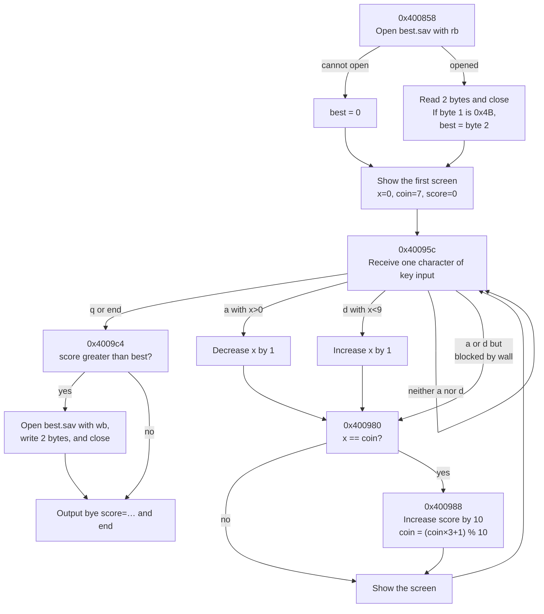

# Reading machine code with REA and Ghidra

[Trying reverse engineering with REA](22-rea-hands-on.md) took apart an SD card image and extracted `coin_term`, a game for the RG40XXH. However, it stopped just short of reading the machine code inside. Reading it required an analysis engine.

In this article, I install the analysis engine Ghidra and continue from there.

1. Find the function that handles saves, using a string as a clue
2. Draw the function's flow as a diagram and recover it as pseudocode (a form resembling C)
3. Try the same thing on a program with its function names removed
4. Use what was read to rewrite one byte and multiply the score by 5
5. Also read a function from a modified Pokémon Emerald

[CPUs and machine code](20-cpu.md) practiced reading instructions one at a time. In this article, I have a tool read the instructions in bulk and turn them back into a form that is easy for people to read. The experiments were done on x86_64 Ubuntu 24.04, using `rea-agents` 4.1.0 from npm for REA, the same as article 22. The scripts used are in [examples/rea-lab](../examples/rea-lab).

## Preparing Ghidra

[Ghidra](https://github.com/NationalSecurityAgency/ghidra) is a free reverse engineering tool published by the US National Security Agency (NSA). According to REA's [installation documentation](https://github.com/morluto/rea/blob/472b72a53068a8e2ec78fe239d687023482daaa7/docs/installation.md), REA uses Ghidra 12.1.4 and a 64-bit JDK 21. The supported platforms are Linux x64 and macOS (x64, arm64).

Normally you download it from [Ghidra's GitHub releases](https://github.com/NationalSecurityAgency/ghidra/releases). In this experiment's environment, that download was refused. So I extracted just the Ghidra folder from an image published on Docker Hub, `blacktop/ghidra:12.1.4`, and used that. I confirmed that the version was 12.1.4 in `Ghidra/application.properties` in the extracted folder. When trying this on a Mac, use the official release.

You tell it the locations with environment variables.

```sh
export GHIDRA_INSTALL_DIR=/path/to/ghidra_12.1.4_PUBLIC
export JAVA_HOME=/path/to/jdk-21
rea doctor --json
```

`rea doctor` checked three things, the Ghidra version, `analyzeHeadless` (the entry point for running Ghidra without a GUI), and the JDK version, and reported all of them as `healthy` (no problems).

## Tracing a function from a string

The subject is `coin_term`, extracted from the SD card image in [experiment 1 of article 22](22-rea-hands-on.md#experiment-1-taking-apart-an-sd-card-image). Its contents are the coin collecting game from experiment 2 of article 22 compiled for aarch64, with function names remaining.

In reverse engineering, you first look for a string that can serve as a clue. This game saves to `best.sav`, so I searched for this string.

```sh
rea search coin_term best.sav --provider ghidra --json
```

`best.sav` was at address `0x453648`. Next, I looked up the places that use this string (references).

```sh
rea xrefs coin_term 0x453648 --json
```

There were two references, `0x400894` and `0x400a34`. Searching for functions by name showed that `main` starts at `0x400858`, and both places are inside `main`.

These two steps can be combined into a single `rea trace`. It searches for the text, collects references, and goes as far as finding which function each reference is in.

```sh
rea trace coin_term best.sav --json
```

For each of the two references, the result said "inside `main` (528 bytes from `0x400858` to `0x400a67`)".

Each time a command is run, REA loads the game into Ghidra, analyzes it, and deletes it when finished (the limitations field of the result says so). In this experiment, each command took 30 to 40 seconds.

## Examining the whole function

`rea function` returns, all at once for a single function, the pseudocode, instructions, functions called, places it is called from, strings used, processing divisions, and more.

```sh
rea function coin_term main --json
```

`main` calls the following eight functions.

| Function | Role |
|---|---|
| `fopen64`, `fread`, `fwrite`, `fclose` | Open, read and write, and close `best.sav` |
| `fgetc` | Receive one character of key input |
| `draw` | Output one row to the screen |
| `___printf_chk` | Output the final `bye score=…` |
| `__stack_chk_fail` | Stop the program when it notices the function's work area (the stack) has been corrupted |

The last one, `__stack_chk_fail`, is not in the original source. It is a mechanism the compiler automatically added for safety.

`main` is called from one place, `0x400678`. This place comes up again in [when names are removed](#what-happens-when-you-remove-the-names).

### Drawing the flow as a diagram

The result of `rea function` contained 22 processing divisions (basic blocks) and where each one proceeds next. A basic block is a continuous group of instructions with no branches partway through. Combining the 22 with the contents of their instructions and grouping them by role gives the following diagram.



This diagram draws, at the scale of one function, what was seen in [CPUs and machine code](20-cpu.md): "instructions proceeding in order from the top, occasionally jumping." The `0x400988` in the diagram is the location of the instruction to be [rewritten](#rewriting-one-byte-to-multiply-the-score-by-five) later.

## Recovering pseudocode

I had Ghidra turn `main` back into pseudocode (a form resembling C).

```sh
rea decompile coin_term 0x400858 --json
```

From the result, here are the part that reads the save and the part that receives key input.

```c
  pFVar2 = fopen64("best.sav","rb");
  if (pFVar2 == (FILE *)0x0) {
    uVar7 = 0;
  }
  else {
    sVar3 = fread(&local_60,1,2,pFVar2);
    fclose(pFVar2);
    uVar7 = 0;
    if (((int)sVar3 == 2) && (uVar7 = (uint)local_5f, local_60 != 'K')) {
      uVar7 = 0;
    }
  }
  draw(0,7,0,uVar7);
  ...
    iVar1 = fgetc((_IO_FILE *)stdin);
    if (iVar1 == 0x71 || iVar1 == -1) {
      ...
    }
    if (iVar1 == 0x61 && 0 < iVar4) break;
    if (iVar1 == 100 && iVar4 < 9) {
      iVar4 = iVar4 + 1;
      goto LAB_00400980;
    }
    ...
        iVar6 = iVar6 + 10;
        iVar5 = (iVar5 * 3 + 1) % 10;
```

Comparing this with the original source shows the following.

| Pseudocode | Original source | How to read it |
|---|---|---|
| `local_60 != 'K'` | `b[0] == SAVE_MAGIC` | The marker `0x4B` is the same number as the character `K`, so Ghidra displayed it as a character |
| `0x71`, `0x61`, `100` | `'q'`, `'a'`, `'d'` | The key characters appear as plain numbers |
| `iVar4`, `iVar5`, `iVar6` | `x`, `coin`, `score` | Variable names do not remain. Giving them new names based on their roles is the reader's job |
| No `load_best` or `save_best` | The two functions exist | The compiler embedded functions called only once into `main` |

The last row is due to optimization at compile time. This game was compiled with `-O1`. According to GCC's [optimization documentation](https://gcc.gnu.org/onlinedocs/gcc/Optimize-Options.html), at `-O1`, `static` functions called only once are embedded in the caller (`-finline-functions-called-once`). The way pseudocode is divided into functions is not necessarily the same as in the original source.

### "% 10" had become a multiplication

The `(iVar5 * 3 + 1) % 10` in the pseudocode is the same as `(coin * 3 + 1) % WIDTH` in the original source. However, reading the instructions shows that no instruction dividing by 10 was used. Here is that part, from the instruction list in `rea function`.

```
mov   w25, #0x6667
movk  w25, #0x6666, lsl #16   … w25 = 0x66666667
add   w20, w20, w20, lsl #1   … coin × 3
add   w0, w20, #0x1           … + 1
smull x20, w0, w25            … multiply by 0x66666667
asr   x20, x20, #34           … shift right 34 bits (divide by 2 to the 34th power)
```

2 to the 34th power (17179869184) divided by 10 is 1717986918.4. Rounding this up gives 1717986919, which is `0x66666667` in hexadecimal. "Multiplying by `0x66666667` and dividing by 2 to the 34th power" gives the same answer as "dividing by 10". The compiler (GCC) replaced division by a fixed number with this kind of multiplication and shift. Ghidra saw this sequence and displayed it back as `% 10`. This is an example where pseudocode lets you grasp the meaning faster than reading the instructions directly.

## Checking the answer to experiment 2 of article 22

In [experiment 2 of article 22](22-rea-hands-on.md#experiment-2-rebuilding-from-behavior-alone), behavior at the left wall was not recorded, so the rebuild guessed "wraps around". The pseudocode contains the answer.

```c
    if (iVar1 == 0x61 && 0 < iVar4) break;   /* with a, move left only when right of 0 */
    if (iVar1 == 100 && iVar4 < 9) {         /* with d, move right only when left of 9 */
```

At the left and right ends, it stops and moves no further. It does not wrap around. The part that could only be filled in by guessing when watching behavior can be confirmed by reading the contents. On the other hand, taking a record of input B would have reached the same answer without reading the contents. If observation produces an answer, you can use it first.

## What happens when you remove the names

Distributed programs sometimes have their function names removed (stripping). I removed the names from the same game and tried the same steps.

```sh
aarch64-linux-gnu-strip -o coin_term_stripped coin_term
```

The string `best.sav` and the two places that use it (`0x400894` and `0x400a34`) were found the same way as with names. The following two things differed.

- No function named `main` is found. Other functions get names made from their addresses, such as `FUN_004007b0`
- Trying to turn `0x400858` back into pseudocode makes REA return an error saying "the input is invalid". This is because Ghidra has not registered this place as the start of a function

Examining the same thing with `rea trace` makes the difference clear. Both references were reported as "not in a function" (`found: false`, `reason: not_in_procedure`). The location of a reference is known, but Ghidra does not know the function that contains it.

Turning the program's entry point (`0x400640`) back into pseudocode gave the following.

```c
void entry(undefined8 param_1)
{
  ...
  FUN_00400b54(&DAT_00400674,in_stack_00000000,&stack0x00000008,0,0,param_1);
  FUN_004002c0();
}
```

The entry point passes the address `0x400674` to another function. I read the 8 bytes at `0x400674`.

```sh
rea read-bytes coin_term_stripped 0x400674 --length 8 --json
```

The result was `1f2003d5 78000014`. Read with an aarch64 disassembler (`aarch64-linux-gnu-objdump`), these are two instructions: "do nothing" (`nop`) and "jump to `0x400858`" (`b 0x400858`). Checking the version with names, `0x400674` is named `__wrap_main` and `0x400858` is named `main`. In other words, following two steps from the entry point gets you to `main`.

## Running Ghidra directly

I could not find a command for registering a new function in REA's command list (`rea --help`) or in the [installation documentation](https://github.com/morluto/rea/blob/472b72a53068a8e2ec78fe239d687023482daaa7/docs/installation.md). According to the documentation, REA's operations on Ghidra are read-only, apart from those that write function names and descriptions. So I directly used `analyzeHeadless`, which comes with Ghidra. Ghidra has a mechanism for running a small program written in Java (a script) after analysis. The following script registers a function at the specified address if there is none, and outputs the pseudocode ([DecompAt.java](../examples/rea-lab/DecompAt.java)).

```java
Address a = toAddr(getScriptArgs()[0]);
Function f = getFunctionAt(a);
if (f == null) {
    disassemble(a);
    f = createFunction(a, null);
}
DecompInterface d = new DecompInterface();
d.openProgram(currentProgram);
DecompileResults r = d.decompileFunction(f, 60, monitor);
println(r.getDecompiledFunction().getC());
```

```sh
analyzeHeadless ./proj lab -import coin_term_stripped -deleteProject \
  -scriptPath ./scripts -postScript DecompAt.java 0x400858
```

The result begins as follows.

```c
undefined8 FUN_00400858(void)
{
  ...
  lVar4 = FUN_00401e50("best.sav",&DAT_00453640);
  if (lVar4 == 0) {
    uVar7 = 0;
  }
  else {
    iVar2 = FUN_00401e70(&cStack_60,1,2,lVar4);
    FUN_00401870(lVar4);
    ...
    if ((iVar2 == 2) && (uVar7 = (uint)bStack_5f, cStack_60 != 'K')) {
```

The shape of the game's processing is the same as with names. However, library functions such as `fopen64` and `fread` also lost their names and became `FUN_`. This game was compiled in a form that bundles the libraries inside the program (`-static`), so the library functions lost their names too.

From here, you deduce a function's role from its arguments. `FUN_00401e50` is passed two things: `"best.sav"` and `DAT_00453640`. The contents of `0x453640` were the characters `rb`. Since it receives a file name and `rb` (open for reading), you can guess that it is a function that opens a file. Checking the version with names, `0x401e50` was `fopen`. Likewise, `0x401e70` is `fread` and `0x401870` is `fclose`.

| Address | With names removed | With names |
|---|---|---|
| `0x400858` | Not found as a function | `main` |
| `0x401e50` | `FUN_00401e50` | `fopen` |
| `0x401e70` | `FUN_00401e70` | `fread` |
| `0x401870` | `FUN_00401870` | `fclose` |
| `0x4007b0` | `FUN_004007b0` | `draw` |


REA also has a command that gives names and descriptions to existing functions. I tried giving a name to `0x4007b0` in the version with names removed.

```sh
rea annotate-native-function coin_term_stripped 0x4007b0 --name draw_row --comment "row of 10 cells"
```

The result returned the function's information, containing the new name `draw_row` and the description. However, according to REA's documentation, this write disappears when the analysis is closed. The program file itself is not rewritten. The work of naming unnamed functions based on their roles makes up most of reverse engineering. If you work in Ghidra's GUI, you can save the names you give to the project.

## Rewriting one byte to multiply the score by five

Up to this point, everything has been reading only. Finally, I use what was read to rewrite the game. The score for taking a coin changes from 10 points to 50 points.

### Deciding where to rewrite

In the [flow diagram](#drawing-the-flow-as-a-diagram), the instruction that increases the score was at `0x400988`. I had REA disassemble this instruction.

```sh
rea inspect-native-instruction coin_term 0x400988 --json
```

| Item | Result |
|---|---|
| Instruction | `add w21,w21,#0xa` (add 10 to `w21`) |
| Bytes in the file | `b5 2a 00 11` |
| Length | 4 bytes |

`w21` is the score and `#0xa` is 10. The bytes `b5 2a 00 11` are in the reverse order of the instruction's number `0x11002ab5` because aarch64 follows the rule of placing the lowest digits in memory first (little endian).

Next, I looked up how many bytes from the start of the file this instruction is. The addresses Ghidra displays are the positions when the program is placed in memory, which differ from the positions in the file.

```sh
rea address-to-file-offset coin_term 0x400988 --json
```

The answer was byte 2440.

### Rebuilding the instruction

In the aarch64 `add` instruction, the number to add is in the 12 bits from bit 10 to bit 21 of the 32 bits. Extracting it from `0x11002ab5` gives `0xa` (10). Changing this to 50 (`0x32`) makes the instruction `0x1100cab5`, and the bytes to write in the file `b5 ca 00 11`. What changes is just one byte: the second byte, `2a`, becomes `ca`.

```sh
cp coin_term coin_term_x50
printf '\xb5\xca\x00\x11' | dd of=coin_term_x50 bs=1 seek=2440 conv=notrunc
```

When I had REA turn the rewritten file back into pseudocode, the score line had changed as follows.

```c
        iVar6 = iVar6 + 0x32;   /* 0x32 is 50 */
```

### Running it to confirm

An aarch64 program does not run as is on an x86_64 machine. As in [CPUs and machine code](20-cpu.md), it is run through the emulator QEMU (`qemu-aarch64`). In the scenario for REA's `capture-process`, I made `qemu-aarch64` the program to run and passed the game file as an argument.

```json
{
  "executable": "/usr/bin/qemu-aarch64",
  "arguments": ["/path/to/coin_term_x50"],
  "working_directory": "/path/to/run",
  "filesystem_observation_paths": ["/path/to/run"],
  "events": [
    { "type": "input", "at_ms": 500, "data": "ddddddd\r" },
    { "type": "input", "at_ms": 1200, "data": "q\r" }
  ],
  "normalization": { "ports": false, "time_bucket_ms": 1000 },
  "timeout_ms": 15000
}
```

I recorded the original game and the rewritten game with the same input.

| | Original | After rewriting |
|---|---|---|
| Final screen | `bye score=10` | `bye score=50` |
| `best.sav` | `4b 0a` (10 points) | `4b 32` (50 points) |
| Exit code | 0 | 0 |

As intended, rewriting one byte multiplied the score by 5. The save also has 50 points written in it.

### Pitfall: The recorded "program fingerprint" belongs to QEMU

REA's record keeps the SHA-256 of the program that was run (`executable_sha256`). Comparing the two records, this value was the same. What REA fingerprinted was `qemu-aarch64`, written under `executable`, and the game file, as one of the arguments, remained only as a path.

When running through an emulator, the record says "the same program was run with different arguments". To show which game was run, you need to take a `sha256sum` yourself and keep it with the record.

The verdict of `compare-process-captures` was again `changed`. What was reported as the first difference was not the score but the way the screen output was divided. As in [pitfall 2 of article 22](22-rea-hands-on.md#pitfall-2-reas-same-is-strict), you need to check the contents, not only the word in the verdict.

### If you take it to the real device

The rewritten file is for aarch64, the same as the RG40XXH. However, ROCKNIX's `SYSTEM` is squashfs and read-only ([the OS article](18-os.md)). To replace a file inside, `SYSTEM` needs to be rebuilt. This article did not confirm this on the real device.

## Also reading a function from Emerald

In [CPUs and machine code](20-cpu.md), the `GetStarterPokemon` of a modified Emerald was turned back into instructions with `arm-none-eabi-objdump` and read. This time, I use Ghidra to read `pokeemerald.elf` (36MB, for the GBA's ARM) from the build in which all three starter Pokémon were changed.

At first, searching for the function with REA's `rea search` timed out after 330 seconds (`provider_timeout`). So I changed the script above into a form that finds a function by name ([DecompByName.java](../examples/rea-lab/DecompByName.java)) and ran it directly with `analyzeHeadless`. Analysis took about 5 minutes, and the log has 8 lines of errors saying that part of the debug information (DWARF) could not be read. Even so, the analysis itself ended in "success".

```c
undefined2 GetStarterPokemon(uint param_1)
{
  undefined2 uVar1;

  uVar1 = 0x19;
  if ((param_1 & 0xffff) < 4) {
    uVar1 = *(undefined2 *)(DAT_0820bc50 + (param_1 & 0xffff) * 2 + 8);
  }
  return uVar1;
}
```

This corresponds line by line with the instruction table in article 20.

| Pseudocode | Instruction in article 20 | Meaning |
|---|---|---|
| `param_1 & 0xffff` | `lsls`, `lsrs` | Fit the number to 16 bits |
| `uVar1 = 0x19;` | `movs r0, #25` | Put 25 (Pikachu) in first |
| `< 4` | `cmp r3, #3` and `bhi` | If greater than 3, return with 25 as is |
| `DAT_0820bc50` | `ldr r2, [table position]` | The place where the table's position is written |
| `* 2 + 8` | `lsls r3, r3, #1`, `ldrh r0, [r2, #8]` | Double the number and read 2 bytes from the position with 8 added |

Reading the 4 bytes at `0x0820bc50` gives `0x08ca3f08`, and adding 8 gives `0x08ca3f10`, the position of the table `sStarterMon`. The table's 6 bytes are `19 00 85 00 bf 01`: 25 (Pikachu), 133 (Eevee), and 447 (Riolu).

The condition in the original source is `chosenStarterId > STARTER_MON_COUNT` (greater than 3), and Ghidra wrote the same meaning as `< 4`. As a result, when the number is 3, it reads the next 2 bytes of a table with room for only three Pokémon. A boundary that is easy to overlook in the source appears as a number in the pseudocode.

## Hopper and IDA Pro could not be tried

[Hopper](https://www.hopperapp.com/) is a paid reverse engineering tool. According to REA's [installation documentation](https://github.com/morluto/rea/blob/472b72a53068a8e2ec78fe239d687023482daaa7/docs/installation.md), Hopper has a free trial version (demo) for Linux, and REA's `rea setup` can verify Hopper's official package before installing it. This experiment's environment could not connect to Hopper's distribution site, so I did not try it.

IDA Pro is a paid tool sold by Hex-Rays. REA does not install IDA Pro itself but uses it through a separate tool called [ida-pro-mcp](https://github.com/mrexodia/ida-pro-mcp) ([IDA documentation](https://github.com/morluto/rea/blob/472b72a53068a8e2ec78fe239d687023482daaa7/docs/ida-provider.md)). Obtaining IDA Pro and arranging a license is up to the user. According to REA's README, what has been verified is operation with IDA 9.3 on Windows. IDA Pro could not be obtained in this environment, so I did not try it.

According to REA's documentation, the appearance of pseudocode differs by engine, and REA does not treat them as the same (the result of `rea decompile` also said, "This is Ghidra output, and its text will not be the same as Hopper output").

## Ground rules

What was rewritten in this article is a game I made myself. Rewriting and distributing other people's games can violate game terms of service and the law.

REA's `capture-process` is not a sandbox ([article 22](22-rea-hands-on.md#ground-rules)). Even through QEMU, the program runs with the current user's privileges.

## Environment used

| Item | Version |
|---|---|
| OS | x86_64 Ubuntu 24.04 |
| REA | `rea-agents` 4.1.0 from npm |
| Ghidra | 12.1.4 (extracted from `blacktop/ghidra:12.1.4` on Docker Hub) |
| JDK | OpenJDK 21.0.11 (Ubuntu package) |
| Compiling for aarch64 | `aarch64-linux-gnu-gcc -O1 -static` |
| Running aarch64 | `qemu-aarch64` (Ubuntu's `qemu-user`) |

## What you can learn

With Ghidra installed, REA found functions from strings and returned function flow and pseudocode with evidence. The pseudocode closely resembled the original source, but variable names were gone, small functions were embedded, and `% 10` was a multiplication at the instruction level. In a program with its names removed, even `main` cannot be found as a function, so you follow instructions from the entry point and find it yourself. Using what was read, rewriting one byte changed the game's score. On the other hand, you need to check each time what a tool's record refers to; for example, going through an emulator makes the fingerprint in the record QEMU's. Hopper and IDA Pro could not be tried in this environment.
