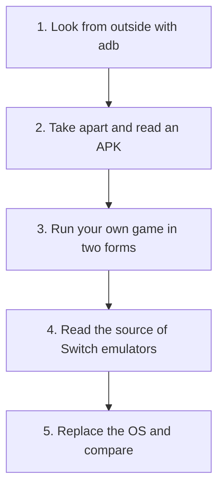
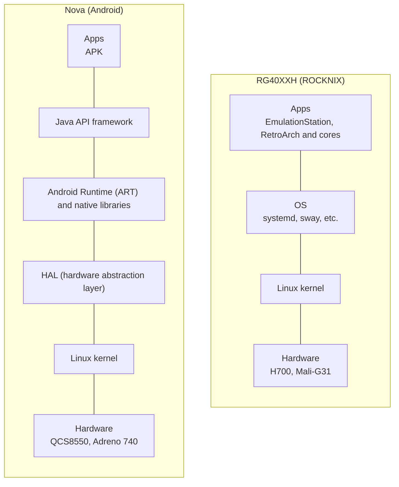
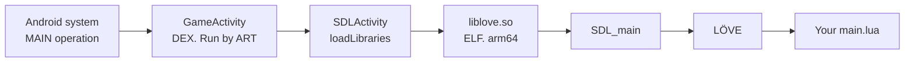
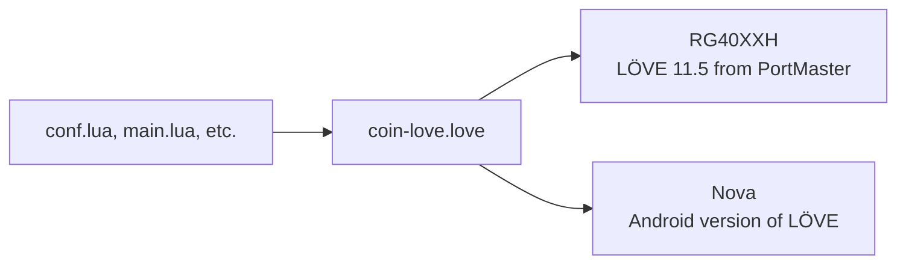

# Learning Android with the Nova: a study plan compared with the RG40XXH

Up to [Reading machine code with REA and Ghidra](23-rea-and-ghidra.md), we have read the insides of the RG40XXH as a Linux machine. In this article, I choose the Android handheld Retroid Pocket Nova (the Nova from here on) as the next device and plan what to learn, and in what order, after it arrives.

A plan alone cannot verify anything inside the device before it arrives. So I decided to read files of the same kind as those that will go on the Nova in advance. I took apart the official Android version (APK) of LÖVE with REA and traced in the code the flow from app launch to the game running. I also rebuilt the coin collecting game from [article 22](22-rea-hands-on.md) in LÖVE and confirmed that it produces the same screen as the original C version.

## Approach of this article

I settled on the following four points.

- Learn how Android works
- Compare what I learn with Linux on the RG40XXH
- Do not put a Linux-based OS on the Nova; compare with the RG40XXH using Android only
- Do not buy cards loaded with games; prepare the data to play myself

I do not have the Nova itself yet. Nothing has been verified on a real device. What I verified is official documents, manufacturer pages, repositories, and the results of experiments run in this environment (Ubuntu 24.04 on x86_64). What has not been verified is collected in the last section.

## Nova specifications

| Item | Details | Source |
|---|---|---|
| Chip | QCS8550. A Snapdragon 8 Gen 2 with the cellular communication part removed | [LineageOS](https://wiki.lineageos.org/devices/RPN), [Notebookcheck](https://www.notebookcheck.net/Retroid-Pocket-Nova-launches-as-4-3-Android-handheld-with-a-229-starting-price.1328608.0.html) |
| GPU | Adreno 740 | [掌机圈](https://zhangjiquan.com/handheld/retroid-pocket-nova) |
| Memory | 8GB or 12GB | [Retroid official](https://www.goretroid.com/products/retroid-pocket-nova-handheld) |
| Storage | 128GB (UFS 3.1) and a microSD card slot | [Notebookcheck](https://www.notebookcheck.net/Retroid-Pocket-Nova-launches-as-4-3-Android-handheld-with-a-229-starting-price.1328608.0.html) |
| Screen | 4.5-inch, 4:3, AMOLED, 1280×960, 120Hz | [Notebookcheck](https://www.notebookcheck.net/Retroid-Pocket-Nova-launches-as-4-3-Android-handheld-with-a-229-starting-price.1328608.0.html) |
| Weight | 255g | [掌机圈](https://zhangjiquan.com/handheld/retroid-pocket-nova) |
| Price | 8GB version from $239 (as shown in the official shop on October 3, 2026) | [Buying guide](09-buying.md) |

The screen's aspect ratio is 4:3, the same as the RG40XXH. The same game can be run and compared on both devices with the same screen shape.

## What you need

Besides the Nova itself, what you need is a USB cable to connect the Mac and the Nova. The microSD card is only for holding your own games and data, so a blank card is enough.

I will not buy a card loaded with games. Such cards contain a menu screen called Tianma G and data from commercial games ([article on Tianma G](05-frontend-tianma-g.md)). Much of that data is thought to lack permission from the rights holders, and it is not needed for study either. As seen in the [buying guide](09-buying.md), some Chinese proxy services refused this kind of product on grounds of "suspected rights infringement."

### The role of the memory card

On the RG40XXH, the SD card was everything. The OS, games, and saves are all on one card ([article on the OS](18-os.md), [article on booting](19-boot.md)). On the Nova, the OS is on the device's internal storage. The microSD card is a place for additional data.

| | RG40XXH | Nova |
|---|---|---|
| Where the OS is | SD card | Internal storage of the device |
| How to look inside | Connect the SD card to a computer. You can also get in over SSH ([article 14](14-making-games.md)) | Connect to the Mac with a USB cable and use adb |

So the center of Android study is not writing to an SD card. It is connecting the Mac and the Nova with a USB cable and operating the device from the Mac.

## The big picture of the study plan

The learning order is five stages that move from the outside in.



| Stage | What to learn | Corresponding study on the RG40XXH |
|---|---|---|
| 1 | Look inside the Nova from outside with adb | Examine the contents of the SD card ([article on the OS](18-os.md), [article on booting](19-boot.md)) |
| 2 | Read the contents of an APK | Read ELF ([article 22](22-rea-hands-on.md), [article 23](23-rea-and-ghidra.md)) |
| 3 | Run the same game on Linux and Android | Run LÖVE with PortMaster ([article 14](14-making-games.md)) |
| 4 | Read the translation when the CPU is the same ARM but the GPU differs | CPUs and machine code ([article 20](20-cpu.md)) |
| 5 | Compare the original Android with an Android whose source is public | Read how booting works ([article 19](19-boot.md)) |

## The big picture of Android: side by side with Linux on the RG40XXH

Before going into detail, I will line up the stacks of the two devices. In [article 15](15-rg40xxh-big-picture.md), the RG40XXH was divided into three layers: hardware, OS, and apps. Android's official description ([Platform architecture](https://developer.android.com/guide/platform)) divides things somewhat more finely.



The official description tells us the following.

- The bottom layer of Android is also a Linux kernel. ART relies on the kernel for low-level handling of threads and memory.
- The HAL is a layer that provides a standard interface for each component, such as the camera or Bluetooth. When the framework uses a component, the system loads the library for that component.
- ART runs apps in a dedicated bytecode called DEX. Java (or Kotlin) source is converted to DEX by tools such as d8.
- On Android 5.0 and later, each app gets its own process and its own ART.

In other words, up to the kernel, both the RG40XXH and the Nova are the same Linux. The difference is in what goes on top. The RG40XXH is built so that a menu and emulators run on an OS that remains plain Linux. Android places the HAL, ART, and framework between the kernel and the apps, and handles apps in the "form of an APK." The second half of this article checks that "form" on a real file.

## Stage 1: Looking from outside with adb

adb is a tool for connecting to an Android device from a computer and operating it ([official description of adb](https://developer.android.com/tools/adb)). To use it, you reveal "Developer options" in the device's settings and enable USB debugging. LineageOS's [installation instructions](https://wiki.lineageos.org/devices/RPN/install/) also list, as preparation, a computer that can use adb and fastboot, and enabling USB debugging.

The first four commands to use are below. These are uses written in the official description, and I have not yet tried them on the Nova.

| Command | What it does | Basis |
|---|---|---|
| `adb devices` | Lists connected devices. If connected, the device's name is shown as "device" | [Description of adb](https://developer.android.com/tools/adb) |
| `adb shell` | Lets you type Unix commands inside the device. Available tools can be checked with `adb shell ls /system/bin` | [Description of adb](https://developer.android.com/tools/adb) |
| `adb push local-file device-location` | Sends a file to the device | [Description of adb](https://developer.android.com/tools/adb) |
| `adb logcat` | Outputs the device's log. This includes messages your own app wrote with the `Log` class | [Description of logcat](https://developer.android.com/tools/logcat) |

On the RG40XXH, I pulled the SD card and looked at the contents. On Android, the same kind of thing is done with the USB cable left connected.

The biggest difference from using SSH on the RG40XXH is probably Android's app isolation. According to the [official description](https://developer.android.com/guide/components/fundamentals), Android is a multi-user Linux in which each app is assigned a different user. The system decides a unique user ID for each app, and permissions on that app's files are set so that only that ID can read them. Apps basically run in their own process and their own virtual machine. How much of other apps' data is visible when connected with adb should be affected by this isolation, and I will check how it looks on the Nova.

## Stage 2: Taking apart and reading an APK

Without waiting for the delivery, I read files of the same kind as those that will go on the Nova in advance. The material is the official Android version of LÖVE, `love-11.5-android.apk`. It was obtained from the [LÖVE release page](https://github.com/love2d/love/releases/tag/11.5); its SHA-256 is `10a804f8…` and its size was 7,719,206 bytes. PortMaster on the RG40XXH also uses LÖVE 11.5, so two forms of the same version can be compared.

### Looking at the file's form

An APK is a zip file. `unzip -l` lists the contents.

| Inside | Size and characteristics |
|---|---|
| `AndroidManifest.xml` | 10,172 bytes. A table listing the app's name, permissions, and accepted operations |
| `classes.dex` | 1,048,564 bytes. DEX bytecode converted from Java code |
| `lib/arm64-v8a/` | Four shared libraries (such as `liblove.so`). For 64-bit ARM |
| `lib/armeabi-v7a/` | The same four. For 32-bit ARM |
| `assets/dexopt/` | Such as `baseline.prof`. Judging by the name, probably files related to DEX optimization, but the contents have not been read |
| `res/` and others | Resources such as images and text |

In total there are 427 files, which come to 16,553,372 bytes when extracted. Libraries for x86 are not included. Since the Nova's CPU is ARM, `arm64-v8a` for 64-bit ARM should be used. Which one is selected will be checked on the real device.

In [article 20](20-cpu.md), we identified the "shape of the box" from the leading bytes. I did the same with the contents of the APK.

| File | Leading bytes | What this tells us |
|---|---|---|
| `lib/arm64-v8a/liblove.so` | `7f 45 4c 46`, `b7 00` (183) at offset 18 | ELF, for arm64 |
| `lib/armeabi-v7a/liblove.so` | `7f 45 4c 46`, `28 00` (40) at offset 18 | ELF, for 32-bit ARM |
| `classes.dex` | `64 65 78 0a 30 33 35 00` (`dex\n035`) | Marker of the DEX format |
| `AndroidManifest.xml` | `03 00 08 00 …` | Binary XML, not text XML |

Games on the RG40XXH are ELF executables. An Android APK wraps in a zip both ELF components (`.so`) and the DEX that ART reads.

I also checked with `readelf -d` the components that `liblove.so` (arm64 version) loads. They include `libGLESv2.so` and `libGLESv1_CM.so`, which shows that LÖVE uses OpenGL ES on Android. Others listed include `libopenal.so`, `libmpg123.so`, `libc++_shared.so`, `liblog.so`, and `libandroid.so`.

### Reading the manifest with REA

REA from [article 23](23-rea-and-ghidra.md) has commands for reading APKs ([REA's description](https://github.com/morluto/rea/blob/472b72a53068a8e2ec78fe239d687023482daaa7/docs/android-analysis.md)). The prerequisites are Java 17 or later and version 0.7.1 of [jadx-headless-mcp](https://github.com/1013503897/jadx-headless-mcp), which is based on JADX. REA does not install these itself. This time, I obtained the public JAR that REA specifies, confirmed that its SHA-256 (`6e5eacf5…`) matched REA's record, and then used it. The JDK used was OpenJDK 21.

```sh
export REA_JADX_MCP_JAR=/path/to/jadx-headless-mcp-0.7.1-all.jar
rea inspect-android-package love-11.5-android.apk --json
```

One command took about 10 seconds. The key points of the result are as follows.

| Item | Result |
|---|---|
| Package name | `org.love2d.android` |
| Version | `11.5a` (version code 32) |
| Minimum Android | API 16 |
| Target Android | API 34 (Android 14) |
| Number of classes | 928 |
| Number of resources | 427 |
| Signature verification | Not performed (`not_performed`) |

Seven permissions are declared.

| Permission | Notes |
|---|---|
| `READ_EXTERNAL_STORAGE`, `WRITE_EXTERNAL_STORAGE` | `maxSdkVersion` is 28. Used only on devices up to Android 9 (API 28) |
| `INTERNET` | Network communication |
| `VIBRATE` | Vibration |
| `BLUETOOTH` | Bluetooth |
| `RECORD_AUDIO` | Audio recording |
| `org.love2d.android.DYNAMIC_RECEIVER_NOT_EXPORTED_PERMISSION` | A permission defined by this app itself. `protectionLevel` is `signature` |

The manifest also lists declarations of non-required features. Touchscreen, gamepad, Bluetooth, and USB host are all `required="false"`, a declaration that the app can be installed without them. For the OpenGL ES version, `glEsVersion` was `0x20000` (2.0 or later).

### Declarations of accepted operations

`GameActivity` (the screen that runs the game) lists several accepted operations (intent filters). (According to the [official description of intent filters](https://developer.android.com/guide/topics/manifest/intent-filter-element), they declare the kinds of operations an app component can respond to.)

| What it accepts | Condition |
|---|---|
| Operation to open a file (VIEW) | `file://`, with a name ending in `.love` |
| Operation to open a file | `content://`, with type `application/x-love-game` |
| Operation to open a file | `content://`, with type `application/octet-stream` |
| Operation to launch from the app list (MAIN, LAUNCHER) | Appears in the launcher list |
| Operation of connecting a USB device | `USB_DEVICE_ATTACHED` |

In other words, when you open a `.love` in a file manager app, the Android version of LÖVE steps forward and says "I can open this file." The explanation in the [love-android README](https://github.com/love2d/love-android/blob/4c65fff4f8b38693aca5d91bc06f254f86a97adf/README.md), "it runs if you open a `.love` in a file manager app," is backed by this declaration.

Another component, `DownloadActivity`, accepts operations to open URLs over `http` and `https` that end in `.love`.

### Names that remain and names that disappear

Searching for classes with REA found 14 under `org.love2d.android`.

```sh
rea search-android-classes love-11.5-android.apk org.love2d.android --json
```

`DownloadActivity`, `DownloadService`, `GameActivity`, `R`, and `SelectorActivity` keep their names. The rest have one-letter names: `a`, `b`, `c`, …, `i`. The 90 SDL components likewise divide into those that keep their names, like `SDLActivity`, and those whose names disappeared, like `a`, `a0`, and `b1`.

What keeps its name is the classes written in the manifest and the resource class `R`. The rest are thought to have been replaced with short names during conversion. This is the same kind of event as in [article 23](23-rea-and-ghidra.md), where an ELF with its names stripped showed names like `FUN_00401e50`. The reader renames things based on their role.

## Stage 2, continued: From app launch to the game running

I read the contents of `GameActivity` with REA. It has 33 methods and 17 variables.

```sh
rea inspect-android-class love-11.5-android.apk org.love2d.android.GameActivity --json
rea inspect-android-method love-11.5-android.apk org.love2d.android.GameActivity handleIntent --json
```

### The parent class and loading libraries

The parent of `GameActivity` is SDLActivity. SDLActivity has 100 methods, including `loadLibraries`, `getMainFunction`, and `nativeRunMain`.

What `GameActivity` overrides is the list of libraries to load.

```java
protected String[] getLibraries() {
    return new String[]{"c++_shared", "mpg123", "openal", "love"};
}
```

SDLActivity loads this list in order.

```java
public void loadLibraries() {
    for (String str : getLibraries()) {
        SDL.loadLibrary(str);
    }
}
```

The last one, "love," corresponds to `liblove.so`. The name of the function to start is set to `"SDL_main"` on the SDLActivity side. Looking at `liblove.so` with `strings` also turned up the string `SDL_main`. The `run` method of SDL's `SDLMain` class has the role of passing the names gathered so far to the native `nativeRunMain`.

```java
String mainSharedObject = SDLActivity.mSingleton.getMainSharedObject();
String mainFunction = SDLActivity.mSingleton.getMainFunction();
...
SDLActivity.nativeRunMain(mainSharedObject, mainFunction, arguments);
```

This connects the chain inside the APK.



On the RG40XXH, PortMaster's launch script called the LÖVE executable, and LÖVE ran `main.lua`. On Android, there is one more layer, the Java layer on the Android side, and from there control passes to the same LÖVE (`liblove.so`).

### How the game data is found

`GameActivity.onCreate` calls `handleIntent`. Checking the callers of `handleIntent` with REA's `trace-android-references` showed two: `onCreate` and `onNewIntent`.

```sh
rea trace-android-references love-11.5-android.apk org.love2d.android.GameActivity --method-name handleIntent --json
```

The contents of `handleIntent` are the following branches (only the key points are extracted).

```java
String scheme = data.getScheme();
if (scheme.equals("file")) {
    // If it points to main.lua, its parent folder. Otherwise, that file
    gamePath = ...;
} else if (scheme.equals("content")) {
    // Copy the file to the app's cache location and use it
    String str = getCacheDir().getPath() + "/" + (the last name or "game.love")...;
    if (copyAssetFile(getContentResolver().openInputStream(data), str)) {
        gamePath = str;
        this.storagePermissionUnnecessary = true;
    }
} else {
    // Unsupported form. Show an error screen
}
```

When no game was passed by an operation, `getGamePath` tries two other paths.

| Order | Condition | Behavior |
|---|---|---|
| 1 | A file was passed by an operation | The `handleIntent` branches above |
| 2 | A game is embedded in the APK (`embed` is true) | Copies `game.love` from `assets` to the cache and uses it (`copyGameInsideArchive`) |
| 3 | Neither | Looks for `lovegame/main.lua` under `getExternalFilesDir("games")` (`checkLovegameFolder`) |

The `getExternalFilesDir` in the third is an app-specific location on external storage. According to the [official description](https://developer.android.com/training/data-storage/app-specific), files placed there disappear when the app is uninstalled. On devices up to Android 9 (API 28), it also looks for `/sdcard/lovegame/main.lua`.

These three conditions correspond directly to three paths for running your own game on the Nova.

| Path | What to do | Good for |
|---|---|---|
| Open from a file manager app | Open the `.love` in a file manager app | Trying things easily |
| Place with adb | Send `lovegame/main.lua` to the app-specific location with `adb push` | Replacing it repeatedly during development |
| Embed in the APK | Put `game.love` in `assets` and rebuild the APK | Distributing a finished game |

Where things end up will be checked on the Nova using `adb`.

This way of reading is practice in "guessing where things are before reading the code." I looked at the `.love` declaration in the manifest, predicted the branches in `handleIntent`, and the prediction matched the code.

## Stage 3: Running your own game in two forms

Now that I understand how to read the Android version of LÖVE, I will prepare a game to run. I rebuilt the coin collecting game from [article 22](22-rea-hands-on.md) in LÖVE. The rules and the shape of the on-screen text match the original C version ([coin-love](../examples/rea-lab/coin-love)).

### The rebuild

The game's rules are separated into `game.lua`. This is the part that depends on neither the screen nor the terminal.

```lua
function M.move(g, key)
  if key ~= "a" and key ~= "d" then return false end
  if key == "a" and g.x > 0 then g.x = g.x - 1 end
  if key == "d" and g.x < M.WIDTH - 1 then g.x = g.x + 1 end
  if g.x == g.coin then
    g.score = g.score + 10
    g.coin = (g.coin * 3 + 1) % M.WIDTH
    if g.coin == g.x then g.coin = (g.coin + 1) % M.WIDTH end
  end
  return true
end
```

The saved high score also has the same form as in the C version. It is two bytes: the marker `0x4B` and the score.

```lua
love.filesystem.write("best.sav", string.char(game.SAVE_MAGIC, best))
```

`conf.lua` sets the screen to 640×480. This is 4:3, exactly half of the Nova's 1280×960. The [ROCKNIX RG40XX H page](https://rocknix.org/devices/anbernic/rg40xx-h/) lists the RG40XXH's screen as 640×480 as well, though this series has not checked it on the device.

### Does it produce the same screen as the original game?

So it can be checked without a screen, I made a test entry point that takes a key sequence as an argument, as in `love . selftest ddddddd`. I ran LÖVE 11.5 (the Ubuntu package) on a virtual screen (Xvfb).

```sh
xvfb-run -a love coin-love selftest ddddddd
```

The output matched operation A from article 22 (move seven steps right, then end) line by line.

```
[@......$..] score=0 best=0
[.@.....$..] score=0 best=0
...
[......@$..] score=0 best=0
[..$....@..] score=10 best=0
bye score=10
```

Compared with the output of the C version using `diff`, all screen lines matched. In article 22, the original game stopped at the left wall while the rebuilt Python version wrapped around, and they diverged on operation B. This LÖVE version copies the stopping-at-the-wall behavior read from the pseudocode in article 23. The last line of operation B (two steps left, one step right) was also `[.@.....$..]`, the same as the C version.

The saved `best.sav` is `4b 0a` (the marker and 10 points), the same form as what the C version writes.

### Wrapping it into two forms

A LÖVE game wrapped in a zip becomes a file called `.love`.

```sh
zip -r -X coin-love.love conf.lua game.lua main.lua save.lua
xvfb-run -a love coin-love.love selftest ddddddd
```

Here I checked one pitfall. Zipping the whole folder puts `main.lua` one level deeper. That `.love` did not start (after waiting 10 seconds, there was no output and it did not exit). The LÖVE binary contains the text "`No code to run`, the package may be wrong, `main.lua` must be at the top of the zip." Because this is an error shown on the screen, I have not seen the text itself in this environment.



### The RG40XXH side: a PortMaster example

I read how one LÖVE game registered with PortMaster is put together: the launch script of [100 Lil Jumps](https://github.com/PortsMaster/PortMaster-New/blob/82be96be2a0cca803990e9ac7ef57f8d2c017fa0/ports/100liljumps/100%20Lil%20Jumps.sh). The folder has the following form.

```
100 Lil Jumps.sh          Launch script
100liljumps/
  100liljumps.love        The game itself (.love)
  100liljumps.ini         Button assignments
  conf/love/100 lil jumps/savefile.lua   Save
```

The key points of the launch script come down to the following four lines.

```sh
export XDG_DATA_HOME="$CONFDIR"                       # Put the save location inside the game's folder
source $controlfolder/runtimes/"love_11.5"/love.txt   # Load the LÖVE 11.5 runtime
$GPTOKEYB2 "$LOVE_GPTK" -c "./100liljumps.ini" &      # Convert buttons to keyboard input
$LOVE_RUN "$GAMEDIR/100liljumps.love"                 # Run the .love
```

I also checked locally how the `XDG_DATA_HOME` in the first line determines the save location. Running `coin-love` with `XDG_DATA_HOME=/tmp/xdgtest` created `best.sav` at `/tmp/xdgtest/love/coin-love/best.sav`. This mechanism is why `conf/love/<game name>/` appears in a PortMaster game's folder.

One more point is worth noting. On ROCKNIX, this game does not support the graphics driver called Panfrost. If `glxinfo` shows `OpenGL version string`, the script concludes that Panfrost is in use, displays a message telling you to switch to libMali, and exits.

```sh
if [[ "$CFW_NAME" = "ROCKNIX" ]]; then
  if glxinfo | grep -q "OpenGL version string"; then
    pm_message "This port does not support the Panfrost graphics driver. Switch to libMali to play."
```

This is an example of how, even with the same LÖVE, whether a game runs changes with the choice of GPU driver. On the Android side too, LÖVE uses `libGLESv2.so`. The topic of the Nova's GPU drivers comes up again in stage 4.

### The Android side

Running LÖVE on the Nova is one of the three paths read in stage 2. First, install the Android version of LÖVE and open `coin-love.love` from a file manager app. The save location should be the app-specific location, but exactly where it ends up will be checked with `adb`.

For input, `coin-love` accepts the gamepad's D-pad (`dpleft`, `dpright`) as well as the keyboard's `a` and `d`. On the RG40XXH, `gptokeyb` converted buttons to keyboard input. Whether D-pad input reaches LÖVE on Android will not be known until it is checked on the real device. What the manifest declares is only that the app can be installed without a gamepad (`required="false"`), and how the D-pad is handled cannot be determined from it.

## Stage 4: Reading the source of Switch emulators

The Nova's Snapdragon 8 Gen 2-equivalent chip is much newer than the Tegra X1 of the original Switch. Even so, not every game runs on a Switch emulator. That is because an emulator is an interpreter.

| Component | Original Switch | Nova |
|---|---|---|
| CPU | ARM Cortex-A57 and A53 | High-performance ARM cores |
| GPU | NVIDIA Maxwell, 256 cores | Qualcomm Adreno 740 |

The sources for the table are an [explanation of the Switch's chip](https://guru3d.com/story/nintendo-switch-houses-a-nvidia-tegra-x1-soc) and the [Nova page on 掌机圈](https://zhangjiquan.com/handheld/retroid-pocket-nova).

Both CPUs belong to the ARM family. The Switch emulator [Eden](https://github.com/eden-emulator/mirror) has a method on Android called NCE (Native Code Execution). It is a method that runs the game's CPU instructions as they are, with almost no translation.

The GPUs differ in both company and design, so drawing methods for NVIDIA have to be retranslated for Adreno. Eden's [documentation](https://github.com/eden-emulator/mirror/blob/10bcd2d849843b146a79c61a21df615e1bdcfcde/docs/user/Architectures.md) also says that when NCE is available, the GPU tends to become the performance limit. In particular, on Android, Adreno, Mali, and others are weak compared with the CPU.

The ROCKNIX [Nova page](https://rocknix.org/devices/retroid/retroid-pocket-nova/) lists Freedreno and Turnip as GPU drivers. A driver is the component that passes translated instructions to the GPU. Adreno has the same kind of difference as the Panfrost and libMali topic seen in stage 3.

### Size of the source

I counted the number of files in the four folders of the Eden repository relevant to this topic. The comparison is between Eden on October 5, 2026, and the final period of yuzu (March 3, 2024, commit `c280f95b1a4b2a415a26a7db9f2b9823042f2781`).

| Folder | Role | Eden | Final yuzu |
|---|---|---|---|
| `src/android` | Android app | 583 | 413 |
| `src/dynarmic` | Translation of CPU instructions | 439 | 0 |
| `src/shader_recompiler` | Translation of GPU shaders | 238 | 241 |
| `src/video_core` | Drawing | 438 | 370 |

`src/dynarmic` was not in `src` in the final period of yuzu. This article did not investigate the reason.

### Source you can read

Switch emulator repositories have disappeared or moved because of takedown requests. Only those whose contents could be checked from this environment are listed here.

| Item | Location | What was checked |
|---|---|---|
| Eden | [GitHub mirror](https://github.com/eden-emulator/mirror) | GPLv3 or later. Includes Android. Contains yuzu's history up to March 3, 2024 |
| Ryujinx | [Archival copy on GitLab](https://gitlab.com/dragonloverlord/ryujinxbackup) | MIT license. GitLab gives the project's creation date as October 3, 2024 |
| Kenji-NX | [GitLab](https://gitlab.com/kenji-nx/Ryujinx) | MIT license. Contains Ryujinx's history from 2018. On November 2, 2026, opening it without logging in showed GitLab's sign-in page |

yuzu ended development in March 2024 in a settlement with Nintendo ([The Sixth Axis](https://www.thesixthaxis.com/2024/03/05/switch-emulator-yuzu-shuts-down-in-2-4-million-settlement-with-nintendo/)). In the Eden repository, switching to `c280f95b1a4b2a415a26a7db9f2b9823042f2781` lets you read the source from just before the end.

Using a Switch emulator requires keys, firmware, and games taken from your own Switch ([Eden's steps](https://github.com/eden-emulator/mirror/blob/10bcd2d849843b146a79c61a21df615e1bdcfcde/docs/user/QuickStart.md)). While I do not own a Switch, I will limit this to studying by reading the source.

## Stage 5: Replacing the OS and comparing

I will swap between the Nova manufacturer's Android and LineageOS and compare them. LineageOS is an Android whose source code is public, and the Nova is an officially supported device (code name `RPN`). The preparation in the [installation instructions](https://wiki.lineageos.org/devices/RPN/install/) says that the model number must match `RPN`, that the original OS must be booted at least once, and that the Google account must be removed.

The official page could not be opened directly when this was first written, so a summary obtained through search was used. On November 2, 2026, the page could be opened, its requirements matched the above, and it stated that the instructions are for LineageOS 24.0. When doing the work, please read the official page from the beginning.

This stage is left for the very end. Replacing the OS is work that writes to the inside of the device, and unlike the RG40XXH, you cannot go back just by swapping an SD card. I will do it only after finishing stages 1 to 4 on the original Android. There are three things I want to compare.

- The list of installed apps and differences in their permissions
- Differences in how the same APK behaves
- Differences in the behavior and saving of the same `coin-love`

## First things to do when it arrives

When the device arrives, I will fill in "what has not been tested" in the following order.

| Order | What to do | What to check |
|---|---|---|
| 1 | Look up the model number and Android version | Whether the listing's "Android 13" is correct |
| 2 | Reveal Developer options and enable USB debugging | Whether the device appears on the Mac with `adb devices` |
| 3 | Go in with `adb shell` and look at `ls /system/bin` | The list of available tools |
| 4 | Launch a game app while running `adb logcat` | The log at launch |
| 5 | Install the Android version of LÖVE and open `coin-love.love` | Whether it runs. Whether the D-pad input arrives. The location of `best.sav` |
| 6 | Place `lovegame/main.lua` with `adb push` | Whether the third path read in stage 2 actually works |

## Overall comparison with the RG40XXH

| What to compare | RG40XXH | Nova |
|---|---|---|
| Where the OS is | SD card | Internal storage |
| Replacing the OS | Rewrite the SD card | Use adb and fastboot to write to the inside of the device |
| App form | ELF ([CPUs and machine code](20-cpu.md)) | APK. A zip that wraps DEX and ELF |
| Tool for reading the contents | Read ELF with REA | Read APKs with REA's Android commands |
| How LÖVE is run | PortMaster's launch script calls the runtime | Android's GameActivity calls `liblove.so` |
| Save location | Inside the game's folder via `XDG_DATA_HOME` | App-specific location (to be checked on the real device) |
| GPU | Mali-G31 MP2. Some games do not run depending on the driver choice | Adreno 740. Freedreno and Turnip are listed |
| Emulators you can play | 8- to 16-bit consoles and PS1, up to some DC and PSP ([article on emulation](06-emulation.md)) | Up to some Switch |

## What has not been tested

Since I do not have one yet, all behavior on a real Nova is unconfirmed. Specifically, this means the version of the stock Android, the four adb commands, the behavior of the Android version of LÖVE, gamepad input, and the save location of `best.sav`. Of the LineageOS installation steps, only the requirements section has been read; the steps have not been tried.

On the reading side, I only read the Android APK of LÖVE without running it. REA did not perform signature verification. The APK's actual behavior has not been verified. Whether REA's Android commands can run on a Mac is also unconfirmed. This reading was done on Linux (Ubuntu on x86_64).

`coin-love` was run on LÖVE 11.5 on Linux. It has not been run on PortMaster on the RG40XXH or on Android. The total cost of shipping to Japan from the official shop, including shipping and taxes, has also not been researched yet.

## Ground rules

The work described in this article applies only to machines I own and data I prepared myself. The APK I read is an official LÖVE distribution, and I have not modified or redistributed its contents. Data used with Switch emulators is also limited to what was taken from my own Switch.

## Chinese terms in this article

| Chinese | Pinyin | Meaning | Source |
|---|---|---|---|
| 安卓 | ānzhuō | Android | [掌机圈 RG-556](https://zhangjiquan.com/handheld/rg-556) |
| 模拟器 | mónǐqì | Emulator | [模拟器游戏 篇四](https://zhuanlan.zhihu.com/p/703325151) |
| 内存 | nèicún | Memory | [掌机圈 RG-35XX H](https://zhangjiquan.com/handheld/rg-35xx-h) |
| 天马 | tiānmǎ | Tianma, the name of a menu screen | [CNFans](https://cnfans.com/search?keywords=RP5%E9%A2%84%E8%A3%85%E5%A4%A9%E9%A9%AC&searchType=keywords) |

## What you can learn

Lining up the Nova with the RG40XXH lets you compare on real devices how the same "machine for running games" is built differently on Linux and Android. Up to the kernel they are the same Linux, and Android is what places the HAL, ART, and framework on top and handles apps in the form of an APK. An APK turned out to be a box that wraps a manifest, DEX, and ELF shared libraries in a zip. Only names written in the manifest remain, and the rest become one-letter names, which is the same as an ELF with its names stripped. In the Android version of LÖVE, we could trace the launch chain from the manifest's declarations through `GameActivity`, SDL, and `liblove.so` to `main.lua`. The three paths for where a game is placed could also be read from the code.

The coin collecting game I made produced the same screen and the same save in the C version and the LÖVE version (Linux). The next task is to run that same game on the Nova's Android. The reason Switch emulators only partly work was that, even with the same ARM CPU, GPU translation is heavy. Its size can also be confirmed from the scale of the source. When the device arrives, let's fill in the "First things to do when it arrives" table from the top.
