# Turning an original Switch into your own homebrew development device

Up to [Learning Android with the Nova](24-android-nova.md), we have looked at two lines: the RG40XXH and Android. This article covers a third device, the original Nintendo Switch (the base model). The scope is limited to units manufactured before mid-2018 that still have the hardware vulnerability (fusée gelée). This vulnerability stems from how the chip itself is built, so it cannot be closed by software updates ([Switchbrew documentation](https://switchbrewdocs.readthedocs.io/en/latest/hacking/rcm.html)).

This article explains the steps for running your own homebrew apps on a unit you own. Dumping commercial software and using illegal copies are out of scope.

## How this article is organized

The "work steps" in the first half go through, in order, booting CFW (custom firmware) using a Mac. Chapters 1–8 in the second half explain how each step works and its background.

| Part | Contents |
|---|---|
| [Work steps](#work-steps-on-a-mac-with-images) | Steps 0–10. From preparing the tools to booting CFW on emuMMC |
| [Chapter 1](#1-identifying-your-unit)–[Chapter 2](#2-what-to-prepare) | How to identify eligible units, RCM jigs, AutoRCM |
| [Chapter 3](#3-entering-rcm-mode)–[Chapter 4](#4-sending-a-payload) | RCM mode and tools for sending payloads (including methods without a PC) |
| [Chapter 5](#5-booting-from-hekate)–[Chapter 6](#6-creating-emummc) | hekate's boot entries and how emuMMC works |
| [Chapter 7](#7-running-homebrew-hbmenu)–[Chapter 8b](#8b-modifying-existing-games) | Homebrew, your own apps, mods, cheats |

## Work steps (on a Mac, with images)

The steps are based on the content of the [Switch Guide](https://switch.hacks.guide/) (an installation guide run by Nintendo Homebrew) as of October 2026 (the source is commit `64db3a8` of [nh-server/switch-guide](https://github.com/nh-server/switch-guide)). These steps have not been tried on a real device. Before working, and when something goes wrong, please also check the original Switch Guide pages.

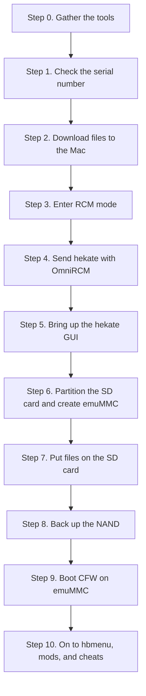

Among the images, those whose file names start with `switch-guide-` were taken from the Switch Guide repository (© Nintendo Homebrew, ISC license. The license text is in [LICENSE-switch-guide.txt](../assets/screenshots/LICENSE-switch-guide.txt)). Those starting with `github-` and `omnircm-` were captured for this article in October 2026 with Chrome (macOS version).

### Step 0. Gather the tools

| Item | How to choose | Explanation |
|---|---|---|
| RCM jig | One for the base-model Switch. The shape in the image below is the model recommended by the Switch Guide | [Chapter 2](#what-an-rcm-jig-is) |
| microSD card | 128GB or larger recommended. Use with FAT32 | [Chapter 2](#2-what-to-prepare) |
| USB cable | To match the Mac's port, USB-A to USB-C or USB-C to USB-C. One that supports data transfer (a charge-only cable will not be recognized) | [Chapter 4](#4-sending-a-payload) |
| Mac | Use a Chromium-based browser such as Chrome, or the Mac version of OmniRCM | [Chapter 4](#4-sending-a-payload) |

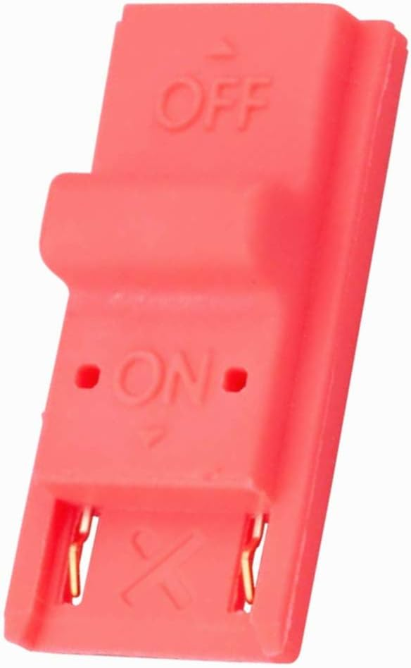

*The RCM jig model recommended by the Switch Guide. Insert the contacts at the tip into the right Joy-Con rail of the console. Image: [Switch Guide: Entering RCM](https://switch.hacks.guide/user_guide/rcm/entering_rcm)*

An RCM jig is a part for connecting pin 10 of the Joy-Con rail to GND (ground). If you substitute a paperclip or aluminum foil, you may touch pin 4, which carries 5V power, and destroy the console. The Switch Guide also warns never to use substitutes ([Switch Guide: Entering RCM](https://switch.hacks.guide/user_guide/rcm/entering_rcm)).

### Step 1. Check the serial number

1. Boot the Switch normally and open `Settings → System → Serial Information`
2. Enter the displayed serial number in the checker form on the Switch Guide's [Getting Started](https://switch.hacks.guide/user_guide/getting_started)
3. If it says "Unpatched," go on to the next step. If it says "Patched," the method in this article cannot be used. If it says "Potentially patched," check with the payload test in step 4

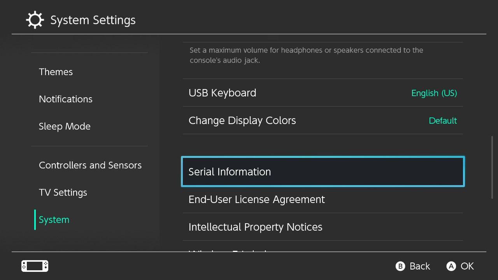

*Where Serial Information is. The image is in the English display; in the Japanese display, it corresponds to シリアル情報 (Serial Information) inside 本体 (System). Image: [Switch Guide](https://switch.hacks.guide/user_guide/getting_started)*

The serial number is also on a label on the bottom of the console, but the Switch Guide says that using the settings screen's display is more reliable. This is because, especially with used units, the label may not match the console ([Switch Guide: Getting Started](https://switch.hacks.guide/user_guide/getting_started)). How the determination works is explained in [Chapter 1](#1-identifying-your-unit).

### Step 2. Download files to the Mac

Download the following files to the Mac.

| File | Where to get it | Role |
|---|---|---|
| `OmniRCM-osx.zip` | [OmniRCM release page](https://github.com/DefenderOfHyrule/OmniRCM/releases/latest) | App that sends payloads from the Mac to the Switch |
| `hekate_ctcaer_(version)_Nyx_(version).zip` | [hekate release page](https://github.com/CTCaer/hekate/releases/latest) | The hekate bootloader and its GUI (Nyx) |
| `atmosphere-(version)-master-…+hbl-…+hbmenu-….zip` | [Atmosphère release page](https://github.com/Atmosphere-NX/Atmosphere/releases/latest) | The CFW itself and the homebrew launcher (hbmenu) set |
| `hekate_ipl.ini` | [Switch Guide's distributed file](https://switch.hacks.guide/files/emu/hekate_ipl.ini) | Settings for hekate's boot menu |
| `emummc.txt` | [Nintendo Homebrew's distributed file](https://nintendohomebrew.com/assets/emummc.txt) | Settings that stop emuMMC from connecting to Nintendo's servers |
| `bootlogos.zip` | [Switch Guide's distributed file](https://switch.hacks.guide/files/bootlogos.zip) | Icon images shown in the boot menu |

([Switch Guide: Sending a Payload](https://switch.hacks.guide/user_guide/rcm/sending_payload), [SD Preparation](https://switch.hacks.guide/user_guide/all/sd_preparation))

On a GitHub release page, choose the file name in the `Assets` section at the bottom of the page and download it. "Source code" is the program's source, so do not choose it.

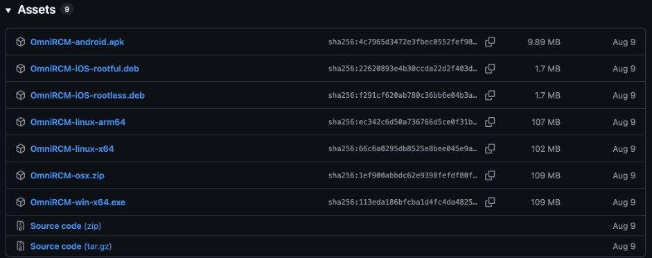

*OmniRCM's Assets section. On a Mac, choose `OmniRCM-osx.zip` (October 2026, v1.1.1)*

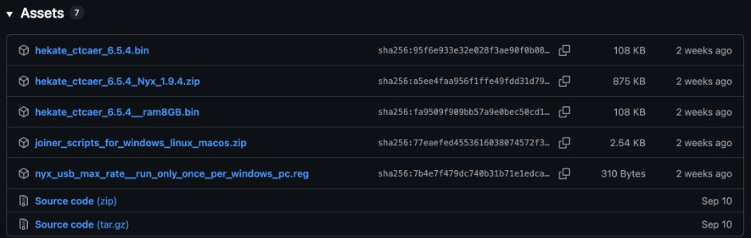

*hekate's Assets section. Choose the second one, `hekate_ctcaer_6.5.4_Nyx_1.9.4.zip` (October 2026, v6.5.4)*

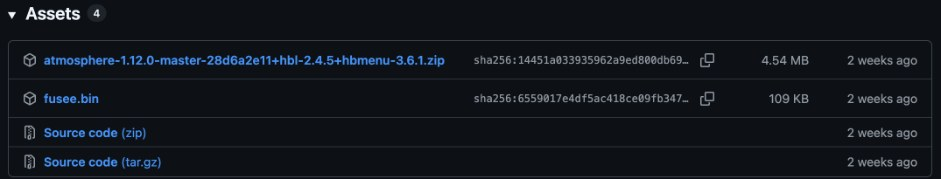

*Atmosphère's Assets section. Choose the first one, the zip. `fusee.bin` is Atmosphère's own bootloader and is not used in these steps (October 2026, 1.12.0)*

Atmosphère 1.12.1 came out on October 16, 2026, after these images were taken, so choose the latest release when you download. Its release notes say that on firmware 23.0.0, host redirection was not being applied at all, with no warning, and that 1.12.1 fixes this in `dns.mitm`. The `emummc.txt` in the table above relies on that redirection, so do not use an older Atmosphère with this firmware ([Atmosphère 1.12.1 release notes](https://github.com/Atmosphere-NX/Atmosphere/releases/tag/1.12.1)).

Besides the hekate zip, `hekate_ctcaer_6.5.4.bin` is also listed on its own, but this is a payload-only file. In these steps, OmniRCM fetches the hekate payload automatically, so there is no need to download it by hand. `nyx_usb_max_rate__run_only_once_per_windows_pc.reg` is a settings file for Windows, and the release notes also say it is "not needed on Linux/Mac OS" ([hekate v6.5.4 release notes](https://github.com/CTCaer/hekate/releases/tag/v6.5.4)).

Atmosphère also has its own bootloader called `fusee`, but the Switch Guide's steps use hekate, which offers functions such as NAND backup ([Switch Guide: SD Preparation](https://switch.hacks.guide/user_guide/all/sd_preparation)).

If you open `hekate_ipl.ini`, it lists three boot entries: `[Atmosphere PKG3 emuMMC]`, `[Atmosphere PKG3 sysMMC]`, and `[Stock sysMMC]`. `emummcforce=1` means always use emuMMC, `emummc_force_disable=1` means do not use emuMMC, and `stock=1` means boot in the stock state without loading CFW. The `icon=` lines point to the three icons (such as `emu_boot.bmp`) in `bootlogos.zip` ([hekate README](https://github.com/CTCaer/hekate)).

If you open `emummc.txt`, it lists lines such as `127.0.0.1 *nintendo.com`. It stops communication by pointing name resolution for Nintendo's domains at the device itself (127.0.0.1).

### Step 3. Enter RCM mode

1. Turn the Switch off completely (hold the power button → Power Options → Power Off. Not sleep)
2. Remove the right Joy-Con and insert the RCM jig all the way into the right Joy-Con rail
3. While holding the volume + button, press the power button once
4. If the screen stays black, it succeeded. If it stays black even after pressing the power button again, you are in RCM mode. Release volume + and pull out the jig

If the Nintendo logo appears and the console boots normally, it failed. Turn the power off and try again ([Switch Guide: Entering RCM](https://switch.hacks.guide/user_guide/rcm/entering_rcm)).

RCM is a recovery mode built into the boot program (BootROM) of the console's chip (Tegra X1). In this mode, the processing that receives a program (payload) sent over USB has a vulnerability, and that is used to run hekate. Nothing appears on screen because things have stopped at a stage before the OS boots. For details, see [Chapter 3](#3-entering-rcm-mode).

### Step 4. Send hekate with OmniRCM

1. Extract the downloaded `OmniRCM-osx.zip`, move `OmniRCM.app` to the `Applications` folder, and then open it in Finder
2. Connect the Switch in RCM mode to the Mac with a USB cable
3. Press `↓ Update` in the `Payloads` section to fetch the list of payloads
4. Select hekate and press the green `► Inject Payload`
5. If a warning such as `Update bootloader folder!` appears in yellow text on the Switch screen, it succeeded

([Switch Guide: Sending a Payload](https://switch.hacks.guide/user_guide/rcm/sending_payload))

If you prefer not to install an app, you can do the same by opening [OmniRCM Web](https://omnircm.nintendohomebrew.com/web/) in Chrome and going through `Connect device…` → select `APX` → select hekate → `Inject`.

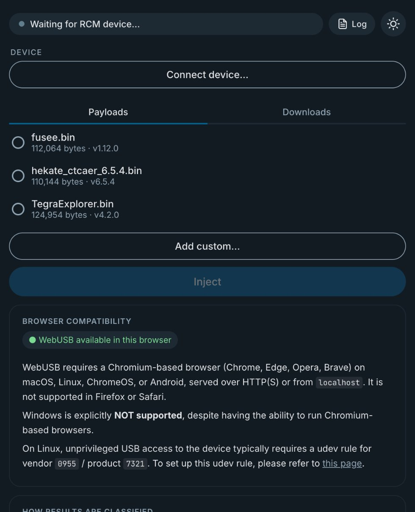

*OmniRCM Web. When you connect the Switch and press "Connect device…," the browser shows a USB device selection screen, so choose `APX`*

The reason for moving `OmniRCM.app` to the Applications folder in the first operation is to use the in-app auto-update. The OmniRCM v1.1.1 release notes say that to use auto-update from v1.1.0, the app must be copied to the Applications folder ([OmniRCM v1.1.1 release notes](https://github.com/DefenderOfHyrule/OmniRCM/releases/tag/v1.1.1)).

`APX` is the name by which a Switch in RCM mode identifies itself as a USB device.

The yellow warning appears because the SD card does not yet have hekate's files, and it is resolved in the next step. If no microSD card is inserted, `Failed to init or mount SD!` appears, but you need not worry about this either.

If the screen stays black, either the payload is corrupt or the unit is patched. If OmniRCM shows "Patched," the unit is definitely patched. For details, see [Chapter 4](#telling-success-from-failure).

### Step 5. Bring up the hekate GUI

Do the following with the hekate screen left up. **Do not turn off the Switch.** If you do, you have to start over from step 3.

1. Remove the microSD card from the Switch and insert it into the Mac (it is safe to remove it with the hekate screen up)
2. Copy the `Nintendo` folder on the card (and any other important data) to the Mac as a backup
3. Extract the downloaded hekate zip and copy the `bootloader` folder inside to the root of the card
4. Put the card back in the Switch and press a volume button or the power button to proceed to the hekate menu
5. `Warning: Nyx is missing!` appears at the bottom of the screen, but continue anyway. Use volume up and down to move to `load nyx`, and select it with the power button
6. If the screen in the image below (Nyx) appears, it succeeded

([Switch Guide: Sending a Payload](https://switch.hacks.guide/user_guide/rcm/sending_payload))

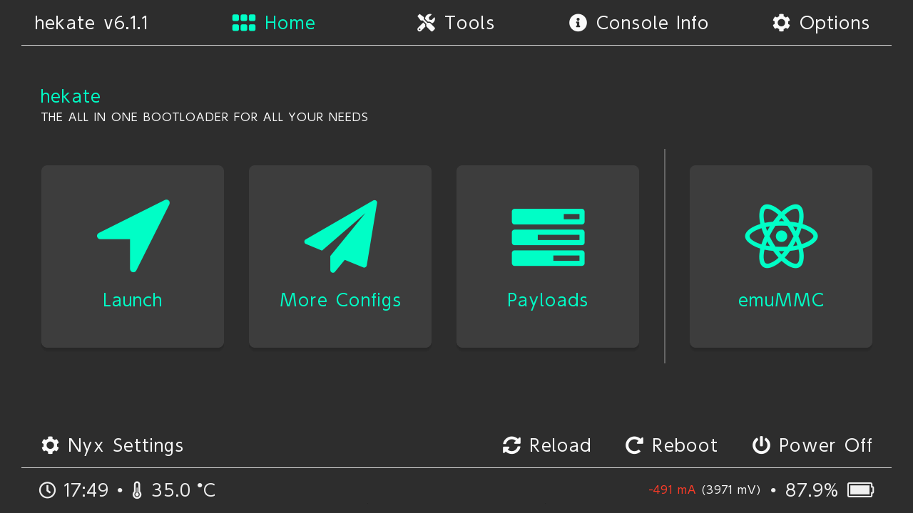

*The home screen of hekate's GUI (Nyx) (the image shows v6.1.1, current when it was captured). Image: [Switch Guide](https://switch.hacks.guide/user_guide/rcm/sending_payload)*

Nyx is hekate's touch-enabled GUI. Nyx itself is inside the `bootloader` folder placed on the card in the third operation. From here, you can operate with the touch panel or the left Joy-Con's stick. The `Nintendo` folder is where the Switch saves data such as game data. The card is initialized in the next step, so be sure to save a copy here.

### Step 6. Partition the SD card and create emuMMC

**This step erases everything on the microSD card.** Confirm that you made the backup in step 5 before proceeding.

1. Open `Tools → Partition SD card`
2. Set the `emuMMC (RAW)` slider to `29 FULL` at the center of the bar
3. Select `Next Step` at the bottom right, and select `Start` in the menu that appears. Initialization and partitioning begin
4. When finished, go back to `Home` and select `emuMMC → Create emuMMC → SD Partition → Part 1` (the one that is not grayed out). Creation takes time, so wait until it finishes
5. Close the creation menu with `Close`, and select `Change emuMMC → SD RAW 1` (the one that is not grayed out)
6. Press `Close` at the top right twice to go back to Home

([Switch Guide: Partitioning the microSD Card](https://switch.hacks.guide/user_guide/all/partitioning_sd))

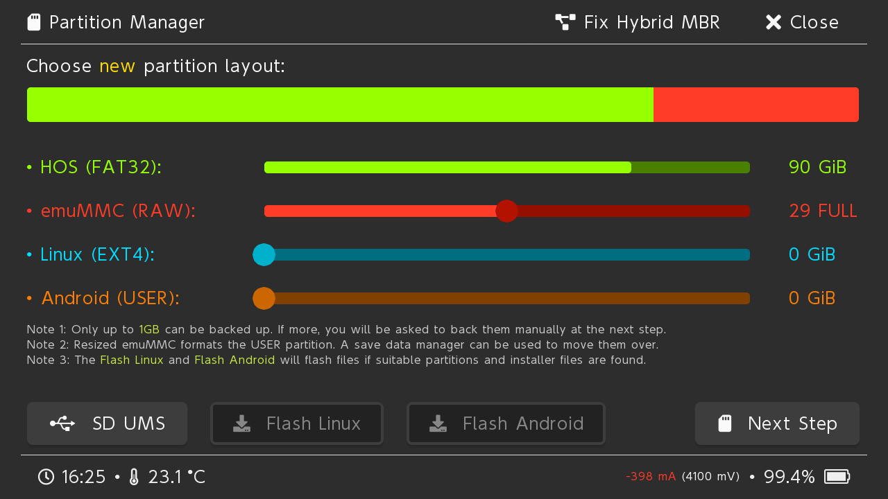

*The slider set to 29 FULL. If you do not plan to install Android or Linux, the other sliders can stay at 0. Image: [Switch Guide](https://switch.hacks.guide/user_guide/all/partitioning_sd)*

emuMMC is an exact copy of the console's internal storage (NAND) on the microSD card. The modified environment runs here, and the console's internal storage (sysMMC) can be kept as a stock environment for online use.

"29 FULL" reserves enough space to copy the entire internal storage of a base-model Switch. The Switch Guide uses the slider value 29 (58 for the OLED model) in its steps and describes the reserved size as 32GB (64GB for the OLED model) on another page, without explaining the difference. The remaining capacity becomes a normal FAT32 partition for holding games and homebrew.

"SD Partition" is a method that writes directly to a partition dedicated to emuMMC.

For the Part and SD RAW numbers, choose the ones not grayed out on screen. The steps above say 1, but this can differ by environment.

For details, see [Chapter 6](#6-creating-emummc).

### Step 7. Put files on the SD card

Because the partitions were recreated, the card is empty. Here you place the files needed to boot CFW. The easy way is to leave the card in and connect it to the Mac using hekate's USB function.

1. In hekate, select `Tools → USB Tools → SD Card` and connect the Switch to the Mac with a USB cable. A drive named `SWITCH SD` appears on the Mac
2. Extract the Atmosphère zip and copy its contents (the `atmosphere` folder, the `switch` folder, and `hbmenu.nro`) to the root of `SWITCH SD`
3. Copy the `bootloader` folder in the hekate zip to the root. If asked "Replace?", choose `Merge`
4. Extract `bootlogos.zip` and copy the `bootloader` folder inside to the root. Again, choose `Merge`
5. Copy `hekate_ipl.ini` into the `bootloader` folder. If asked whether to replace, replace
6. Create a `hosts` folder inside the `atmosphere` folder and put `emummc.txt` in it
7. Return the `Nintendo` folder you backed up in step 5 to the root. Also copy the same thing into `emuMMC/RAW1/` (match the number in `RAW1` to what is on the card)
8. Eject `SWITCH SD` in Finder, and then close hekate's USB screen

([Switch Guide: SD Preparation](https://switch.hacks.guide/user_guide/all/sd_preparation), [Making Essential Backups](https://switch.hacks.guide/user_guide/all/making_essential_backups))

The card's root is correct if it looks like the following image. The `Nintendo` folder will not exist yet if the Switch has never booted with this card. `payload.bin` is a file for consoles with a modchip, so it is not placed in these steps.

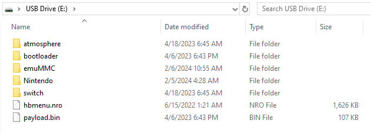

*The prepared card's root as seen in Windows Explorer. The structure is the same on a Mac. Image: [Switch Guide](https://switch.hacks.guide/user_guide/all/sd_preparation)*

For the Atmosphère zip, place "the contents" at the root, not "the whole folder created by extracting the zip." If you copy the whole folder, everything is one level deeper and hekate cannot find the files.

Watch out for "replace" on the Mac. When you copy a folder with the same name in Finder, by default it is replaced along with its contents, and the files you put in earlier disappear. The Switch Guide also says to explicitly choose "Merge" on macOS ([Switch Guide: SD Preparation](https://switch.hacks.guide/user_guide/all/sd_preparation)). If the merge option does not appear, copy the files in the folder individually.

Watch out for the archive bit on the Mac. Files copied on a Mac may get an attribute called the "archive bit," which causes homebrew and mods not to be recognized. If things do not work, run `Tools → Arch bit • RCM Touch • Pkg1/2 → Fix Archive Bit` in hekate ([Switch Guide: Game modding](https://switch.hacks.guide/extras/game_modding)).

If you do not place `emummc.txt`, emuMMC connects to Nintendo's servers and the chance of a ban becomes high. Be sure to place it. For details, see [Chapter 6](#cutting-emummc-off-from-the-network).

If you close the USB screen without ejecting, files that have not finished writing may be corrupted.

### Step 8. Back up the NAND

Before booting CFW, back up the console's entire internal storage. This is a step the Switch Guide emphasizes "never skip."

1. Open `Tools → Backup eMMC` in hekate
2. Select `eMMC BOOT0 & BOOT1` (finishes in a few seconds to about a minute)
3. Press `Close`, then select `eMMC RAW GPP` (takes 10 minutes to over an hour)
4. When finished, go back with `Close → Home` at the top right
5. Connect to the Mac with `Tools → USB Tools → SD Card` and copy the card's `backup` folder to a safe place on the Mac
6. When the copy is finished, delete the `backup` folder on the card, eject it in Finder, and then return to the hekate screen

([Switch Guide: Making Essential Backups](https://switch.hacks.guide/user_guide/all/making_essential_backups))

If the card does not have enough free space, hekate stops partway and shows the next screen.

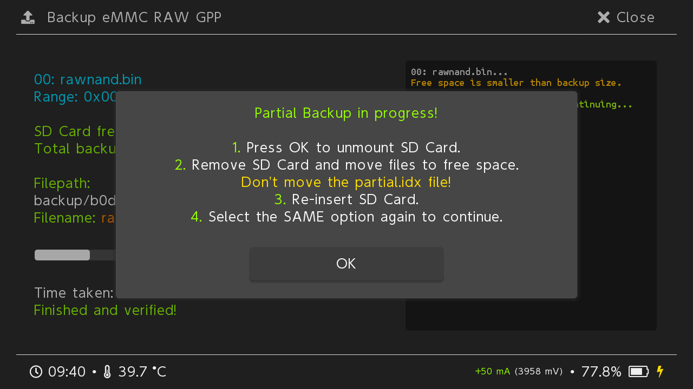

*The screen when free space runs out. Image: [Switch Guide](https://switch.hacks.guide/user_guide/all/making_essential_backups)*

In this case, press `OK`, connect to the Mac with `Close → Close → USB Tools → SD Card`, and move the `backup` folder to the Mac (if asked about merging, merge). After ejecting, select `Close → Backup eMMC → eMMC RAW GPP` again and it resumes where it left off. As the on-screen notice says, the file called `partial.idx` must not be moved. Repeat this until it finishes completely (same source).

The NAND backup is the only means of restoring the original state when the console no longer boots. The backup contains data unique to the console, so it cannot be used on other consoles. The Switch Guide recommends compressing it into a zip or similar for storage to save space.

### Step 9. Boot CFW on emuMMC

1. Open `Home → Launch` in hekate
2. Select `Atmosphere PKG3 emuMMC`
3. Once booted, open `Settings → System` and check the version notation. It succeeded if there is the text `AMS` and a trailing `E`

([Switch Guide: Launching CFW](https://switch.hacks.guide/user_guide/all/launching_cfw))

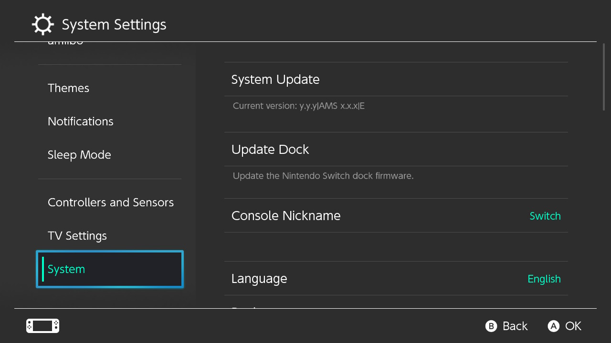

*`AMS` indicates booting with Atmosphère, and the trailing `E` indicates booting on emuMMC. When booted on sysMMC, it becomes `S`. Image: [Switch Guide](https://switch.hacks.guide/user_guide/all/launching_cfw)*

**Do not use Nintendo's online services on emuMMC.** Online play and the eShop are done on sysMMC (the stock state booted with `Stock sysMMC`). The Switch Guide warns that connecting online on both makes an eventual ban likely ([Switch Guide: Launching CFW](https://switch.hacks.guide/user_guide/all/launching_cfw)).

CFW disappears when the power is turned off completely. The next time you boot into CFW, repeat step 3 (RCM mode) and step 4 (sending hekate) and boot from Launch. Steps 5–8 are only for the first time.

Restarting from the CFW state returns you to hekate. This is because the `updater2p=1` setting in `hekate_ipl.ini` replaces Atmosphère's reboot payload with hekate ([hekate README](https://github.com/CTCaer/hekate)).

For details, see [Chapter 5](#boot-options).

### Step 10. On to hbmenu, mods, and cheats

The CFW environment is now complete. From here, go on to the following chapters according to your purpose.

| What you want to do | Where the operation starts | Explanation |
|---|---|---|
| Run homebrew | Hold the R button, launch any game, and open hbmenu | [Chapter 7](#7-running-homebrew-hbmenu) |
| Make your own apps | Make a `.nro` with devkitA64 and libnx, and put it in the `switch` folder | [Chapter 8a](#8a-making-your-own-games-libnx--devkita64) |
| Put mods in existing games | Put mods in `atmosphere/contents/<title ID>/` | [Chapter 8b](#8b-modifying-existing-games) |
| Turn mods on and off | SimpleModManager (for Smash Ultimate, ARCropolis's Mod Manager) | [Chapter 8b](#turning-mods-on-and-off-simplemodmanager) |
| Use cheats | Place `cheats/<build ID>.txt` and toggle with EdiZon or Tesla Menu | [Chapter 8b](#cheat-codes) |

## 1. Identifying your unit

First, check whether your unit is eligible.

### Model number

Check the model number on the label on the back of the console.

| Model number | Determination |
|---|---|
| `HAC-001` (nothing at the end) | Possible candidate |
| `HAC-001(-01)` | Mariko version. Not eligible (separate hardware modification needed) |
| `HDH-001` (Switch Lite), `HEG-001` (OLED) | None eligible |

### Serial number

Even with model number `HAC-001`, units manufactured from mid-2018 onward may have switched to a patched BootROM while looking the same. It is common to use the serial number for a rough determination.

The serial number can be checked on the console at `Settings → System → Serial Information`. It is also written on a label on the bottom of the console (next to the charging port), but the Switch Guide says that using the settings screen's display is more reliable than the label, especially for consoles obtained used ([Switch Guide: Getting Started](https://switch.hacks.guide/user_guide/getting_started)).

The Switch Guide page has a form where you enter the whole serial number for a determination, and a table that summarizes the ranges of "unpatched, potentially patched, patched" for each first four characters such as `XAW1` and `XAJ4`. Serial numbers not in the table are not subject to the vulnerability. The table's underlying data was collected in a [GBAtemp thread](https://gbatemp.net/threads/switch-informations-by-serial-number-read-the-first-post-before-asking-questions.481215/) ([Switch Guide: Getting Started](https://switch.hacks.guide/user_guide/getting_started)). In addition, [Such Meme serial list](https://suchmememanyskill.github.io/guides/switchserials/) and [ReHack](https://rehack.com/gaming/console-gaming/is-my-switch-patched/) publish similar lists. Prefixes `XKJ`, `XJW`, `XKW`, and `XWW` are said to be all Mariko generation, regardless of range ([ReHack](https://rehack.com/gaming/console-gaming/is-my-switch-patched/)).

The Switch Guide explains that no units are known to go against the pattern in this table, and that outside the "potentially patched" ranges, the table's determination matches reality. However, units within the "potentially patched" ranges cannot be decided by the table alone. In that case, the only way to check is the payload test in [Chapter 4](#4-sending-a-payload).

## 2. What to prepare

| Item | Role | Notes |
|---|---|---|
| RCM jig | Electrical bridge for entering RCM mode | Explained in detail in the next section |
| Mac (or a Windows PC or an Android phone) | Sends the payload | Any of them works. Details in "4. Sending a payload" |
| USB Type-C cable | Connects the Switch and the Mac | |
| microSD card (128GB recommended) | Storage for hekate, Atmosphère, and homebrew | FAT32 recommended (exFAT not recommended because it corrupts easily). 32GB or less can be used for homebrew but is not recommended because it cannot hold a complete NAND backup or emuMMC ([Switch Guide FAQ](https://switch.hacks.guide/faq)) |

### What an RCM jig is

The Switch has no physical "home button." To enter RCM (Recovery Mode), a contact inside the console equivalent to a home button has to be electrically shorted (connected). The small tool that does this is the RCM jig ([Switchbrew documentation](https://switchbrewdocs.readthedocs.io/en/latest/hacking/rcm.html)).

#### How it works

An RCM jig is a part for reliably shorting pin 10 and the GND (ground, the electrical reference point) pin on the rail (row of contacts) where the console's right Joy-Con attaches. Because the jig holds the wire in place, it can connect the correct pair of pins stably ([Switch Guide's explanation](https://switch.hacks.guide/user_guide/rcm/entering_rcm)).

#### The pin you must absolutely avoid

**Pin 4** on the same rail carries **5V power sent to the Joy-Con**. The Switch Guide warns that a homemade jig must never touch pin 4, and that shorting it may permanently destroy the rail or the console ([Switch Guide](https://switch.hacks.guide/user_guide/rcm/entering_rcm)).

The safest option is to use a commercially sold dedicated jig. The Switch Guide positions the jig method as the easiest and, in many cases, more reliable and safer than the paperclip method. **Do not substitute a paperclip or aluminum foil.** The Switch Guide clearly prohibits this as something that "may destroy the console," and says that jigs designed to use a paperclip carry the same risk ([Switch Guide](https://switch.hacks.guide/user_guide/rcm/entering_rcm)). If you make your own jig, be sure to check the pin layout with the pad number diagram in the Switch Guide.

#### How to obtain one

RCM jigs are sold as small electronic components at several online shops. The shape differs by console model (base/Lite/OLED), so it is important to choose one that supports your model.

### Another method called AutoRCM (for advanced users, high risk)

There is also a setting called AutoRCM that avoids using a jig every time. This is a method that writes a setting to the console so that it is forced into RCM at boot.

#### How it works (verified in hekate's source code)

AutoRCM rewrites only the BOOT0 area of the eMMC. BOOT1 is not changed (some guides explain that "both BOOT0 and BOOT1 are rewritten," but checking hekate's [source code](https://github.com/CTCaer/hekate/blob/45cd81ed08e30a26ba380958c7e20b55c342834b/bdk/storage/emmc.c#L215-L227) directly showed that only BOOT0 is actually written).

Inside BOOT0, four BCTs (Boot Config Tables, tables used for signature verification at boot) are stored at regular intervals. AutoRCM rewrites the first byte of the RSA public key modulus in each copy to `0x00`. As a result, BootROM's signature verification always fails, and the console automatically falls back to RCM (Recovery Mode) as "a console that cannot boot normally" ([hekate source `fe_tools.c`](https://github.com/CTCaer/hekate/blob/45cd81ed08e30a26ba380958c7e20b55c342834b/bootloader/frontend/fe_tools.c#L34-L159)). The hekate menu itself also shows a warning, "This corrupts BOOT0!", as part of the tool's name.

#### Why patched units get bricked

Switching to RCM mode is an electrical function, so patched units can enter it without problems. What is closed is only the part that executes payloads (unsigned homemade code) sent through RCM (the 2018 patch, a fix at BootROM address `0x0010769A`).

So if you enable AutoRCM on a patched unit, normal boot fails because of the corrupted BCT, and the fallback to RCM rejects payloads, leaving a state that cannot boot by either path. This is what the brick actually is. This is why several guides stress "never do this" ([Homebrew-Guide](https://github.com/noahc3/Homebrew-Guide/blob/master/usingcfw/hekate.rst)).

#### Prevention features in recent hekate

Current hekate (v6.5.4 generation), on detecting a patched unit, refuses to enable AutoRCM at all ([`fuse.c`](https://github.com/CTCaer/hekate/blob/45cd81ed08e30a26ba380958c7e20b55c342834b/bdk/soc/fuse.c#L487-L515)). The classic menu shows "This device is RCM patched and the function is disabled to avoid BRICKS!" and does not touch the eMMC at all, and the GUI version (Nyx) also detects the patched state right after an attempt to enable it and cancels the write. In other words, as long as you use a genuine recent hekate, this kind of brick is in principle unlikely to happen (this does not apply when using old versions or modified tools that bypass this feature).

#### Backup and how to undo

Before enabling, making a NAND backup (`Tools → Backup eMMC → eMMC BOOT0 & BOOT1`) is recommended. This is less a measure specific to AutoRCM than general insurance against other unexpected eMMC corruption.

On an unpatched unit, the setting can be undone at any time. Disabling is also done from the same hekate menu, and even without a backup, hekate calculates the correct byte and writes it back. However, even the disabling operation requires sending a payload and booting hekate at least once. On a patched unit, this "booting at least once" itself is impossible, so even with a backup, it cannot be undone by software alone.

### A reliable way to determine patched or unpatched

The serial number determination seen in [Chapter 1](#1-identifying-your-unit) is not decisive for units within the "potentially patched" ranges. The most reliable determination is the Console Info screen, where hekate reads and displays the console's fuses (information burned in at manufacture). It shows "This unit is exploitable to the RCM bug!" in green text, or "This unit is patched to the RCM bug!" in orange text ([`gui_info.c`](https://github.com/CTCaer/hekate/blob/45cd81ed08e30a26ba380958c7e20b55c342834b/nyx/nyx_gui/frontend/gui_info.c#L1281-L1286)). However, seeing this screen requires that a payload has already gone through and hekate has booted, so in practice "whether the payload in Chapter 4 goes through" is itself the final determination.

This article assumes not using AutoRCM at first and entering RCM with a jig every time. AutoRCM was introduced as an advanced option to choose once you are thoroughly used to the jig procedure.

## 3. Entering RCM mode

The operation is as in [step 3](#step-3-enter-rcm-mode). Nothing is displayed on screen in RCM mode, so success is judged by "whether the screen stays black." If the Nintendo logo appears and the console boots normally, or if a screen that was on goes black, you have not entered RCM mode ([Switch Guide](https://switch.hacks.guide/user_guide/rcm/entering_rcm)).

Even patched units can enter RCM mode. What is closed is only the part that executes payloads ([Switch Guide](https://switch.hacks.guide/user_guide/rcm/entering_rcm)). Also, RCM is a different mode from "maintenance mode," which is entered by pressing volume +, volume -, and the power button (same source).

## 4. Sending a payload

With the Mac (or a Windows PC or an Android phone) connected by USB cable, use a payload injection tool.

What the current Switch Guide points to first on all operating systems is [OmniRCM](https://github.com/DefenderOfHyrule/OmniRCM). It is GPL-3.0 open source, v1.1.1 came out in August 2026, and development continues ([Switch Guide: Sending a Payload](https://switch.hacks.guide/user_guide/rcm/sending_payload)).

| Environment | Tool | Notes |
|---|---|---|
| Mac | OmniRCM (`OmniRCM-osx.zip`) | Alternatively, the browser version (OmniRCM Web) can be used |
| Windows | OmniRCM (`OmniRCM-win-x64.exe`) | Driver installation required. As an alternative, [TegraRcmGUI](https://github.com/eliboa/TegraRcmGUI) and Zadig (libusbK) are also suggested. TegraRcmGUI's last release was in 2019 |
| Linux | OmniRCM | udev rules must be set |
| Android | OmniRCM (`OmniRCM-android.apk`) | No root required. Details below |
| iOS | OmniRCM (installed from a Sileo repository) | Jailbroken iPhones only |
| ChromeOS | OmniRCM Web | Does not work with USB-C to USB-C cables |

([Switch Guide: Sending a Payload](https://switch.hacks.guide/user_guide/rcm/sending_payload))

The Mac operations are collected in [step 4](#step-4-send-hekate-with-omnircm). Besides the app version, OmniRCM has [OmniRCM Web](https://omnircm.nintendohomebrew.com/web/), which runs in a browser. It uses the browser's WebUSB feature, so it works only in Chromium-based browsers such as Chrome and does not work in Firefox or Safari. Windows is explicitly stated as unsupported even with a Chromium-based browser.

### Telling success from failure

When injection succeeds, hekate's yellow text (a warning about missing libraries and `Update bootloader folder!`) appears on the Switch screen. If no microSD card is inserted, the display is `Failed to init or mount SD!`. Both warnings disappear once the SD card is prepared in the next chapter, so they can be ignored at this point ([Switch Guide: Sending a Payload](https://switch.hacks.guide/user_guide/rcm/sending_payload)).

This result is the actual operational check. If the screen stays black after sending a payload, either the payload is corrupt or the unit is patched. The Switch Guide says that if the injection tool shows "Patched," this is not a temporary glitch and the unit is definitely patched ([Switch Guide: Sending a Payload](https://switch.hacks.guide/user_guide/rcm/sending_payload)). According to the OmniRCM Web page, the tool determines the unit from the position where the transfer stopped (stopping at offset `0xF000` means a patched original model, `0x10000` means Mariko) and from the device ID. This is more reliable than the serial number determination.

#### About fusee-launcher, formerly the standard tool

Formerly, the Python script fusee-launcher was introduced as the tool for sending payloads on a Mac. However, development stopped in 2018, and the developer's own repository no longer exists on GitHub. Only volunteer mirrors ([the one by mid-kid](https://github.com/mid-kid/fusee-launcher) and others) remain. If you start on a Mac now, OmniRCM is the more reliable choice.

### Can you go without a PC?

Something other than a PC can take over the role of sending the payload. However, the condition itself that "some device must act as the USB host" does not change whichever method you choose.

#### Using an Android phone

What the current Switch Guide points to is the Android version of OmniRCM. No root is required.

1. Install and open `OmniRCM-android.apk`
2. Connect the Switch in RCM mode to the Android device with a USB cable (if the device has USB-C, a C-to-C cable is fine. A micro USB device needs an OTG adapter and an A-to-C cable)
3. Allow OmniRCM to access the `APX` device
4. Fetch the list of payloads with `Fetch Payloads`, select hekate, and press `Inject`

([Switch Guide: Sending a Payload](https://switch.hacks.guide/user_guide/rcm/sending_payload))

The older app [NXLoader](https://github.com/DavidBuchanan314/NXLoader) can likewise send payloads over USB-OTG ([NXLoader README](https://github.com/DavidBuchanan314/NXLoader)). However, the latest release is still alpha-0.3 from 2018, and the developer explicitly states it is "alpha, experimental." Also, a limitation has been reported in which it fails with a "SUBMITURB Failed" error when the Android device's USB controller is EHCI ([SXTools, README of a fork of NXLoader](https://github.com/annson24/SXTools)).

On an iPhone, only on jailbroken devices, OmniRCM can be installed and used from Sileo (a package manager for jailbroken devices). The Switch Guide lists no method usable on a non-jailbroken iPhone ([Switch Guide: Sending a Payload](https://switch.hacks.guide/user_guide/rcm/sending_payload)).

#### Standalone RCM injection dongles

There are also small USB-C dongles sold under names such as "RCM Loader." Whereas a jig "only lets you enter RCM mode," these store the payload itself in built-in flash memory and send it just by being plugged in, without a PC or phone.

As an open source design, a DIY board called SAMD Fusee Payload Launcher V2 is shared in the community ([GBAtemp thread](https://gbatemp.net/goto/post?id=8273176)). Writing the payload itself must first be done through a PC, but after that it can be used on its own.

Many commercial products are assorted rebranded goods and imitations sold through AliExpress and eBay. In a June 2026 GBAtemp thread, in response to a question about a device not being recognized when connected to a PC, a reply says that the original product is no longer available and that what circulates now is all imitations with reduced functions ([GBAtemp troubleshooting thread](https://gbatemp.net/threads/rcm-loader-not-being-detected-on-pc.682629/)).

This kind of device carries its own legal risk. Nintendo obtained an injunction in the United States against a seller of a device named "RCM Loader." The court determined that "the sole purpose of this device is circumventing protection mechanisms" ([TorrentFreak](https://torrentfreak.com/nintendo-wins-us-wide-injunction-against-seller-of-rcm-loader-piracy-device-210416/)). This is a lawsuit over selling the device, but it is something you should know if you are considering buying one.

##### Concrete usage

Reading the GBAtemp reports, products called "RCM Loader" come in two generations used in entirely different ways. Before buying, you need to confirm which generation it is.

| | Early product (the original) | Product now circulating (imitation) |
|---|---|---|
| Connection to a PC | Recognized as a USB drive when connected to a PC, and the payload can be rewritten | Not recognized when connected to a PC. Cannot be rewritten or updated |
| Payload sent | `payload.bin` placed in each folder. The LED color selects which folder's payload is sent (there is an explanation that blue = Atmosphère) | hekate is fixed-written into the device |
| Button | Used to switch payloads and update firmware | Only glows blue while pressed |
| Keeping up with the latest version | Replace `payload.bin` yourself | Relies on hekate's `update.bin` mechanism (below) |

([GBAtemp: not being detected on PC](https://gbatemp.net/threads/rcm-loader-not-being-detected-on-pc.682629/), [GBAtemp: OneB Update Firmware](https://gbatemp.net/threads/rcm-loader-oneb-update-firmware.594251/))

Imitations can keep working with a fixed hekate because hekate itself has a function that, if `bootloader/update.bin` on the SD card is newer than itself, reloads from that. The hekate README describes this mechanism as "mainly for modchips" ([hekate README](https://github.com/CTCaer/hekate)). In other words, even when using an imitation dongle, you need to put the latest hekate on the SD card.

The flow of use is the same for both generations. Turn the Switch off completely, insert the RCM jig into the right Joy-Con rail, plug the dongle into the USB-C port, and press the power button while holding volume +. If the dongle's LED blinks, it is attempting injection. There is an explanation that a steady blue light means charging, which should not normally happen if you have entered RCM mode ([GBAtemp](https://gbatemp.net/threads/rcm-loader-not-being-detected-on-pc.682629/)).

For firmware updates on the early products, a procedure is reported of connecting to a PC while holding the button (almost simultaneously) and writing with the seller's update software. However, it is also pointed out that firmware v2.02 applies only to products in white boxes and not to products in clear boxes ([GBAtemp](https://gbatemp.net/threads/rcm-loader-oneb-update-firmware.594251/)).

##### Common problems

If it is not recognized as a USB drive on a PC, it is likely a new imitation that cannot be rewritten in the first place ([GBAtemp](https://gbatemp.net/threads/rcm-loader-not-being-detected-on-pc.682629/)). Even with early products, there are reports of the built-in battery degrading and no longer holding a charge (same source).

There are also reports of the screen showing noise (static) after updating the CFW on the Switch side. The payload in the dongle may be old or the built-in flash may be broken, and for early products, suggested remedies include rewriting the payload or pressing the reset button ([GBAtemp](https://gbatemp.net/threads/rcm-loader-bootup-showing-static-on-switch.638508/)).

With early products, nothing happens unless the file is placed in the correct folder under the name `payload.bin` ([GBAtemp](https://gbatemp.net/threads/rcm-loader-oneb-update-firmware.594251/)).

##### How this differs from another option, SX OS

Many dongles of this kind can store not only a payload for Atmosphère but also a payload for SX OS (a commercial CFW that was developed by Team Xecuter) at the same time, and are advertised as supporting "双系统 (dual system)."

| | SX OS | Atmosphère |
|---|---|---|
| Developer and nature | Team Xecuter (commercial, paid) | Community, switchbrew (free, open source) |
| Development status | Effectively stopped. Members of Team Xecuter pleaded guilty in 2021 in the United States to charges including conspiracy to violate the DMCA (Digital Millennium Copyright Act), and in 2022 were sentenced to prison and ordered to pay restitution ([TorrentFreak](https://torrentfreak.com/team-xecuters-gary-bowser-pleads-guilty-to-criminal-charges-211101/), [GeekWire](https://www.geekwire.com/2022/switch-hacker-gary-w-bowser-given-40-month-sentence-owes-nintendo-14-5m/)) | Still under active development |
| Supported firmware | Said to have stopped at HOS 11.0.0, and is likely not to work on the latest system versions (based on several community reports. No official end-of-life statement could be confirmed) | Continues to support up to the latest HOS |
| Representative features | The highlight of the paid version was a feature that directly loaded and launched backup data of commercial games. This feature is why it was said to be strongly tied to piracy | The foundation for homebrew development, mods, emuMMC, and so on, as covered in this article |

Under this article's policy (limited to self-owned hardware, your own homebrew, and self-dumped data, with piracy out of scope), the SX OS side's features are out of scope. Even if you buy a dongle advertising "双系统 support," the premise is that you choose and use only the Atmosphère payload.

#### Methods that need no injection each time (out of scope for this article)

All the methods so far require sending a payload from some device each time the power is turned on. The only way to eliminate this completely is to solder a hardware modchip to the board. Because it loads and boots CFW directly from the SD card, no external device is needed each time.

The only one the Switch Guide supports is Picofly, which is fully open source from the firmware to the microcontroller (RP2040). For commercial chips such as hwfly and SX Core/Lite, it states that it will not help with obtaining or installing them, calling them of "unclear origin" (it says it will help only with writing firmware to chips already installed) ([Switch Guide modchip page](https://switch.hacks.guide/user_guide/modchip/)). This is a hardware modification requiring soldering, which goes beyond the non-destructive procedures covered in this article, so only the names are introduced here.

## 5. Booting from hekate

The operation for bringing up hekate's GUI (Nyx) is collected in [step 5](#step-5-bring-up-the-hekate-gui), and the operation for putting files on the SD card is collected in [step 7](#step-7-put-files-on-the-sd-card). After sending a payload, it is safe to remove the SD card with the hekate screen left up. If you do not turn the power off, you also save the trouble of resending the payload ([Switch Guide: Sending a Payload](https://switch.hacks.guide/user_guide/rcm/sending_payload)).

### Boot options

With the Switch Guide's `hekate_ipl.ini`, the following three appear in hekate's `Launch` menu.

| Item | What it boots |
|---|---|
| `Atmosphere PKG3 emuMMC` | Boots Atmosphère (CFW) on emuMMC. The default in this article |
| `Atmosphere PKG3 sysMMC` | Boots Atmosphère on the console's internal storage (sysCFW) |
| `Stock sysMMC` | Boots in the unmodified, stock state |

Whether it booted correctly is checked, as in [step 9](#step-9-boot-cfw-on-emummc), by whether the version notation in System Settings has `AMS` and the `E` indicating emuMMC ([Switch Guide: Launching CFW](https://switch.hacks.guide/user_guide/all/launching_cfw)).

Atmosphère CFW disappears when the power is turned off completely. To boot into CFW again, you need to enter RCM mode and resend the payload. To return to hekate from the CFW state, select `Restart` from the menu shown by holding the power button, or use the "reboot to payload" app in hbmenu ([Switch Guide: Launching CFW](https://switch.hacks.guide/user_guide/all/launching_cfw)).

## 6. Creating emuMMC

You can also use the console's internal storage (sysNAND) as is with CFW, but using emuMMC (a virtual NAND on the SD card) is widely recommended ([Switch Guide](https://switch.hacks.guide/user_guide/all/cfw_environment)).

| | sysNAND | emuMMC |
|---|---|---|
| Location | The console's internal storage | On the SD card |
| Connection to Nintendo's servers | Connects | Not blocked automatically. Place `emummc.txt` and block it yourself (below) |
| Online use | Possible if kept in the stock state | Not used. Always keep offline |
| Required capacity | — | 32GB (64GB for the OLED model) is reserved on the SD card. 128GB or more is needed for comfortable use ([Switch Guide](https://switch.hacks.guide/user_guide/all/cfw_environment)) |

Atmosphère is not permanently installed on the console. Each time the power is turned off, it must be booted again using the vulnerability (unless you add a hardware modification [modchip]).

### Cutting emuMMC off from the network

Being on the SD card does not by itself cut emuMMC off from the network. The Switch Guide requires that emuMMC never connect to Nintendo's servers, and that online play and the eShop be done on sysMMC (the console's internal storage). It also warns that connecting online on both emuMMC and sysMMC makes an eventual ban likely ([Switch Guide: Launching CFW](https://switch.hacks.guide/user_guide/all/launching_cfw)).

The setting for that is the `emummc.txt` placed in `atmosphere/hosts/` in [step 7](#step-7-put-files-on-the-sd-card). A feature of Atmosphère called DNS.MITM follows this file's contents and stops name resolution from emuMMC to Nintendo's servers. **It is said that without this file, the chance of a ban is high** ([Switch Guide: SD Preparation](https://switch.hacks.guide/user_guide/all/sd_preparation)). As an extra precaution, the Switch Guide also describes setting up a DNS server called 90DNS.

### Partitioning and creating emuMMC

The operation is as in [step 6](#step-6-partition-the-sd-card-and-create-emummc). Recreating the partitions erases the card's contents. The slider value is `29 FULL` for the base-model Switch and `58 FULL` for the OLED model ([Switch Guide](https://switch.hacks.guide/user_guide/all/partitioning_sd)).

The Switch Guide's procedure uses SD Partition (`emuMMC → Create emuMMC → SD Partition`), which writes directly to a dedicated partition.

### Caution on Windows

After creation, connecting the SD card to Windows may bring up a warning like "The card cannot be read. Format it?" **Do not format it.** This is the partition for emuMMC. A card with partitions created appears on a PC as two drives, so use the readable and writable one named `SWITCH SD` ([Switch Guide](https://switch.hacks.guide/user_guide/all/partitioning_sd)).

### Targets of backup and restore

A personal guide explains that hekate's `Tools → Backup eMMC` and `Restore eMMC` screens have a toggle called "SD emuMMC Raw Partition" that switches the operation's target from the console's internal storage (sysNAND) to emuMMC ([reference guide](https://gist.github.com/nicholemattera/47174b4cfd583820e312039927a304be)). What is backed up in [step 8](#step-8-back-up-the-nand) is the console's internal storage, so the Switch Guide's steps include no operation of switching this toggle. Restore in particular will overwrite the data you want to keep if you get the target wrong. Before running it, be sure to check the target on screen.

### What has not been tested (this chapter)

The menu names for creating partitions and emuMMC and the slider values have been checked against the original text of the [relevant switch.hacks.guide page](https://switch.hacks.guide/user_guide/all/partitioning_sd) (as of October 2026). However, the creation procedure on a real device has not yet been confirmed in this article. Menu names can change with the hekate version. Before working, be sure to check the current procedure on the same page.

The name of the toggle in the "Targets of backup and restore" section above has a personal guide (GitHub Gist) as its source and could not be confirmed on hekate's screen.

## 7. Running homebrew (hbmenu)

Once booted with Atmosphère, you can open hbmenu (Homebrew Menu). This is a launcher that lists and runs `.nro` files placed in the `switch` folder on the SD card. There are two ways to open it ([Switch Guide: Launching CFW](https://switch.hacks.guide/user_guide/all/launching_cfw)).

| How to open | Operation | Characteristics |
|---|---|---|
| Title override (recommended) | Hold the R button and launch any game (demos and cartridges are also fine) or app | Can use the game's memory as is, so there are few restrictions. If you do not hold R, the game launches normally |
| Applet mode | Open "Album" on the home screen | Much less memory is available, and even a full-featured web browser cannot run |

The R button assignment can be changed with `override_any_app_key` and others in `sd:/atmosphere/config/override_config.ini` ([official Atmosphère documentation: configurations.md](https://github.com/Atmosphere-NX/Atmosphere/blob/master/docs/features/configurations.md)).

```
sd card/
  switch/
    my_game.nro
    retroarch.nro
```

## 8a. Making your own games (libnx + devkitA64)

From here, you can go on to development for the Switch as an extension of making your own games in [article 14](14-making-games.md).

| Tool | Role |
|---|---|
| [devkitA64](https://devkitpro.org/) | Compiler and toolchain for ARM64 |
| [libnx](https://github.com/switchbrew/libnx) | C SDK that handles graphics, input, file I/O, and so on |
| [switch-examples](https://github.com/switchbrew/switch-examples) | Official sample collection. Contains minimal examples of graphics display and audio output |

Building libnx-based code with devkitA64 generates a `.nro` file, which runs from hbmenu when placed in the `switch` folder on the SD card.

### The option of retro emulators

Using the same `.nro` mechanism, you can also install emulators of retro game consoles, such as the Switch port of RetroArch. The structure is the same as RetroArch on the RG40XXH seen in [article 16](16-emulator-and-menu.md), and the only difference is that the OS underneath becomes Horizon (+ Atmosphère). Rather than emulating the Switch itself, this runs emulators of other retro game consoles on top of the Switch.

## 8b. Modifying existing games

As a different direction from making your own games, there is a way to modify cartridge games you own in a CFW environment. Atmosphère has a built-in feature called LayeredFS that swaps files at load time without rewriting the game's own files ([official Atmosphère documentation: loader.md](https://github.com/Atmosphere-NX/Atmosphere/blob/master/docs/components/modules/loader.md)).

### How it works and folder structure

Mod files are placed in folders distinguished by each game's title ID (16-digit hexadecimal number).

```
sd card/
  atmosphere/
    contents/
      0100000000010000/   # Folder for each title ID
        romfs/             # Replacement of assets such as graphics, audio, and text
        exefs/             # Patches to executable code
        cheats/            # Cheat codes (described later)
```

Files placed in the `romfs` folder are loaded at launch in a way that overrides the corresponding files of the game itself. The `exefs` folder is used for patches to the executable code itself. In versions before Atmosphère 0.9.4, a folder named `titles` was used instead of `contents`. Match the version you are using ([official Atmosphère changelog](https://github.com/Atmosphere-NX/Atmosphere/blob/master/docs/changelog.md)).

### How to install distributed mods

If you open a distributed mod's zip and look at the folder structure inside, you can tell where to place it. The Switch Guide explains by dividing into the following three cases ([Switch Guide: Game modding](https://switch.hacks.guide/extras/game_modding)).

| Zip contents | How to place |
|---|---|
| Complete, down to `atmosphere/contents/<title ID>/romfs` | Copy the whole `atmosphere` folder to the root of the SD card. Merge if asked |
| Starts from a `contents` folder | Copy the `contents` folder to `sd:/atmosphere/`. Merge if asked |
| Contains only `romfs` (or `exefs`) | Create `sd:/atmosphere/contents/<title ID>/` yourself and place it inside |

### How to look up a title ID

Before installing a mod, check the target game's title ID. Using the homebrew EdiZon (or EdiZon-SE), the title ID (TID) and build ID (BID) are shown in the cheat menu (image below). You can also look them up in the [Switchbrew title list](https://switchbrew.org/wiki/Title_list/Games) or databases such as [nswdb](https://nswdb.com/) ([Switch Guide: EdiZon](https://switch.hacks.guide/homebrew/edizon)).

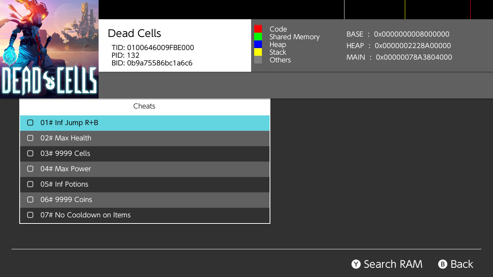

*The cheat screen opened in EdiZon while Dead Cells is running. In this example, cheats are loaded from `sd:/atmosphere/contents/0100646009FBE000/cheats/0B9A75586BC1A6C6.txt`. Image: [Switch Guide](https://github.com/nh-server/switch-guide)*

### Common problems during installation

If a game crashes right after launch, hold the L button while launching and try whether it boots with all mods stopped. If it boots, delete the mod you installed last ([Switch Guide: Game modding](https://switch.hacks.guide/extras/game_modding)).

If a mod is not taking effect, especially if you use a Mac, the files copied on the Mac may have the archive bit set. Fix it with `Tools → Arch bit • RCM Touch • Pkg1/2 → Fix Archive Bit` in hekate (same source).

Some games need more than LayeredFS, and the Switch Guide gives the following examples (same source).

| Game | What is needed |
|---|---|
| Super Smash Bros. Ultimate | [ARCropolis](https://github.com/Raytwo/ARCropolis) and [Skyline](https://github.com/skyline-dev/skyline). Explained below in "Concrete example of mods" |
| Breath of the Wild | To combine multiple mods, the PC mod manager [BCML](https://github.com/NiceneNerd/BCML) or [UKMM](https://github.com/NiceneNerd/UKMM) (recommended) |
| Tears of the Kingdom | Likewise, [TKMM](https://github.com/TKMM-Team/Tkmm) for PC |
| Animal Crossing: New Horizons | Name the folder `romFs` instead of `romfs`, and create an empty file named `ResourceSizeTable.srsizetable` in `atmosphere/contents/01006F8002326000/romFs/System/Resource/` |

### Checking whether a mod has taken effect

Atmosphère's official documentation ([loader.md](https://github.com/Atmosphere-NX/Atmosphere/blob/master/docs/components/modules/loader.md)) has no mention of a feature that shows the mod application state on screen. Basically, you launch the game normally and check changes in appearance and behavior with your own eyes. Some mod loaders have their own way of checking (for example, ARCropolis shows its own version on the title screen; see below).

The first common cause when a mod does not take effect is not fully quitting the game and launching it again. LayeredFS is applied only when a process starts, so it does not take effect when returning from sleep or resuming after suspending with the home button.

The second is that the title ID folder does not match the one on the console. The folder name must use the base game's ID, not the update's ID.

The third is a mismatch between the version the mod supports and the version of the game actually installed. If the file placement does not match that version's romfs structure, the result is no reaction or unstable behavior.

### Turning mods on and off (SimpleModManager)

LayeredFS loads everything placed in `atmosphere/contents/`. When you want to remove a mod to try things out, moving folders on a PC every time is a hassle. So there is a homebrew app, [SimpleModManager](https://github.com/nadrino/SimpleModManager), that manages the place where mods are kept separately from where LayeredFS loads. You can turn mods on and off individually and switch between combinations of large mods ([Switch Guide: SimpleModManager](https://switch.hacks.guide/homebrew/simplemodmanager)).

1. Get `SimpleModManager.nro` from the [release page](https://github.com/nadrino/SimpleModManager/releases) and put it in the `switch` folder on the SD card
2. Create a folder `mods/<game name>/<mod name>/` at the root of the SD card. The game name and mod name can be whatever you like
3. Inside the `<mod name>` folder, place the mod's folder structure with the `atmosphere` folder omitted (that is, starting from `contents/<title ID>/romfs/…`)
4. Launching SimpleModManager from hbmenu shows a list of games. Select a game and press the A button to show a list of available mods

([Switch Guide: SimpleModManager](https://switch.hacks.guide/homebrew/simplemodmanager))

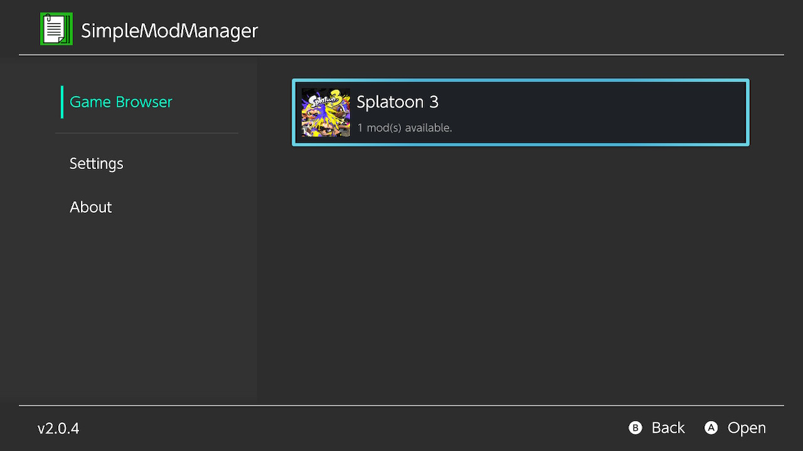

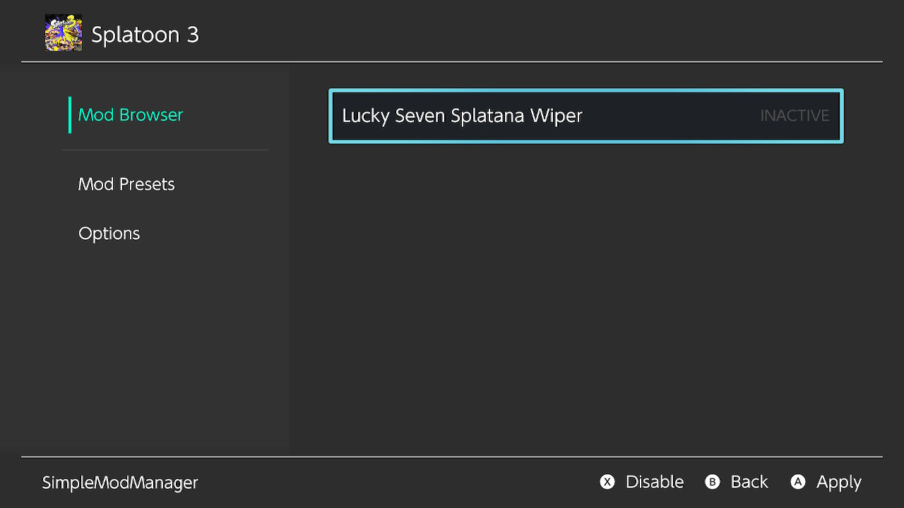

*Top: the list of games. Bottom: the list of mods. The A button applies (Apply), and the X button disables (Disable). "Mod Presets" on the left lets you save combinations of mods. Image: [Switch Guide](https://github.com/nh-server/switch-guide)*

However, the Switch Guide cautions against using SimpleModManager for Smash Ultimate, Breath of the Wild, and Tears of the Kingdom. These games handle mods differently from others (same source). For Smash Ultimate, use the Mod Manager built into ARCropolis, covered in the next section.

### Concrete example of mods (Super Smash Bros. Ultimate)

As a concrete example, I take up Super Smash Bros. Ultimate (Smash Ultimate from here on, title ID `01006A800016E000`), whose mod mechanisms are published in detail in official documentation. The Switch Guide also lists "mods and cheats in any game" as one of the representative uses of emuMMC ([Switch Guide](https://switch.hacks.guide/user_guide/all/cfw_environment)).

#### ARCropolis, the foundation

Many Smash Ultimate mods assume a mod framework called [ARCropolis](https://github.com/Raytwo/ARCropolis). It is a mod loader and manager dedicated to Smash Ultimate that runs on [Skyline](https://github.com/skyline-dev/skyline). Its prerequisites are the latest Atmosphère (other CFWs are not supported) and Smash Ultimate updated to the latest version (either the cartridge or download version) ([ARCropolis Wiki: Setup](https://github.com/Raytwo/ARCropolis/wiki/Setup-(Getting-Started))).

The file layout after installation is as follows ([same source](https://github.com/Raytwo/ARCropolis/wiki/Setup-(Getting-Started))).

```
sd card/
  atmosphere/
    contents/
      01006A800016E000/
        exefs/
          subsdk9                      # Skyline itself (from skyline.zip)
        romfs/
          skyline/
            plugins/
              libarcropolis.nro        # ARCropolis (from release.zip)
  ultimate/
    mods/
      <folder for each mod>/            # Where individual mods go
```

Skyline's `subsdk9` is loaded through the replacement of executable code by `exefs`, part of [the LayeredFS mechanism](#how-it-works-and-folder-structure). When creating a process, Atmosphère's loader looks for files named `rtld`, `main`, `subsdk0`–`subsdk9`, and `sdk`, and if a file with the same name exists on the SD card, it uses that one ([official Atmosphère documentation: loader.md](https://github.com/Atmosphere-NX/Atmosphere/blob/master/docs/components/modules/loader.md)).

Whether ARCropolis is running can be checked on the game's title screen. If installed correctly, the ARCropolis version is displayed ([ARCropolis Wiki: Setup](https://github.com/Raytwo/ARCropolis/wiki/Setup-(Getting-Started))).

#### Where mods go, and how to use the Mod Manager

ARCropolis looks for mods in two places. You have to create both yourself ([ARCropolis Wiki: Usage](https://github.com/Raytwo/ARCropolis/wiki/Usage-(Getting-Started))).

| Location | Use |
|---|---|
| `sd:/ultimate/mods/<folder for each mod>/` | Recommended. Each mod is placed in its own folder, and it can be turned on and off with the in-game Mod Manager. Many mods distributed on [GameBanana's Smash Ultimate page](https://gamebanana.com/games/6498) are installed just by dragging and dropping them here |
| `sd:/atmosphere/contents/01006A800016E000/romfs/arc/` | The old method. The contents are treated as the root of the game's data archive (`data.arc`). Mods cannot be organized here, so this is limited to placing a "base mod pack" to build on |

For example, placing a file at `sd:/ultimate/mods/My Cool Mod/ui/message/msg_melee.msbt` treats it as a mod called `My Cool Mod`.

The entry point to the Mod Manager is the Nintendo eShop button at the bottom right of Smash Ultimate's main menu. Selecting "Mod Manager (ARCadia-RS)" there shows the list of mods, and the A button toggles them on and off one at a time. Closing the menu brings up a screen asking whether to restart the game. Choosing "Yes" applies the changes on the spot. Also, when launching Smash Ultimate from the Switch home screen, holding the `+` button around when the Joy-Con animation at the bottom right of the loading screen ends opens the Mod Manager before the game starts. With this method, no restart is needed after making changes ([ARCropolis Wiki: Mod Manager](https://github.com/Raytwo/ARCropolis/wiki/Mod-Manager-(Features))).


*ARCropolis's Mod Manager. The image is the one posted on [ARCropolis Wiki: Mod Manager](https://github.com/Raytwo/ARCropolis/wiki/Mod-Manager-(Features)) (it is not copied into this repository; the original location is referenced)*

The name, description, and preview image shown in the list can be set by placing `info.toml` and `preview.webp` in the mod's folder. Both are optional, and the mod works without them. In `info.toml`, you write `display_name` (the display name), `authors`, `version`, `description`, and `category` (one of Fighter, Stage, Effects, UI, Param, Audio, or Misc) (same source).

```toml
display_name = "My Cool Mod"
authors = "Your name"
version = "1.0"
description = """
A mod that replaces menu text
"""
category = "UI"
```

In ARCropolis 3.0.0 and later, if two mods try to replace the same file, you are notified at launch of a "file conflict." The list of conflicting files can be checked at `sd:/ultimate/arcropolis/conflicts.json` ([ARCropolis Wiki: Usage](https://github.com/Raytwo/ARCropolis/wiki/Usage-(Getting-Started)), [FAQ](https://github.com/Raytwo/ARCropolis/wiki/FAQ-(Troubleshooting))).

#### Category 1: Replacing appearance (skins)

The most common are skin mods that replace a fighter's appearance (models and textures). In Smash Ultimate, files are separated for each fighter's color variation (slot), but some files are shared between slots. So in older environments, installing a skin for one slot could break the appearance of other slots too. ARCropolis 2.0.0 and later support skin and voice mods that affect only one slot ([ARCropolis Wiki: FAQ](https://github.com/Raytwo/ARCropolis/wiki/FAQ-(Troubleshooting)), [Common issues](https://github.com/Raytwo/ARCropolis/wiki/Common-Issues-and-How-To-Fix-Them-(Troubleshooting))).

Mods introduced as "letting you play as characters from other games" also fall into this category. A skin mod replaces the appearance of an existing fighter's slot and does not add a new fighter including moves and AI. Data on move performance and motion is in separate files such as `param` (parameters) and `motion_list`, and rewriting these is a mod that changes gameplay, like category 2 next ([ARCropolis Wiki: Param Patching](https://github.com/Raytwo/ARCropolis/wiki/Param-Patching-(Features)), [MotionList Patching](https://github.com/Raytwo/ARCropolis/wiki/MotionList-Patching-(Features))).

As a real example, there is the "Master Chief (the protagonist of Halo) mod" that drew attention in 2019. According to a TheGamer article, it was made as a skin for Snake, and although it looks like Master Chief, it uses Snake's moves as they are. The article speculates that the creator chose Snake because he is a fighter with moves close to Master Chief's ([TheGamer, June 2019](https://www.thegamer.com/new-mod-master-chief-smash-ultimate/)).

One example of the skin type is a Skyline plugin called [Smash Minecraft Skins](https://github.com/jam1garner/smash-minecraft-skins). When you enter a Minecraft username, it fetches that skin and makes it usable in the game. You can also use it by placing PNG skins in `sd:/atmosphere/contents/01006A800016E000/romfs/minecraft_skins/`. It requires Skyline and ARCropolis 0.9.3 or later ([confirmed in the README](https://github.com/jam1garner/smash-minecraft-skins)). An October 2020 TechRaptor article introduces this mod as one that lets you import Java edition Minecraft skins from a menu added to the character selection screen ([TechRaptor](https://techraptor.net/gaming/news/super-smash-bros-ultimate-steve-mod-custom-skins)).

#### Category 2: Adding content and changing gameplay

There are also mods that change not just the appearance but the content of the game itself. [HewDraw Remix (HDR)](https://github.com/HDR-Development/HDR-Releases), which the ARCropolis README gives as a representative example, is a mod that includes a large-scale rework of gameplay plus carefully selected skins, its own menus, new music, and more ([ARCropolis README](https://github.com/Raytwo/ARCropolis)). According to HDR's official README, installing is just extracting the distributed `switch-release.zip` to the SD card, and uninstalling is deleting the folders starting with `hdr` in `/ultimate/mods` ([HDR-Releases README](https://github.com/HDR-Development/HDR-Releases)).

For this kind of mod, the ARCropolis FAQ cites as a general community agreement not to modify files that give an advantage online (such as parameter adjustments and move changes) ([ARCropolis Wiki: FAQ](https://github.com/Raytwo/ARCropolis/wiki/FAQ-(Troubleshooting))). With the "workspaces" feature in ARCropolis 3.2.0 and later, you can save combinations of mods as presets and switch from an in-game menu between, for example, "a skins-only configuration for online" and "a configuration that changes gameplay" ([ARCropolis Wiki: Workspaces](https://github.com/Raytwo/ARCropolis/wiki/Workspaces-and-Workspace-Selector-(Features))).

#### An example from another game: CTGP Deluxe for Mario Kart 8 Deluxe

As an example other than Smash Ultimate, there is CTGP Deluxe, which adds original courses to Mario Kart 8 Deluxe. It is a mod in the lineage of the Wii "CTGP Revolution" and the 3DS "CTGP-7." According to the GameBrew page, whose Last Updated field reads March 23, 2025, the version is 1.1.1, and the prerequisites are a Switch with CFW and Mario Kart 8 Deluxe updated to the latest version (3.0.3). When installing, delete all other Mario Kart 8 Deluxe mods (including older versions of CTGP Deluxe), and then extract the contents of the zip to the root of the SD card. Playing on emuMMC is strongly recommended ([GameBrew: CTGP Deluxe Switch](https://www.gamebrew.org/wiki/CTGP_Deluxe_Switch)).

The credits and update history include the name Skyline (the same foundation for modifying executable code as Smash Ultimate's ARCropolis), and v1.1.0 records the addition of a "Skyline patch."

#### Category 3: Combining with cheats

ARCropolis mods and Atmosphère cheats are placed in different locations. ARCropolis-related files go in `exefs`, `romfs`, and `sd:/ultimate/`, and cheats go in `cheats` in the same title ID folder (for the cheat location, see the next section, "Cheat codes"). As far as file locations go they can coexist, but ARCropolis's official documentation has no statement on behavior when used together with Atmosphère cheats. Behavior with both enabled at the same time is unconfirmed.

To stop everything temporarily, hold the L button when launching the game. HDR's README also explains that launching while holding the L button temporarily disables all mods, regardless of the menu settings ([HDR-Releases README](https://github.com/HDR-Development/HDR-Releases)).

### Cheat codes

Cheat codes are loaded by Atmosphère's in-memory cheat engine, a mechanism separate from LayeredFS.

```
sd card/
  atmosphere/
    contents/
      <title ID>/
        cheats/
          <build ID>.txt
```

The build ID changes with each version (update) of the game, so you must use a cheat file with an exactly matching build ID. If it does not match, the cheat has no effect (or the target of application is shifted and things become unstable).

To stop cheats and mods temporarily, hold the L button when launching the game to disable their application ([Switch Guide: EdiZon](https://switch.hacks.guide/homebrew/edizon)). Atmosphère's documentation explains that cheats operate under the condition "load if L is not pressed," and that this button can be changed with `cheat_enable_key` (for mod replacement, `override_key`) in `sd:/atmosphere/config/override_config.ini`. Both default to `!L` (enabled when L is not pressed) ([official Atmosphère documentation: cheats.md](https://github.com/Atmosphere-NX/Atmosphere/blob/master/docs/features/cheats.md), [configurations.md](https://github.com/Atmosphere-NX/Atmosphere/blob/master/docs/features/configurations.md)).

To load cheats with all of them off from the start, use `system_settings.ini` (next section).

#### Types of cheat codes

Atmosphère cheats are written in text in a dedicated virtual machine (VM) format of "which instructions (code types) to line up in what order." It is a program-like mechanism that can express everything from simple memory rewriting to conditional branches and loops. The main code types are defined as follows in the [official Atmosphère documentation](https://github.com/Atmosphere-NX/Atmosphere/blob/master/docs/features/cheats.md).

| Code type | Name (official notation) | Role |
|---|---|---|
| 0x0 | Store Static Value to Memory | Writes a fixed value to memory |
| 0x1 / 0x2 | Begin / End Conditional Block | Start and end of a conditional branch |
| 0x3 | Start/End Loop | Start and end of a loop |
| 0x4 / 0x5 | Load Register with Static Value / Memory Value | Loads a value into a register (a temporary work area) |
| 0x6 | Store Static Value to Register Memory Address | Writes a value to the address the register points to |
| 0x9 | Perform Arithmetic | Performs arithmetic (0x7, "Legacy Arithmetic," is distinguished by name as a separate old instruction) |
| 0x8 / 0xC4 | Begin Keypress Conditional Block / Begin Extended Keypress Conditional Block | Enables processing only while specific buttons are pressed |
| 0xFF0 / 0xFF1 | Pause Process / Resume Process | Pauses and resumes the game's processing |
| 0xFFF | Debug Log | Writes an operation log to `/atmosphere/cheat_vm_logs/` on the SD card |

Among these, 0xFFF (Debug Log) is almost the only mechanism that can confirm a cheat was actually executed. Otherwise, there is no clear on-screen indication like "loaded successfully," so the basic approach is to check with your own eyes whether the expected effect (such as infinite health) actually appears.

Also, checking the source code ([dmnt_cheat_api.cpp](https://github.com/Atmosphere-NX/Atmosphere/blob/master/stratosphere/dmnt/source/cheat/impl/dmnt_cheat_api.cpp)) showed that slot 0 is reserved as the "master cheat" and is always treated as enabled. This is why the cheat limit is said to be effectively 127 rather than 128.

#### Turning individual cheats on and off during play

The cheats in a `.txt` file are, as they stand, all enabled at once. This is due to a setting called `dmnt_cheats_enabled_by_default` (default `u8!0x1`) in the `[atmosphere]` section of `system_settings.ini`; setting it to `u8!0x0` makes the game start with all of them disabled ([official Atmosphère documentation](https://github.com/Atmosphere-NX/Atmosphere/blob/master/docs/features/cheats.md)). Specifically, copy `sd:/atmosphere/config_templates/system_settings.ini` to `sd:/atmosphere/config/`, remove the leading `; ` from the line `; dmnt_cheats_enabled_by_default = u8!0x1`, and rewrite it to `dmnt_cheats_enabled_by_default = u8!0x0` ([Switch Guide: EdiZon](https://switch.hacks.guide/homebrew/edizon)).

To turn them on and off individually, use a separate homebrew app, not Atmosphère itself. There are two ways.

The first is EdiZon (the app version). As in the image above, opening EdiZon from hbmenu while a game is running shows the list of cheats with checkboxes, and you can toggle them on and off. Downloading new cheats is also possible. The Switch Guide recommends [EdiZon-SE](https://github.com/tomvita/EdiZon-SE), which is still being updated and has more features than the original EdiZon. EdiZon-SE is installed by copying the contents of the zip to the root of the SD card. If installed correctly, the folder `sd:/atmosphere/contents/054e4f4558454000` and `sd:/switch/EdiZon/EdiZon.nro` will exist ([Switch Guide: EdiZon](https://switch.hacks.guide/homebrew/edizon)).

The second is an "overlay" that can be called up while playing the game. An overlay is menu-type homebrew opened on top of the game, like the console's quick settings. A system module called `nx-ovlloader` is installed for this. The Switch Guide's steps are as follows ([Switch Guide: Tesla-Menu](https://switch.hacks.guide/homebrew/tesla-menu)).

1. Copy the contents of `nx-ovlloader.zip` from [nx-ovlloader](https://github.com/DefenderOfHyrule/nx-ovlloader/releases) to the root of the SD card
2. Copy `ovlmenu.ovl` from [Tesla-Menu](https://github.com/DefenderOfHyrule/Tesla-Menu/releases) to `sd:/switch/.overlays/`
3. If installed correctly, the folder `sd:/atmosphere/contents/420000000007E51A` (nx-ovlloader) and `sd:/switch/.overlays/ovlmenu.ovl` will exist
4. Boot into CFW, and press L + right stick click + D-pad down at the same time to open Tesla Menu
5. Also place the overlays you want to use (`.ovl` files) in the same `sd:/switch/.overlays/`. For switching cheats, use [EdiZon-Overlay](https://github.com/proferabg/EdiZon-Overlay)

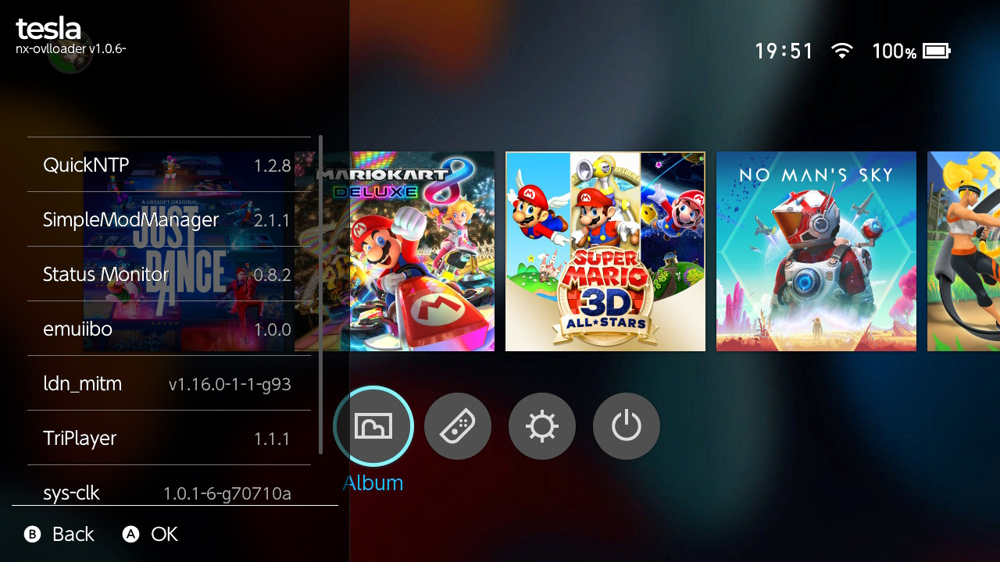

*Tesla Menu opened on top of the home screen. Select an overlay from the list and open it with the A button. Image: [Switch Guide](https://github.com/nh-server/switch-guide)*

The official EdiZon overlay is no longer maintained, and trying to use it on system version 16.0.0 or later crashes Atmosphère itself. The one still maintained is the [EdiZon-Overlay](https://github.com/proferabg/EdiZon-Overlay) above ([Switch Guide EdiZon page](https://switch.hacks.guide/homebrew/edizon)). The button combination for calling it up can be changed by writing something like `key_combo=L+R+RS` in the `[tesla]` section of `sd:/config/tesla/config.ini` (confirmed in [tesla.hpp](https://github.com/WerWolv/libtesla/blob/master/include/tesla.hpp) in libtesla's official source code and on the [Switch Guide Tesla Menu page](https://switch.hacks.guide/homebrew/tesla-menu)).

The Switch Guide lists two remedies for when things do not work ([Switch Guide: Tesla-Menu](https://switch.hacks.guide/homebrew/tesla-menu)). If it crashes at launch or when opening an overlay with error code `2001-0123 (0xf601)` and title ID `420000000007E51A`, Tesla Menu or the overlay you tried to open is an old version, so replace it with the latest version. If Tesla Menu appears only on the home screen when connected to a TV, set "TV Output → Screen Size" in System Settings to 100%.

There is no standard way to check on screen whether cheat code syntax is correct. In practice, the common approach is to check with your own eyes whether the expected effect (infinite health, item unlocks, and so on) appears.

#### Combining multiple cheats and mods

Atmosphère loads only one cheat file per build ID. To use cheats from multiple sources, you have to combine them into one file by hand. As explained in the "Types of cheat codes" section, the limit on the number of cheats is effectively 127, and anything beyond that is ignored without warning.

No official statement could be found on the priority when multiple mod folders override the same file path. Treat this as unconfirmed information.

### exefs_patches (a separate mechanism)

Apart from the text files in the `cheats` folder, there is also a mechanism called `exefs_patches` that applies binary patches in `.ips` format.

```
sd card/
  atmosphere/
    exefs_patches/
      <folder with any name>/
        <.ips file matching the build ID>
```

This also requires the patch file to match the build ID of the target executable.

### About dumping cartridges you own

Apart from mods and cheats, some people probably wonder, "Can I dump and keep the data of a cartridge I bought myself?" I will write about the technical facts and how they are treated separately.

Technically, it is possible. With the homebrew app [nxdumptool](https://github.com/DarkMatterCore/nxdumptool), you can write an inserted cartridge in full to the SD card in XCI format. However, the data is encrypted, so a tool called [Lockpick_RCM](https://github.com/s1204IT/Lockpick_RCM) that first extracts console-unique keys is needed (this repository is archived, and its last update was in 2023).

This article does not go as far as specific operating steps (what to select on which screen). The first reason is that no established procedure exists yet. nxdumptool's older stable version has stopped development, and only a rewritten version is now under main development. The developer of that rewritten version states explicitly in the official README that "at this time it has no proper UI and is experimental code" ([official GitHub](https://github.com/DarkMatterCore/nxdumptool)). The new UI (using a foundation called borealis) is at the "partially implemented" stage on the development checklist and is not complete.

The second reason is that the legal position is not as simple as it looks. Article 30(1) of Japan's Copyright Act permits copying within a personal or home setting (private copying), but item (ii) excludes copying made possible by circumventing technological protection measures when the person knows that fact ([Copyright Act, e-Gov](https://laws.e-gov.go.jp/law/345AC0000000048)). Since dumping a cartridge involves circumvention of protection through CFW as a prerequisite, you cannot simply say "it is my property, so I may copy it."

This article gives no legal judgment. Check the law where you live.

Furthermore, the practice of "continuing to play without using the cartridge after dumping" is out of scope for this article, regardless of ownership. Continuing to run a game from dumped data without physical media is technically indistinguishable from the pattern of use generally understood as piracy. The line this article has consistently drawn, "limited to your own homebrew apps and materials you own; piracy is out of scope," applies equally to the dumping function.

### What has not been tested (this chapter)

This environment has no moddable real cartridge, so the actual behavior of replacement via LayeredFS and of cheats and exefs_patches has not been confirmed. For ARCropolis, HDR, Smash Minecraft Skins, SimpleModManager, EdiZon, and Tesla Menu, the descriptions in the official repositories, wikis, and the Switch Guide were checked, but installation and behavior on a real device are unconfirmed. Before installing, be sure to check the individual steps given by the distributor of the mod or cheat you want to use.

The statements in this chapter sourced to TheGamer, TechRaptor, and GameBrew were checked against the original text in October 2026.

## What has not been tested

This article summarizes, with sources, the content of public guides and documents. Because there is no real Switch at hand, work steps 0–10, the building of your own app in Chapter 8a, the RetroArch port, and the installation of mods, cheats, and ARCropolis in Chapter 8b have all not been verified on a real device.

The status of checking against sources, as of October 2026, is as follows.

| Source | Status of checking |
|---|---|
| switch.hacks.guide | Checked against the original text in the official source ([nh-server/switch-guide](https://github.com/nh-server/switch-guide), commit `64db3a8`) |
| hekate, Atmosphère, OmniRCM, ARCropolis | Checked against each repository's source, README, release pages, and wiki |
| GBAtemp (RCM injection dongles) | Checked against the posts in each thread. However, all are personal posts, and products differ |
| TheGamer, TechRaptor, GameBrew | Checked against the original text |
| Name of the toggle in Chapter 6's "Targets of backup and restore" | The only source is a personal Gist, and it could not be checked |
| SX OS supported firmware | The only source is community reports, and it could not be checked |

Summaries for each source and the dates checked are collected in the [source notes](../sources/switch-community.md). I will verify these one at a time as soon as I obtain a real device.

## Ground rules

- The target is only a unit you own
- What you run is limited to your own homebrew apps and retro game ROMs you own (dumped yourself). Dumping commercial software and illegal acquisition are out of scope
- For Switch game cartridges, dumping itself amounts to circumventing technological protection measures, so it can fall outside the private copying exception. Also, the practice of continuing to play from dumped data without the cartridge is out of scope for this article, regardless of ownership
- Making your own jig carries the risk of damaging the console if you get the pins wrong. Follow steps from reliable information sources
- Using emuMMC lets you keep the modified environment and the stock environment for online use separate

## Terms in this article

| Term | Meaning | Source |
|---|---|---|
| fusée gelée | A hardware-level vulnerability in the Tegra X1's BootROM | [Switchbrew documentation](https://switchbrewdocs.readthedocs.io/en/latest/hacking/rcm.html) |
| RCM | Recovery Mode. A pre-boot mode that can receive payloads over USB | Same source |
| CFW | Custom Firmware. A mechanism that patches the standard OS in memory | [Atmosphère](https://github.com/Atmosphere-NX/Atmosphere) |
| emuMMC | A virtual NAND (internal storage) created on the SD card | [Switch Guide](https://switch.hacks.guide/user_guide/all/cfw_environment) |
| LayeredFS | An Atmosphère feature that swaps files at load time without rewriting the game's own files | [official Atmosphère documentation: loader.md](https://github.com/Atmosphere-NX/Atmosphere/blob/master/docs/components/modules/loader.md) |
| Title ID / build ID | A 16-digit ID that identifies a game (title ID), and an ID that identifies that game's version (build ID) | [Switchbrew title list](https://switchbrew.org/wiki/Title_list) |
| XCI / NSP | The raw data format of a cartridge (XCI), and the distribution and storage format of an installed title (NSP) | [nxdumptool](https://github.com/DarkMatterCore/nxdumptool) |

## What you can learn

The original Switch is one of the few current consoles that retain a hardware-level vulnerability that cannot be closed by software updates. The flow seen in this article (BootROM vulnerability → payload injection → OS patching in memory) lets you experience, in a stricter environment, the boot chain topic learned in [article 19](19-boot.md). For identifying a unit there is the clue of the serial number, but even cross-checking multiple information sources does not allow a definite conclusion, and final confirmation relies on a payload test on the real device. Using emuMMC also has the benefit of separating the modified environment from the stock environment for online use, so you can experiment with peace of mind. From here, the path splits into two different directions, developing your own apps with libnx and modifying existing games with LayeredFS, but both lead onward to analyzing real device firmware with the REA/Ghidra used in [article 22](22-rea-hands-on.md) and [article 23](23-rea-and-ghidra.md).
