# 初代Switchを、自分のホームブリュー開発機にする

[Novaで学ぶAndroid](24-android-nova.md)までは、RG40XXHとAndroidの2系統を見てきました。この記事では、3台目として、初代Nintendo Switch(無印)を扱います。対象は、2018年半ば以前に製造された、ハードウェアの脆弱性(fusée gelée)が残る個体だけです。この脆弱性は、チップ自体の作りに起因するため、ソフトウェアの更新では塞がれません([Switchbrewドキュメント](https://switchbrewdocs.readthedocs.io/en/latest/hacking/rcm.html))。

この記事で説明するのは、自分で所有する機体に、自作のホームブリューアプリを動かすための手順です。市販ソフトの吸い出しや違法なコピーの利用は、対象外とします。この境界は、[チートとパススルー](21-cheats-and-passthrough.md)で紹介したガイド集の立場と同じです。

## この記事の構成

前半の「作業手順」では、Macを使って、CFW(カスタムファームウェア)を起動するところまでを、順番どおりに進めます。後半の1〜8章では、各手順の仕組みと背景を説明します。

| 部分 | 内容 |
|---|---|
| [作業手順](#作業手順macで進める場合画像つき) | 手順0〜10。道具の準備から、emuMMCでCFWを起動するまで |
| [1章](#1-個体の確認)〜[2章](#2-準備するもの) | 対象になる個体の見分け方、RCM治具、AutoRCM |
| [3章](#3-rcmモードに入る)〜[4章](#4-ペイロードを送る) | RCMモードと、ペイロードを送るツール(PCがない場合の方法を含む) |
| [5章](#5-hekateからの起動)〜[6章](#6-emummcを作る) | hekateの起動項目と、emuMMCの仕組み |
| [7章](#7-ホームブリューを動かすhbmenu)〜[8b章](#8b-既存ゲームを改造する) | ホームブリュー、自作アプリ、MOD、チート |

## 作業手順(Macで進める場合、画像つき)

手順は、[Switch Guide](https://switch.hacks.guide/)(Nintendo Homebrewが運営する導入ガイド)の2026年10月時点の内容に基づいています(ソースは[nh-server/switch-guide](https://github.com/nh-server/switch-guide)のコミット `64db3a8`)。この手順は、実機では試していません。作業の前と、うまくいかないときは、Switch Guideの本家のページも確認してください。

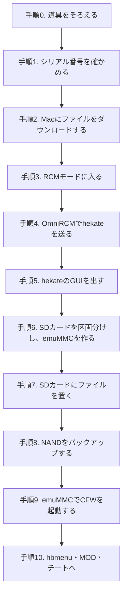

画像のうち、ファイル名が `switch-guide-` で始まるものは、Switch Guideのリポジトリから取ったものです(© Nintendo Homebrew、ISCライセンス。許諾文は[LICENSE-switch-guide.txt](../assets/screenshots/LICENSE-switch-guide.txt))。`github-` と `omnircm-` で始まるものは、この記事のために、2026年10月にChrome(macOS版)で撮影したものです。

### 手順0. 道具をそろえる

| もの | 選び方 | 解説へ |
|---|---|---|
| RCM治具 | 無印Switch用のもの。下の画像の形が、Switch Guideの推奨モデル | [2章](#rcm治具とは何か) |
| microSDカード | 128GB以上を推奨。FAT32で使う | [2章](#2-準備するもの) |
| USBケーブル | Macの端子に合わせて、USB-A→USB-C、またはUSB-C同士。データ転送に対応したもの(充電専用のケーブルでは認識されない) | [4章](#4-ペイロードを送る) |
| Mac | ChromeなどのChromium系ブラウザか、OmniRCMのMac版を使う | [4章](#4-ペイロードを送る) |

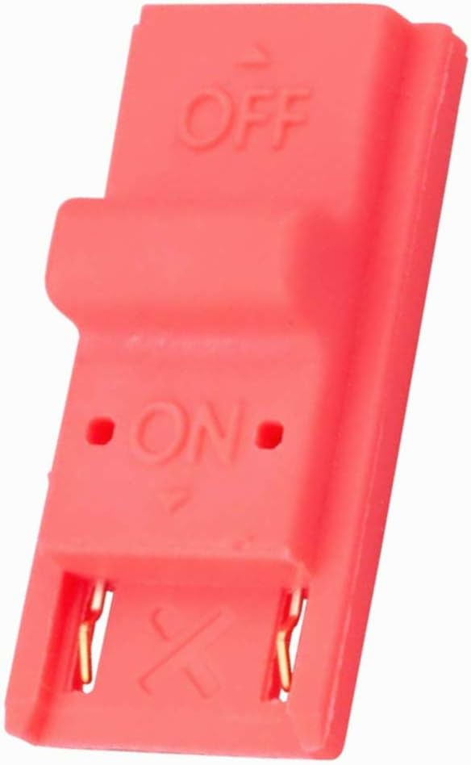

*Switch Guideの推奨モデルのRCM治具。先端の接点を、本体右側のJoy-Conレールに差し込む。画像:[Switch Guide:Entering RCM](https://switch.hacks.guide/user_guide/rcm/entering_rcm)*

RCM治具は、Joy-Conレールの10番ピンとGND(グラウンド)をつなぐための部品です。ペーパークリップやアルミホイルで代用すると、5Vの電源が来ている4番ピンに触れて、本体を壊すおそれがあります。Switch Guideも、代用は絶対にしないよう警告しています([Switch Guide:Entering RCM](https://switch.hacks.guide/user_guide/rcm/entering_rcm))。

### 手順1. シリアル番号を確かめる

1. Switchを普通に起動し、`設定 → 本体 → シリアル情報` を開く
2. 表示されたシリアル番号を、[Switch GuideのGetting Started](https://switch.hacks.guide/user_guide/getting_started)の判定フォームに入力する
3. 「Unpatched(未対策)」なら次に進む。「Patched(対策済み)」なら、この記事の方法は使えない。「Potentially patched(対策済みの可能性あり)」なら、手順4のペイロードテストで確かめる

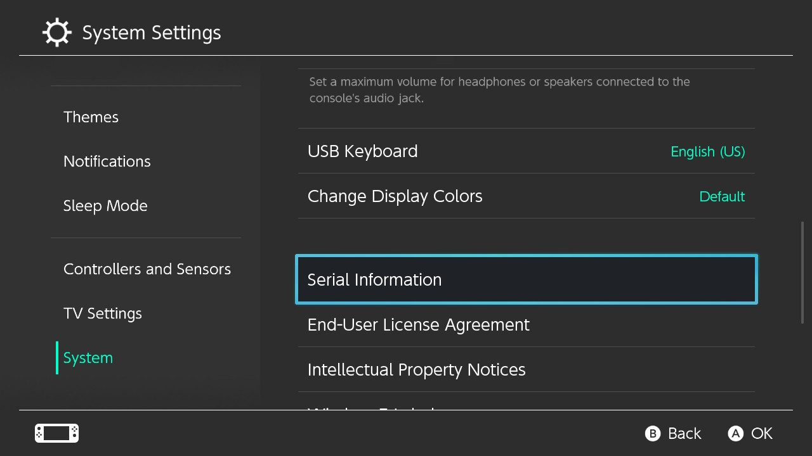

*シリアル情報の場所。画像は英語表示だが、日本語表示では「本体」の中の「シリアル情報」にあたる。画像:[Switch Guide](https://switch.hacks.guide/user_guide/getting_started)*

シリアル番号は本体の底面のラベルにもありますが、Switch Guideは、設定画面の表示を使うほうが確実だとしています。特に中古品では、ラベルが本体と一致しない場合があるためです([Switch Guide:Getting Started](https://switch.hacks.guide/user_guide/getting_started))。判定の仕組みは[1章](#1-個体の確認)で説明しています。

### 手順2. Macにファイルをダウンロードする

次のファイルを、Macにダウンロードしておきます。

| ファイル | 入手先 | 役目 |
|---|---|---|
| `OmniRCM-osx.zip` | [OmniRCMのリリースページ](https://github.com/DefenderOfHyrule/OmniRCM/releases/latest) | Macから、Switchにペイロードを送るアプリ |
| `hekate_ctcaer_(版)_Nyx_(版).zip` | [hekateのリリースページ](https://github.com/CTCaer/hekate/releases/latest) | ブートローダーのhekateと、そのGUI(Nyx) |
| `atmosphere-(版)-master-…+hbl-…+hbmenu-….zip` | [Atmosphèreのリリースページ](https://github.com/Atmosphere-NX/Atmosphere/releases/latest) | CFW本体と、ホームブリューのランチャー(hbmenu)一式 |
| `hekate_ipl.ini` | [Switch Guideの配布ファイル](https://switch.hacks.guide/files/emu/hekate_ipl.ini) | hekateの起動メニューの設定 |
| `emummc.txt` | [Nintendo Homebrewの配布ファイル](https://nintendohomebrew.com/assets/emummc.txt) | emuMMCから任天堂のサーバーへの接続を止める設定 |
| `bootlogos.zip` | [Switch Guideの配布ファイル](https://switch.hacks.guide/files/bootlogos.zip) | 起動メニューに表示するアイコン画像 |

([Switch Guide:Sending a Payload](https://switch.hacks.guide/user_guide/rcm/sending_payload)、[SD Preparation](https://switch.hacks.guide/user_guide/all/sd_preparation))

GitHubのリリースページでは、ページ下部の `Assets` の欄から、ファイル名を選んでダウンロードします。「Source code」は、プログラムのソースなので、選ばないでください。

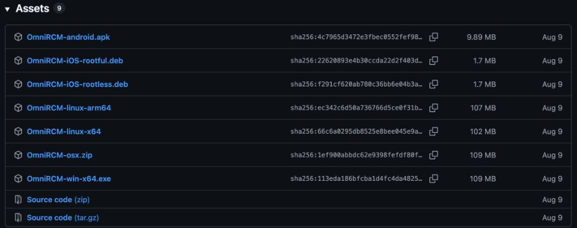

*OmniRCMのAssets欄。Macでは `OmniRCM-osx.zip` を選ぶ(2026年10月、v1.1.1)*

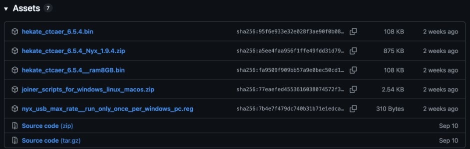

*hekateのAssets欄。選ぶのは2番目の `hekate_ctcaer_6.5.4_Nyx_1.9.4.zip`(2026年10月、v6.5.4)*

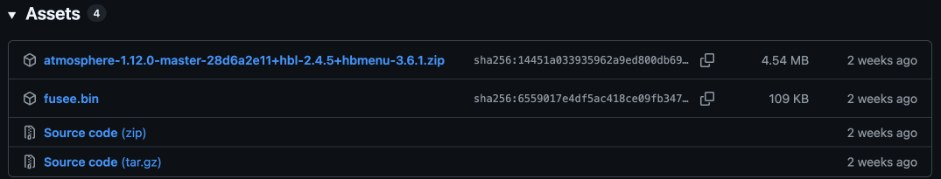

*AtmosphèreのAssets欄。選ぶのは1番目のzip。`fusee.bin` は、Atmosphère自身のブートローダーで、この手順では使わない(2026年10月、1.12.0)*

hekateのzipのほかに、`hekate_ctcaer_6.5.4.bin` 単体も並んでいますが、これはペイロードだけのファイルです。この手順では、OmniRCMがhekateのペイロードを自動で取得するので、手で落とす必要はありません。`nyx_usb_max_rate__run_only_once_per_windows_pc.reg` は、Windows用の設定ファイルで、リリースノートにも「Linux/Mac OSでは不要」と書かれています([hekate v6.5.4のリリースノート](https://github.com/CTCaer/hekate/releases/tag/v6.5.4))。

Atmosphèreには、`fusee` という独自のブートローダーもありますが、Switch Guideは、NANDのバックアップなどの機能が使えるhekateを使う手順にしています([Switch Guide:SD Preparation](https://switch.hacks.guide/user_guide/all/sd_preparation))。

`hekate_ipl.ini` を開くと、`[Atmosphere PKG3 emuMMC]`・`[Atmosphere PKG3 sysMMC]`・`[Stock sysMMC]` という3つの起動項目が書かれています。`emummcforce=1` はemuMMCを必ず使う、`emummc_force_disable=1` はemuMMCを使わない、`stock=1` はCFWを読み込まずに純正の状態で起動する、という意味です。`icon=` の行は、`bootlogos.zip` に入っている3つのアイコン(`emu_boot.bmp` など)を指しています([hekateのREADME](https://github.com/CTCaer/hekate))。

`emummc.txt` を開くと、`127.0.0.1 *nintendo.com` のような行が並んでいます。任天堂のドメインの名前解決を、自分自身(127.0.0.1)に向けることで、通信を止める仕組みです。

### 手順3. RCMモードに入る

1. Switchの電源を完全に切る(電源ボタン長押し → 電源オプション → 電源OFF。スリープではない)
2. 右側のJoy-Conを外し、RCM治具を、右側のJoy-Conレールの奥まで差し込む
3. 音量+ボタンを押したまま、電源ボタンを1回押す
4. 画面が真っ黒のままなら成功。電源ボタンをもう一度押しても黒いままなら、RCMモードに入っている。音量+から手を離し、治具を抜く

ニンテンドーのロゴが出て普通に起動した場合は、失敗です。電源を切って、もう一度やり直します([Switch Guide:Entering RCM](https://switch.hacks.guide/user_guide/rcm/entering_rcm))。

RCMは、本体のチップ(Tegra X1)の起動プログラム(BootROM)に組み込まれた、復旧用のモードです。このモードのまま、USB経由で送られたプログラム(ペイロード)を受け取る処理に脆弱性があり、それを使って、hekateを動かします。画面に何も出ないのは、OSが起動する前の段階で止まっているからです。詳しくは[3章](#3-rcmモードに入る)を見てください。

### 手順4. OmniRCMでhekateを送る

1. ダウンロードした `OmniRCM-osx.zip` を展開し、`OmniRCM.app` を `アプリケーション` フォルダに移してから、Finderで開く
2. RCMモードのSwitchを、USBケーブルでMacに繋ぐ
3. `Payloads` の欄にある `↓ Update` を押して、ペイロードの一覧を取得する
4. hekate を選び、緑色の `► Inject Payload` を押す
5. Switchの画面に、黄色い文字で `Update bootloader folder!` などの警告が出れば成功

([Switch Guide:Sending a Payload](https://switch.hacks.guide/user_guide/rcm/sending_payload))

アプリを入れずに済ませたい場合は、Chromeで[OmniRCM Web](https://omnircm.nintendohomebrew.com/web/)を開き、`Connect device…` → `APX` を選択 → hekateを選ぶ → `Inject` の順に操作しても同じです。

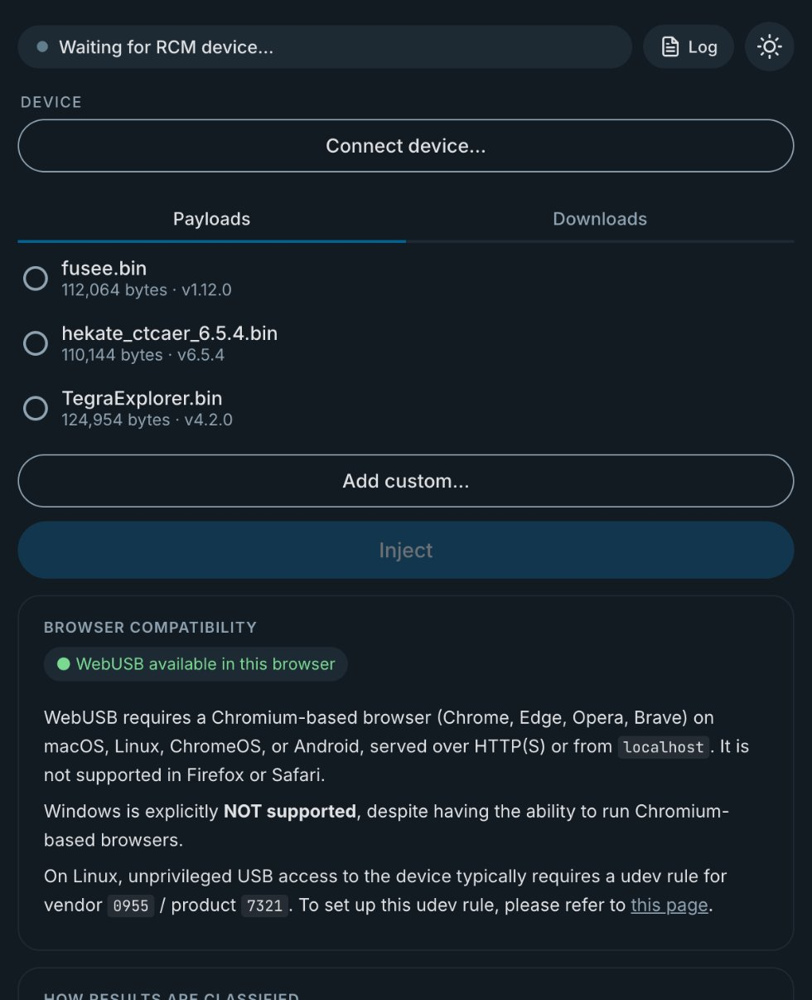

*OmniRCM Web。Switchを繋いで「Connect device…」を押すと、ブラウザがUSB機器の選択画面を出すので、`APX` を選ぶ*

1番目の操作で `OmniRCM.app` をアプリケーションフォルダに移すのは、アプリ内の自動更新を使うためです。OmniRCM v1.1.1のリリースノートは、v1.1.0から自動更新を使うには、アプリをアプリケーションフォルダにコピーしておく必要があると書いています([OmniRCM v1.1.1のリリースノート](https://github.com/DefenderOfHyrule/OmniRCM/releases/tag/v1.1.1))。

`APX` は、RCMモードのSwitchが、USB機器として名乗る名前です。

黄色い警告は、SDカードにまだhekateのファイルがないために出るもので、次の手順で解消します。microSDカードを入れていない場合は、`Failed to init or mount SD!` と出ますが、これも気にしなくてかまいません。

画面が黒いままの場合は、ペイロードが壊れているか、対策済みの個体です。OmniRCMが「Patched」と表示したなら、対策済みで確定です。詳しくは[4章](#成功失敗の見分け方)を見てください。

### 手順5. hekateのGUIを出す

hekateの画面を出したまま、次の作業をします。**Switchの電源は切りません。** 切ると、手順3からやり直しになります。

1. SwitchからmicroSDカードを抜き、Macに挿す(hekateの画面のまま抜いても安全)
2. カードの中の `Nintendo` フォルダ(と、ほかに大事なデータ)を、Macにコピーしてバックアップする
3. ダウンロードしたhekateのzipを展開し、中の `bootloader` フォルダを、カードのルートにコピーする
4. カードをSwitchに戻し、音量ボタンか電源ボタンを押して、hekateのメニューに進む
5. 画面下に `Warning: Nyx is missing!` と出るが、そのまま進む。音量の上下で `load nyx` に合わせ、電源ボタンで選ぶ
6. 下の画像の画面(Nyx)が出れば成功

([Switch Guide:Sending a Payload](https://switch.hacks.guide/user_guide/rcm/sending_payload))

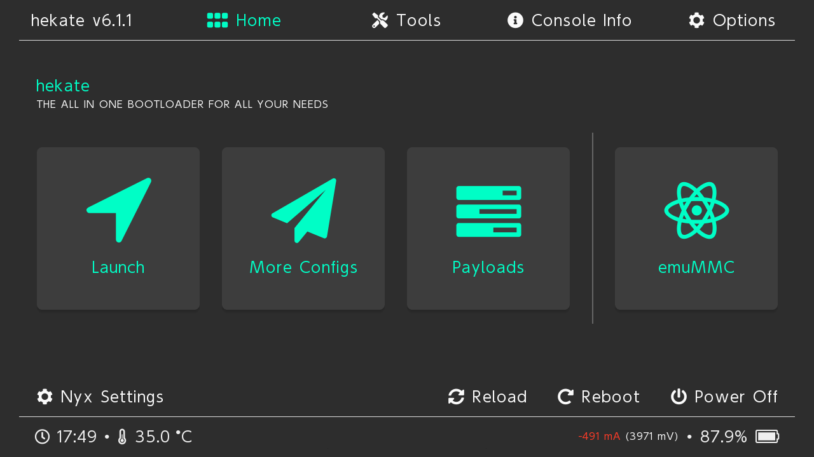

*hekateのGUI(Nyx)のホーム画面(画像は撮影当時のv6.1.1)。画像:[Switch Guide](https://switch.hacks.guide/user_guide/rcm/sending_payload)*

Nyxは、hekateのタッチ操作に対応したGUIです。3番目の操作でカードに置いた `bootloader` フォルダの中に、Nyxの本体が入っています。ここからは、タッチパネルか、左Joy-Conのスティックで操作できます。`Nintendo` フォルダは、Switchがゲームのデータなどを保存するフォルダです。次の手順でカードが初期化されるので、ここで必ず退避しておきます。

### 手順6. SDカードを区画分けし、emuMMCを作る

**この手順で、microSDカードの中身はすべて消えます。** 手順5でバックアップを取ったことを確認してから進めてください。

1. `Tools → Partition SD card` を開く
2. `emuMMC (RAW)` のスライダーを、バーの中央の `29 FULL` に合わせる
3. 右下の `Next Step` を選び、表示されたメニューで `Start` を選ぶ。初期化と区画分けが始まる
4. 終わったら、`Home` に戻り、`emuMMC → Create emuMMC → SD Partition → Part 1`(灰色になっていないもの)を選ぶ。作成には時間がかかるので、終わるまで待つ
5. `Close` で作成メニューを閉じ、`Change emuMMC → SD RAW 1`(灰色になっていないもの)を選ぶ
6. 右上の `Close` を2回押して、Homeに戻る

([Switch Guide:Partitioning the microSD Card](https://switch.hacks.guide/user_guide/all/partitioning_sd))

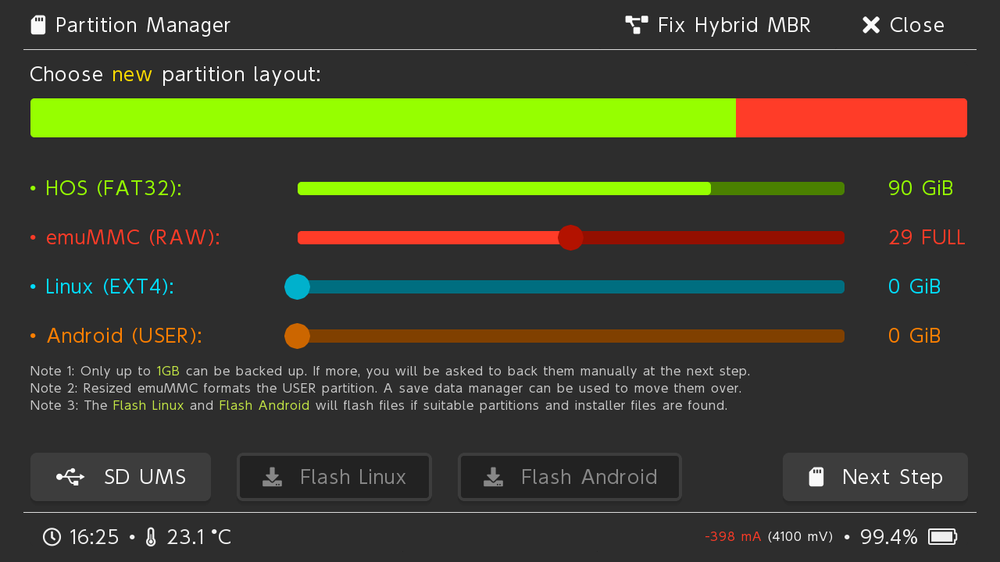

*スライダーを29 FULLに合わせたところ。Android・Linuxを入れる予定がなければ、ほかのスライダーは0のままでよい。画像:[Switch Guide](https://switch.hacks.guide/user_guide/all/partitioning_sd)*

emuMMCは、本体の内蔵ストレージ(NAND)を、そっくりmicroSDカードの上に複製したものです。改造した環境はこちらで動かし、本体の内蔵ストレージ(sysMMC)は、オンラインで使う純正の環境として残しておけます。

「29 FULL」は、無印Switchの内蔵ストレージを丸ごと複製できる大きさ(約29GB)を確保する、という意味です。残りの容量は、ゲームやホームブリューを置く、普通のFAT32の区画になります。

「SD Partition」は、emuMMC専用の区画に直接書き込む方式です。もう一つの「SD File」方式は、安定性が劣るとされています([ConsoleMods Wiki](https://consolemods.org/wiki/Switch:Creating_and_Using_EmuNAND))。

Part・SD RAWの番号は、画面で灰色になっていないものを選びます。上の手順では1と書きましたが、環境によって違うことがあります。

詳しくは[6章](#6-emummcを作る)を見てください。

### 手順7. SDカードにファイルを置く

区画を作り直したので、カードは空になっています。ここで、CFWの起動に必要なファイルを置きます。カードは抜かずに、hekateのUSB機能を使ってMacに繋ぐのが手軽です。

1. hekateで `Tools → USB Tools → SD Card` を選び、SwitchをUSBケーブルでMacに繋ぐ。Macに、`SWITCH SD` という名前のドライブが出る
2. Atmosphèreのzipを展開し、中身(`atmosphere` フォルダ、`switch` フォルダ、`hbmenu.nro`)を、`SWITCH SD` のルートにコピーする
3. hekateのzipの中の `bootloader` フォルダを、ルートにコピーする。「置き換えますか」と聞かれたら、`結合` を選ぶ
4. `bootlogos.zip` を展開し、中の `bootloader` フォルダを、ルートにコピーする。これも `結合` を選ぶ
5. `hekate_ipl.ini` を、`bootloader` フォルダの中にコピーする。置き換えるか聞かれたら、置き換える
6. `atmosphere` フォルダの中に `hosts` フォルダを作り、その中に `emummc.txt` を置く
7. 手順5でバックアップした `Nintendo` フォルダを、ルートに戻す。さらに、同じものを `emuMMC/RAW1/` の中にもコピーする(`RAW1` の数字は、カードにあるものに合わせる)
8. Finderで `SWITCH SD` を取り出して(イジェクトして)から、hekateのUSBの画面を閉じる

([Switch Guide:SD Preparation](https://switch.hacks.guide/user_guide/all/sd_preparation)、[Making Essential Backups](https://switch.hacks.guide/user_guide/all/making_essential_backups))

カードのルートは、次の画像のようになっていれば正しい状態です。`Nintendo` フォルダは、Switchが一度もこのカードで起動していなければ、まだありません。`payload.bin` は、modchipを付けた本体向けのファイルなので、この手順では置きません。

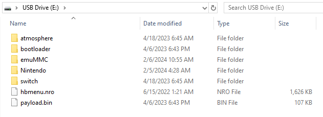

*Windowsのエクスプローラーで見た、準備後のカードのルート。Macでも同じ構成になる。画像:[Switch Guide](https://switch.hacks.guide/user_guide/all/sd_preparation)*

Atmosphèreのzipは、「zipを展開してできたフォルダごと」ではなく、「中身」をルートに置きます。フォルダごとコピーすると、1階層深くなり、hekateがファイルを見つけられません。

Macの「置き換え」に注意します。Finderで同じ名前のフォルダをコピーすると、既定では中身ごと置き換えられ、先に入れたファイルが消えます。Switch Guideも、macOSでは「結合」を明示的に選ぶよう書いています([Switch Guide:SD Preparation](https://switch.hacks.guide/user_guide/all/sd_preparation))。結合の選択肢が出ない場合は、フォルダの中のファイルを、個別にコピーしてください。

Macのアーカイブビットに注意します。Macでコピーしたファイルには、「アーカイブビット」という属性が付くことがあり、ホームブリューやMODが認識されない原因になります。うまく動かないときは、hekateの `Tools → Arch bit • RCM Touch • Pkg1/2 → Fix Archive Bit` を実行します([Switch Guide:Game modding](https://switch.hacks.guide/extras/game_modding))。

`emummc.txt` を置かないと、emuMMCが任天堂のサーバーに繋がり、BANされる可能性が高くなります。必ず置いてください。詳しくは[6章](#emummcをネットワークから切り離す)を見てください。

取り出しをせずにUSBの画面を閉じると、書き込みが終わっていないファイルが壊れることがあります。

### 手順8. NANDをバックアップする

CFWを起動する前に、本体の内蔵ストレージを丸ごとバックアップします。Switch Guideが「絶対に飛ばさないで」と強調している手順です。

1. hekateの `Tools → Backup eMMC` を開く
2. `eMMC BOOT0 & BOOT1` を選ぶ(数秒〜1分程度で終わる)
3. `Close` を押し、続けて `eMMC RAW GPP` を選ぶ(10分〜1時間以上かかる)
4. 終わったら、右上の `Close → Home` で戻る
5. `Tools → USB Tools → SD Card` でMacに繋ぎ、カードの `backup` フォルダを、Macの安全な場所にコピーする
6. コピーが終わったら、カードの `backup` フォルダを消し、Finderで取り出してから、hekateの画面に戻る

([Switch Guide:Making Essential Backups](https://switch.hacks.guide/user_guide/all/making_essential_backups))

カードの空き容量が足りないと、hekateが途中で止まり、次の画面を出します。

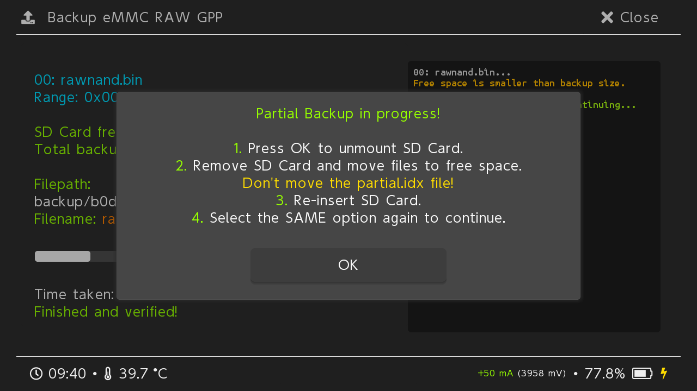

*空き容量が足りないときの画面。画像:[Switch Guide](https://switch.hacks.guide/user_guide/all/making_essential_backups)*

この場合は、`OK` を押し、`Close → Close → USB Tools → SD Card` でMacに繋いで、`backup` フォルダをMacに移します(結合を聞かれたら結合する)。取り出してから、`Close → Backup eMMC → eMMC RAW GPP` をもう一度選ぶと、続きから再開します。画面の案内にある通り、`partial.idx` というファイルは動かしてはいけません。最後まで終わるまで、これを繰り返します(同上)。

NANDのバックアップは、本体が起動しなくなったときに、元の状態へ戻すための、唯一の手段です。バックアップには本体固有のデータが含まれるので、ほかの本体には使えません。Switch Guideは、容量を節約するため、zipなどに圧縮して保管することを勧めています。

### 手順9. emuMMCでCFWを起動する

1. hekateの `Home → Launch` を開く
2. `Atmosphere PKG3 emuMMC` を選ぶ
3. 起動したら、`設定 → 本体` を開き、バージョンの表記を確かめる。`AMS` の文字と、末尾の `E` があれば成功

([Switch Guide:Launching CFW](https://switch.hacks.guide/user_guide/all/launching_cfw))

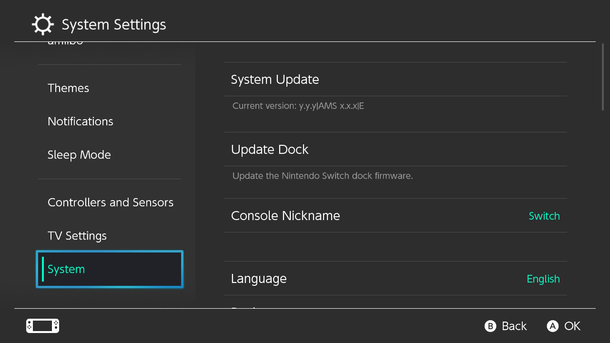

*`AMS` はAtmosphèreで起動していること、末尾の `E` はemuMMCで起動していることを表す。sysMMCで起動した場合は `S` になる。画像:[Switch Guide](https://switch.hacks.guide/user_guide/all/launching_cfw)*

**emuMMCでは、任天堂のオンラインサービスを使いません。** オンラインのプレイやeショップは、sysMMC(`Stock sysMMC` で起動した純正の状態)で行います。両方でオンラインに繋ぐと、いずれBANされる可能性が高い、とSwitch Guideは警告しています([Switch Guide:Launching CFW](https://switch.hacks.guide/user_guide/all/launching_cfw))。

CFWは、電源を完全に切ると消えます。次にCFWで起動するときは、手順3(RCMモード)と手順4(hekateを送る)を繰り返し、Launchから起動します。手順5〜8は、最初の1回だけです。

CFWの状態から再起動すると、hekateに戻ります。これは、`hekate_ipl.ini` の `updater2p=1` という設定が、Atmosphèreの再起動用ペイロードを、hekateに置き換えているためです([hekateのREADME](https://github.com/CTCaer/hekate))。

詳しくは[5章](#起動の選択肢)を見てください。

### 手順10. hbmenu・MOD・チートへ

ここまでで、CFWの環境ができあがりました。ここから先は、目的に応じて、次の章に進みます。

| やりたいこと | 操作の入口 | 解説へ |
|---|---|---|
| ホームブリューを動かす | Rボタンを押したまま、任意のゲームを起動して、hbmenuを開く | [7章](#7-ホームブリューを動かすhbmenu) |
| 自作のアプリを作る | devkitA64とlibnxで `.nro` を作り、`switch` フォルダに置く | [8a章](#8a-自作ゲームを作るlibnx--devkita64) |
| 既存のゲームにMODを入れる | `atmosphere/contents/<タイトルID>/` にMODを置く | [8b章](#8b-既存ゲームを改造する) |
| MODをオン・オフする | SimpleModManager(スマブラSPではARCropolisのMod Manager) | [8b章](#modをオンオフするsimplemodmanager) |
| チートを使う | `cheats/<ビルドID>.txt` を置き、EdiZonやTesla Menuで切り替える | [8b章](#チートコード) |

## 1. 個体の確認

まず、自分の機体が対象になるかを確認します。

### 型番

本体裏のラベルで、型番を確認してください。

| 型番 | 判定 |
|---|---|
| `HAC-001`(末尾に何も付かない) | 候補になりうる |
| `HAC-001(-01)` | Mariko版。対象外(別途、ハードウェアの改造が必要) |
| `HDH-001`(Switch Lite)、`HEG-001`(OLED) | すべて対象外 |

### シリアル番号

型番が `HAC-001` でも、2018年半ば以降の製造分は、見た目はそのままで、対策済み(Patched)のBootROMに切り替わっていることがあります。おおよその判定には、シリアル番号を使うのが一般的です。

シリアル番号は、本体の `設定 → 本体 → シリアル情報` で確認できます。本体底面(充電端子の横)のラベルにも書かれていますが、Switch Guideは、特に中古で入手した本体では、ラベルより設定画面の表示を使うほうが確実だとしています([Switch Guide:Getting Started](https://switch.hacks.guide/user_guide/getting_started))。

Switch Guideのページには、シリアル番号を丸ごと入力して判定するフォームと、`XAW1`・`XAJ4` のような先頭4文字ごとに「未対策・対策済みの可能性あり・対策済み」の範囲をまとめた表があります。表に載っていないシリアル番号は、脆弱性の対象外です。表の元データは、[GBAtempのスレッド](https://gbatemp.net/threads/switch-informations-by-serial-number-read-the-first-post-before-asking-questions.481215/)で集められたものです([Switch Guide:Getting Started](https://switch.hacks.guide/user_guide/getting_started))。ほかにも、[Such Meme serial list](https://suchmememanyskill.github.io/guides/switchserials/)や[ReHack](https://rehack.com/gaming/console-gaming/is-my-switch-patched/)が、同様の一覧を公開しています。プレフィックスが `XKJ`、`XJW`、`XKW`、`XWW` のものは、範囲に関係なく、全数Mariko世代とされています([ReHack](https://rehack.com/gaming/console-gaming/is-my-switch-patched/))。

Switch Guideは、この表の傾向に反する個体は知られておらず、「対策済みの可能性あり」の範囲でなければ、表の判定は実態に沿っていると説明しています。ただし、「対策済みの可能性あり」の範囲に入る個体は、表だけでは決まりません。その場合に確認できるのは、次の章のペイロードテストだけです。

## 2. 準備するもの

| もの | 役目 | 備考 |
|---|---|---|
| RCM治具 | RCMモードに入るための、電気的な橋渡し | 次の節で詳しく説明する |
| Mac(またはWindows PC、Androidスマホ) | ペイロードを送る | どれでも行ける。詳細は「4. ペイロードを送る」 |
| USB Type-Cケーブル | SwitchとMacを繋ぐ | |
| microSDカード(推奨128GB) | hekate、Atmosphère、ホームブリューの保存先 | FAT32推奨(exFATは壊れやすいため非推奨)。32GB以下はホームブリューには使えるが、NANDの完全なバックアップやemuMMCを置けないため非推奨([Switch GuideのFAQ](https://switch.hacks.guide/faq)) |

### RCM治具とは何か

Switchには、物理的な「ホームボタン」がありません。RCM(Recovery Mode、復旧モード)に入るには、本体の中にある、ホームボタンに相当する接点を、電気的に短絡させる(つなげる)必要があります。この役目を果たす小さな道具が、RCM治具です([Switchbrewのドキュメント](https://switchbrewdocs.readthedocs.io/en/latest/hacking/rcm.html))。

#### 仕組み

RCM治具は、本体の右側のJoy-Conを差し込むレール(接点の並び)のうち、10番ピンとGND(グラウンド、電気的な基準点)のピンを、確実に短絡させるための部品です。治具が線材を固定するので、正しいピンの組み合わせを安定してつなげます([Switch Guideの解説](https://switch.hacks.guide/user_guide/rcm/entering_rcm))。

#### 絶対に避けるべきピン

同じレールの**4番ピンには、Joy-Conへ送る5Vの電源**が来ています。Switch Guideは、自作の治具が4番ピンに決して触れないようにすること、ショートさせるとレールや本体を恒久的に壊すおそれがあることを警告しています([Switch Guide](https://switch.hacks.guide/user_guide/rcm/entering_rcm))。

もっとも安全なのは、市販の専用治具を使うことです。Switch Guideは、治具を使う方法を、もっとも手軽で、多くの場合ペーパークリップ方式より確実で安全な方法と位置づけています。**ペーパークリップやアルミホイルで代用してはいけません。** Switch Guideは「本体を壊すおそれがある」として明確に禁じており、ペーパークリップを使う設計の治具も同じリスクがあるとしています([Switch Guide](https://switch.hacks.guide/user_guide/rcm/entering_rcm))。治具を自作する場合は、Switch Guideに掲載されているパッドの番号図で、ピン配置を必ず確認してください。

#### 入手方法

RCM治具は、小型の電子部品として、複数のオンラインショップで販売されています。本体の機種(無印/Lite/OLED)によって形が違うので、自分の機種に対応したものを選ぶことが大切です。

### AutoRCMという別の方法(上級者向け、リスクが高い)

治具を毎回使わずに済む、AutoRCMという設定もあります。これは、起動時に強制的にRCMへ入るよう、本体に設定を書き込む方法です。

#### 仕組み(hekateのソースコードで確認)

AutoRCMは、eMMCのBOOT0領域だけを書き換えます。BOOT1は変更されません(「BOOT0とBOOT1の両方を書き換える」と説明しているガイドも見られますが、hekateの[ソースコード](https://github.com/CTCaer/hekate/blob/45cd81ed08e30a26ba380958c7e20b55c342834b/bdk/storage/emmc.c#L215-L227)を直接確認したところ、実際に書き込まれるのはBOOT0のみでした)。

BOOT0内には、BCT(Boot Config Table、起動時の署名検証に使うテーブル)が4つ、一定間隔で格納されています。AutoRCMは、その各コピーにある、RSA公開鍵モジュラスの先頭1バイトを `0x00` に書き換えます。この結果、BootROMの署名検証が必ず失敗するようになり、「正常に起動できない本体」としてRCM(Recovery Mode)へ自動的にフォールバックする、という仕組みです([hekateソース `fe_tools.c`](https://github.com/CTCaer/hekate/blob/45cd81ed08e30a26ba380958c7e20b55c342834b/bootloader/frontend/fe_tools.c#L34-L159))。hekateのメニュー自体にも、「This corrupts BOOT0!」(これはBOOT0を破壊します)という警告が、ツール名としてそのまま表示されます。

#### なぜ対策済み(Patched)個体でブリックするのか

RCMモードへの切り替えは電気的な機能なので、Patched個体でも問題なく入れます。塞がれているのは、RCM経由で送られたペイロード(署名のない自作コード)を実行する部分だけです(2018年のパッチ、BootROMアドレス `0x0010769A` の修正)。

そのため、Patched個体でAutoRCMを有効化すると、通常起動はBCT破損で失敗し、RCMへのフォールバックはペイロードを拒否される、というどちらの経路でも起動できない状態に陥ります。これが、ブリックの実体です。複数のガイドが「絶対に行うな」と強調しているのは、このためです([Homebrew-Guide](https://github.com/noahc3/Homebrew-Guide/blob/master/usingcfw/hekate.rst))。

#### 最新のhekateに備わる防止機能

現在のhekate(v6.5.4世代)は、Patched個体を検出すると、AutoRCMの有効化そのものを拒否するようになっています([`fuse.c`](https://github.com/CTCaer/hekate/blob/45cd81ed08e30a26ba380958c7e20b55c342834b/bdk/soc/fuse.c#L487-L515))。クラシックメニューでは「This device is RCM patched and the function is disabled to avoid BRICKS!」と表示されてeMMCには一切触れず、GUI版(Nyx)でも、有効化を試みた直後にPatched状態を検知して書き込みを取り消します。つまり、正規の最新hekateを使う限り、この種のブリックは原理的に起きにくくなっています(古いバージョンや、この機能を回避する改造ツールを使った場合は対象外です)。

#### バックアップと、元に戻す方法

有効化する前には、NANDのバックアップ(`Tools → Backup eMMC → eMMC BOOT0 & BOOT1`)を取っておくことが推奨されています。これはAutoRCM専用の対策というより、それ以外の予期しないeMMC破損に備えた、一般的な保険です。

Unpatched個体であれば、設定はいつでも元に戻せます。無効化もhekateの同じメニューから行い、バックアップがなくても、hekateが正しいバイトを計算して書き戻します。ただし、無効化の操作をするにも、一度はペイロードを送ってhekateを起動しなければなりません。Patched個体では、この「一度は起動する」こと自体ができないため、バックアップがあっても、ソフトウェアだけでは元に戻せません。

### Patched/Unpatchedの確実な判定方法

[1章](#1-個体の確認)で見たシリアル番号の判定は、「対策済みの可能性あり」の範囲に入る個体では、決め手になりません。もっとも確実な判定は、hekateが本体のFuse(ヒューズ、製造時に焼き込まれる情報)を読み取って表示する、Console Info画面です。緑文字で「This unit is exploitable to the RCM bug!」、オレンジ文字で「This unit is patched to the RCM bug!」と表示されます([`gui_info.c`](https://github.com/CTCaer/hekate/blob/45cd81ed08e30a26ba380958c7e20b55c342834b/nyx/nyx_gui/frontend/gui_info.c#L1281-L1286))。ただし、この画面を見るには、そもそも一度ペイロードが通ってhekateが起動している必要があるため、実質的には「4章のペイロードが通るかどうか」自体が、最終的な判定にほかなりません。

この記事では、最初はAutoRCMを使わず、毎回治具でRCMに入る方法を前提とします。AutoRCMは、治具を使う手順に十分慣れてから選ぶ、発展的な選択肢として紹介しました。

## 3. RCMモードに入る

操作は[手順3](#手順3-rcmモードに入る)の通りです。RCMモードでは画面に何も表示されないため、成功したかどうかは「画面が黒いままか」で判断します。ニンテンドーのロゴが出て通常起動した場合や、点いていた画面が黒くなった場合は、RCMモードに入れていません([Switch Guide](https://switch.hacks.guide/user_guide/rcm/entering_rcm))。

対策済み(Patched)の個体でも、RCMモードには入れます。塞がれているのは、ペイロードを実行する部分だけです([Switch Guide](https://switch.hacks.guide/user_guide/rcm/entering_rcm))。また、RCMは、音量+・音量-・電源ボタンを押して入る「メンテナンスモード」とは別のモードです(同上)。

## 4. ペイロードを送る

Mac(またはWindows PC、Androidスマホ)とUSBケーブルで繋いだ状態で、ペイロード注入ツールを使います。

現在のSwitch Guideが、すべてのOSで第一に案内しているのは、[OmniRCM](https://github.com/DefenderOfHyrule/OmniRCM) です。GPL-3.0のオープンソースで、2026年8月にv1.1.1が出ており、開発が続いています([Switch Guide:Sending a Payload](https://switch.hacks.guide/user_guide/rcm/sending_payload))。

| 環境 | ツール | 備考 |
|---|---|---|
| Mac | OmniRCM(`OmniRCM-osx.zip`) | 代わりに、ブラウザ版(OmniRCM Web)も使える |
| Windows | OmniRCM(`OmniRCM-win-x64.exe`) | ドライバーの導入が必要。代わりの方法として、[TegraRcmGUI](https://github.com/eliboa/TegraRcmGUI)とZadig(libusbK)も案内されている。TegraRcmGUIの最終リリースは2019年 |
| Linux | OmniRCM | udevルールの設定が必要 |
| Android | OmniRCM(`OmniRCM-android.apk`) | root化は不要。詳しくは後述 |
| iOS | OmniRCM(Sileoリポジトリから入れる) | 脱獄済みのiPhoneに限る |
| ChromeOS | OmniRCM Web | USB-C同士のケーブルでは動かない |

([Switch Guide:Sending a Payload](https://switch.hacks.guide/user_guide/rcm/sending_payload))

Macでの操作は[手順4](#手順4-omnircmでhekateを送る)にまとめました。OmniRCMには、アプリ版のほかに、ブラウザで動く[OmniRCM Web](https://omnircm.nintendohomebrew.com/web/)があります。ブラウザのWebUSB機能を使うため、ChromeなどのChromium系ブラウザでだけ動き、Firefox・Safariでは動きません。Windowsは、Chromium系ブラウザがあっても非対応と明記されています。

### 成功・失敗の見分け方

注入に成功すると、Switchの画面に、hekateの黄色い文字(ライブラリが足りないという警告と、`Update bootloader folder!`)が出ます。microSDカードを入れていない場合の表示は `Failed to init or mount SD!` です。どちらの警告も、次の章でSDカードを準備すれば消えるので、この時点では無視してかまいません([Switch Guide:Sending a Payload](https://switch.hacks.guide/user_guide/rcm/sending_payload))。

この結果が、実際の動作確認になります。ペイロードを送っても画面が黒いままなら、ペイロードが壊れているか、対策済み(Patched)の個体です。Switch Guideは、注入ツールが「Patched」と表示した場合は、一時的な不具合ではなく、確実に対策済みだとしています([Switch Guide:Sending a Payload](https://switch.hacks.guide/user_guide/rcm/sending_payload))。OmniRCM Webのページによると、ツールは転送が止まった位置(オフセット `0xF000` で止まれば対策済みの初代、`0x10000` ならMariko)や、デバイスIDから、個体を判定しています。シリアル番号の判定より、こちらのほうが確実です。

#### 以前の定番だったfusee-launcherについて

以前は、Macでペイロードを送るツールとして、Pythonスクリプトの fusee-launcher が紹介されていました。ただし、開発は2018年で止まっており、開発者自身によるリポジトリは、現在GitHub上に存在しません。有志によるミラー版([mid-kidによるもの](https://github.com/mid-kid/fusee-launcher)など)が残っているだけです。今からMacで始めるなら、OmniRCMを使うほうが確実です。

### PCがなくてもいいのか

ペイロードを送る役目は、PCでなくても代わりが務まります。ただし、「何らかの機器がUSBホスト役を務める」という条件そのものは、どの方法を選んでも変わりません。

#### Androidスマホを使う方法

現在のSwitch Guideが案内しているのは、OmniRCMのAndroid版です。root化は不要です。

1. `OmniRCM-android.apk` をインストールして開く
2. RCMモードのSwitchを、USBケーブルでAndroid端末に繋ぐ(端末がUSB-Cなら、C-Cケーブルでよい。micro USBの端末では、OTGアダプタとA-Cケーブルが必要)
3. OmniRCMに、`APX` デバイスへのアクセスを許可する
4. `Fetch Payloads` でペイロードの一覧を取得し、hekateを選んで `Inject` を押す

([Switch Guide:Sending a Payload](https://switch.hacks.guide/user_guide/rcm/sending_payload))

以前からある [NXLoader](https://github.com/DavidBuchanan314/NXLoader) というアプリも、同じようにUSB-OTG経由でペイロードを送れます([NXLoaderのREADME](https://github.com/DavidBuchanan314/NXLoader))。ただし、最新リリースは2018年のalpha-0.3のままで、開発者自身が「アルファ版、実験的」と明記しています。また、Android端末のUSBコントローラーがEHCI方式の場合、「SUBMITURB Failed」というエラーで動作しない、という制限が報告されています([SXTools、NXLoaderの派生版のREADME](https://github.com/annson24/SXTools))。

iPhoneでは、脱獄済みの端末に限って、OmniRCMをSileo(脱獄端末向けのパッケージマネージャー)から入れて使えます。脱獄していないiPhoneで使える方法は、Switch Guideには載っていません([Switch Guide:Sending a Payload](https://switch.hacks.guide/user_guide/rcm/sending_payload))。

#### スタンドアロンのRCM注入ドングル

「RCM Loader」などの名前で販売されている、USB-C型の小型ドングルもあります。治具が「RCMモードに入れるだけ」なのに対し、こちらは内蔵のフラッシュメモリにペイロードそのものを保存しておき、PCもスマホも使わずに、挿すだけでペイロードを送る仕組みです。

オープンソースの設計としては、SAMD Fusee Payload Launcher V2 というDIY基板がコミュニティで共有されています([GBAtempのスレッド](https://gbatemp.net/goto/post?id=8273176))。ペイロードの書き込み自体は、最初にPC経由で行う必要がありますが、以降は単体で使えます。

市販品の多くは、AliExpressやeBay経由で売られている、様々なリブランド品・模倣品です。2026年6月のGBAtempのスレッドでは、PCに繋いでも認識されない、という相談に対して、元の製品はすでに手に入らず、今出回っているのは機能を削った模倣品ばかりだ、という回答が付いています([GBAtempのトラブル報告スレッド](https://gbatemp.net/threads/rcm-loader-not-being-detected-on-pc.682629/))。

この種のデバイスには、固有の法的リスクがあります。任天堂は、アメリカで「RCM Loader」という名称のデバイスの販売者に対し、差止命令(injunction)を得ています。裁判所は「このデバイスの唯一の目的は、保護機構の回避である」と判断しました([TorrentFreak](https://torrentfreak.com/nintendo-wins-us-wide-injunction-against-seller-of-rcm-loader-piracy-device-210416/))。これは機器の販売に対する訴訟ですが、購入を検討する場合は知っておくべき事情です。

##### 具体的な使い方

GBAtempの報告を読むと、「RCM Loader」と呼ばれる製品には、使い方がまったく違う2つの世代があります。買う前に、どちらの世代かを確かめる必要があります。

| | 初期の製品(本家) | 現在出回っている製品(模倣品) |
|---|---|---|
| PCとの接続 | PCに繋ぐとUSBメモリとして認識され、ペイロードを書き換えられる | PCに繋いでも認識されない。書き換えも更新もできない |
| 送るペイロード | フォルダごとに置いた `payload.bin`。LEDの色で、どのフォルダのものを送るかを選ぶ(青=Atmosphère、という説明がある) | hekateが本体に固定で書き込まれている |
| ボタン | ペイロードの切り替えや、ファームウェア更新に使う | 押している間、青く光るだけ |
| 最新版への追従 | 自分で `payload.bin` を差し替える | hekateの `update.bin` の仕組みに頼る(下記) |

([GBAtemp:not being detected on PC](https://gbatemp.net/threads/rcm-loader-not-being-detected-on-pc.682629/)、[GBAtemp:OneB Update Firmware](https://gbatemp.net/threads/rcm-loader-oneb-update-firmware.594251/))

模倣品が固定のhekateで動き続けられるのは、hekate自体に、SDカードの `bootloader/update.bin` が自分より新しければ、そちらを読み込み直す機能があるためです。hekateのREADMEは、この仕組みを「主にmodchip向け」と説明しています([hekateのREADME](https://github.com/CTCaer/hekate))。つまり、模倣品のドングルを使う場合でも、SDカード側に最新のhekateを入れておく必要があります。

使い方の流れは、どちらの世代も同じです。Switchの電源を完全に切り、右Joy-ConレールにRCM治具を挿してから、ドングルをUSB-C端子に挿し、音量+を押しながら電源ボタンを押します。ドングルのLEDが点滅すれば、注入を試みています。点灯したままの青い光は、充電中という意味で、RCMモードに入れていれば本来は起きないはずだ、という説明があります([GBAtemp](https://gbatemp.net/threads/rcm-loader-not-being-detected-on-pc.682629/))。

初期の製品のファームウェア更新は、ボタンを押しながら(ほぼ同時に)PCに繋ぎ、販売元の更新ソフトで書き込む、という手順が報告されています。ただし、ファームウェア v2.02は白い箱の製品だけが対象で、透明な箱の製品には当てはまらない、という指摘もあります([GBAtemp](https://gbatemp.net/threads/rcm-loader-oneb-update-firmware.594251/))。

##### よくある不具合

PCにUSBメモリとして認識されない場合は、そもそも書き換えのできない、新しい模倣品である可能性が高いです([GBAtemp](https://gbatemp.net/threads/rcm-loader-not-being-detected-on-pc.682629/))。初期の製品でも、内蔵バッテリーが劣化して、充電を保持できなくなったという報告があります(同上)。

Switch側のCFWを更新した後に、画面がノイズ(砂嵐)状態になったという報告もあります。ドングル内のペイロードが古いか、内蔵フラッシュが壊れている可能性があり、初期の製品ならペイロードの書き直しや、底面の小さな穴の中にあるリセットボタンを押す、といった対処が挙がっています([GBAtemp](https://gbatemp.net/threads/rcm-loader-bootup-showing-static-on-switch.638508/))。

初期の製品では、正しいフォルダに `payload.bin` という名前で置かないと、何も起きません([GBAtemp](https://gbatemp.net/threads/rcm-loader-oneb-update-firmware.594251/))。

##### SX OSという、もう一つの選択肢との違い

この種のドングルは、Atmosphère用のペイロードだけでなく、SX OS(Team Xecuterが開発していた商用CFW)のペイロードも同時に保存できる製品が多く、「双系统(デュアルシステム)対応」としてうたわれています。

| | SX OS | Atmosphère |
|---|---|---|
| 開発元・性質 | Team Xecuter(商用・有料) | コミュニティ・switchbrew(無料・オープンソース) |
| 開発状況 | 事実上停止。Team Xecuterのメンバーは、2021年にアメリカでDMCA(デジタルミレニアム著作権法)違反の共謀罪などについて有罪を認め、2022年に懲役刑と賠償が言い渡されました([TorrentFreak](https://torrentfreak.com/team-xecuters-gary-bowser-pleads-guilty-to-criminal-charges-211101/)、[GeekWire](https://www.geekwire.com/2022/switch-hacker-gary-w-bowser-given-40-month-sentence-owes-nintendo-14-5m/)) | 現在も活発に開発が続いています |
| 対応ファームウェア | HOS 11.0.0で止まっているとされ、最新の本体バージョンでは動作しない可能性が高いです(コミュニティの複数の報告による。公式な終了声明は確認できていません) | 最新のHOSまで継続して対応しています |
| 代表的な機能 | 市販ゲームのバックアップデータを直接読み込んで起動する機能が、有料版の目玉でした。この機能が、海賊版利用との結びつきが強いとされた理由です | この記事で扱っている、ホームブリュー開発・MOD・emuMMCなどの基盤です |

この記事の方針(自己所有ハードウェア・自作ホームブリュー・自己ダンプデータに限る、海賊版利用は対象外)からは、SX OS側の機能は対象外です。「双系统対応」をうたうドングルを購入しても、Atmosphère側のペイロードだけを選んで使う、という前提になります。

#### 毎回の注入が要らない方法(この記事の範囲外)

ここまでの方法はいずれも、電源を入れるたびに、何らかの機器からペイロードを送る必要があります。これを完全になくすには、ハードウェアのmodchip(改造チップ)を基板にハンダ付けするしかありません。SDカードから直接CFWを読み込んで起動するため、外部機器が毎回不要になります。

Switch Guideがサポート対象とするのは、ファームウェアからマイコン(RP2040)まで完全にオープンソースの Picofly だけです。hwfly・SX Core/Liteのような商用チップについては、「出自が不明瞭」として、入手・取り付けの支援を行わないと明言しています(すでに取り付け済みのチップへのファームウェア書き込みに限っては手伝う、としています)([Switch Guideのmodchipページ](https://switch.hacks.guide/user_guide/modchip/))。ハンダ付けを要するハードウェア改造であり、この記事で扱う非破壊的な手順の範囲を超えるため、ここで紹介するのは名称だけです。

## 5. hekateからの起動

hekateのGUI(Nyx)を出す操作は[手順5](#手順5-hekateのguiを出す)、SDカードにファイルを置く操作は[手順7](#手順7-sdカードにファイルを置く)にまとめました。ペイロードを送った後、hekateの画面を出したままSDカードを抜いても安全です。電源を切らなければ、ペイロードを送り直す手間も省けます([Switch Guide:Sending a Payload](https://switch.hacks.guide/user_guide/rcm/sending_payload))。

### 起動の選択肢

Switch Guideの `hekate_ipl.ini` を使うと、hekateの `Launch` メニューに、次の3つが並びます。

| 項目 | 起動するもの |
|---|---|
| `Atmosphere PKG3 emuMMC` | emuMMC上で、Atmosphère(CFW)を起動する。この記事の基本 |
| `Atmosphere PKG3 sysMMC` | 本体の内蔵ストレージ上で、Atmosphèreを起動する(sysCFW) |
| `Stock sysMMC` | 改造なしの、純正の状態で起動する |

正しく起動できたかは、[手順9](#手順9-emummcでcfwを起動する)の通り、本体設定のバージョン表記に `AMS` と、emuMMCを表す `E` があるかで確かめます([Switch Guide:Launching CFW](https://switch.hacks.guide/user_guide/all/launching_cfw))。

AtmosphèreのCFWは、電源を完全に切ると消えます。もう一度CFWで起動するには、RCMモードに入ってペイロードを送り直す必要があります。CFWを起動した状態からhekateに戻るには、電源ボタン長押しのメニューから `再起動` を選ぶか、hbmenuの「reboot to payload」アプリを使います([Switch Guide:Launching CFW](https://switch.hacks.guide/user_guide/all/launching_cfw))。

## 6. emuMMCを作る

本体の内蔵ストレージ(sysNAND)を、そのままCFWで使うこともできますが、emuMMC(SDカード上の仮想NAND)を使う方法が、広く勧められています([Switch Guide](https://switch.hacks.guide/user_guide/all/cfw_environment))。

| | sysNAND | emuMMC |
|---|---|---|
| 置き場所 | 本体の内蔵ストレージ | SDカード上 |
| 任天堂のサーバーへの接続 | 繋がる | 自動では遮断されない。`emummc.txt` を置いて、自分で遮断する(下記) |
| オンライン利用 | 純正の状態を保てば可能 | 使わない。常にオフラインにしておく |
| 必要な容量 | — | SDカード上に32GB(有機ELモデルは64GB)が確保される。快適に使うには128GB以上が必要([Switch Guide](https://switch.hacks.guide/user_guide/all/cfw_environment)) |

Atmosphèreは、本体に恒久的にインストールされるものではありません。電源を切るたびに、脆弱性を使って再度起動し直す必要があります(ハードウェア改造[modchip]を追加しない限り)。

### emuMMCをネットワークから切り離す

emuMMCは、SDカード上にあるというだけで、それ自体がネットワークから切り離されるわけではありません。Switch Guideは、emuMMCは決して任天堂のサーバーに繋がないこと、オンラインでのプレイやeショップは、sysMMC(本体の内蔵ストレージ)のほうで行うことを求めています。emuMMCとsysMMCの両方でオンラインに繋ぐと、いずれBANされる可能性が高い、とも警告しています([Switch Guide:Launching CFW](https://switch.hacks.guide/user_guide/all/launching_cfw))。

そのための設定が、[手順7](#手順7-sdカードにファイルを置く)で `atmosphere/hosts/` に置く `emummc.txt` です。AtmosphèreのDNS.MITMという機能が、このファイルの内容に従って、emuMMCから任天堂のサーバーへの名前解決を止めます。**このファイルを置かないと、BANされる可能性が高い**とされています([Switch Guide:SD Preparation](https://switch.hacks.guide/user_guide/all/sd_preparation))。さらに念を入れる方法として、Switch Guideは、90DNSというDNSサーバーの設定も案内しています。

### 区画分けとemuMMCの作成

操作は[手順6](#手順6-sdカードを区画分けしemummcを作る)の通りです。区画を作り直すとカードの中身は消えますが、hekateが自動でバックアップするのは、データが1GB未満のときだけです([ConsoleMods Wiki:Creating and Using EmuNAND](https://consolemods.org/wiki/Switch:Creating_and_Using_EmuNAND))。スライダーの値は、無印Switchでは `29 FULL`、有機ELモデルでは `58 FULL` です([Switch Guide](https://switch.hacks.guide/user_guide/all/partitioning_sd))。

emuMMCの作り方には、2つの方式があります。

| 方式 | 選び方 | 特徴 |
|---|---|---|
| SD Partition(パーティション方式) | emuMMC → Create emuMMC → SD Partition | 専用の区画に直接書き込む。Switch Guideの手順はこちら |
| SD File(ファイル方式) | emuMMC → Create emuMMC → SD File | 通常の区画内のフォルダに、ファイルとして作る。ConsoleMods Wikiは、こちらの方式は安定性が劣るとしている([ConsoleMods Wiki:Creating and Using EmuNAND](https://consolemods.org/wiki/Switch:Creating_and_Using_EmuNAND)) |

### Windowsでの注意

作成後、WindowsにSDカードをつなぐと、「カードが読めません。フォーマットしますか」という警告が出ることがあります。**フォーマットしないでください。** これはemuMMC用の区画です。区画を作った後のカードは、PCから2つのドライブとして見えるので、`SWITCH SD` という名前の、読み書きできるほうを使います([Switch Guide](https://switch.hacks.guide/user_guide/all/partitioning_sd))。

### バックアップと復元の対象

hekateの `Tools → Backup eMMC` と `Restore eMMC` の画面には、操作の対象を、本体の内蔵ストレージ(sysNAND)からemuMMCに切り替える「SD emuMMC Raw Partition」というトグルがある、と個人のガイドが説明しています([参考ガイド](https://gist.github.com/nicholemattera/47174b4cfd583820e312039927a304be))。[手順8](#手順8-nandをバックアップする)でバックアップするのは本体の内蔵ストレージなので、Switch Guideの手順には、このトグルを切り替える操作はありません。特に復元は、対象を間違えると、残したい側のデータを上書きしてしまいます。実行する前に、画面で対象を必ず確かめてください。

### 試せていないこと(この章)

区画作成とemuMMC作成のメニュー名・スライダーの値は、[switch.hacks.guideの該当ページ](https://switch.hacks.guide/user_guide/all/partitioning_sd)の原文(2026年10月時点)と照合済みです。ただし、実機での作成手順は、この記事ではまだ確認していません。メニューの名称は、hekateの版によって変わることがあります。作業前に、同じページで現在の手順を必ず確認してください。

SD File方式の安定性と、自動バックアップの条件についての記述は、[ConsoleMods Wikiの該当ページ](https://consolemods.org/wiki/Switch:Creating_and_Using_EmuNAND)の原文(2026年10月時点)と照合済みです。上の「バックアップと復元の対象」の節のトグルの名前は、個人のガイド(GitHub Gist)を出典としており、hekateの画面での確認はできていません。

## 7. ホームブリューを動かす(hbmenu)

Atmosphèreで起動したら、hbmenu(Homebrew Menu)を開けます。これは、SDカードの `switch` フォルダに置かれた `.nro` ファイルを、一覧表示して実行するランチャーです。開き方は2つあります([Switch Guide:Launching CFW](https://switch.hacks.guide/user_guide/all/launching_cfw))。

| 開き方 | 操作 | 特徴 |
|---|---|---|
| タイトルオーバーライド(推奨) | Rボタンを押したまま、任意のゲーム(体験版・カートリッジも可)やアプリを起動する | ゲームのメモリをそのまま使えるので、制限が少ない。Rを押さなければ、ゲームは普通に起動する |
| アプレットモード | ホーム画面の「アルバム」を開く | 使えるメモリがずっと少なく、フル機能のWebブラウザも動かせない |

Rボタンという割り当ては、`sd:/atmosphere/config/override_config.ini` の `override_any_app_key` などで変えられます([Atmosphère公式ドキュメント:configurations.md](https://github.com/Atmosphere-NX/Atmosphere/blob/master/docs/features/configurations.md))。

```
sdカード/
  switch/
    my_game.nro
    retroarch.nro
```

## 8a. 自作ゲームを作る(libnx + devkitA64)

ここから、[記事14](14-making-games.md)の自作ゲーム作りの延長として、Switch向けの開発に進めます。

| ツール | 役目 |
|---|---|
| [devkitA64](https://devkitpro.org/) | ARM64向けのコンパイラ・ツールチェーン |
| [libnx](https://github.com/switchbrew/libnx) | グラフィック・入力・ファイルI/Oなどを扱う、C言語のSDK |
| [switch-examples](https://github.com/switchbrew/switch-examples) | 公式のサンプル集。グラフィック表示や音声出力の最小例が入っている |

devkitA64でlibnxベースのコードをビルドすると、`.nro` ファイルが生成され、SDカードの `switch` フォルダに置くとhbmenuから実行される仕組みです。

### レトロエミュレーターという選択肢

同じ `.nro` の仕組みを使えば、RetroArchのSwitch移植版のような、レトロゲーム機のエミュレーターも入れられます。構造は、[記事16](16-emulator-and-menu.md)で見たRG40XXHのRetroArchと同じで、違いは下で動くOSがHorizon(+Atmosphère)になるだけです。Switch本体をエミュレートするのではなく、別のレトロゲーム機のエミュレーターを、Switchの上で動かす形になります。

## 8b. 既存ゲームを改造する

自作ゲームとは別の方向性として、所有しているカートリッジのゲームを、CFW環境で改造する方法があります。Atmosphèreには、LayeredFSという機能が組み込まれており、ゲーム本体のファイルを書き換えずに、読み込み時に差し替える仕組みになっています([Atmosphère公式ドキュメント:loader.md](https://github.com/Atmosphere-NX/Atmosphere/blob/master/docs/components/modules/loader.md))。

### 仕組みとフォルダ構成

MODファイルは、ゲームごとのタイトルID(16桁の16進数)で区別されたフォルダに置きます。

```
sdカード/
  atmosphere/
    contents/
      0100000000010000/   # タイトルIDごとのフォルダ
        romfs/             # グラフィック・音声・テキストなどのアセット差し替え
        exefs/             # 実行コードのパッチ
        cheats/            # チートコード(後述)
```

`romfs` フォルダに入れたファイルは、ゲーム本体の対応するファイルを、起動時に上書きする形で読み込まれます。`exefs` フォルダは、実行コード自体へのパッチに使うフォルダです。Atmosphère 0.9.4より前のバージョンでは、`contents` ではなく `titles` という名前のフォルダが使われていました。使っている版に合わせてください([Atmosphère公式のchangelog](https://github.com/Atmosphere-NX/Atmosphere/blob/master/docs/changelog.md))。

### 配布されたMODの入れ方

配布されているMODのzipを開いて、中のフォルダ構成を見ると、どこに置けばいいかが分かります。Switch Guideは、次の3つの場合に分けて説明しています([Switch Guide:Game modding](https://switch.hacks.guide/extras/game_modding))。

| zipの中身 | 置き方 |
|---|---|
| `atmosphere/contents/<タイトルID>/romfs` まで、全部そろっている | `atmosphere` フォルダごと、SDカードのルートにコピーする。聞かれたら結合(Merge)する |
| `contents` フォルダから始まっている | `contents` フォルダを、`sd:/atmosphere/` にコピーする。聞かれたら結合する |
| `romfs`(や `exefs`)だけが入っている | `sd:/atmosphere/contents/<タイトルID>/` を自分で作り、その中に置く |

### タイトルIDの調べ方

MODを入れる前に、対象ゲームのタイトルIDを確かめます。ホームブリューのEdiZon(またはEdiZon-SE)を使うと、チートのメニューにタイトルID(TID)とビルドID(BID)が表示されます(下の画像)。[Switchbrewのタイトル一覧](https://switchbrew.org/wiki/Title_list/Games)や、[nswdb](https://nswdb.com/)のようなデータベースでも調べられます([Switch Guide:EdiZon](https://switch.hacks.guide/homebrew/edizon))。

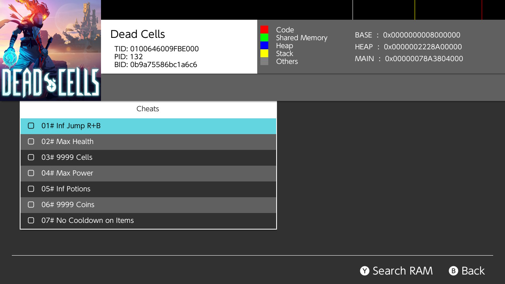

*EdiZonで、Dead Cellsを起動中に開いたチート画面。この例では、チートは `sd:/atmosphere/contents/0100646009FBE000/cheats/0B9A75586BC1A6C6.txt` から読み込まれる。画像:[Switch Guide](https://github.com/nh-server/switch-guide)*

### 導入時によくある問題

ゲームが起動直後に落ちる場合は、Lボタンを押したまま起動して、MODを全部止めた状態で起動できるか試します。起動できるなら、最後に入れたMODを消します([Switch Guide:Game modding](https://switch.hacks.guide/extras/game_modding))。

MODが反映されない場合、特にMacを使っているなら、Macでコピーしたファイルにアーカイブビットが付いている可能性があります。hekateの `Tools → Arch bit • RCM Touch • Pkg1/2 → Fix Archive Bit` で直します(同上)。

LayeredFSだけでは足りないゲームもあり、Switch Guideは次の例を挙げています(同上)。

| ゲーム | 必要なもの |
|---|---|
| 大乱闘スマッシュブラザーズ SPECIAL | [ARCropolis](https://github.com/Raytwo/ARCropolis)と[Skyline](https://github.com/skyline-dev/skyline)。後述の「MODの具体例」で説明する |
| ブレス オブ ザ ワイルド | 複数のMODを組み合わせるには、PC用のMODマネージャー [BCML](https://github.com/NiceneNerd/BCML) か [UKMM](https://github.com/NiceneNerd/UKMM)(推奨) |
| ティアーズ オブ ザ キングダム | 同じく、PC用の [TKMM](https://github.com/TKMM-Team/Tkmm) |
| あつまれ どうぶつの森 | フォルダ名を `romfs` ではなく `romFs` にし、`atmosphere/contents/01006F8002326000/romFs/System/Resource/` に、`ResourceSizeTable.srsizetable` という空のファイルを作る |

### MODが反映されているかの確認

Atmosphèreの公式ドキュメント([loader.md](https://github.com/Atmosphere-NX/Atmosphere/blob/master/docs/components/modules/loader.md))には、MODの適用状態を画面に表示する機能の記載はありません。基本的には、ゲームを普通に起動して、見た目や挙動の変化を、自分の目で確認することになります。MODローダーによっては、独自の確認方法を持つものもあります(たとえばARCropolisは、タイトル画面に自身のバージョンを表示します。後述)。

反映されない場合によくある原因の1つ目は、ゲームを完全に終了してから起動し直していないことです。LayeredFSは、プロセスの起動時にだけ適用されるため、スリープ状態からの復帰や、ホームボタンでの中断からの再開では反映されません。

2つ目は、タイトルIDのフォルダが、本体のものと一致していないことです。フォルダ名には、アップデート版のIDではなく、ベースゲームのIDを使う必要があります。

3つ目は、MODの対応バージョンと、実際にインストールされているゲームの版のずれです。ファイルの配置先が、その版のromfs構成と合っていないと、無反応、または不安定な動作になります。

### MODをオン・オフする(SimpleModManager)

LayeredFSは、`atmosphere/contents/` に置いたものを、すべて読み込みます。MODを試しに外したいとき、毎回PCでフォルダを移動するのは手間です。そこで、MODの置き場所と、LayeredFSの読み込み先を分けて管理する、[SimpleModManager](https://github.com/nadrino/SimpleModManager) というホームブリューアプリがあります。MODを個別にオン・オフしたり、大きなMODの組み合わせを切り替えたりできます([Switch Guide:SimpleModManager](https://switch.hacks.guide/homebrew/simplemodmanager))。

1. [リリースページ](https://github.com/nadrino/SimpleModManager/releases)から `SimpleModManager.nro` を入手し、SDカードの `switch` フォルダに置く
2. SDカードのルートに、`mods/<ゲーム名>/<MOD名>/` というフォルダを作る。ゲーム名・MOD名は、好きな名前でよい
3. `<MOD名>` フォルダの中に、MODのフォルダ構成を、`atmosphere` フォルダを省いて置く(つまり `contents/<タイトルID>/romfs/…` から始める)
4. hbmenuからSimpleModManagerを起動すると、ゲームの一覧が出る。ゲームを選んでAボタンを押すと、使えるMODの一覧が出る

([Switch Guide:SimpleModManager](https://switch.hacks.guide/homebrew/simplemodmanager))

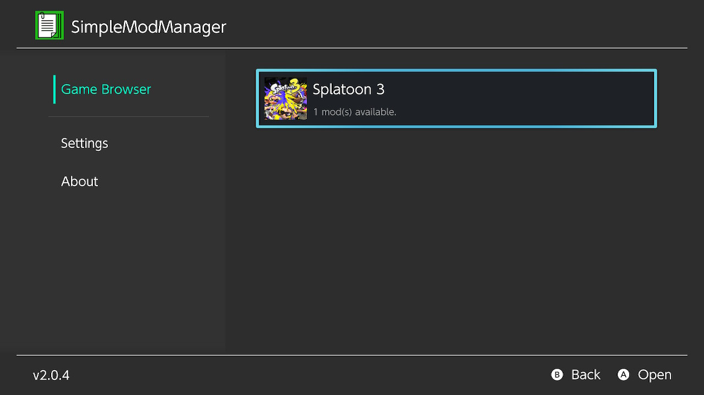

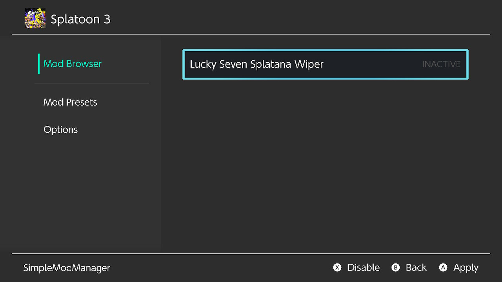

*上:ゲームの一覧。下:MODの一覧。Aボタンで適用(Apply)、Xボタンで無効化(Disable)する。左側の「Mod Presets」で、MODの組み合わせを保存できる。画像:[Switch Guide](https://github.com/nh-server/switch-guide)*

ただし、Switch Guideは、スマブラSP、ブレス オブ ザ ワイルド、ティアーズ オブ ザ キングダムには、SimpleModManagerを使わないようにと注意しています。これらのゲームは、MODの扱い方がほかと違うためです(同上)。スマブラSPでは、次の節のARCropolisに内蔵されたMod Managerを使います。

### MODの具体例(大乱闘スマッシュブラザーズ SPECIAL)

具体例として、MODの仕組みが公式ドキュメントで詳しく公開されている、大乱闘スマッシュブラザーズ SPECIAL(以下スマブラSP、タイトルID `01006A800016E000`)を取り上げます。Switch Guideも、emuMMCの代表的な用途の一つに「あらゆるゲームでのMOD・チート」を挙げています([Switch Guide](https://switch.hacks.guide/user_guide/all/cfw_environment))。

#### 土台になるARCropolis

スマブラSPのMODの多くは、[ARCropolis](https://github.com/Raytwo/ARCropolis)というMODフレームワークを前提にしています。[Skyline](https://github.com/skyline-dev/skyline)の上で動く、スマブラSP専用のMODローダー兼マネージャーです。動作の前提は、最新のAtmosphère(他のCFWは非対応)と、最新版に更新したスマブラSP(カートリッジ版・ダウンロード版のどちらでもよい)です([ARCropolis Wiki:Setup](https://github.com/Raytwo/ARCropolis/wiki/Setup-(Getting-Started)))。

導入後のファイル配置は、次の通りです([同上](https://github.com/Raytwo/ARCropolis/wiki/Setup-(Getting-Started)))。

```
sdカード/
  atmosphere/
    contents/
      01006A800016E000/
        exefs/
          subsdk9                      # Skyline本体(skyline.zipから)
        romfs/
          skyline/
            plugins/
              libarcropolis.nro        # ARCropolis(release.zipから)
  ultimate/
    mods/
      <MODごとのフォルダ>/            # 個々のMODを置く場所
```

Skylineの `subsdk9` は、[LayeredFSの仕組み](#仕組みとフォルダ構成)のうち、`exefs` による実行コードの差し替えで読み込まれます。Atmosphèreのloaderは、プロセスを作るときに `rtld`・`main`・`subsdk0`〜`subsdk9`・`sdk` という名前のファイルを探し、SDカード上に同名のファイルがあればそちらを使います([Atmosphère公式ドキュメント:loader.md](https://github.com/Atmosphere-NX/Atmosphere/blob/master/docs/components/modules/loader.md))。

ARCropolisが動いているかは、ゲームのタイトル画面で確認できます。正しく導入できていれば、ARCropolisのバージョンが表示されます([ARCropolis Wiki:Setup](https://github.com/Raytwo/ARCropolis/wiki/Setup-(Getting-Started)))。

#### MODの置き場所と、Mod Managerの使い方

ARCropolisがMODを探す場所は、2つあります。どちらも、自分で作る必要があります([ARCropolis Wiki:Usage](https://github.com/Raytwo/ARCropolis/wiki/Usage-(Getting-Started)))。

| 場所 | 用途 |
|---|---|
| `sd:/ultimate/mods/<MODごとのフォルダ>/` | 推奨。MODごとにフォルダを分けて置き、ゲーム内のMod Managerでオン・オフを切り替えられる。[GameBananaのスマブラSPのページ](https://gamebanana.com/games/6498)で配布されているMODの多くは、ここにドラッグ&ドロップするだけで入る |
| `sd:/atmosphere/contents/01006A800016E000/romfs/arc/` | 古い方式。中身はゲームのデータアーカイブ(`data.arc`)のルートとして扱われる。MODを整理できないので、土台にする「ベースのMODパック」を置く場合に限られる |

たとえば、`sd:/ultimate/mods/My Cool Mod/ui/message/msg_melee.msbt` のように置くと、`My Cool Mod` というMODとして扱われます。

Mod Managerの入口は、スマブラSPのメインメニューの右下にある、ニンテンドーeショップのボタンです。そこで「Mod Manager(ARCadia-RS)」を選ぶと、MODの一覧が出て、Aボタンで1つずつオン・オフを切り替えられます。メニューを閉じると、ゲームを再起動するかを聞く画面になります。「はい」を選べば、その場で変更が反映される仕組みです。また、Switchのホーム画面からスマブラSPを起動するとき、読み込み画面の右下のJoy-Conのアニメーションが終わったころに `+` ボタンを押し続けると、ゲームの起動前にMod Managerを開けます。この方法なら、変更後に再起動する必要がありません([ARCropolis Wiki:Mod Manager](https://github.com/Raytwo/ARCropolis/wiki/Mod-Manager-(Features)))。


*ARCropolisのMod Manager。画像は[ARCropolis Wiki:Mod Manager](https://github.com/Raytwo/ARCropolis/wiki/Mod-Manager-(Features))に掲載されているもの(このリポジトリには複製せず、元の場所を参照している)*

一覧に出る名前・説明・プレビュー画像は、MODのフォルダに `info.toml` と `preview.webp` を置くと設定できます。どちらも任意で、なくてもMODは動きます。`info.toml` には、`display_name`(表示名)、`authors`、`version`、`description`、`category`(Fighter・Stage・Effects・UI・Param・Audio・Miscのどれか1つ)を書きます(同上)。

```toml
display_name = "My Cool Mod"
authors = "自分の名前"
version = "1.0"
description = """
メニューの文言を差し替えるMOD
"""
category = "UI"
```

ARCropolis 3.0.0以降では、2つのMODが同じファイルを置き換えようとすると、起動時に「ファイルの競合」として知らせてくれます。競合しているファイルの一覧は、`sd:/ultimate/arcropolis/conflicts.json` で確認できます([ARCropolis Wiki:Usage](https://github.com/Raytwo/ARCropolis/wiki/Usage-(Getting-Started))、[FAQ](https://github.com/Raytwo/ARCropolis/wiki/FAQ-(Troubleshooting)))。

#### 分類1:見た目の差し替え(スキン)

もっとも多いのが、ファイターの見た目(モデル・テクスチャ)を差し替えるスキンMODです。スマブラSPでは、各ファイターのカラーバリエーション(スロット)ごとにファイルが分かれていますが、一部のファイルはスロット間で共有されています。そのため、古い環境では、あるスロットのスキンを入れると、ほかのスロットの見た目まで崩れることがありました。ARCropolis 2.0.0以降は、1つのスロットだけに効くスキンMOD・ボイスMODに対応しています([ARCropolis Wiki:FAQ](https://github.com/Raytwo/ARCropolis/wiki/FAQ-(Troubleshooting))、[よくある問題](https://github.com/Raytwo/ARCropolis/wiki/Common-Issues-and-How-To-Fix-Them-(Troubleshooting)))。

「他のゲームのキャラクターで遊べる」と紹介されるMODも、この分類に入ります。スキンMODは、既存のファイターのスロットの見た目を置き換えるもので、技・AIを含めた新しいファイターを追加するものではありません。技の性能や動きのデータは、`param`(パラメータ)や `motion_list` といった別のファイルにあり、これらを書き換えるのは、次の分類2のような、ゲームプレイを変えるMODです([ARCropolis Wiki:Param Patching](https://github.com/Raytwo/ARCropolis/wiki/Param-Patching-(Features))、[MotionList Patching](https://github.com/Raytwo/ARCropolis/wiki/MotionList-Patching-(Features)))。

実例として、2019年に話題になった「マスターチーフ(Haloの主人公)のMOD」があります。TheGamerの記事によると、これはスネークのスキンとして作られたもので、見た目はマスターチーフでも、技はスネークのものをそのまま使っています。作者がスネークを選んだのは、マスターチーフに近い技を持つファイターだからだろう、と記事は推測しています([TheGamer、2019年6月](https://www.thegamer.com/new-mod-master-chief-smash-ultimate/))。

スキン系の一例として、[Smash Minecraft Skins](https://github.com/jam1garner/smash-minecraft-skins)というSkylineプラグインがあります。Minecraftのユーザー名を入力すると、そのスキンを取得してゲーム内で使えるようにするものです。PNG形式のスキンを `sd:/atmosphere/contents/01006A800016E000/romfs/minecraft_skins/` に置いて使うこともできます。動作には、SkylineとARCropolis 0.9.3以降が必要です([READMEで確認](https://github.com/jam1garner/smash-minecraft-skins))。TechRaptorの2020年10月の記事は、このMODを、キャラクター選択画面に追加されたメニューから、Java版Minecraftのスキンを取り込めるものとして紹介しています([TechRaptor](https://techraptor.net/gaming/news/super-smash-bros-ultimate-steve-mod-custom-skins))。

#### 分類2:コンテンツの追加・ゲームプレイの変更

見た目だけでなく、ゲームの中身そのものを変えるMODもあります。ARCropolisのREADMEが代表例として挙げている[HewDraw Remix(HDR)](https://github.com/HDR-Development/HDR-Releases)は、ゲームプレイの大規模な作り直しに加えて、選び抜いたスキン、独自のメニュー、新しい音楽などを含むMODです([ARCropolisのREADME](https://github.com/Raytwo/ARCropolis))。HDRの公式READMEによると、導入は配布されている `switch-release.zip` をSDカードに展開するだけで、アンインストールは `/ultimate/mods` にある `hdr` で始まるフォルダを削除します([HDR-ReleasesのREADME](https://github.com/HDR-Development/HDR-Releases))。

この種のMODについて、ARCropolisのFAQは、オンラインで有利になるファイル(パラメータの調整や技の変更など)を改造しないことを、コミュニティの一般的な合意として挙げています([ARCropolis Wiki:FAQ](https://github.com/Raytwo/ARCropolis/wiki/FAQ-(Troubleshooting)))。ARCropolis 3.2.0以降の「ワークスペース」機能を使うと、MODの組み合わせをプリセットとして保存し、たとえば「スキンだけのオンライン向け構成」と「ゲームプレイを変える構成」を、ゲーム内のメニューから切り替えられます([ARCropolis Wiki:Workspaces](https://github.com/Raytwo/ARCropolis/wiki/Workspaces-and-Workspace-Selector-(Features)))。

#### 別のゲームの例:マリオカート8 デラックスのCTGP Deluxe

スマブラSP以外の例として、マリオカート8 デラックスに独自のコースを追加する CTGP Deluxe があります。Wii版の「CTGP Revolution」、3DS版の「CTGP-7」の流れをくむMODです。GameBrewのページ(2025年6月更新)によると、版は1.1.1で、前提はCFWの入ったSwitchと、最新版(3.0.3)に更新したマリオカート8 デラックスです。導入するときは、ほかのマリオカート8 デラックスのMOD(古い版のCTGP Deluxeを含む)をすべて消してから、zipの中身をSDカードのルートに展開します。emuMMCで遊ぶことが強く推奨されています([GameBrew:CTGP Deluxe Switch](https://www.gamebrew.org/wiki/CTGP_Deluxe_Switch))。

クレジットと更新履歴には、Skyline(スマブラSPのARCropolisと同じ、実行コードに手を入れるための基盤)の名前があり、v1.1.0では「Skyline patch」の追加が記録されています。

#### 分類3:チートとの併用

ARCropolisのMODと、Atmosphèreのチートは、置き場所が別です。ARCropolis関連のファイルは `exefs`・`romfs` と `sd:/ultimate/` に、チートは同じタイトルIDフォルダの `cheats` に置かれます(チートの置き場所は、次の「チートコード」節を参照)。ファイルの置き場所としては共存できますが、ARCropolisの公式ドキュメントには、Atmosphèreのチートと同時に使った場合の動作についての記載は見当たりません。両者を同時に有効にした場合の動作は未確認です。

一時的にすべて止めたいときは、ゲーム起動時にLボタンを押し続けます。HDRのREADMEも、Lボタンを押しながら起動すれば、メニューの設定にかかわらず、すべてのMODが一時的に無効になると説明しています([HDR-ReleasesのREADME](https://github.com/HDR-Development/HDR-Releases))。

### チートコード

チートコードは、LayeredFSとは別の仕組みで、Atmosphèreのメモリ内チートエンジンが読み込みます。

```
sdカード/
  atmosphere/
    contents/
      <タイトルID>/
        cheats/
          <ビルドID>.txt
```

ビルドIDは、ゲームの版(アップデート)ごとに変わるため、チートファイルは完全に一致するビルドIDのものを使う必要があります。合っていないと、チートが効きません(または、適用先がずれて不安定になります)。

チートやMODを一時的に止めたい場合は、ゲーム起動時にLボタンを押し続けると、適用を無効化できます([Switch Guide:EdiZon](https://switch.hacks.guide/homebrew/edizon))。Atmosphèreのドキュメントでは、チートは「Lが押されていなければ読み込む」という条件で動いており、このボタンは `sd:/atmosphere/config/override_config.ini` の `cheat_enable_key`(MODの差し替えは `override_key`)で変えられる、と説明されています。どちらも既定値は `!L`(Lを押していないとき有効)です([Atmosphère公式ドキュメント:cheats.md](https://github.com/Atmosphere-NX/Atmosphere/blob/master/docs/features/cheats.md)、[configurations.md](https://github.com/Atmosphere-NX/Atmosphere/blob/master/docs/features/configurations.md))。

チートを、最初から全部オフの状態で読み込みたい場合は、`system_settings.ini` を使います(次の節)。

#### チートコードの種類

Atmosphèreのチートは、「どの命令(コードタイプ)を、どんな順番で並べるか」という、専用の仮想マシン(VM)形式のテキストで書かれています。単純なメモリ書き換えから、条件分岐・ループまで表現できる、プログラムに近い仕組みです。主なコードタイプは、[Atmosphère公式ドキュメント](https://github.com/Atmosphere-NX/Atmosphere/blob/master/docs/features/cheats.md)で、次のように定義されています。

| コードタイプ | 名称(公式表記) | 役割 |
|---|---|---|
| 0x0 | Store Static Value to Memory | メモリに、固定の値を書き込む |
| 0x1 / 0x2 | Begin / End Conditional Block | 条件分岐の開始・終了 |
| 0x3 | Start/End Loop | ループの開始・終了 |
| 0x4 / 0x5 | Load Register with Static Value / Memory Value | レジスタ(作業用の一時領域)に、値を読み込む |
| 0x6 | Store Static Value to Register Memory Address | レジスタが指すアドレスに、値を書き込む |
| 0x9 | Perform Arithmetic | 演算を行う(0x7の「Legacy Arithmetic」は、名称上は別の古い命令として区別されています) |
| 0x8 / 0xC4 | Begin Keypress Conditional Block / Begin Extended Keypress Conditional Block | 特定のボタンが押されている間だけ、処理を有効にする |
| 0xFF0 / 0xFF1 | Pause Process / Resume Process | ゲームの処理を一時停止・再開する |
| 0xFFF | Debug Log | SDカードの `/atmosphere/cheat_vm_logs/` に、動作ログを書き出す |

この中で、0xFFF(Debug Log)は、チートが実際に実行されたことを確認できる、ほぼ唯一の仕組みです。それ以外は、画面上の分かりやすい「読み込み成功」のような表示がないため、期待した効果(体力無限など)が実際に出ているかどうかを、目で見て確かめるのが基本になります。

また、ソースコード([dmnt_cheat_api.cpp](https://github.com/Atmosphere-NX/Atmosphere/blob/master/stratosphere/dmnt/source/cheat/impl/dmnt_cheat_api.cpp))を確認したところ、スロット0番は「マスターチート」として予約されており、常に有効な扱いになっています。これが、チートの上限が128個ではなく、実質127個とされる理由です。

#### プレイ中に個別のチートをオン・オフする

`.txt` ファイル内のチートは、そのままではすべてが同時に有効になります。これは、`system_settings.ini` の `[atmosphere]` セクションにある `dmnt_cheats_enabled_by_default`(既定値は `u8!0x1`)という設定によるもので、`u8!0x0` にすると、すべて無効の状態から起動するようになります([Atmosphère公式ドキュメント](https://github.com/Atmosphere-NX/Atmosphere/blob/master/docs/features/cheats.md))。具体的には、`sd:/atmosphere/config_templates/system_settings.ini` を `sd:/atmosphere/config/` にコピーし、`; dmnt_cheats_enabled_by_default = u8!0x1` の行を、先頭の `; ` を消したうえで `dmnt_cheats_enabled_by_default = u8!0x0` に書き換えます([Switch Guide:EdiZon](https://switch.hacks.guide/homebrew/edizon))。

個別にオン・オフしたい場合は、Atmosphère自体ではなく、別のホームブリューアプリを使います。方法は2つあります。

1つ目は、EdiZon(アプリ版)です。上の画像のように、ゲームの起動中にhbmenuからEdiZonを開くと、チートの一覧がチェックボックス付きで表示され、オン・オフを切り替えられます。新しいチートのダウンロードも可能です。Switch Guideは、元のEdiZonより、更新が続いていて機能も多い [EdiZon-SE](https://github.com/tomvita/EdiZon-SE) を勧めています。EdiZon-SEは、zipの中身をSDカードのルートにコピーして入れます。正しく入っていれば、`sd:/atmosphere/contents/054e4f4558454000` フォルダと、`sd:/switch/EdiZon/EdiZon.nro` ができています([Switch Guide:EdiZon](https://switch.hacks.guide/homebrew/edizon))。

2つ目は、ゲームをプレイしたまま呼び出せる「オーバーレイ」です。オーバーレイは、本体のクイック設定のように、ゲームの上に重ねて開くメニュー型のホームブリューです。`nx-ovlloader` というシステムモジュールが、オーバーレイのメニュー(Tesla Menu、または、より新しくカスタマイズ性の高いUltrahand)を読み込みます([ConsoleMods Wiki:Overlay Apps](https://consolemods.org/wiki/Switch:Overlay_Apps))。Switch Guideの手順は、次の通りです([Switch Guide:Tesla-Menu](https://switch.hacks.guide/homebrew/tesla-menu))。

1. [nx-ovlloader](https://github.com/DefenderOfHyrule/nx-ovlloader/releases)の `nx-ovlloader.zip` の中身を、SDカードのルートにコピーする
2. [Tesla-Menu](https://github.com/DefenderOfHyrule/Tesla-Menu/releases)の `ovlmenu.ovl` を、`sd:/switch/.overlays/` にコピーする
3. 正しく入っていれば、`sd:/atmosphere/contents/420000000007E51A`(nx-ovlloader)フォルダと、`sd:/switch/.overlays/ovlmenu.ovl` ができている
4. CFWで起動し、L+右スティック押し込み+十字キー下を同時に押すと、Tesla Menuが開く
5. 使いたいオーバーレイ(`.ovl` ファイル)も、同じ `sd:/switch/.overlays/` に置く。チートの切り替えには、[EdiZon-Overlay](https://github.com/proferabg/EdiZon-Overlay)を使う

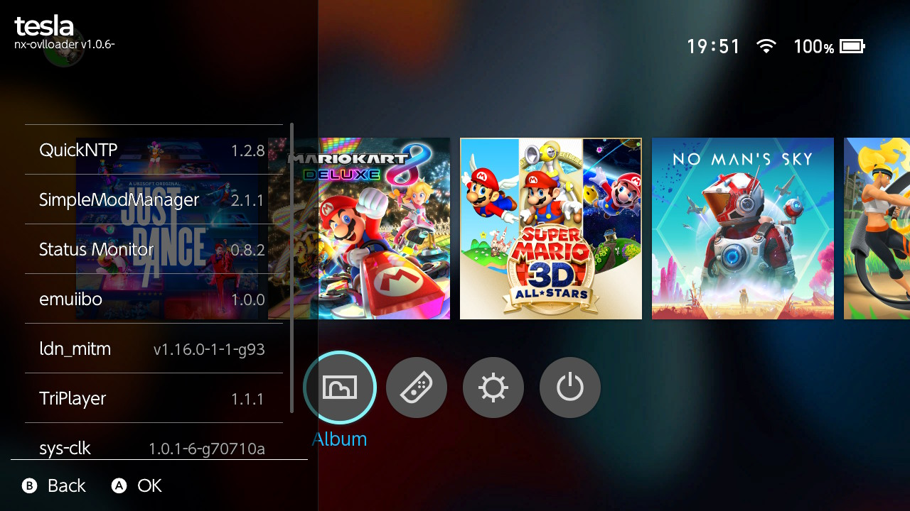

*Tesla Menuを、ホーム画面の上に開いたところ。一覧からオーバーレイを選んでAボタンで開く。画像:[Switch Guide](https://github.com/nh-server/switch-guide)*

公式のEdiZonオーバーレイはメンテナンスが止まっており、本体バージョン16.0.0以降で使おうとすると、Atmosphère自体がクラッシュします。メンテナンスが続いているのが、上の[EdiZon-Overlay](https://github.com/proferabg/EdiZon-Overlay)です([Switch GuideのEdiZonページ](https://switch.hacks.guide/homebrew/edizon))。呼び出すボタンの組み合わせは、`sd:/config/tesla/config.ini` の `[tesla]` セクションに `key_combo=L+R+RS` のように書いて変えられます(libtesla公式ソースコードの[tesla.hpp](https://github.com/WerWolv/libtesla/blob/master/include/tesla.hpp)と、[Switch GuideのTesla Menuページ](https://switch.hacks.guide/homebrew/tesla-menu)で確認)。

うまく動かないときの対処は、Switch Guideに2つ載っています([Switch Guide:Tesla-Menu](https://switch.hacks.guide/homebrew/tesla-menu))。起動時やオーバーレイを開いたときに、エラーコード `2001-0123 (0xf601)`、タイトルID `420000000007E51A` で落ちる場合は、Tesla Menuか、開こうとしたオーバーレイが古い版なので、最新版に入れ替えます。テレビに繋いでいるとき、Tesla Menuがホーム画面でしか出ない場合は、本体設定の「テレビ出力 → 画面サイズ」を100%にします。

チートコードの文法が正しいかどうかを、画面上で確認する標準的な方法はありません。実際には、期待通りの効果(体力無限、アイテム解放など)が出るかどうかを、目で見て確認するのが一般的なやり方です。

#### 複数のチート・MODを組み合わせる

Atmosphèreは、1つのビルドIDにつき1つのチートファイルしか読み込みません。複数の配布元のチートを使いたい場合は、1つのファイルに手動でまとめる必要があります。チートの数の上限は、「チートコードの種類」の節で説明した通り実質127個で、超えた分は警告なく無視されます。

複数のMODフォルダが、同じファイルパスを上書きし合う場合の優先順位は、公式な記載が見つかりませんでした。未確認の情報として扱ってください。

### exefs_patches(別の仕組み)

`cheats` フォルダのテキストファイルとは別に、`.ips` 形式のバイナリパッチを当てる`exefs_patches`という仕組みもあります。

```
sdカード/
  atmosphere/
    exefs_patches/
      <任意の名前のフォルダ>/
        <ビルドIDに対応する .ipsファイル>
```

これも、対象の実行ファイルのビルドIDと、パッチファイルが一致している必要があります。

### 自己所有カートリッジの吸い出しについて

MODやチートとは別の話として、「自分で買ったカートリッジのデータを、吸い出して保存できるか」という疑問を持つ人もいるはずです。技術的な事実と、その扱いについて、分けて書いておきます。

技術的には可能です。ホームブリューアプリの [nxdumptool](https://github.com/DarkMatterCore/nxdumptool) を使うと、挿したカートリッジを、丸ごとXCI形式でSDカードに書き出せます。ただし、データは暗号化されているため、先に本体固有の鍵を取り出す [Lockpick_RCM](https://github.com/s1204IT/Lockpick_RCM) というツールが必要です(このリポジトリはアーカイブ済みで、最後の更新は2023年です)。

この記事では、具体的な操作手順(どの画面で何を選ぶか)までは書きません。1つ目の理由は、確立された手順がまだないことです。nxdumptoolの、以前からあった安定版は開発が止まっており、現在メインで開発が続いているのは書き直し版だけです。その書き直し版は、開発者自身が公式README上で「現時点ではまともなUIがなく、実験的なコードだ」と明記しています([公式GitHub](https://github.com/DarkMatterCore/nxdumptool))。新しいUI(borealisという基盤を使用)は、開発チェックリスト上「一部実装」の段階で、完成はしていません。

2つ目の理由は、法的な位置づけが、見た目ほど単純ではないためです。日本の著作権法30条1項は、個人・家庭内の複製(私的複製)を認めていますが、コピープロテクト(技術的保護手段)を回避して複製する行為は、この例外の対象外になりうる、という法律家の見解があります。カートリッジの吸い出しには、CFWによる保護回避が前提として絡むため、「所有物だから複製していい」と単純には言えません。アメリカのDMCAにも、個人のバックアップ目的で保護回避を認める一般的な例外はありません(光学ドライブの修理など、ごく限定的な例外に限られます)。

日本・アメリカいずれについても、Switchのカートリッジ吸い出しそのものを扱った判例や行政判断は見つけられませんでした。「個人の吸い出しが実際に摘発された例をほとんど聞かない」ことと、「合法である」ことは、別の話として扱うべきです。

さらに、「吸い出した後、カートリッジを使わずに遊び続ける」という運用は、所有権の有無に関わらず、この記事の対象外とします。吸い出したデータを使って、物理メディアを介さずにゲームを動かし続けることは、一般に海賊版利用として理解されている使い方のパターンと、技術的に区別がつきません。この記事が一貫して置いてきた「自作のホームブリューアプリと、自己所有の素材に限る。海賊版利用は対象外」という境界線は、吸い出し機能についても同じように適用します。

### 試せていないこと(この章)

この環境には、改造可能な実機カートリッジがないため、LayeredFSによる差し替えや、チート・exefs_patchesの実際の動作は確認していません。ARCropolis・HDR・Smash Minecraft Skins・SimpleModManager・EdiZon・Tesla Menuについては、公式リポジトリ、Wiki、Switch Guideの記載を確認しましたが、実機での導入と動作は未確認です。導入前には、使いたいMOD・チートの配布元が示す、個別の手順を必ず確認してください。

この章のConsoleMods Wiki・TheGamer・TechRaptor・GameBrewを出典とする記述は、2026年10月に原文と照合しました。ConsoleMods Wikiのオーバーレイの説明は、[Overlay Appsのページ](https://consolemods.org/wiki/Switch:Overlay_Apps)によります。

## 試せていないこと

この記事は、公開されているガイドとドキュメントの内容を、出典つきでまとめたものです。実機のSwitchがないため、作業手順の0〜10、8a章の自作アプリのビルド、RetroArchの移植版、8b章のMOD・チート・ARCropolisの導入は、どれも実機では確かめていません。

出典との照合の状況は、2026年10月時点で次の通りです。

| 出典 | 照合の状況 |
|---|---|
| switch.hacks.guide | 公式ソース([nh-server/switch-guide](https://github.com/nh-server/switch-guide)、コミット `64db3a8`)の原文と照合済み |
| hekate・Atmosphère・OmniRCM・ARCropolis | 各リポジトリのソース、README、リリースページ、Wikiと照合済み |
| GBAtemp(RCM注入ドングル) | 各スレッドの投稿と照合済み。ただし、どれも個人の投稿で、製品ごとに違いがある |
| ConsoleMods Wiki・TheGamer・TechRaptor・GameBrew | 原文と照合済み |
| 6章の「バックアップと復元の対象」のトグルの名前 | 個人のGistのみが出典で、照合できていない |
| SX OSの対応ファームウェア | コミュニティの報告のみが出典で、照合できていない |

出典ごとの要約と確認日は、[出典ノート](../sources/switch-community.md)にまとめています。実機を入手し次第、1つずつ確かめます。

## 守ること

- 対象は、自分が所有する機体だけです
- 動かすのは、自作のホームブリューアプリと、自分が所有するレトロゲームのROM(自分で吸い出したもの)に限ります。市販ソフトの吸い出しや、違法な入手は対象外です
- Switchのゲームカートリッジについては、吸い出し自体が技術的保護手段の回避にあたるため、私的複製の例外の対象外になりえます。また、吸い出したデータでカートリッジなしに遊び続ける運用は、所有の有無に関わらず、この記事の対象外です
- 治具の自作は、ピンを間違えると本体を破損させる危険があります。確実な情報源の手順に従ってください
- emuMMCを使うことで、改造した環境と、オンラインで使う純正の環境を、分けておくことができます

## この記事で出てくる用語

| 用語 | 意味 | 出典 |
|---|---|---|
| fusée gelée | Tegra X1のBootROMにある、ハードウェアレベルの脆弱性 | [Switchbrewドキュメント](https://switchbrewdocs.readthedocs.io/en/latest/hacking/rcm.html) |
| RCM | Recovery Mode。USB経由でペイロードを受け取れる、起動前のモード | 同上 |
| CFW | Custom Firmware。標準OSにメモリ上でパッチを当てる仕組み | [Atmosphère](https://github.com/Atmosphere-NX/Atmosphere) |
| emuMMC | SDカード上に作る、仮想のNAND(内蔵ストレージ) | [Switch Guide](https://switch.hacks.guide/user_guide/all/cfw_environment) |
| LayeredFS | ゲーム本体のファイルを書き換えずに、読み込み時に差し替える、Atmosphèreの機能 | [Atmosphère公式ドキュメント:loader.md](https://github.com/Atmosphere-NX/Atmosphere/blob/master/docs/components/modules/loader.md) |
| タイトルID / ビルドID | ゲームを識別する16桁のID(タイトルID)と、そのゲームの版を識別するID(ビルドID) | [Switchbrewのタイトル一覧](https://switchbrew.org/wiki/Title_list) |
| XCI / NSP | カートリッジの生データ形式(XCI)と、インストール済みタイトルの配布・保存形式(NSP) | [nxdumptool](https://github.com/DarkMatterCore/nxdumptool) |

## 学べること

初代Switchは、ソフトウェアの更新では塞がれない、ハードウェアレベルの脆弱性が残る、数少ない現行機です。この記事で見た流れ(BootROM脆弱性→ペイロード注入→メモリ上でのOSパッチ)は、[記事19](19-boot.md)で学んだ起動チェーンの話を、より厳格な環境で体験するものです。個体の見極めには、シリアル番号という手がかりがありますが、複数の情報源を突き合わせても断定はできず、最終的な確認は実機でのペイロードテストに頼ることになります。emuMMCを使えば、改造した環境と、オンラインで使う純正の環境を分けられるため、安心して試行できるというメリットもあります。ここから先は、libnxでの自作アプリ開発と、LayeredFSによる既存ゲームの改造という、2つの異なる方向性に分かれますが、どちらも[記事22](22-rea-hands-on.md)・[記事23](23-rea-and-ghidra.md)で使ったREA/Ghidraでの、実機ファームウェアの解析という先に続く道です。
