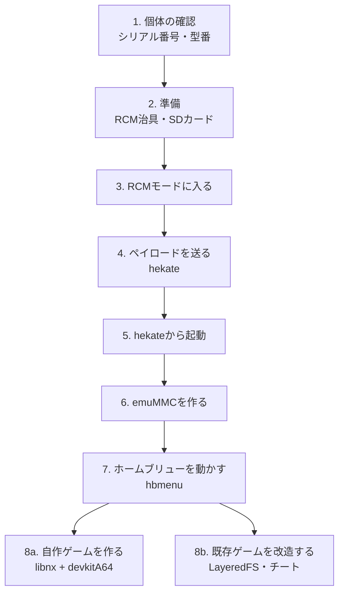

# 初代Switchを、自分のホームブリュー開発機にする

[Novaで学ぶAndroid](24-android-nova.md)までは、RG40XXHとAndroidの2系統を見てきました。この記事では、3台目として、初代Nintendo Switch(無印)を扱います。対象は、2018年半ば以前に製造された、ハードウェアの脆弱性(fusée gelée)が残る個体だけです。この脆弱性は、チップ自体の作りに起因するため、ソフトウェアの更新では塞がれません([Switchbrewドキュメント](https://switchbrewdocs.readthedocs.io/en/latest/hacking/rcm.html))。

この記事で説明するのは、自分で所有する機体に、自作のホームブリューアプリを動かすための手順です。市販ソフトの吸い出しや違法なコピーの利用は、対象外とします。この境界は、[チートとパススルー](21-cheats-and-passthrough.md)で紹介したガイド集の立場と同じです。

## 全体の流れ



## 1. 個体の確認

まず、自分の機体が対象になるかを確認します。

### 型番

本体裏のラベルで、型番を確認してください。

| 型番 | 判定 |
|---|---|
| `HAC-001`(末尾に何も付かない) | 候補になりうる |
| `HAC-001(-01)` | Mariko版。対象外(別途、ハードウェアの改造が必要) |
| `HDH-001`(Switch Lite)、`HEG-001`(OLED) | すべて対象外 |

### シリアル番号

型番が `HAC-001` でも、2018年半ば以降の製造分は、見た目はそのままで中身だけMariko版に切り替わっていることがあります。おおよその判定には、シリアル番号の先頭数桁を使うのが一般的です。

```sh
# 判定サイトの例(先頭6桁を入力)
# https://switch.hacks.guide/user_guide/getting_started.html
```

プレフィックスごとに、未対策・要注意・対策済みの範囲が、コミュニティによってまとめられています([Hacks Guide](https://switch.hacks.guide/user_guide/getting_started.html)、[Such Meme serial list](https://suchmememanyskill.github.io/guides/switchserials/)、[ReHack](https://rehack.com/gaming/console-gaming/is-my-switch-patched/))。プレフィックスが `XKJ`、`XJW`、`XKW`、`XWW` のものは、範囲に関係なく、全数Mariko世代とされています([ReHack](https://rehack.com/gaming/console-gaming/is-my-switch-patched/))。

この判定は、あくまで推測です。 複数の情報源(Hacks Guide、ReHack、Alphr、DigitalWorldz、GBAtempの投稿)を突き合わせても、境界値の数字は完全には一致しません。実際の個体で確認できるのは、次の章のペイロードテストだけです。

## 2. 準備するもの

| もの | 役目 | 備考 |
|---|---|---|
| RCM治具 | RCMモードに入るための、電気的な橋渡し | 次の節で詳しく説明する |
| Mac(またはWindows PC) | ペイロードを送る | どちらでも行ける。詳細は「4. ペイロードを送る」 |
| USB Type-Cケーブル | SwitchとMacを繋ぐ | |
| microSDカード(64GB以上) | hekate、Atmosphère、ホームブリューの保存先 | FAT32推奨。32GB以下は、完全な構成には不向き([複数のガイド](https://switch.hacks.guide/user_guide/all/sd_preparation)) |

### RCM治具とは何か

Switchには、物理的な「ホームボタン」がありません。RCM(Recovery Mode、復旧モード)に入るには、本体の中にある、ホームボタンに相当する接点を、電気的に短絡させる(つなげる)必要があります。この役目を果たす小さな道具が、RCM治具です([Switchbrewのドキュメント](https://switchbrewdocs.readthedocs.io/en/latest/hacking/rcm.html))。

#### 仕組み

本体の右側のJoy-Conを差し込むレール(接点の並び)には、10番ピンをGND(グラウンド、電気的な基準点)に接続すると、ホームボタンを押したのと同じ信号になるという性質があります。RCM治具は、この10番ピンと、近くのGNDピンだけを、確実につなぐための部品です([Switch Guideの解説](https://switch.hacks.guide/user_guide/rcm/entering_rcm))。

#### 絶対に避けるべきピン

同じレールの**4番ピンには、Joy-Conへ送る5Vの電源**が来ています。このピンを誤って別のピンと接触させると、**レールや本体が修復不可能なレベルで壊れる**と、複数のガイドが明確に警告しています([Switch Guide](https://switch.hacks.guide/user_guide/rcm/entering_rcm))。安全に進めるには、次の点に注意してください。

- 市販の専用治具を使うことが、もっとも安全です。ピンの間隔に合わせて作られているため、狙った2本以外には触れません
- **クリップやペーパークリップでの自作は、避けるべきとされています。** 硬くて先が尖っているため、レール内部の接点(パッド)を傷つけやすいと、ガイドは指摘しています([Switch Guide](https://switch.hacks.guide/user_guide/all/sd_preparation)の関連ページ)
- 細い金属線(32ゲージ程度)で自作する例もありますが、正確なピン配置を、信頼できる一次情報(Switchbrewや、switch.hacks.guideのような、技術的に詳しいガイド)で確認したうえで、慎重に行ってください

#### 入手方法

RCM治具は、小型の電子部品として、複数のオンラインショップで販売されています。本体の機種(無印/Lite/OLED)によって形が違うので、自分の機種に対応したものを選ぶことが大切です。

#### AutoRCMという別の方法(上級者向け、リスクが高い)

治具を毎回使わずに済む、**AutoRCM**という設定もあります。これは、起動時に強制的にRCMへ入るよう、本体に設定を書き込む方法です。

#### 仕組み(hekateのソースコードで確認)

AutoRCMは、eMMCの**BOOT0領域だけ**を書き換えます。BOOT1は変更されません(「BOOT0とBOOT1の両方を書き換える」と説明しているガイドも見られますが、hekateの[ソースコード](https://github.com/CTCaer/hekate/blob/45cd81ed08e30a26ba380958c7e20b55c342834b/bdk/storage/emmc.c#L215-L227)を直接確認したところ、実際に書き込まれるのはBOOT0のみでした)。

BOOT0内には、BCT(Boot Config Table、起動時の署名検証に使うテーブル)が4つ、一定間隔で格納されています。AutoRCMは、その各コピーにある、RSA公開鍵モジュラスの先頭1バイトを `0x00` に書き換えます。この結果、BootROMの署名検証が必ず失敗するようになり、「正常に起動できない本体」としてRCM(Recovery Mode)へ自動的にフォールバックする、という仕組みです([hekateソース `fe_tools.c`](https://github.com/CTCaer/hekate/blob/45cd81ed08e30a26ba380958c7e20b55c342834b/bootloader/frontend/fe_tools.c#L34-L159))。hekateのメニュー自体にも、「This corrupts BOOT0!」(これはBOOT0を破壊します)という警告が、ツール名としてそのまま表示されます。

#### なぜ対策済み(Patched)個体でブリックするのか

RCMモードへの切り替えは電気的な機能なので、Patched個体でも問題なく入れます。塞がれているのは、**RCM経由で送られたペイロード(署名のない自作コード)を実行する部分**だけです(2018年のパッチ、BootROMアドレス `0x0010769A` の修正)。

そのため、Patched個体でAutoRCMを有効化すると、通常起動はBCT破損で失敗し、RCMへのフォールバックはペイロードを拒否される、という**どちらの経路でも起動できない状態**に陥ります。これが、ブリックの実体です。複数のガイドが「絶対に行うな」と強調しているのは、このためです([Homebrew-Guide](https://github.com/noahc3/Homebrew-Guide/blob/master/usingcfw/hekate.rst))。

#### 最新のhekateに備わる防止機能

重要な補足として、**現在のhekate(v6.5.4世代)は、Patched個体を検出すると、AutoRCMの有効化そのものを拒否するようになっています**([`fuse.c`](https://github.com/CTCaer/hekate/blob/45cd81ed08e30a26ba380958c7e20b55c342834b/bdk/soc/fuse.c#L487-L515))。クラシックメニューでは「This device is RCM patched and the function is disabled to avoid BRICKS!」と表示されてeMMCには一切触れず、GUI版(Nyx)でも、有効化を試みた直後にPatched状態を検知して書き込みを取り消します。つまり、**正規の最新hekateを使う限り、この種のブリックは原理的に起きにくくなっています**(古いバージョンや、この機能を回避する改造ツールを使った場合は対象外です)。

#### バックアップと、元に戻す方法

- 有効化する前に、NANDのバックアップ(Tools → Backup eMMC → eMMC BOOT0 & BOOT1)を取っておくことが推奨されています。これはAutoRCM専用の対策というより、それ以外の予期しないeMMC破損に備えた、一般的な保険です
- Unpatched個体であれば、設定はいつでも元に戻せます。無効化もhekateの同じメニューから行い、バックアップがなくても、正しいバイトを計算して書き戻してくれます。ただし、無効化の操作をするにも、一度はペイロードを送ってhekateを起動する必要があります
- Patched個体の場合、この「一度は起動する」こと自体ができないため、バックアップがあっても、ソフトウェアだけでは元に戻せません

### Patched/Unpatchedの確実な判定方法

[1章](#1-個体の確認)で見たシリアル番号の判定は、あくまで推測です。もっとも確実な判定は、hekateが本体のFuse(ヒューズ、製造時に焼き込まれる情報)を読み取って表示する、Console Info画面です。緑文字で「This unit is exploitable to the RCM bug!」、オレンジ文字で「This unit is patched to the RCM bug!」と表示されます([`gui_info.c`](https://github.com/CTCaer/hekate/blob/45cd81ed08e30a26ba380958c7e20b55c342834b/nyx/nyx_gui/frontend/gui_info.c#L1281-L1286))。ただし、この画面を見るには、そもそも一度ペイロードが通ってhekateが起動している必要があるため、実質的には「4章のペイロードが通るかどうか」自体が、最終的な判定にほかなりません。

この記事では、最初はAutoRCMを使わず、毎回治具でRCMに入る方法を前提とします。AutoRCMは、治具を使う手順に十分慣れてから選ぶ、発展的な選択肢として紹介しました。

## 3. RCMモードに入る

1. 本体の電源を、完全に切る(スリープではない)
2. 治具を、右Joy-Conのレールに差し込む
3. 音量+ボタンを押しながら、電源ボタンを押す

成功していれば、画面は真っ黒のまま、バックライトも点灯しません。 ニンテンドーのロゴが出たり、すぐ電源が切れたりした場合は、RCMモードに入れていません([Switch Guide](https://switch.hacks.guide/switch-guide/user_guide/emummc/entering_rcm/))。

## 4. ペイロードを送る

Mac(またはWindows PC)とUSBケーブルで繋いだ状態で、ペイロード注入ツールを使います。

| OS | ツール | 備考 |
|---|---|---|
| **Mac** | **fusee-launcher**、または[CrystalRCM](https://alternativeto.net/software/crystalrcm/about/)(GUIアプリ) | fusee-launcherは、元々Windows・Linux・macOS・FreeBSDにネイティブ対応をうたっていたツール([mid-kidによるミラー版のREADME](https://github.com/mid-kid/fusee-launcher)で確認)。ただし開発自体は2018年で止まっており、**開発者自身によるリポジトリは現在GitHub上に存在しません**。有志によるミラー版のみが残っている状態です |
| Windows | TegraRcmGUI | [公式リポジトリ](https://github.com/eliboa/TegraRcmGUI)のREADMEでは、Windows専用と明記され、ドライバーとしてlibusbKの導入が案内されています。開発自体は2021年で止まっています |
| Linux | fusee-launcher など | |

### Macでの手順の目安

fusee-launcherは、Pythonのスクリプトとして動きます。過去のガイドでは、次のような準備が紹介されていました([iPhoneSoft、2019年の記事](https://iphonesoft.fr/2019/01/06/comment-lancer-payloads-mac-jailbreak-switch))。

```sh
brew install libusb-compat
pip3 install pyusb
```

ペイロードを送るコマンドの例です。

```sh
sudo python3 fusee-launcher.py hekate.bin
```

この記事を書いた時点では、実機で試せていません。 2019年のガイドをもとにしているため、Pythonのバージョンや、依存ライブラリの名前が、現在と変わっている可能性があります。**fusee-launcher自体の開発が止まって8年以上が経っており、公式の配布元は失われています。** 実行前には、現在信頼できる形で配布されているミラー版(たとえば[mid-kidによるもの](https://github.com/mid-kid/fusee-launcher))を探し、READMEの内容を確認してください。

送るファイルは、hekateの `.bin` ファイルです。注入ツールに同梱されたものは古いことが多いため、[hekateの公式リポジトリ](https://github.com/CTCaer/hekate)から、最新版を別途取得することが推奨されています。

ここが、本当の意味での動作確認です。 注入ツールが「成功した」と表示しても、Switch側の画面に何も表示されなければ、その個体は対策済み(Patched)です([Switchbrewドキュメント](https://switchbrewdocs.readthedocs.io/en/latest/hacking/rcm.html))。シリアル番号の判定より、こちらのほうが確実です。

### PCがなくてもいいのか

ペイロードを送る役目は、PCでなくても代わりが務まります。ただし、**「何らかの機器がUSBホスト役を務める」という条件そのものは、どの方法を選んでも変わりません。**

#### Androidスマホを使う方法

**[NXLoader](https://github.com/DavidBuchanan314/NXLoader)** というAndroidアプリは、USB-OTG経由でペイロードを送れます。root化は不要です。

1. アプリを起動し、設定画面でペイロードファイル(デフォルトは `fusee.bin`。hekateの `.bin` に差し替え可能)を選ぶ
2. OTGアダプタ経由で、SwitchとAndroid端末をUSBケーブルで繋ぐ
3. Switch側で、音量+を押しながら電源を入れ、RCMモードに入れる
4. アプリにUSBデバイスへのアクセス権限を許可する

成功すれば、ペイロードが起動します。アプリを開いたままにする必要はなく、画面ロックしても問題ありません([NXLoaderのREADME](https://github.com/DavidBuchanan314/NXLoader))。

この方式には、既知の制限があります。Android端末のUSBコントローラーがEHCI方式の場合、「SUBMITURB Failed」というエラーで動作しません。XHCI方式のコントローラーを積んだ端末が必要です([SXTools、NXLoaderの派生版のREADME](https://github.com/annson24/SXTools))。NXLoader自体は、開発者自身が「アルファ版、実験的」と明記しているツールです。実行前に、GitHubで現在のメンテナンス状況を確認してください。

iOS向けの同等アプリは見つかりませんでした。iOSのUSBホスト機能の制約が大きいため、現時点では存在しないと考えられます。

#### スタンドアロンのRCM注入ドングル

「RCM Loader」などの名前で販売されている、USB-C型の小型ドングルもあります。治具が「RCMモードに入れるだけ」なのに対し、こちらは内蔵のフラッシュメモリにペイロードそのものを保存しておき、PCもスマホも使わずに、挿すだけでペイロードを送る仕組みです。

- オープンソースの正規設計として、**SAMD Fusee Payload Launcher V2** というDIY基板がコミュニティで共有されています([GBAtempのスレッド](https://gbatemp.net/goto/post?id=8273176))。ペイロードの書き込み自体は、最初にPC経由で行う必要がありますが、以降は単体で使えます
- 市販品の多くは、AliExpress経由の様々なリブランド品(名称は販売元によって異なる)です。コミュニティの評価は一定せず、「給電が不安定」「検出されない」「結局PC用ツールが必要だった」といった不満も報告されています([GBAtempのトラブル報告スレッド](https://gbatemp.net/posts/10874821/))

**この種のデバイスには、固有の法的リスクがあります。** 任天堂は、アメリカで「RCM Loader」という名称のデバイスの販売者に対し、差止命令(injunction)を得ています。裁判所は「このデバイスの唯一の目的は、保護機構の回避である」と判断しました([TorrentFreak](https://torrentfreak.com/nintendo-wins-us-wide-injunction-against-seller-of-rcm-loader-piracy-device-210416/))。これは機器の販売に対する訴訟ですが、購入を検討する場合は知っておくべき事情です。

##### 具体的な使い方

この種のドングルは、**「どのペイロードを送るか」を、ドングル本体のボタンで事前に選んでおく**、という操作が加わります。Switch本体側のボタン操作とは別物です。

1. ペイロードを書き込む(初回のみ):ドングルをPCに接続すると、USBメモリとして認識されます。専用フォルダ(製品によって名称が異なり、たとえば「`ATMOSPHERE_HEKATE`」のような名前のことがあります)の中に、`payload.bin` という名前でファイルを置きます。ルート直下に置くだけでは動かない、という報告が複数あります([GBAtemp](https://gbatemp.net/threads/rcm-loader-not-being-detected-on-pc.682629/))
2. 送るペイロードを選ぶ:ドングルのボタンを押すと、LEDの色や点滅回数で、現在選択中のペイロードが分かる製品があります(例:ある製品では、青=Atmosphère、緑=ReiNX、赤=SX OSという報告がありますが、**この色の対応は製品ごとに異なる可能性があり、普遍的な規格ではありません**。購入した製品の説明書やラベルで確認してください)
3. 注入する:Switchの電源を完全に切り、右Joy-ConレールにRCM治具を挿し、ドングル本体をUSB-C端子に挿します。音量+を押しながら電源ボタンを押すと、選択中のペイロードが起動します

ドングル自体のファームウェア更新は、ボタンを押しながらPCに接続し、専用の更新ソフトで書き込む、という手順が報告されています。何度か試行が必要なこともあるようです([GBAtemp](https://gbatemp.net/threads/rcm-loader-oneb-update-firmware.594251/))。製品によっては、最後の更新が数年前で止まっているものもあるため、継続的なサポートを期待しすぎないほうがよさそうです。

##### よくある不具合

- PCにUSBメモリとして認識されない:内蔵バッテリーの劣化やケーブル不良が原因のことが多い([GBAtemp](https://gbatemp.net/threads/rcm-loader-not-being-detected-on-pc.682629/))
- フォルダ名・ファイル名の誤り:正確な名前・正しいフォルダでないと、サイレントに失敗する
- ファームウェア更新後に画面がノイズ状態になる:内蔵フラッシュの破損の可能性があり、リセットやペイロードの再書き込みで直ることがある([GBAtemp](https://gbatemp.net/threads/rcm-loader-bootup-showing-static-on-switch.638508/))
- 非正規のクローン品は、ボタン・LEDの挙動が本家と異なることがあります。市場に出回っている製品の多くは、様々なリブランド・クローン品です

##### SX OSという、もう一つの選択肢との違い

この種のドングルは、Atmosphère用のペイロードだけでなく、SX OS(Team Xecuterが開発していた商用CFW)のペイロードも同時に保存できる製品が多く、「双系统(デュアルシステム)対応」としてうたわれています。

| | SX OS | Atmosphère |
|---|---|---|
| 開発元・性質 | Team Xecuter(商用・有料) | コミュニティ・switchbrew(無料・オープンソース) |
| 開発状況 | 事実上停止。Team Xecuterのメンバーは、2021年にアメリカでDMCA(デジタルミレニアム著作権法)違反の共謀罪などについて有罪を認め、2022年に懲役刑と賠償が言い渡されました([TorrentFreak](https://torrentfreak.com/team-xecuters-gary-bowser-pleads-guilty-to-criminal-charges-211101/)、[GeekWire](https://www.geekwire.com/2022/switch-hacker-gary-w-bowser-given-40-month-sentence-owes-nintendo-14-5m/)) | 現在も活発に開発が続いています |
| 対応ファームウェア | HOS 11.0.0で止まっているとされ、最新の本体バージョンでは動作しない可能性が高いです(コミュニティの複数の報告による。公式な終了声明は確認できていません) | 最新のHOSまで継続して対応しています |
| 代表的な機能 | 市販ゲームのバックアップデータを直接読み込んで起動する機能が、有料版の目玉でした。この機能が、海賊版利用との結びつきが強いとされた理由です | この記事で扱っている、ホームブリュー開発・MOD・emuMMCなどの基盤です |

この記事の方針(自己所有ハードウェア・自作ホームブリュー・自己ダンプデータに限る、海賊版利用は対象外)からは、**SX OS側の機能は対象外**です。「双系统対応」をうたうドングルを購入しても、Atmosphère側のペイロードだけを選んで使う、という前提になります。

#### 毎回の注入が要らない方法(この記事の範囲外)

ここまでの方法はいずれも、電源を入れるたびに、何らかの機器からペイロードを送る必要があります。これを完全になくすには、**ハードウェアのmodchip(改造チップ)を基板にハンダ付けする**しかありません。SDカードから直接CFWを読み込んで起動するため、外部機器が毎回不要になります。

コミュニティガイドが「もっとも一般的で入手しやすい」と位置づけているのは、オープン設計の **Picofly**(RP2040ベース)です。SX Core・hwflyのような商用チップについては、ガイド自身が「出自が不明瞭」として、入手・取り付けの支援を行わないと明言しています([Switch Guideのmodchipページ](https://switch.hacks.guide/user_guide/modchip/))。ハンダ付けを要するハードウェア改造であり、この記事で扱う非破壊的な手順の範囲を超えるため、ここで紹介するのは名称だけです。

## 5. SDカードの準備とhekateからの起動

hekateが起動すると、画面にメニューが出ます。ここから、SDカードに入れた内容を読み込みます。

### フォルダ構成

| 配布物 | SDカードに置く場所 | 中身 |
|---|---|---|
| hekate | ルート直下 | `bootloader` フォルダと、hekate本体の `.bin` |
| [Atmosphère](https://github.com/Atmosphere-NX/Atmosphere) | ルート直下 | `atmosphere` フォルダ、`bootloader` フォルダ(hekateと共有) |

hekateとAtmosphèreは、同じリリース日のものを組み合わせるのが無難です。版がずれると、「Failed to launch」やエラーコード2168-0002のような起動失敗が起きる、と複数のガイドが書いています([atmosphereswitch.com](https://atmosphereswitch.com/install-atmosphere-hekate-nintendo-switch/))。

### 起動の選択肢

hekateのメニューから、次のいずれかを選べます。

- **標準OS + Atmosphère(CFW)起動:** 通常のゲームも遊びつつ、ホームブリューも使える状態
- **hbloader単体起動:** ホームブリューだけを動かす、より単純な構成

## 6. emuMMCを作る

本体の内蔵ストレージ(sysNAND)を、そのままCFWで使うこともできますが、emuMMC(SDカード上の仮想NAND)を使う方法が、広く勧められています([Switch Guide](https://git.hitsave.org/code-sync/switch-guide/raw/commit/3535d32a04e4965a0cd1d4785e1e42317190f93f/docs/user_guide/all/cfw_environment.md))。

| | sysNAND | emuMMC |
|---|---|---|
| 置き場所 | 本体の内蔵ストレージ | SDカード上 |
| 本体とのネットワーク接続 | 任天堂のサービスに繋がる | 完全に分離される |
| オンライン利用 | 純正の状態を保てば可能 | 基本的にオフライン向け |
| 必要な容量 | — | 64GB以上のSDカードを推奨 |

Atmosphèreは、本体に恒久的にインストールされるものではありません。電源を切るたびに、脆弱性を使って再度起動し直す必要があります(ハードウェア改造[modchip]を追加しない限り)。

### 作る前の確認

hekateのホーム画面で、**emuMMC**のボタンを開くと、現在の状態が分かります。「Type」の欄が空欄(disabled)なら、まだemuMMCが存在しません([ConsoleMods Wiki](https://consolemods.org/wiki/Switch:Creating_and_Using_EmuNAND))。

### SDカードに、emuMMC用の区画を作る

1. hekateのホームから **Tools → Partition SD card** を開く
2. 「emuMMC (RAW)」のスライダーを調整する。目安は、無印/有機ELでない機種で**29GB**、有機ELモデルでは**58GB**([参考ガイド](https://gist.github.com/nicholemattera/47174b4cfd583820e312039927a304be))
3. **先にSDカードのデータをバックアップしておく。** hekateは、カード内のデータが1GB未満のときしか、自動でバックアップしません。それ以上のデータがある場合は、事前に手動でバックアップする必要があります([参考ガイド](https://gist.github.com/nicholemattera/47174b4cfd583820e312039927a304be))

### emuMMCを作成する

区画を確保したら、中身を書き込みます。方式が2つあります。

| 方式 | 選び方 | 特徴 |
|---|---|---|
| **SD Partition(パーティション方式)** | emuMMC → Create emuMMC → SD Partition | 専用の区画に直接書き込む。安定性が高いとされる([ConsoleMods Wiki](https://consolemods.org/wiki/Switch:Creating_and_Using_EmuNAND)) |
| **SD File(ファイル方式)** | emuMMC → Create emuMMC → SD File | 通常のFAT32の区画内に、1つのファイルとして作る。復旧や取り回しはしやすいが、安定性はパーティション方式に劣るとされる |

1. hekateのホームから、**emuMMC → Create emuMMC** を選ぶ
2. 先ほど確保した区画(灰色になっていない選択肢)を選んで作成する
3. 作成後、**Change emuMMC → SD RAW X**(Xは作成した番号)で、使うemuMMCを選択する

### Windowsでの注意

作成後、WindowsにSDカードを挿すと、「カードが読めません。フォーマットしますか」という警告が出ることがあります。**これは、emuMMC用の区画が、Windowsから見て未知の形式に見えているだけです。フォーマットしないでください。** フォーマットすると、作成したemuMMCのデータが消えます([参考ガイド](https://gist.github.com/nicholemattera/47174b4cfd583820e312039927a304be))。

### バックアップと復元

NANDのバックアップ・復元を行う際は、**「SD EmuMMC Raw Partition」のトグルを、必ずONにします。** これをOFFのまま作業すると、sysNAND(本体の内蔵ストレージ)そのものを書き換えてしまう危険があります。この一点が、もっとも間違えやすく、もっとも重要な安全確認です([参考ガイド](https://gist.github.com/nicholemattera/47174b4cfd583820e312039927a304be))。

- **Tools → Backup eMMC**(SD EmuMMC Raw PartitionをON)でバックアップ
- **Tools → Restore eMMC**(同じくON)で復元

### 試せていないこと(この章)

メニューの名称や、スライダーの具体的な数値は、hekateの版によって変わることがあります。**実機での作成手順は、この記事ではまだ確認していません。** 作業前に、[switch.hacks.guideの該当ページ](https://switch.hacks.guide/user_guide/all/partitioning_sd)で、現在の手順を必ず確認してください。

## 7. ホームブリューを動かす(hbmenu)

標準のOSが起動したら、ホーム画面の「アルバム」アプリ経由で、**hbmenu** (Homebrew Menu) を起動できます。これは、SDカードの `switch` フォルダに置かれた `.nro` ファイルを、一覧表示して実行するランチャーです。

```
sdカード/
  switch/
    my_game.nro
    retroarch.nro
```

## 8a. 自作ゲームを作る(libnx + devkitA64)

ここから、[記事14](14-making-games.md)の自作ゲーム作りの延長として、Switch向けの開発に進めます。

| ツール | 役目 |
|---|---|
| [devkitA64](https://devkitpro.org/) | ARM64向けのコンパイラ・ツールチェーン |
| [libnx](https://github.com/switchbrew/libnx) | グラフィック・入力・ファイルI/Oなどを扱う、C言語のSDK |
| [switch-examples](https://github.com/switchbrew/switch-examples) | 公式のサンプル集。グラフィック表示や音声出力の最小例が入っている |

devkitA64でlibnxベースのコードをビルドすると、`.nro` ファイルが生成され、SDカードの `switch` フォルダに置くとhbmenuから実行される仕組みです。

### レトロエミュレーターという選択肢

同じ `.nro` の仕組みを使えば、RetroArchのSwitch移植版のような、レトロゲーム機のエミュレーターも入れられます。構造は、[記事16](16-emulator-and-menu.md)で見たRG40XXHのRetroArchと同じで、違いは下で動くOSがHorizon(+Atmosphère)になるだけです。Switch本体をエミュレートするのではなく、別のレトロゲーム機のエミュレーターを、Switchの上で動かす形になります。

## 8b. 既存ゲームを改造する

自作ゲームとは別の方向性として、所有しているカートリッジのゲームを、CFW環境で改造する方法があります。これは「新しいゲームを作る」のではなく、「既存のゲームの挙動を変える」側の手順です。Atmosphèreには、**LayeredFS**という機能が組み込まれており、ゲーム本体のファイルを書き換えずに、読み込み時に差し替える仕組みになっています([Atmosphère公式ドキュメント:loader.md](https://github.com/Atmosphere-NX/Atmosphere/blob/master/docs/components/modules/loader.md))。

### 仕組みとフォルダ構成

MODファイルは、ゲームごとのタイトルID(16桁の16進数)で区別されたフォルダに置きます。

```
sdカード/
  atmosphere/
    contents/
      0100000000010000/   # タイトルIDごとのフォルダ
        romfs/             # グラフィック・音声・テキストなどのアセット差し替え
        exefs/             # 実行コードのパッチ
        cheats/            # チートコード(後述)
```

- `romfs` フォルダに入れたファイルは、ゲーム本体の対応するファイルを、起動時に上書きする形で読み込まれます
- `exefs` フォルダは、実行コード自体へのパッチに使います
- Atmosphère 0.9.4より前のバージョンでは、`contents` ではなく `titles` という名前のフォルダが使われていました。使っている版に合わせてください([Atmosphère公式のchangelog](https://github.com/Atmosphere-NX/Atmosphere/blob/master/docs/changelog.md))

配布されているMODの多くは、`atmosphere/contents/<タイトルID>/` 以下のフォルダをまとめて配布しています。この場合は、SDカードのルートにある `atmosphere` フォルダへ、そのまま重ね合わせる(同名フォルダがあれば中身を合流させる)形で導入するのが基本です。romfsやexefsだけが配布されている場合は、タイトルIDのフォルダを自分で作る必要があります。

### タイトルIDの調べ方

MODを入れる前に必要なのは、対象ゲームのタイトルIDの確認です。

- ホームブリューのEdiZonを使うと、チート設定メニューにタイトルID(TID)とビルドID(BID)が表示されます
- [Switchbrewのタイトル一覧](https://switchbrew.org/wiki/Title_list)や、[nswdb](https://nswdb.com/)のようなデータベースでも調べられます

### 導入時によくある問題

- ファイルマネージャー上で、`romfs` や `exefs` が「フォルダ」ではなく「ファイル」として表示される場合、正しく展開されていません。手動でフォルダを作り直す必要があります([ConsoleMods Wiki](https://consolemods.org/wiki/Switch:Mods))
- MODによっては、LayeredFSだけでは動かず、追加のローダーが必要です。たとえば大乱闘スマッシュブラザーズのキャラクターMODの多くは、[ARCropolis](https://github.com/ARCropolis/arcropolis)(skylineというコード注入フレームワークの上で動く)を必要とします
- 一部のMOD(例:ブレス オブ ザ ワイルドのLuminescent系MOD)は、`romfs`・`exefs` に加えて、別の `exefs_patches` フォルダも使う構成になっています

### MODが反映されているかの確認

Atmosphèreには、「MODが有効になっています」という画面上の表示はありません。ゲームを普通に起動して、見た目や挙動の変化を、自分の目で確認する以外の方法がない、という仕組みです([switch.hacks.guide](https://switch.hacks.guide/homebrew/edizon))。

反映されない場合によくある原因は、次の通りです。

- ゲームを完全に終了してから、起動し直していない場合があります。LayeredFSは、プロセスの起動時にだけ適用されるため、スリープ状態からの復帰や、ホームボタンでの中断からの再開では反映されません
- タイトルIDのフォルダが、本体のものと一致していない場合があります(アップデート版のIDではなく、ベースゲームのIDを使う必要があります)
- MODの対応バージョンと、実際にインストールされているゲームの版がずれている場合があります。ファイルの配置先が、その版のromfs構成と合っていないと、無反応、または不安定な動作になります

### チートコード

チートコードは、LayeredFSとは別の仕組みで、Atmosphèreのメモリ内チートエンジンが読み込みます。

```
sdカード/
  atmosphere/
    contents/
      <タイトルID>/
        cheats/
          <ビルドID>.txt
```

ビルドIDは、ゲームの版(アップデート)ごとに変わるため、チートファイルは**完全に一致するビルドID**のものを使う必要があります。合っていないと、チートが効きません(または、適用先がずれて不安定になります)。

チートやMODを一時的に止めたい場合は、ゲーム起動時に**Lボタン**を押し続けると、適用を無効化できます。恒久的に無効化するには、`sd:/atmosphere/config/system_settings.ini` を編集します([Atmosphère公式ドキュメント:loader.md](https://github.com/Atmosphere-NX/Atmosphere/blob/master/docs/components/modules/loader.md))。

#### チートコードの種類

Atmosphèreのチートは、「どの命令(コードタイプ)を、どんな順番で並べるか」という、専用の仮想マシン(VM)形式のテキストで書かれています。単純なメモリ書き換えから、条件分岐・ループまで表現できる、プログラムに近い仕組みです。主なコードタイプは、[Atmosphère公式ドキュメント](https://github.com/Atmosphere-NX/Atmosphere/blob/master/docs/features/cheats.md)で、次のように定義されています。

| コードタイプ | 名称(公式表記) | 役割 |
|---|---|---|
| 0x0 | Store Static Value to Memory | メモリに、固定の値を書き込む |
| 0x1 / 0x2 | Begin / End Conditional Block | 条件分岐の開始・終了 |
| 0x3 | Start/End Loop | ループの開始・終了 |
| 0x4 / 0x5 | Load Register with Static Value / Memory Value | レジスタ(作業用の一時領域)に、値を読み込む |
| 0x6 | Store Static Value to Register Memory Address | レジスタが指すアドレスに、値を書き込む |
| 0x9 | Perform Arithmetic | 演算を行う(0x7の「Legacy Arithmetic」は、名称上は別の古い命令として区別されています) |
| 0x8 / 0xC4 | Begin Keypress Conditional Block / Begin Extended Keypress Conditional Block | 特定のボタンが押されている間だけ、処理を有効にする |
| 0xFF0 / 0xFF1 | Pause Process / Resume Process | ゲームの処理を一時停止・再開する |
| 0xFFF | Debug Log | SDカードの `/atmosphere/cheat_vm_logs/` に、動作ログを書き出す |

この中で、**0xFFF(Debug Log)は、チートが実際に実行されたことを確認できる、ほぼ唯一の仕組み**です。それ以外は、画面上の分かりやすい「読み込み成功」のような表示がないため、期待した効果(体力無限など)が実際に出ているかどうかを、目で見て確かめるのが基本になります。

また、ソースコード([dmnt_cheat_api.cpp](https://github.com/Atmosphere-NX/Atmosphere/blob/master/stratosphere/dmnt/source/cheat/impl/dmnt_cheat_api.cpp))を確認したところ、スロット0番は「マスターチート」として予約されており、常に有効な扱いになっています。これが、チートの上限が128個ではなく、実質127個とされる理由です。

#### プレイ中に個別のチートをオン・オフする

`.txt` ファイル内のチートは、そのままではすべてが同時に有効になります。これは、`system_settings.ini` の `[atmosphere]` セクションにある `dmnt_cheats_enabled_by_default`(既定値は `u8!0x1`)という設定によるもので、`u8!0x0` にすると、すべて無効の状態から起動するようになります([Atmosphère公式ドキュメント](https://github.com/Atmosphere-NX/Atmosphere/blob/master/docs/features/cheats.md))。個別にオン・オフしたい場合は、Atmosphère自体ではなく、別のホームブリュー(オーバーレイ)アプリを使います。

- Switchのホームブリュー向けオーバーレイ基盤である**Tesla Menu**の上で動く、**EdiZon-Overlay**や**Zing**といったアプリが、チートの一覧をチェックボックス形式で表示し、ゲームをプレイしたまま切り替えられます([ConsoleMods Wiki](https://consolemods.org/wiki/Switch:Overlay_Apps))
- オリジナルのEdiZonオーバーレイは、メンテナンスが止まっており、新しい本体バージョンでAtmosphère自体をクラッシュさせることが報告されています。EdiZon-OverlayかZingを使ってください([GBAtemp](https://gbatemp.net/threads/how-i-invoke-the-edizon-cheat-overleay.621149/))
- オーバーレイを呼び出すボタンの組み合わせは、初期設定では**L+十字キー下+右スティック押し込み**です(libtesla公式ソースコードの[tesla.hpp](https://github.com/WerWolv/libtesla/blob/master/include/tesla.hpp)で確認。古い情報源では別の組み合わせが書かれていることもありますが、変更後の値である可能性があります)。`sd:/config/tesla/config.ini` で自由に変更できます

チートコードの文法が正しいかどうかを、画面上で確認する標準的な方法はありません。実際には、**期待通りの効果(体力無限、アイテム解放など)が出るかどうかを、目で見て確認する**のが一般的なやり方です。

#### 複数のチート・MODを組み合わせる

- Atmosphèreは、1つのビルドIDにつき1つのチートファイルしか読み込みません。複数の配布元のチートを使いたい場合は、1つのファイルに手動でまとめる必要があります
- チートの数の上限(実質127個)は、前述の「チートコードの種類」節で説明した通りです。超えた分は、警告なく無視されます
- 複数のMODフォルダが、同じファイルパスを上書きし合う場合の優先順位は、公式な記載が見つかりませんでした。未確認の情報として扱ってください

### exefs_patches(別の仕組み)

`cheats` フォルダのテキストファイルとは別に、`.ips` 形式のバイナリパッチを当てる`exefs_patches`という仕組みもあります。

```
sdカード/
  atmosphere/
    exefs_patches/
      <任意の名前のフォルダ>/
        <ビルドIDに対応する .ipsファイル>
```

これも、対象の実行ファイルのビルドIDと、パッチファイルが一致している必要があります。

### 自己所有カートリッジの吸い出しについて

MODやチートとは別の話として、「自分で買ったカートリッジのデータを、吸い出して保存できるか」という疑問を持つ人もいるはずです。技術的な事実と、その扱いについて、分けて書いておきます。

**技術的には可能です。** ホームブリューアプリの [nxdumptool](https://github.com/DarkMatterCore/nxdumptool) を使うと、挿したカートリッジを、丸ごとXCI形式でSDカードに書き出せます。ただし、データは暗号化されているため、先に本体固有の鍵を取り出す [Lockpick_RCM](https://github.com/s1204IT/Lockpick_RCM) というツールが必要です(このツールは2025年2月にアーカイブされ、開発は終了しています)。

この記事では、具体的な操作手順(どの画面で何を選ぶか)までは書きません。理由は、建前ではなく実状によるものです。nxdumptoolの、以前からあった安定版は開発が止まっており、現在メインで開発が続いているのは書き直し版だけです。その書き直し版は、開発者自身が公式README上で「現時点ではまともなUIがなく、実験的なコードだ」と明記しています([公式GitHub](https://github.com/DarkMatterCore/nxdumptool))。新しいUI(borealisという基盤を使用)は、開発チェックリスト上「一部実装」の段階で、完成はしていません。存在しない確立された手順を、あたかもあるかのように書くことはできません。

**ただし、この記事では、吸い出しの具体的な手順までは扱いません。** 理由は、法的な位置づけが見た目ほど単純ではないためです。

- 日本の著作権法30条1項は、個人・家庭内の複製(私的複製)を認めていますが、**コピープロテクト(技術的保護手段)を回避して複製する行為は、この例外の対象外になりうる**、という法律家の見解があります。カートリッジの吸い出しには、CFWによる保護回避が前提として絡むため、「所有物だから複製していい」と単純には言えません
- アメリカのDMCAにも、個人のバックアップ目的で保護回避を認める一般的な例外はありません(光学ドライブの修理など、ごく限定的な例外に限られます)
- 日本・アメリカいずれについても、Switchのカートリッジ吸い出しそのものを扱った判例や行政判断は見つけられませんでした。「個人の吸い出しが実際に摘発された例をほとんど聞かない」ことと、「合法である」ことは、別の話として扱うべきです

**さらに、「吸い出した後、カートリッジを使わずに遊び続ける」という運用は、所有権の有無に関わらず、この記事の対象外とします。** 吸い出したデータを使って、物理メディアを介さずにゲームを動かし続けることは、一般に海賊版利用として理解されている使い方のパターンと、技術的に区別がつきません。この記事が一貫して置いてきた「自作のホームブリューアプリと、自己所有の素材に限る。海賊版利用は対象外」という境界線は、吸い出し機能についても同じように適用します。

### 試せていないこと(この章)

この環境には、改造可能な実機カートリッジがないため、LayeredFSによる差し替えや、チート・exefs_patchesの実際の動作は確認していません。導入前には、使いたいMOD・チートの配布元が示す、個別の手順を必ず確認してください。

## 試せていないこと

この記事は、公開されているガイドとドキュメントの内容を、出典つきでまとめたものです。この環境には、実機のSwitchがないため、次のことは確認していません。

- 実際のRCM治具を使った、ペイロード注入の成否
- hekateとAtmosphèreの、実際のインストールと起動
- emuMMCの、実際の作成とバックアップ・復元
- libnxでの、自作アプリのビルドと、実機での動作
- RetroArchのSwitch移植版の、実際の動作
- LayeredFSによるMODの導入、チート・exefs_patchesの動作

実機を入手し次第、1つずつ確かめます。

## 守ること

- 対象は、**自分が所有する機体**だけです
- 動かすのは、**自作のホームブリューアプリ**と、**自分が所有するレトロゲームのROM**(自分で吸い出したもの)に限ります。市販ソフトの吸い出しや、違法な入手は対象外です
- Switchのゲームカートリッジについては、吸い出し自体が技術的保護手段の回避にあたるため、私的複製の例外の対象外になりえます。また、吸い出したデータでカートリッジなしに遊び続ける運用は、所有の有無に関わらず、この記事の対象外です
- 治具の自作は、ピンを間違えると本体を破損させる危険があります。確実な情報源の手順に従ってください
- emuMMCを使うことで、改造した環境と、オンラインで使う純正の環境を、分けておくことができます

## この記事で出てくる用語

| 用語 | 意味 | 出典 |
|---|---|---|
| fusée gelée | Tegra X1のBootROMにある、ハードウェアレベルの脆弱性 | [Switchbrewドキュメント](https://switchbrewdocs.readthedocs.io/en/latest/hacking/rcm.html) |
| RCM | Recovery Mode。USB経由でペイロードを受け取れる、起動前のモード | 同上 |
| CFW | Custom Firmware。標準OSにメモリ上でパッチを当てる仕組み | [Atmosphère](https://github.com/Atmosphere-NX/Atmosphere) |
| emuMMC | SDカード上に作る、仮想のNAND(内蔵ストレージ) | [Switch Guide](https://git.hitsave.org/code-sync/switch-guide/raw/commit/3535d32a04e4965a0cd1d4785e1e42317190f93f/docs/user_guide/all/cfw_environment.md) |
| LayeredFS | ゲーム本体のファイルを書き換えずに、読み込み時に差し替える、Atmosphèreの機能 | [Atmosphère公式ドキュメント:loader.md](https://github.com/Atmosphere-NX/Atmosphere/blob/master/docs/components/modules/loader.md) |
| タイトルID / ビルドID | ゲームを識別する16桁のID(タイトルID)と、そのゲームの版を識別するID(ビルドID) | [Switchbrewのタイトル一覧](https://switchbrew.org/wiki/Title_list) |
| XCI / NSP | カートリッジの生データ形式(XCI)と、インストール済みタイトルの配布・保存形式(NSP) | [nxdumptool](https://github.com/DarkMatterCore/nxdumptool) |

## 学べること

初代Switchは、ソフトウェアの更新では塞がれない、ハードウェアレベルの脆弱性が残る、数少ない現行機です。この記事で見た流れ(BootROM脆弱性→ペイロード注入→メモリ上でのOSパッチ)は、[記事19](19-boot.md)で学んだ起動チェーンの話を、より厳格な環境で体験するものです。個体の見極めには、シリアル番号という手がかりがありますが、複数の情報源を突き合わせても断定はできず、最終的な確認は実機でのペイロードテストに頼ることになります。emuMMCを使えば、改造した環境と、オンラインで使う純正の環境を分けられるため、安心して試行できるというメリットもあります。ここから先は、libnxでの自作アプリ開発と、LayeredFSによる既存ゲームの改造という、2つの異なる方向性に分かれますが、どちらも[記事22](22-rea-hands-on.md)・[記事23](23-rea-and-ghidra.md)で使ったREA/Ghidraでの、実機ファームウェアの解析という先に続く道です。
