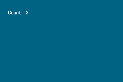

# Counter logic and tests

Continuing from [article 26](26-gba-rust-setup.md), this article writes the counter's rules, connects the buttons, and tests the rules on a normal computer.

## Why keep the rules apart from the GBA?

The rules go in [counter.rs](../examples/agb-counter/src/counter.rs). This file imports nothing from agb.

```rust
pub struct Counter {
    value: i32,
}

impl Counter {
    pub fn new() -> Self {
        Self { value: 0 }
    }

    pub fn increment(&mut self) {
        self.value += 1;
    }

    pub fn decrement(&mut self) {
        self.value -= 1;
    }

    pub fn reset(&mut self) {
        self.value = 0;
    }

    pub fn value(&self) -> i32 {
        self.value
    }
}
```

`&mut self` methods change the value, and `&self` only reads it. `i32` is signed, so the counter can go below 0.

## Testing without a GBA

Because this file has no GBA dependency, it compiles for the Mac on its own. The file's tests cover the start value, adding, going below zero, reset, and adding then subtracting.

```sh
rustc --edition 2024 --test src/counter.rs -o /tmp/counter_test && /tmp/counter_test
```

```
test tests::increment_adds_one ... ok
test tests::decrement_can_go_below_zero ... ok
test tests::increment_and_decrement_cancel_out ... ok
test tests::reset_returns_to_zero ... ok
test tests::starts_at_zero ... ok

test result: ok. 5 passed; 0 failed; 0 ignored; 0 measured; 0 filtered out
```

A plain `cargo test` was not used, because the project's target is the GBA. agb has its own test runner, seen in the template's settings, which was not tried here.

## Why does holding A add only 1?

agb's `ButtonController` remembers the previous and current state ([input.rs](https://github.com/agbrs/agb/blob/v0.25.0/agb/src/input.rs)). `is_just_pressed` is true only in the frame a button goes down, so holding A adds 1 once.

The button names are `Button::A`, `Button::B`, and `Button::Start`. `Button::START` does not compile in agb 0.25.0.

```
error[E0599]: no variant, associated function, or constant named `START` found for enum `Button`
```

| Method | True when | Holding A for 30 frames adds |
|---|---|---|
| `is_pressed` | The button is down | 30 |
| `is_just_pressed` | The button went down in this frame | 1 |

The last column is what the definitions imply, and only `is_just_pressed` was run.

## What repeats every frame?

A game repeats the same steps every frame: read input, update the state, draw.

```rust
loop {
    // Input and update
    buttons.update();
    let before = counter.value();
    if buttons.is_just_pressed(Button::A) {
        counter.increment();
    }
    if buttons.is_just_pressed(Button::B) {
        counter.decrement();
    }
    if buttons.is_just_pressed(Button::Start) {
        counter.reset();
    }
    if counter.value() != before {
        (bg, _renderer) = draw(counter.value());
    }

    // Render
    let mut frame = gfx.frame();
    bg.show(&mut frame);
    frame.commit();
}
```

The [agb book's frame lifecycle article](https://github.com/agbrs/agb/blob/v0.25.0/book/src/articles/frame_lifecycle.md) describes the same update and render loop, and says not to change game state during `show`. Here the text is rebuilt only when the value changes.

Only `Counter` changes the value. The loop decides what to do from the buttons, and `draw` decides how it looks, so the rules can stay tested on their own.

## Checking it

Pressing A three times and B once in mGBA, with the keyboard's X and Z keys, gave this log.

```
counter = 1 KEYINPUT = 0b1111111110
counter = 2 KEYINPUT = 0b1111111110
counter = 3 KEYINPUT = 0b1111111110
counter = 2 KEYINPUT = 0b1111111101
```

In a second run, A twice and then START (the Return key) gave this.

```
counter = 1 KEYINPUT = 0b1111111110
counter = 2 KEYINPUT = 0b1111111110
counter = 0 KEYINPUT = 0b1111110111
```

The second column is explained in [article 28](28-gba-hardware.md). These are the screens from the first and third states: at startup, and after going below zero. They were saved with mGBA's screenshot key.





## Chinese terms in this article

The Chinese terms here were selected for their relevance to this article's topic from words whose sources were confirmed in other articles in this repository.

| Chinese | Pinyin | Meaning | Source |
|---|---|---|---|
| 模拟器 | mónǐqì | Emulator | [模拟器游戏 篇四](https://zhuanlan.zhihu.com/p/703325151) |
| 配置 | pèizhì | Settings | [天马G前端的使用](https://blog.csdn.net/fanged/article/details/152960565) |

## What you can learn

Keeping the rules apart from the hardware lets you test them on a normal computer. `is_just_pressed` turns a held button into one event, and a frame loop ties input, state, and drawing together.
