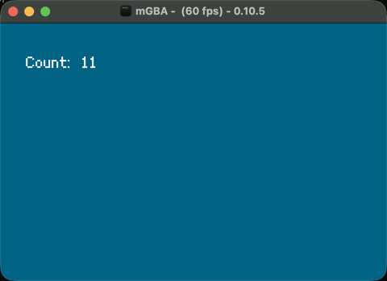

# Drawing on the screen

Continuing from [article 28](28-gba-hardware.md), this article shows the counter's number on the screen and covers how the GBA builds a picture.



## Why not store every pixel?

The screen is 240×160 pixels and shows 32768 (15-bit) colors ([Tonc](https://www.coranac.com/tonc/text/video.htm)), which is 38,400 pixels. In the tiled video modes, the picture is made from 8×8 tiles rather than individual pixels. A separate map says which tile goes where, so one tile can be reused many times.

Colors are stored as numbers into a palette. According to [GBATEK](https://problemkaputt.de/gbatek.htm), with 4-bit depth there are 16 palettes of 16 colors, and each tile takes 32 bytes (8 × 8 × 4 bits). 100 tiles therefore take 3,200 bytes.

## Backgrounds and sprites

[Tonc](https://www.coranac.com/tonc/text/regbg.htm) says the tiled modes (0, 1, and 2) can have up to four backgrounds showing tilemaps. Sprites are separate objects with their own position. OAM is 1KB and holds 128 of them ([GBATEK](https://problemkaputt.de/gbatek.htm), [Tonc](https://www.coranac.com/tonc/text/regobj.htm)). The counter needs only one background and no sprites, so sprites were not tried here.

## Drawing the number

This follows agb's [background_text_render](https://github.com/agbrs/agb/blob/v0.25.0/agb/examples/background_text_render.rs) example. `include_font!` puts the font into the ROM at build time. Nothing is loaded from the Mac when the game runs.

```rust
static FONT: Font = include_font!("assets/ark-pixel-10px-proportional-ja.ttf", 10);

gfx.set_background_palette_colour(0, 0, Rgb::new(0, 97, 132).into());
gfx.set_background_palette_colour(0, 1, Rgb15::WHITE);
```

Color 0 of palette 0 is the backdrop, and color 1 is the text. The font is under the OFL, and its license is next to it in the example folder.

## Two bugs from building this

The first version showed a blank screen, even though the buttons worked. There were two separate causes.

**A one-character string drew nothing.** agb 0.25.0's `Layout` is an iterator of letter groups. Counting its output showed this:

```
TEST "0" groups=0
TEST "0\n" groups=1
TEST "abc" groups=1
TEST "Hello, World!" groups=5
```

The counter starts at `0`, so nothing was drawn. The example now draws `Count: 0`. The reason was not traced in the source, and this is only what was observed.

**The renderer must stay alive.** `RegularBackgroundTextRenderer` holds the letter tiles in its `tiles` field ([tiled.rs](https://github.com/agbrs/agb/blob/v0.25.0/agb/src/display/font/tiled.rs)), and those tiles are `DynamicTile16` values. So `draw` returns it, and the loop keeps it as `_renderer` even though it is never read. Whether dropping it clears the picture was not tested by itself, because the first bug hid the result.

## Why about 60 frames a second?

The screen is drawn line by line. GBATEK gives 160 visible lines and 228 lines in total. The remaining 68 lines are the vertical blank (VBlank), when nothing is being drawn.

| Part | Lines | Time | Cycles |
|---|---|---|---|
| Visible | 160 | 11.749ms | 197,120 |
| VBlank | 68 | 4.994ms | 83,776 |
| Total | 228 | 16.743ms | 280,896 |

One line is 1,232 cycles. At 16,777,216 cycles per second, 16,777,216 ÷ 280,896 is about 59.73 frames per second. mGBA's title showed values from 59.7 to 60.9 while running. [Tonc](https://www.coranac.com/tonc/text/video.htm) explains that positions are usually updated in VBlank to avoid tearing.

In agb, `frame.commit()` handles the wait. Its source calls `wait_for_vblank` ([display/mod.rs](https://github.com/agbrs/agb/blob/v0.25.0/agb/src/display/mod.rs)), and the book says it waits for the current frame to finish, then sets things up for the next one.

## What has not been tested

Sprites, the other backgrounds, and writing to VRAM directly were not tried. Tearing was not observed.

## Chinese terms in this article

The Chinese terms here were selected for their relevance to this article's topic from words whose sources were confirmed in other articles in this repository.

| Chinese | Pinyin | Meaning | Source |
|---|---|---|---|
| 屏幕分辨率 | píngmù fēnbiànlǜ | Screen resolution | [RG-406V](https://zhangjiquan.com/handheld/rg-406v) |
| 刷新率 | shuāxīnlǜ | Refresh rate | [RG-406V](https://zhangjiquan.com/handheld/rg-406v) |
| 模拟器 | mónǐqì | Emulator | [模拟器游戏 篇四](https://zhuanlan.zhihu.com/p/703325151) |

## What you can learn

The GBA builds its picture from reusable tiles, maps, and palettes, which fit in little memory. A loop that waits for VBlank runs about 59.73 times a second. When a screen stays blank, counting what each step produces finds the cause faster than guessing.
