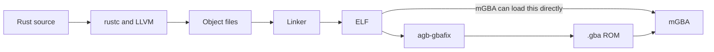

# From Rust code to a GBA ROM

[CPUs and machine code](20-cpu.md) looked at what a CPU reads. This article, the fifth in the GBA counter series that starts at [article 26](26-gba-rust-setup.md), follows how a Rust program becomes something a Game Boy Advance can run, by building one and reading each file it produces. The experiments were run on an Apple Silicon Mac with mGBA 0.10.5. The project is commit `99ee807` of [agbrs/template](https://github.com/agbrs/template), which uses [agb](https://github.com/agbrs/agb) 0.25.0. Nothing was tried on a real GBA.



## How can a Mac build for a GBA?

A Mac and a GBA have different CPUs, so the Mac has to produce instructions it cannot run itself. This is called cross compilation. The template selects the target in `.cargo/config.toml`.

```toml
[build]
target = "thumbv4t-none-eabi"
```

| Part | Meaning |
|---|---|
| `thumb` | Use Thumb, the instruction set seen in [article 20](20-cpu.md), where one instruction is mainly 2 bytes |
| `v4t` | The ARMv4T architecture of the GBA's ARM7TDMI |
| `none` | No operating system is assumed |
| `eabi` | The rules for how compiled code passes arguments and uses the stack |

The [rustc book](https://doc.rust-lang.org/rustc/platform-support/armv4t-none-eabi.html) says that on the GBA one should usually use this Thumb target for the best overall performance, and that it only supports the old Thumb-1 instruction set. The compiler itself does not write the machine code: the [rustc dev guide](https://rustc-dev-guide.rust-lang.org/backend/codegen.html) says rustc usually uses LLVM for that step.

The same file adds `-Clink-arg=-Tgba.ld`, which hands the linker a layout file, and `-Ctarget-cpu=arm7tdmi`.

## The first build failed

The template's `rust-toolchain.toml` asks for `channel = "nightly"`, meaning the newest nightly compiler. On November 2, 2026, that was `rustc 1.101.0-nightly (3e92e1a2d 2026-11-01)`, and `cargo build` stopped.

```
error[E0277]: the trait bound `ALLOCATOR: AllocatorNightly` is not satisfied
error: `alloc::vec::Vec::<T, A>::new_in` is not yet stable as a const fn
error: could not compile `agb_hashmap` (lib) due to 2 previous errors
```

The errors are inside `agb_hashmap` 0.25.0, not in the project. Nightly features can change, and they had changed since agb 0.25.0 was released on July 22, 2026. Using the nightly from that date fixed it. The build took 1 minute 28 seconds.

```sh
RUSTUP_TOOLCHAIN=nightly-2026-07-22 cargo build
```

To keep this working, write the date into `rust-toolchain.toml`.

```toml
[toolchain]
channel = "nightly-2026-07-22"
components = ["rust-src", "clippy", "rustfmt", "llvm-tools"]
```

## What is an object file?

Think of a program split across two chapters of a book, where chapter 1 says "see the section on `increment`". While chapter 1 is being printed, nobody knows what page that section will land on. An object file (`.o`) is a chapter in that state: the machine code is ready, but it still carries a note saying "fill in this page number later".

This can be seen with a tiny experiment in [examples/link-demo](../examples/link-demo). It runs on the Mac rather than the GBA, because that makes the result easy to run. `game.rs` calls a function that lives in `counter.rs`.

```rust
// counter.rs
pub extern "C" fn increment(value: i32) -> i32 {
    value + 1
}

// game.rs
pub extern "C" fn main() -> i32 {
    unsafe { increment(41) }
}
```

Each file is compiled by itself with `rustc --emit=obj`. Listing the names in each object with `llvm-nm` shows what each one has and what it still needs.

```
$ llvm-nm game.o
                 U _increment
0000000000000000 T _main

$ llvm-nm counter.o
0000000000000000 T _increment
```

`T` means "defined here", and `U` means "undefined: needed, but not here". The instruction for the call in `game.o` is unfinished. It jumps to itself, with a note attached.

```
       0: 52800520     	mov	w0, #0x29               ; =41
       4: 14000000     	b	0x4 <ltmp0+0x4>
		0000000000000004:  ARM64_RELOC_BRANCH26	_increment
```

So an object file is machine code, plus a list of names, plus notes on what to fill in. Each address also starts from 0, because no final location has been decided.

In the GBA build, the same thing happens at a larger scale. A `.o` does not correspond to one `.rs` file, though. The dependencies, including agb, were stored as 23 `.rlib` files, and the project's own object file had a generated name.

```
target/thumbv4t-none-eabi/debug/incremental/agb_template-16da6nlkhw16x/.../64z6d7dbsr0p92oz58lpjnjdm.o
```

Rust divides its work by crate and by what the [rustc dev guide](https://rustc-dev-guide.rust-lang.org/backend/codegen.html) calls codegen units. LLVM produces objects from those units, and they are passed to the linker. So you should not expect `main.rs` to become `main.o`.

## What does the linker do?

The linker takes the object files and finishes the job. Giving it only `game.o` fails, because nothing provides the missing name.

```
$ cc game.o -o a
Undefined symbols for architecture arm64:
  "_increment", referenced from:
      _main in game.o
```

This is the error you see when a function is declared but its code is not there. Giving it both works, and the program returns 42.

```
$ cc game.o counter.o -o demo
$ ./demo; echo $?
42
```

The unfinished jump is now filled in with a real address.

```
1000002d8: 52800520    	mov	w0, #0x29               ; =41
1000002dc: 14000001    	b	0x1000002e0 <_increment>

1000002e0: 11000400    	add	w0, w0, #0x1
1000002e4: d65f03c0    	ret
```

The linker does three things: it joins the parts, decides where each one goes, and fills in the notes.

## What does "placement" mean?

A CPU does not know names like `main` or `counter`. It reads instructions and data at numbered memory addresses, the way a library shelf has numbered positions. "Placement" means deciding which address each piece goes to. On a Mac, the system decides what is suitable. On the GBA, it has to match the hardware, so the template passes the linker a layout file with `-Tgba.ld`. Its contents say that ROM starts at `0x08000000`, among other things.

The result for the GBA build can be read with `llvm-objdump`, which comes from Rust's `llvm-tools` component.

```sh
llvm-objdump -h target/thumbv4t-none-eabi/debug/agb_template
```

| Section | Size in bytes (hex) | Run address (VMA) | Stored address (LMA) | Contents |
|---|---|---|---|---|
| `.entrypoint` | `17c` | `08000000` | `08000000` | The first code to run |
| `.text` | `e00c` | `0800017c` | `0800017c` | Machine code |
| `.rodata` | `27230` | `0800e188` | `0800e188` | Read-only data |
| `.iwram` | `22c` | `03000000` | `080353b8` | Code that runs from fast internal memory |
| `.ewram` | `1d0` | `02000000` | `080355e4` | Variables with initial values |
| `.bss` | `18` | `020001d0` | `020001d0` | Variables that start at zero |

`0x08000000` is the cartridge ROM, `0x03000000` is IWRAM, and `0x02000000` is EWRAM, as in the memory map in [article 21](21-cheats-and-passthrough.md).

The last two address columns are the important part. `.iwram` and `.ewram` have different stored and run addresses. They wait in ROM, and something has to copy them to RAM before the game uses them. That is the startup code, covered in [article 31](31-gba-startup-and-memory.md).

## What is an ELF?

The linker's output is an ELF, the same kind of box seen in [article 20](20-cpu.md). The file's first bytes are the same marker.

```
$ file target/thumbv4t-none-eabi/debug/agb_template
ELF 32-bit LSB executable, ARM, EABI5 version 1 (SYSV), statically linked, with debug_info, not stripped

$ xxd -l 24 target/thumbv4t-none-eabi/debug/agb_template
00000000: 7f45 4c46 0101 0100 0000 0000 0000 0000  .ELF............
00000010: 0200 2800 0100 0000                      ..(.....
```

The 2 bytes at offset 18 are `28 00` (40), which is 32-bit ARM. `llvm-objdump -f` gives `start address: 0x08000000`.

## Does mGBA run an ELF?

Yes. Passing the ELF straight to mGBA 0.10.5 started the game, with the window title showing 59.7 fps. mGBA's source has a function for this, `mCoreLoadELF` in [core.c](https://github.com/mgba-emu/mgba/blob/0.10.5/src/core/core.c), which is used when mGBA is built with ELF support. The template relies on this: its `runner` setting calls `mgba-qt` with the build output, so `cargo run` passes it the ELF.

On a Mac with mGBA installed through the Homebrew cask, `mgba-qt` was not on the `PATH`. Calling the program inside the app works.

```sh
/Applications/mGBA.app/Contents/MacOS/mGBA target/thumbv4t-none-eabi/debug/agb_template
```

## What does agb-gbafix add?

A real GBA has no ELF loader. It expects a cartridge image. The [template's README](https://github.com/agbrs/template) describes `agb-gbafix` as the step for shipping to real hardware, and as not required for an emulator.

```sh
cargo install agb-gbafix --version 0.25.0
agb-gbafix target/thumbv4t-none-eabi/debug/agb_template -o counter.gba
```

| File | Size in bytes |
|---|---|
| ELF | About 7.6 MB, including debug information |
| `counter.gba` | About 219 KB |

Comparing the first bytes shows what the tool does. In the ELF, the area after the first instruction is zeros. These are the bytes at `0x08000000`.

```
8000000 2e0000ea 00000000 00000000 00000000
8000010 00000000 00000000 00000000 00000000
```

In `counter.gba`, the same area is filled in, and the file name appears as the title.

```
00000000: 2e00 00ea 24ff ae51 699a a221 3d84 820a  ....$..Qi..!=...
...
000000a0: 6167 625f 7465 6d70 6c61 7465 0000 0000  agb_template....
000000b0: 0000 9600 0000 0000 0000 0000 006c 0000  .............l..
```

`2e 00 00 ea` is the same in both. It is a jump, and `llvm-objdump` reads it as follows.

```
08000000 <__start>:
 8000000: ea00002e     	b	0x80000c0 <.Initialise>
```

The first instruction jumps over the header area, because that area is data and not code. [GBATEK](https://problemkaputt.de/gbatek.htm) gives the layout: the entry point at `000h`, the 156-byte Nintendo logo at `004h`, the title at `0A0h`, a fixed value that must be `96h` at `0B2h`, and a complement check at `0BDh`. These match the bytes above (`96` at `0xb2`, `6c` at `0xbd`). agb's [entrypoint.s](https://github.com/agbrs/agb/blob/v0.25.0/agb/src/entrypoint.s) leaves this area with the comment "Filled in by gbafix". `.gba` also has no section table, debug information, or symbol names, which is why it is much smaller. When opened in mGBA, the window title became `agb_template`, whereas for the ELF the title was empty.

## Why can Finder open `.rs` and `.png` but not these?

In Finder, a `.rs` file and a `.png` both open with a double click, while `.o`, ELF, and `.gba` do not show anything useful. The reason is not that they are a special kind of file. Every file is a sequence of bytes, as in [article 15](15-rg40xxh-big-picture.md). What differs is whether your Mac has an app that knows how to read those bytes.

A text editor treats bytes as letters. Here is the same number 10, saved as text and saved as a number.

```
$ xxd t.txt      (the characters "1" and "0")
00000000: 3130                                     10
$ xxd b.bin      (the number 10 in one byte)
00000000: 0a                                       .
```

`.rs` is the first kind, so a text editor shows it. A CPU works with the second kind, so programs are stored that way, and a text editor shows them as garbled characters. A `.png` is also the second kind, but every Mac has an image viewer that understands it. `.o`, ELF, and `.gba` have viewers too. They are just tools for programmers rather than apps that come with Finder.

So is there a viewer for each one? Yes.

| File | Viewer | What you see | Tried in this series? |
|---|---|---|---|
| `.rs` | A text editor | The source | Yes |
| `.png` | An image viewer | The picture | Yes |
| `.o` | `llvm-nm`, `llvm-objdump` | Names, unfinished instructions | Yes |
| ELF | `llvm-objdump` | Sections, addresses, instructions | Yes |
| ELF | [Ghidra](https://github.com/NationalSecurityAgency/ghidra) | Disassembly and decompilation, as in [article 23](23-rea-and-ghidra.md) | Not on this ELF |
| `.gba` | mGBA | The running game | Yes |
| `.gba` | mGBA's tools, such as "View memory..." and its tile, sprite, palette, and map views | The game's memory and graphics while it runs | No |
| Any file | `xxd` | Raw bytes in hexadecimal | Yes |
| Any file | [Hex Fiend](https://hexfiend.com/) | The same, in a Mac app. It is an open source hex editor | No |
| `.gba` | [YY-CHR](https://www.romhacking.net/utilities/119/) | Graphics inside a ROM. The listed version is for Windows | No |

mGBA's [README](https://github.com/mgba-emu/mgba/blob/0.10.5/README.md) also lists a command-line debugger and GDB remote support, compatible with Ghidra and IDA Pro. This is where the ELF is useful even after you have a `.gba`: it still has the names and debug information that the ROM does not.

The file name's extension is only a label. Programs look at the first bytes, called a magic number, to tell what a file is. The `file` command does this.

```
$ file counter.gba
counter.gba: Game Boy Advance ROM image: "agb_template" (, Rev.00)
$ file src/counter.rs
src/counter.rs: ASCII text
```

## What has not been tested

Whether `counter.gba` boots on a real GBA has not been tested.

## Chinese terms in this article

The Chinese terms here were selected for their relevance to this article's topic from words whose sources were confirmed in other articles in this repository.

| Chinese | Pinyin | Meaning | Source |
|---|---|---|---|
| 模拟器 | mónǐqì | Emulator | [模拟器游戏 篇四](https://zhuanlan.zhihu.com/p/703325151) |
| 内存 | nèicún | Memory | [掌机圈 RG-35XX H](https://zhangjiquan.com/handheld/rg-35xx-h) |
| 处理器 | chǔlǐqì | Processor (SoC) | [RG-406V](https://zhangjiquan.com/handheld/rg-406v) |

## What you can learn

The compiler turns Rust into machine code in object files, which still have unfinished calls. The linker joins them, decides every address, and fills in those calls. The ELF records that layout, including sections that are stored in ROM but run from RAM. mGBA can load an ELF directly, while a real GBA needs the cartridge image that `agb-gbafix` makes. A nightly compiler can also break a build through no fault of your project, so pin the date.
