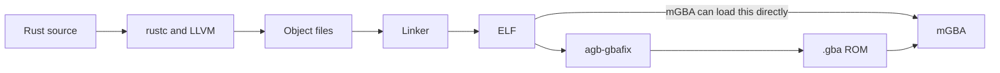

# From Rust code to a GBA ROM

[CPUs and machine code](20-cpu.md) looked at what a CPU reads. This article, the fifth in the GBA counter series that starts at [article 26](26-gba-rust-setup.md), follows how a Rust program becomes something a Game Boy Advance can run, by building one and reading each file it produces. The experiments were run on an Apple Silicon Mac with mGBA 0.10.5. The project is commit `99ee807` of [agbrs/template](https://github.com/agbrs/template), which uses [agb](https://github.com/agbrs/agb) 0.25.0. Nothing was tried on a real GBA.



## Building on a Mac for a different machine

A Mac and a GBA have different CPUs, so the Mac has to produce instructions it cannot run itself. This is called cross compilation. The template selects the target in `.cargo/config.toml`.

```toml
[build]
target = "thumbv4t-none-eabi"
```

| Part | Meaning |
|---|---|
| `thumb` | Use Thumb, the instruction set seen in [article 20](20-cpu.md), where one instruction is mainly 2 bytes |
| `v4t` | The ARMv4T architecture of the GBA's ARM7TDMI |
| `none` | No operating system is assumed |
| `eabi` | The rules for how compiled code passes arguments and uses the stack |

The same file adds `-Clink-arg=-Tgba.ld`, which hands the linker a layout file, and `-Ctarget-cpu=arm7tdmi`.

## The first build failed

The template's `rust-toolchain.toml` asks for `channel = "nightly"`, meaning the newest nightly compiler. On November 2, 2026, that was `rustc 1.101.0-nightly (3e92e1a2d 2026-11-01)`, and `cargo build` stopped.

```
error[E0277]: the trait bound `ALLOCATOR: AllocatorNightly` is not satisfied
error: `alloc::vec::Vec::<T, A>::new_in` is not yet stable as a const fn
error: could not compile `agb_hashmap` (lib) due to 2 previous errors
```

The errors are inside `agb_hashmap` 0.25.0, not in the project. Nightly features can change, and they had changed since agb 0.25.0 was released on July 22, 2026. Using the nightly from that date fixed it. The build took 1 minute 28 seconds.

```sh
RUSTUP_TOOLCHAIN=nightly-2026-07-22 cargo build
```

To keep this working, write the date into `rust-toolchain.toml`.

```toml
[toolchain]
channel = "nightly-2026-07-22"
components = ["rust-src", "clippy", "rustfmt", "llvm-tools"]
```

## Object files: parts before they are joined

The compiler does not produce the finished program directly. It first produces object files (`.o`), which hold machine code plus notes on what still has to be connected.

This build shows that a `.o` does not correspond to one `.rs` file. The dependencies, including agb, were stored as 23 `.rlib` files. The project's own object file had a generated name.

```
target/thumbv4t-none-eabi/debug/incremental/agb_template-16da6nlkhw16x/.../64z6d7dbsr0p92oz58lpjnjdm.o
```

Rust divides its work by crate and by internal compilation units, so you should not expect `main.rs` to become `main.o`.

## The linker decides addresses

A CPU does not know names like `main` or `counter`. It reads instructions and data at numbered memory addresses. Deciding those addresses is what "placement" means, and it is the linker's job. The linker also joins the object files and fills in where each call jumps to.

The result can be read with `llvm-objdump`, which comes from Rust's `llvm-tools` component.

```sh
llvm-objdump -h target/thumbv4t-none-eabi/debug/agb_template
```

| Section | Size in bytes (hex) | Run address (VMA) | Stored address (LMA) | Contents |
|---|---|---|---|---|
| `.entrypoint` | `17c` | `08000000` | `08000000` | The first code to run |
| `.text` | `e00c` | `0800017c` | `0800017c` | Machine code |
| `.rodata` | `27230` | `0800e188` | `0800e188` | Read-only data |
| `.iwram` | `22c` | `03000000` | `080353b8` | Code that runs from fast internal memory |
| `.ewram` | `1d0` | `02000000` | `080355e4` | Variables with initial values |
| `.bss` | `18` | `020001d0` | `020001d0` | Variables that start at zero |

`0x08000000` is the cartridge ROM, `0x03000000` is IWRAM, and `0x02000000` is EWRAM, as in the memory map in [article 21](21-cheats-and-passthrough.md).

The last two address columns are the important part. `.iwram` and `.ewram` have different stored and run addresses. They wait in ROM, and something has to copy them to RAM before the game uses them. That is the startup code, covered in [article 31](31-gba-startup-and-memory.md).

## ELF: the box that records the layout

The linker's output is an ELF, the same kind of box seen in [article 20](20-cpu.md). The file's first bytes are the same marker.

```
$ file target/thumbv4t-none-eabi/debug/agb_template
ELF 32-bit LSB executable, ARM, EABI5 version 1 (SYSV), statically linked, with debug_info, not stripped

$ xxd -l 24 target/thumbv4t-none-eabi/debug/agb_template
00000000: 7f45 4c46 0101 0100 0000 0000 0000 0000  .ELF............
00000010: 0200 2800 0100 0000                      ..(.....
```

The 2 bytes at offset 18 are `28 00` (40), which is 32-bit ARM. `llvm-objdump -f` gives `start address: 0x08000000`.

## Does mGBA run an ELF?

Yes. Passing the ELF straight to mGBA 0.10.5 started the game, with the window title showing 59.7 fps. mGBA's source has a function for this, `mCoreLoadELF` in [core.c](https://github.com/mgba-emu/mgba/blob/master/src/core/core.c), which is used when mGBA is built with ELF support. The template relies on this: its `runner` setting calls `mgba-qt` with the build output, so `cargo run` passes it the ELF.

On a Mac with mGBA installed through the Homebrew cask, `mgba-qt` was not on the `PATH`. Calling the program inside the app works.

```sh
/Applications/mGBA.app/Contents/MacOS/mGBA target/thumbv4t-none-eabi/debug/agb_template
```

## agb-gbafix: making a cartridge image

A real GBA has no ELF loader. It expects a cartridge image. The [template's README](https://github.com/agbrs/template) describes `agb-gbafix` as the step for shipping to real hardware, and as not required for an emulator.

```sh
cargo install agb-gbafix --version 0.25.0
agb-gbafix target/thumbv4t-none-eabi/debug/agb_template -o counter.gba
```

| File | Size in bytes |
|---|---|
| ELF | About 7.6 MB, including debug information |
| `counter.gba` | About 219 KB |

Comparing the first bytes shows what the tool does. In the ELF, the area after the first instruction is zeros. These are the bytes at `0x08000000`.

```
8000000 2e0000ea 00000000 00000000 00000000
8000010 00000000 00000000 00000000 00000000
```

In `counter.gba`, the same area is filled in, and the file name appears as the title.

```
00000000: 2e00 00ea 24ff ae51 699a a221 3d84 820a  ....$..Qi..!=...
...
000000a0: 6167 625f 7465 6d70 6c61 7465 0000 0000  agb_template....
000000b0: 0000 9600 0000 0000 0000 0000 006c 0000  .............l..
```

`2e 00 00 ea` is the same in both. It is a jump, and `llvm-objdump` reads it as follows.

```
08000000 <__start>:
 8000000: ea00002e     	b	0x80000c0 <.Initialise>
```

The first instruction jumps over the header area, because that area is data and not code. [GBATEK](https://problemkaputt.de/gbatek.htm) gives the layout: the entry point at `000h`, the 156-byte Nintendo logo at `004h`, the title at `0A0h`, a fixed value that must be `96h` at `0B2h`, and a complement check at `0BDh`. These match the bytes above (`96` at `0xb2`, `6c` at `0xbd`). agb's [entrypoint.s](https://github.com/agbrs/agb/blob/v0.25.0/agb/src/entrypoint.s) leaves this area with the comment "Filled in by gbafix". `.gba` also has no section table, debug information, or symbol names, which is why it is much smaller. When opened in mGBA, the window title became `agb_template`, whereas for the ELF the title was empty.

## Why these files do not open in Finder

Every one of these files is a sequence of bytes, as in [article 15](15-rg40xxh-big-picture.md). A `.rs` file holds bytes meant to be read as text, so a text editor can show it. A `.png` has an image viewer. `.o`, ELF, and `.gba` also have viewers, but they are tools for programmers.

| File | Tool used in this article | What it shows |
|---|---|---|
| `.rs` | A text editor | The source |
| `.o`, ELF | `llvm-objdump`, `file`, [Ghidra](23-rea-and-ghidra.md) | Sections, addresses, instructions, symbol names |
| `.gba` | `xxd`, mGBA | Raw bytes and the running game |

## What has not been tested

Whether `counter.gba` boots on a real GBA has not been tested.

## Chinese terms in this article

The Chinese terms here were selected for their relevance to this article's topic from words whose sources were confirmed in other articles in this repository.

| Chinese | Pinyin | Meaning | Source |
|---|---|---|---|
| 模拟器 | mónǐqì | Emulator | [模拟器游戏 篇四](https://zhuanlan.zhihu.com/p/703325151) |
| 内存 | nèicún | Memory | [掌机圈 RG-35XX H](https://zhangjiquan.com/handheld/rg-35xx-h) |
| 处理器 | chǔlǐqì | Processor (SoC) | [RG-406V](https://zhangjiquan.com/handheld/rg-406v) |

## What you can learn

The compiler turns Rust into machine code in object files, and the linker joins them and decides every address. The ELF records that layout, including sections that are stored in ROM but run from RAM. mGBA can load an ELF directly, while a real GBA needs the cartridge image that `agb-gbafix` makes. A nightly compiler can also break a build through no fault of your project, so pin the date.
