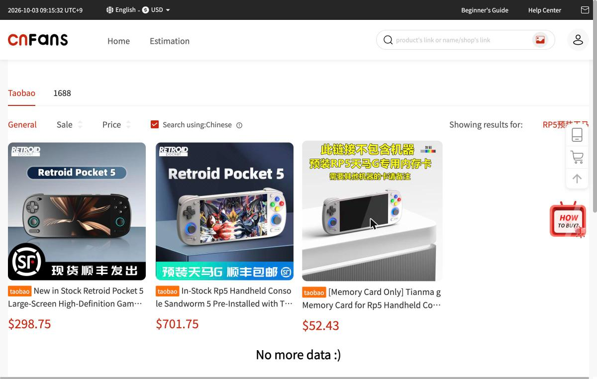
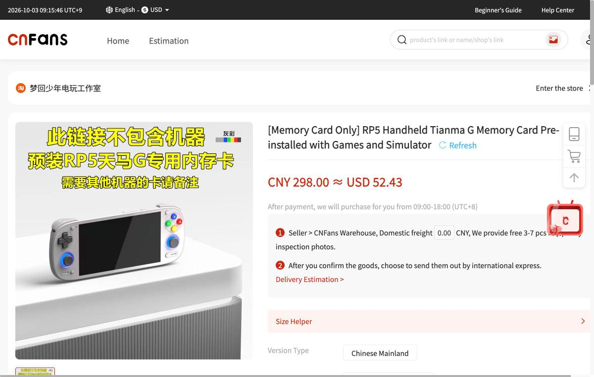
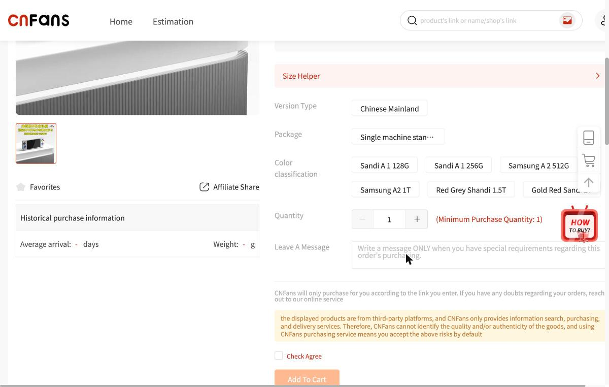

# CNFans listings and terms

The type is an overseas-facing service that buys products from Taobao and 1688 on your behalf. The URL is https://cnfans.com/ and search takes the form `https://cnfans.com/search?keywords=<Chinese>&searchType=keywords`. Reliability is seller, so what the pages state can be treated as fact as it stands. However, CNFans states explicitly that it does not guarantee the quality of the products themselves. The browser check was done on October 3, 2026. On November 2, 2026, the site showed only a maintenance notice citing persistent cyberattacks, so the search and listings could not be rechecked. The URLs of individual products were masked in the tool output, so they are recorded by way of opening them from the search screen.

## Observations on use

You can search without logging in, and results are shown in US dollars. The currency can be chosen from AUD, CAD, CHF, EUR, GBP, NZD, PLN, RON, SEK, USD, and CNY; Japanese yen is not available. The language can be chosen from English, German, Dutch, Spanish, French, Italian, Polish, Portuguese, Romanian, Swedish, and Chinese. The search results screen has a "Search using: Chinese" check, set to search with Chinese keywords. Product names are in machine-translated English.

A product page shows the product name, the price (in yuan and US dollars), "After payment, we will purchase for you from 09:00-18:00 (UTC+8)" (after payment, the purchase is made on your behalf between 9:00 and 18:00 China time), the "Seller > CNFans Warehouse" flow, domestic shipping, 3 to 7 inspection photos, a choice of international shipping, and options (color, capacity, and so on). Switching options did not change the displayed price. Below the product there are the tabs "Product Detail", "Specification Parameter", "Shopping Agent Guidance", "After Sales Service", and "Service Promise".

## After-sales description

For electronics and digital products, inspection is limited to whether the exterior has any problems and whether accessories are all present; turning the device on to check its functions is not possible. A return can be requested within 5 days after arrival at the warehouse. The cost of a return is a fee of about $0.75 per item plus return shipping, for a total of about $3. Custom-made products cannot be returned.

The description of items that cannot be shipped lists knives, lighters, liquids and food (juice, alcohol, cheese, crab, and so on), seeds, magnetic parts, and more. It states that medicine, liquids, creams, powders, and cosmetics are subject to Chinese export restrictions. It says that customs handling differs by country.

## Listings of the Retroid Pocket 5 with Tianma G

Searching for "RP5预装天马" returned 3 results.

The first was a listing for the device ($298.75) with a title mentioning Android 13, Tianma G included, Moonlight Box (月光宝盒), and freebies. Trying to open it displayed a message in English saying "the product is suspected of infringing rights and cannot be purchased on your behalf". A $281.15 device listing showed the same message; it is not among the three results in the screenshot, and how it was reached was not recorded. The second, a $701.75 listing, returned to the CNFans top page when opened.

The third, "[Memory card only] Tianma G memory card for RP5, with games and emulators included" ($52.43, 298 yuan), could be opened. The store name is "梦回少年电玩工作室". The images read "此链接不包含机器", "预装RP5天马G专用内存卡", and "需要其他机器的卡请备注". There are six options: Sandisk A1 128GB and 256GB, Samsung A2 512GB and 1TB, and Sandisk 1.5TB and 2TB. The page description says "此商品链接只有内存卡 请知悉" and explains that the 玩家 installs it following a tutorial after it arrives. It also advises writing in the remarks if a dedicated card is needed for another device (Odin 2, Odin 2 mini, RP5, RP4PRO). The "Specification Parameter" field has values apparently entered carelessly by the seller, with the brand as "Game Kiddy", the screen size as 6 inches, and supported devices as ps1 and so on, which do not match the actual specs of the RP5.

## RG406V listings

RG406V listings had more than 20 color and capacity options, with combinations of "no games" and "with game card" and of the frontends "official" and "Tianma". Images on the page list PS2, WII, NGC, 3DS, PSP, DC, SS, PS1, NDS, N64, ARCADE, FBA, NEOGEO, and others as supported systems, and read "支持用户自下载相关格式游戏" (a format in which users download games themselves to play). The chip was confirmed in an image as "虎贲T820".
