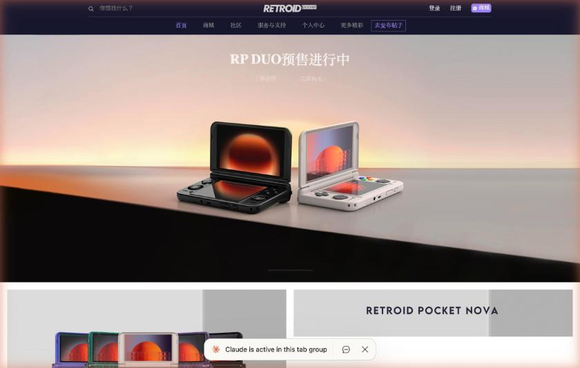

# Retroid official site for China

The type is the official Retroid Pocket site for China. The URL is https://www.retroid.cn/ , and it was checked on October 3, 2026. Reliability is official.

The top page showed pre-orders for the new "RP DUO" in three banners. Lower on the screen, information about the Retroid Pocket Nova follows. The top menu is 首页 (home), 商城 (shop), 社区 (community), 服务与支持 (service and support), 个人中心 (my page), 更多精彩 (more), and 去发布帖子 (make a post).

The bottom of the page lists "掌机" (handhelds) and "配件" (accessories) as products, "天猫旗舰店" and "淘宝企业店" under 商城, "官网社区" under 社区, "使用指南" (usage guide), "下载中心", "视频", and "服务中心" under support, and then entry points to company history, news, and recruitment. For contact, the email is `Retroidpocket@163.com`, the phone reads "即将开放" (opening soon), and it says to contact Taobao customer service for pre-sale and after-sale inquiries.

The site's copyright notice is "2023 深圳市驰晶科技有限公司". There is a note based on law and regulations that commercial promotion counts as advertising.
