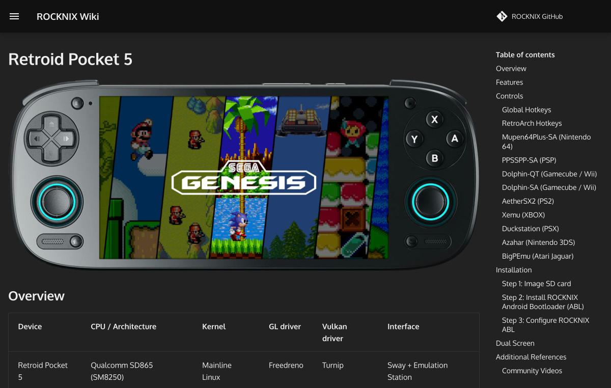

# ROCKNIX Official Wiki

The type is the official wiki of a Linux for handheld game consoles. The URL is https://rocknix.org/ and the source is at https://github.com/ROCKNIX/distribution . Reliability is official, and a screenshot was taken of the Retroid Pocket 5 page.

## Top page

It describes ROCKNIX as an immutable Linux distribution aimed at retro game emulation on handheld game consoles. Development is by a small community of enthusiasts. Listed features include local and remote multiplayer, touch controls on supported devices, power and performance profiles, music and video playback, Bluetooth audio and controllers, HDMI and USB output, cloud and LAN sync through Syncthing and rclone, VPNs through WireGuard, Tailscale, and ZeroTier, and RetroAchievements and automatic fetching of game information. The license is a mix of GPL v2 parts and the licenses of individual components, including non-commercial-only components. The GitHub README states that ROCKNIX is a fork of JELOS.

## Supported devices

The device list in the menu includes Anbernic (RG351P/M/V, RG353P/M/V/VS, RG503, RG552, RG ARC, RG35XX 2024, Plus, Pro, H, SP, RG28XX, RG40XX V, RG40XX H, RG CubeXX), AYANEO (Pocket ACE, DMG, EVO, DS, S2), AYN (Odin 2, Odin 2 Mini, Odin 2 Portal, Thor, Odin 3), GameForce (Ace), Hardkernel (Odroid Go Advance, Super, Ultra), MagicX (XU Mini M), Mangmi (Air X), Powkiddy (RGB10, RGB10 Max 3 Pro, RGB10 Max 3, RGB10X, RK2023, RGB20SX, RGB20 Pro, RGB30, X35S, X35H, X55, XU10), Retroid (Pocket 5, 6, Flip2, Mini, Nova), and unnamed devices (R33S, R35S/R36S, EE clone).

## Installation, updates, and adding games

The [installation](https://rocknix.org/play/install/) page describes two methods, the Image Burner for Windows and manual writing, and explains everything through booting after writing. The OS area is ext4 and cannot be read directly from Windows. The [H700 installation guide](https://rocknix.org/configure/h700-installation/) gives the steps for copying a DTB file and renaming it to `dtb.img` before booting on H700 Anbernic devices, along with the file names for 15 devices. RG35XX series DTBs come in two kinds depending on board revision.

[Adding games](https://rocknix.org/play/add-games/) starts with the storage concepts ("Merged Storage", which merges with the external SD, and "Simple Storage", which uses only the external SD), and then explains in order the methods of network transfer (HTTP, SMB, SFTP), USB gadget, SD card, recovery mode, USB drive, Linux PC, and NFS. The username for network connections is `root` and the default password is `rocknix`. The methods on the [update](https://rocknix.org/play/update/) page are three: OTA, a manual `.tar` file, and development builds.

## Device pages

The [RG40XX H](https://rocknix.org/devices/anbernic/rg40xx-h/) is listed as having an H700 (quad-core 1.4GHz Cortex-A53, Mali G31), a 4-inch 640×480 screen, 1GB of LPDDR4, and Wi-Fi and Bluetooth, and it can be overclocked to 1.5GHz in the settings. The [R35S/R36S](https://rocknix.org/devices/unbranded/game-console-r35s-r36s/) has an RK3326 (quad-core 1.3GHz Cortex-A35, Mali G31), a 3.5-inch 640×480 screen, and 1GB of DDR3, and there are steps for placing a panel overlay file when a 2024 R36S has a new screen.

The [Retroid Pocket 5](https://rocknix.org/devices/retroid/retroid-pocket-5/) is listed as using a Snapdragon 865 (SM8250), mainline Linux, Freedreno, Turnip, Sway, and EmulationStation. There are hotkeys, controls for N64, PSP, GC/Wii, PS2 (AetherSX2), Xbox, PS1, 3DS, and Atari Jaguar, steps for writing the ABL, and dual-screen settings. The Retroid Pocket 6 and AYN Odin 2 pages also have the same ABL steps, and their SoC is the Snapdragon 8 Gen 2 (SM8550).
