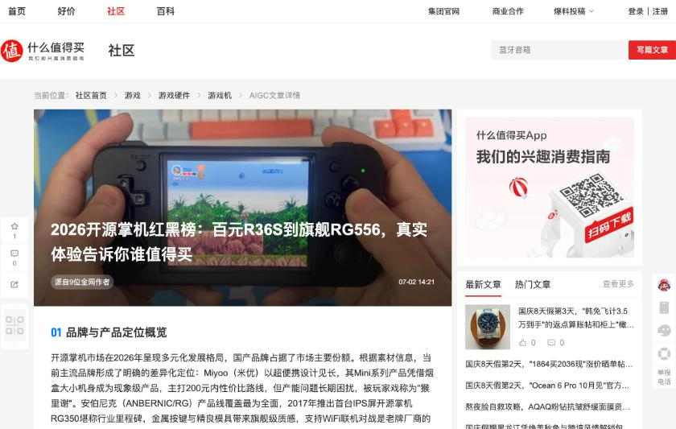
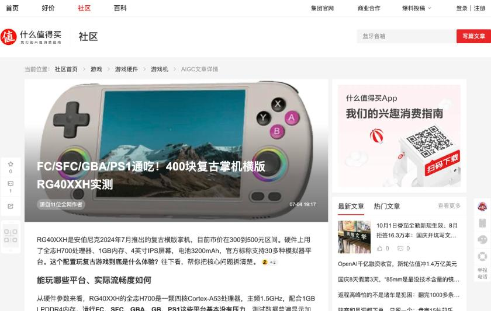

# AI-generated articles on 什么值得买

The type is articles published in the 社区 of 什么值得买, with "AIGC文章详细" displayed at the top of the page. Reliability is AI-generated. "内容由AI生成" is written at the end of each article, and multiple reference pages are listed as the basis for the text. They cannot be used as they stand to support figures and evaluations. The two articles read in this research are the following.

## 2026开源掌机红黑榜

The URL is https://post.smzdm.com/p/aww5ev54/ , the title is "2026开源掌机红黑榜:百元R36S到旗舰RG556,真实体验告诉你谁值得买", and the date is July 2. There is a "源自9位全网作者" label, which shows that it is text in which AI summarized multiple information sources.

The contents are six sections: brand positioning, chip comparison, OS choice, price ranges, reputation, and points of comparison. In its brand descriptions, it calls Miyoo a brand popular for small devices under 200 yuan (called "猴里谢" for its low production), Anbernic a brand with a wide lineup (it released the RG350 with an IPS screen in 2017), and 老张 (GKD) a brand strong in OS optimization, and it calls the R36S an entry-level device at around 100 yuan. On chips, it says the H700 and RK3566 are mid-range, the RK3326 is entry-level, and the RG556 and Retroid Pocket 5 are high-end. On OSes, it says Onion OS suits the Miyoo Mini Plus, muOS and Knulli suit H700 Anbernic devices, and ArkOS and Rocknix suit the R36S, and it writes that the June 2026 stable release of ROCKNIX added Steam and Vita3K and that supported devices increased from 49 to 66. It divides price ranges into 100–200 yuan (R36S), 300–500 yuan (RG35XX, PowKiddy X55), and 1000–3000 yuan (Retroid Pocket 5, RG556).

## FC/SFC/GBA/PS1通吃!400块复古掌机横版RG40XXH实测

The URL is https://post.smzdm.com/p/aqrg0rx2/ , the date is July 4, and it is labeled "源自11位全网作者".

It introduces the RG40XXH as a horizontal Anbernic device released in July 2024 with a market price of 300–500 yuan. It has an H700, 1GB of memory, a 4-inch IPS screen, and a 3200mAh battery, and it says that officially more than 30 emulators are supported. It says FC, SFC, GBA, GB, and PS1 run without problems, and some PSP and N64 games are playable. The screen is 4-inch 640×480 at 200PPI, the weight is 208g, and the buttons are conductive rubber. It points out the horizontal form, Mini HDMI output, Wi-Fi, and 蓝牙 in comparison with the PowKiddy RGB30 and RGB20SX. The reference list includes a 搜狐 article, a 掌机圈 page, an English article from Alibaba, and an Amazon product page. Among the comments at the bottom of the page is "200出头,PSP的三国无双,实况足球都挺好,流畅", which is collapsed.
