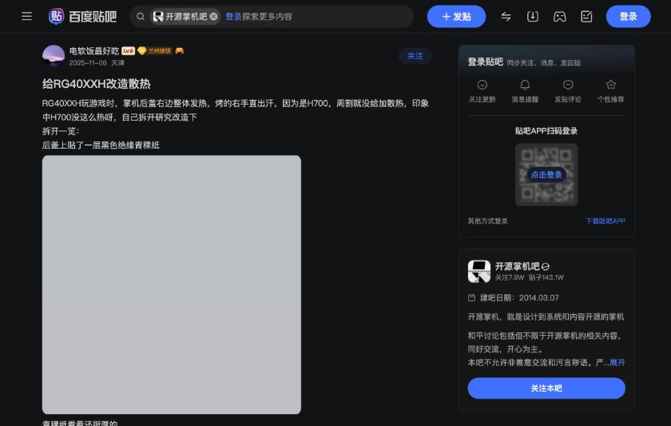

# RG40XXH cooling mod on Tieba

The type is a post on 开源掌机吧 on Baidu Tieba. The URL is https://tieba.baidu.com/p/10191425150 , the title is "给RG40XXH改造散热", the post date is November 6, 2025, and the poster is a user in Tianjin. Reliability is personal, and it describes firsthand experience with photos. There are 11 comments, all of which could be read.

## Contents of the post

The poster found that when playing on the RG40XXH, the right side of the back got hot and their right hand got sweaty, so they took it apart to investigate. They speculate that Anbernic ("周割" in the post) did not add cooling because it uses an H700, and write that they did not remember the H700 being that hot. When taken apart, the back cover had a black insulating paper, "青稞纸", stuck on it. It was 0.5mm thick, and the poster's impression was that it is better not stuck on. Beneath it were two pieces of 2mm-thick foam that keep the battery from moving.

Referring to a method seen in a Bilibili video that uses thermal pads and copper foil on a chip like the "A122" (A122这种U), they stuck on thermal pads bought online. One piece on the H700 would have been enough, but they first stuck it on in the wrong orientation, so they stuck pads on everything. A thickness of 5.5mm suited the pad for the H700, and since the gap between the battery and cover is 2mm, anything suitable that keeps the battery from moving will do. When tested, the only hot part on the back was the small area directly over the H700, and their right hand no longer got hot.

The poster concludes that the H700 does not get extremely hot even at full power, and that if the heat is released to the cover, it will not build up. Finally, they write that the RG40XXH's D-pad has slight mistaken inputs, but that having Bluetooth and Wi-Fi is convenient and the experience of playing with a connected controller is good.

## Comments

Another user wrote that just placing a silicone pad would have been enough. Another wrote that overseas reviews also called heat a problem on the 40XXH. The poster replied that when the H700 is used in a set-top box, just sticking on an aluminum heat sink is enough and no fan is needed, and that it is a pity the manufacturer did not add cooling. To the question "does it really have an effect?", the poster answered that the H700 does not freeze at high temperatures, so the manufacturer did not add cooling, but that adding a pad lowers the temperature, and that it is not essential.

Another comment wrote, "The H700 struggles when PS1 is set to 2x resolution." The poster replied that it does not stutter if filters and masks are turned off, and that a Dreamcast emulator does not stutter either if set to 640×480. Asked about the thickness of the copper foil, they answered that it is about 0.1mm, as thin as paper; asked about the thickness and type of thermal pad, they answered that the cheapest is good enough, and that for the 40XXH, 5mm or two 2.5mm pads stacked will do.
