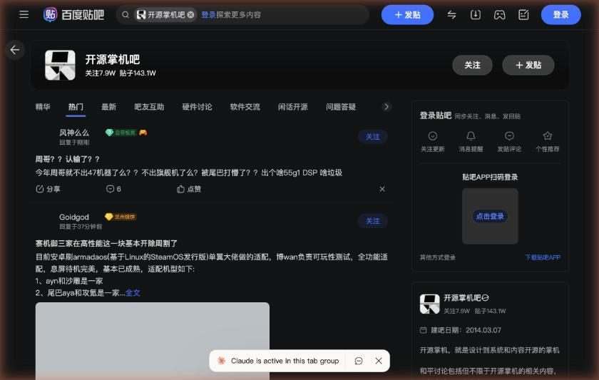
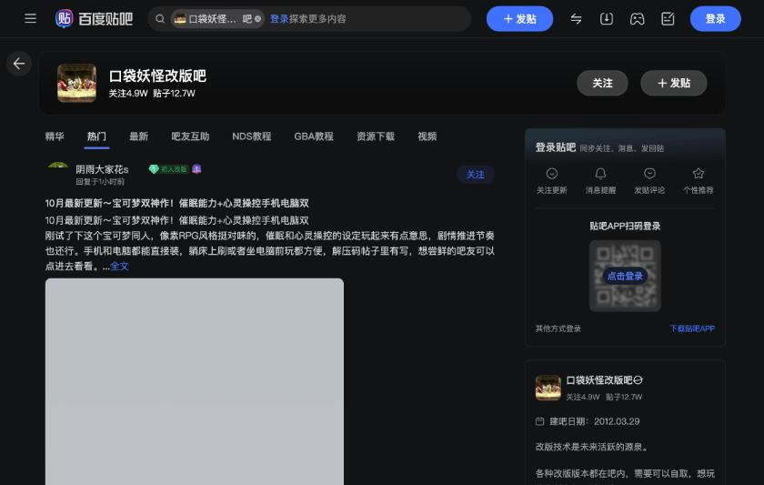

# Three Tieba forums

The type is the top pages of forums on Baidu Tieba. They could be opened without logging in, and what could be read from the on-screen text was the forum names and numbers. Reliability is aggregated, and this is limited to checking the numbers shown on the pages.

## 开源掌机吧

The URL is https://tieba.baidu.com/f?kw=%E5%BC%80%E6%BA%90%E6%8E%8C%E6%9C%BA (the form in which "开源掌机" is expressed in character codes). It has 79,000 followers and 1,431,000 posts, and the forum was created on March 7, 2014. The side description says "开源掌机 are 掌机 whose system and content are open source", says that the topics of this forum are not limited to 开源掌机 and center on interaction among members and having fun, and prohibits malicious exchanges and foul language, blatant advertising and brainwashing, camp wars, and deification, with penalties for violators. The tabs on the top page include 精华, popular, latest, 吧友互助, hardware discussion, software exchange, casual talk about open source, and questions and answers.

When the screenshot was taken, there were 2 popular posts. One mocks Anbernic, asking whether it will not release a model called 47 this week, whether it will not release a flagship, and whether it is being pushed aside by AYANEO. The other is a post by a developer saying "I adapted a Linux-based SteamOS (armadaos) to AYN and Retroid". Where it lists supported devices, it writes "ayn和沙雕是一家", listing AYN and Retroid as the same group. The next line also reads "尾巴aya和攻氪是一家".

## 口袋改版资源吧

The URL is https://tieba.baidu.com/f?kw=%E5%8F%A3%E8%A2%8B%E6%94%B9%E7%89%88%E8%B5%84%E6%BA%90 (the form in which "口袋改版资源" is expressed in character codes). It has 263,000 followers and 1,665,000 posts. The tabs include 精华, popular, latest, 吧友互助, 图文攻略, 汉化发布, 改版发布, and 改版教程. The pinned post is "本吧资源导航", dated March 26, 2021, described as a table of contents of resources in the forum. Its contents include game files, walkthroughs, 秘籍, emulators, cheat codes, helper tools, modding 教程, tools, and materials. An example of a popular post is the release of "宝可梦 水银" (FC), a non-commercial ROM mod based on FireRed.

## 口袋妖怪改版吧

The URL is https://tieba.baidu.com/f?kw=%E5%8F%A3%E8%A2%8B%E5%A6%96%E6%80%AA%E6%94%B9%E7%89%88 (the form in which "口袋妖怪改版" is expressed in character codes). It has 50,000 followers and 127,000 posts, and the forum was created on March 29, 2012. The tabs are 精华, popular, latest, 吧友互助, NDS教程, GBA教程, resource downloads, and videos. The side description has sentences to the effect that "改版 technology is the source of future vitality" and "all kinds of 改版 versions are on the forum, for those who need them to take".

